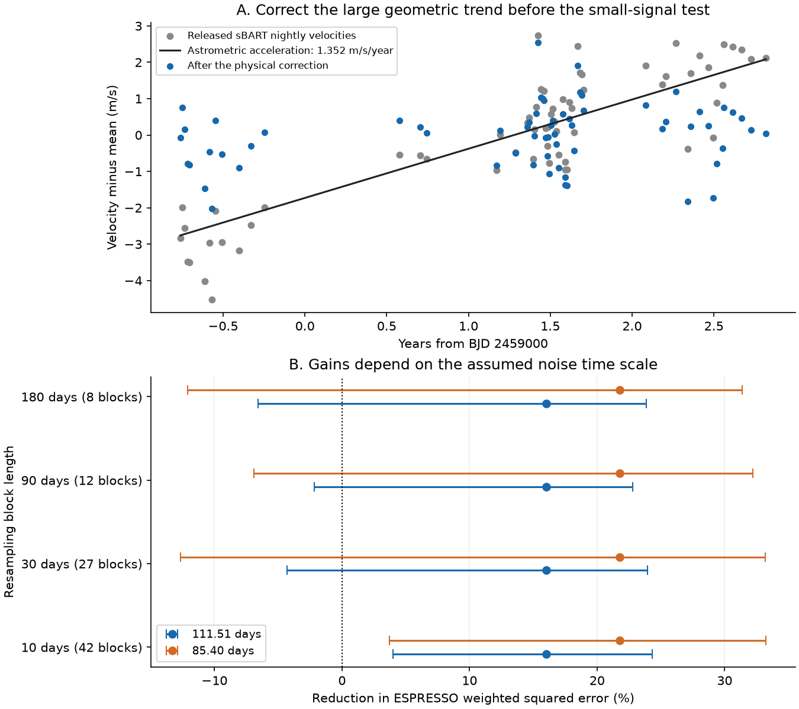
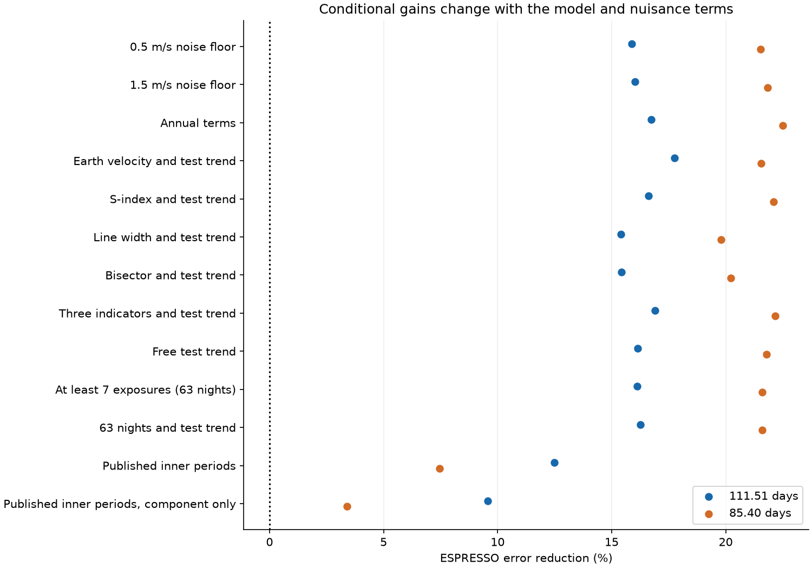
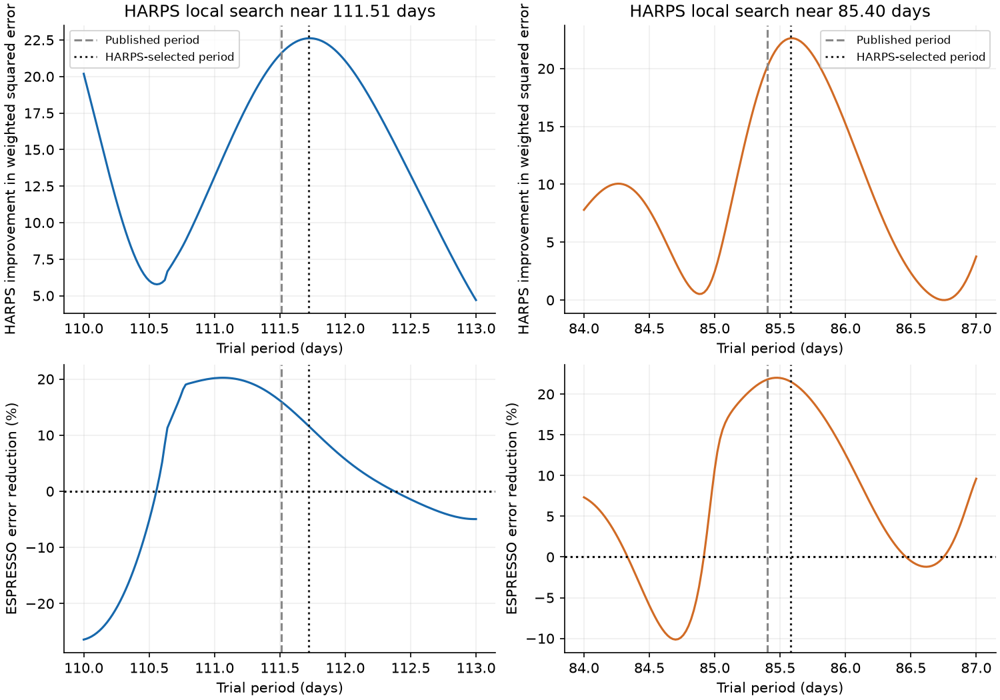

# 30-day block intervals include zero for ESPRESSO error gains from two HARPS models of HD 20794

## Result

The test is inconclusive for both reported weak signals. Both complete HARPS models reduce ESPRESSO error. Their 30-day block intervals include zero. Some of this gain comes from changes in the fitted known orbits. No new planet or new period is found.

| Fixed trial period (days) | Test error reduction (%) | Test-only 95% block interval (%) | Train-and-test 95% sensitivity interval (%) | Test residual RMS (m/s) |
|---|---:|---|---|---:|
| 111.51 | 16.00 | -4.30 to 23.95 | -12.45 to 26.39 | 0.796 |
| 85.40 | 21.78 | -12.68 to 33.18 | -17.27 to 33.65 | 0.768 |

The three-signal reference model has a test weighted RMS of 0.869 m/s. Error reduction means 100 times one minus the ratio of model to reference weighted squared residuals. A negative reduction means more error. These are intervals from resampling, not planet detection probabilities.



## Question and prior work

HD 20794 is a nearby star with small radial-velocity signals. Such systems can be targets for future direct imaging. Nari et al. (2025) report signals near 18.3, 89.7, and 648 days. Their Appendix D reports weak residual structure near 111.5 days and its annual alias near 85.4 days. They do not claim this residual as a planet. Their eccentric residual model can cross the 89-day orbit. Their ESPRESSO-only analysis also has limited support for the known signals.

We ask whether coefficients fitted to HARPS alone can predict the residual structure in ESPRESSO. This is a new quantitative transfer test on the released data. It is not a new detection of the previously reported structure. The source and period ranges were selected from work that used both instruments. Thus, the test is retrospective. It cannot supply a blind discovery significance. The targeted campaign searches found no earlier campaign study of this source. The search record is in `files/campaign_search.json`.

## Data and physical correction

The input is CDS catalog J/A+A/693/A297, first released on 2025-03-03. The VizieR response was downloaded on 2026-11-09 UTC with the campaign dataset helper. We use `harps03`, `harps15`, `espsbart`, and the activity columns of `esp19drs`. The complete response has SHA-256 `400611a0b6d1b2ee602182a5f50b97aed6e51247fe6564dcdbd84bfede5acac6` and 3077342 bytes.

The shared file is `/mnt/dell-data/shared_datasets/hd20794-nari2025-cds-a297-tsv-02c8eca1/hd20794.tsv`. The assigned worktree also exposes it as `./datasets/hd20794-nari2025-cds-a297-tsv-02c8eca1/hd20794.tsv`. These are shared SSD paths. No failed disk path was used. Exact source URLs, table names, units, dates, and hashes are in `files/provenance.json`.

The HARPS03 YARARA v2 table contains 514 nightly measurements. The HARPS15 YARARA v1 table contains 232. One cut removes velocities more than three population standard deviations from the group median, or photon errors above three times the group median error. This leaves 512 and 231 nights. We do not repeat the cut after fitting. Each HARPS era has its own velocity offset.

We select 661 sBART exposures at BJD >= 2458721. We form inverse photon-variance means in integer BJD nights. This gives 65 nights. We apply the same error and velocity cuts after the physical correction below. This leaves 64 nights over 1307.66 days. The paper reports 63 nights. Our explicit photon-error rule retains one two-exposure night. Removing that night gives 63 nights and is a separate check. Activity data use integer-night matches to DRS dates. One sBART night has no activity match. That night is omitted only from checks that need the missing fields.

The released sBART values contain a large positive trend. A change in viewing direction causes a geometric radial acceleration even for constant space velocity. With total proper motion mu and distance D, the acceleration is a = mu squared times D. We use radians per second and meters. The published Gaia proper motions are 3035.017 and 726.964 mas/year. The parallax is 165.5242 mas, as listed by SIMBAD and rounded in the paper. These values predict 1.352337 m/s/year. We subtract a times (BJD - 2459000) / 365.25 from ESPRESSO only. The arbitrary reference date changes only the fitted offset. The HARPS YARARA values have no comparable large trend.

This correction reduces the all-night ESPRESSO scatter from about 1.82 to 0.87 m/s. A free trend in the raw test residuals after the reference model gives 1.366 m/s/year. This supports the use of the geometric correction. It does not prove that all smooth changes in this data product have that cause. Allowing a free test trend makes the corrected and uncorrected scores agree to about 1e-9. We keep the raw and corrected nightly values in `files/nightly.csv`.

## Model and score

The reference model has two circular orbits and one eccentric Keplerian orbit. We fit it only to HARPS. The allowed periods are 18.28-18.35, 89.0-90.4, and 610-690 days. The outer eccentricity is between 0 and 0.8. The outer phase is free. We solve Kepler's equation. We solve the linear sine, cosine, and offset coefficients at each nonlinear fit step. We use 36 starts across the middle period and outer phase. This checks several local minima; it is not a proof of a global minimum.

The reference HARPS fit gives periods of 18.313377, 90.008727, and 649.4613 days. Its outer eccentricity is 0.6044. We add one circular term at 111.51 days or 85.40 days, then refit all HARPS coefficients. The fitted extra amplitudes are about 0.252 and 0.253 m/s. All stellar coefficients stay fixed for ESPRESSO. Only a test velocity offset is fitted. HARPS extends to 2024 and ESPRESSO to 2023; this is an instrument split, not a future-time forecast.

For each night the weight is 1 / (photon error squared + 1 m/s squared). The floor prevents a very small photon error from implying unrealistically small total noise. We use weighted squared error, not a likelihood ratio or Bayesian evidence. The floor is fixed, not inferred. The model has no Gaussian process and no eccentric inner orbit. We do not reproduce the full published inference.

## Uncertainty and controls

We divide the test dates into fixed nonempty time blocks, anchored at the first test date. We draw the same number of blocks with replacement. All nights in a drawn block stay together. The offset is fitted again for each draw. There are 4000 draws at each of four block lengths. The 30-day case has 27 blocks. The 10-day case excludes zero for both main gains. The 30-, 90-, and 180-day cases include zero for both. Sparse seasonal data do not identify one correct block length. These intervals assume that the sampled blocks can represent the noise.

We also make 400 paired sensitivity draws for each fixed period. We change the signs of HARPS residuals by 30-day block under the full fitted model. We refit the nonlinear parameters near their fitted values. We resample the ESPRESSO blocks. The intervals in the first table include these training changes. This procedure is conditional on the model and local fit branch. It does not repeat source or period selection.

The complete-model comparison includes changes in the established signals. A second test removes only the extra fitted component and leaves all other coefficients fixed:

| Period (days) | Component-only gain (%) | 30-day block interval (%) | Fraction of fixed-amplitude phase shifts with at least this gain |
|---|---:|---|---:|
| 111.51 | 11.12 | -9.65 to 19.57 | 0.104 |
| 85.40 | 7.81 | -12.37 to 17.47 | 0.121 |

We test 720 uniform phase rotations. Their fractions are descriptive coherence controls. They are not calibrated false-alarm probabilities. They do not model all red noise or the original source selection.

The known components also have limited transfer in this model:

| HARPS fitted period (days) | Component-only gain (%) | 30-day block interval (%) |
|---|---:|---|
| 18.31338 | 18.32 | 4.38 to 40.48 |
| 90.00873 | 0.56 | -24.89 to 22.25 |
| 649.46132 | -31.67 | -63.41 to 5.23 |

The poor outer-component control limits any use of this simple test as a planet validator. It does not refute the published outer planet. A restricted model, finite noise, and a small test sample can give a poor prediction of a real signal.

## Instrument and model checks

We repeat the fit with 0.5 and 1.5 m/s floors. We add annual terms, barycentric Earth velocity, line width, the bisector, and S-index terms. HARPS indicator slopes are separate for each era. For each matching check, the test offset and specified test nuisance terms are fitted separately. The stellar periodic coefficients still come only from HARPS. Indicator checks include a test trend where stated. These are conditional scores, not fully fixed predictions of the nuisance process. The indicators share spectra with the velocities. They are not independent observations.

We also fix the two inner periods to the joint-paper values of 18.314 and 89.68 days. The 111.51-day main gain then becomes 12.49%; the 85.40-day gain becomes 7.45%. Thus, some main gain can arise from changes in the known-signal fit. No tested indicator uniquely identifies the physical source of the residual.



| Fixed period (days) | Check name | Test gain (%) |
|---|---|---:|
| 111.51 | floor_0.5 | 15.87 |
| 111.51 | floor_1.5 | 16.03 |
| 111.51 | indicators_annual | 16.73 |
| 111.51 | indicators_BERV | 17.75 |
| 111.51 | indicators_SMW | 16.61 |
| 111.51 | indicators_FWHM | 15.40 |
| 111.51 | indicators_BisSpan | 15.43 |
| 111.51 | indicators_SMW_FWHM_BisSpan | 16.91 |
| 111.51 | free_test_trend | 16.13 |
| 111.51 | at_least_7_exposures | 16.12 |
| 111.51 | at_least_7_exposures_and_trend | 16.27 |
| 111.51 | published_inner_periods | 12.49 |
| 111.51 | published_inner_periods_component | 9.58 |
| 85.4 | floor_0.5 | 21.52 |
| 85.4 | floor_1.5 | 21.83 |
| 85.4 | indicators_annual | 22.51 |
| 85.4 | indicators_BERV | 21.56 |
| 85.4 | indicators_SMW | 22.10 |
| 85.4 | indicators_FWHM | 19.79 |
| 85.4 | indicators_BisSpan | 20.23 |
| 85.4 | indicators_SMW_FWHM_BisSpan | 22.18 |
| 85.4 | free_test_trend | 21.78 |
| 85.4 | at_least_7_exposures | 21.60 |
| 85.4 | at_least_7_exposures_and_trend | 21.59 |
| 85.4 | published_inner_periods | 7.45 |
| 85.4 | published_inner_periods_component | 3.40 |

The two frequencies differ by one cycle per 364.72 days. The annual sampling-window amplitudes are 0.634 for HARPS and 0.574 for ESPRESSO. The largest correlations between the sampled sine/cosine spaces are 0.635 and 0.654. Seasonal sampling can link the two periods even with two instruments.

We search 151 trial periods in each of 110-113 and 84-87 days. Only HARPS error selects the local period. It selects 111.72 and 85.58 days. The respective ESPRESSO gains are 11.65% and 21.54%. These local searches do not resolve the alias or remove the selection limit.



We audit conditional power with the actual ESPRESSO dates. We remove an offset and a free sine pair from the test residuals, change residual signs by 30-day block, and add the fixed HARPS wave. At about 0.25 m/s, only about 20% of 4000 draws pass a descriptive phase-fraction threshold of 0.05. The same threshold passes 7.3% and 3.6% of the zero-injection draws. This is a limited simulation, not a calibrated survey completeness result. It shows why failure to confirm does not exclude a small planet. Full outputs are in `files/injections.json`.

## Interpretation and limits

A stable planet can give a common phase across instruments. Stellar variability, small errors in the known-orbit model, and time-dependent processing can also affect a residual this small. Annual sampling can map one signal into two period peaks. The two tested instruments use separate observations, which is useful, but both observe the same changing star. Their processing is not an untouched independent reduction by this study.

The positive gains justify more observations. They do not establish a fourth planet or select one alias. This study does not exclude eccentric residual models, changed amplitudes, or other periods. The source choice, period choice, sparse test coverage, simple noise model, and failed outer-signal control limit the result. A useful next test would fix the signal model before new ESPRESSO or other-instrument data are opened, and would add observations in phases that separate the aliases. No such new data are claimed here.

## Reproduction

Python 3.12 and the package versions are in `files/environment.json` and `files/requirements.txt`. No network or shared raw data are needed to reproduce the numerical tests from the frozen nightly table. Extract this verified SCI bundle to a new directory. Run:

```sh
python files/reproduce.py --output /absolute/path/to/new-output
```

This runs the main fits, block draws, local searches, sensitivity fits, injection tests, numerical audits, and figure code. It can take several minutes. Use an empty output directory. A smaller `--train-bootstrap` value is available for a quick inspection, but the published value is 400.

To rebuild the nightly table from the exact shared response, add:

```sh
python files/reproduce.py --output /absolute/path/to/new-raw-output \
  --raw /mnt/dell-data/shared_datasets/hd20794-nari2025-cds-a297-tsv-02c8eca1/hd20794.tsv
```

`files/retrieve.sh` records the public query and campaign helper command. A fresh query can change the response header date and full-file hash. Use the preserved response for exact raw-byte provenance. The frozen nightly file has SHA-256 `f434cd10f9d70a773eab7f3ab7f75c81b64a2649005ff6b56e0f6c9f8a1c65d0`. The quick audit is `python files/validate.py --directory files` in a writable extracted copy. It checks unique nights, Kepler's equation against a bracket solver, exact synthetic recovery, an independent score calculation, and the trend-correction equivalence. The audits pass. Floating-point fit details can differ across numerical libraries.

## Identity and source credit

Job: sci-1107-hp-astronomy-02c8eca15832. Topic: astronomy. Campaign: 11_07_2026. Machine: hp. Account: codex-myxtap. Model: gpt-6.1-sol, high reasoning effort. The campaign-machine signing key is not a personal authorship claim. No other agent was used. The publication is saved and signed locally. No remote archive or index submission is part of this job.

The data and original signal claims are due to Nari and coauthors, ESO, and CDS. Source rights remain with their owners. The SCI baseline license covers this analysis, code, text, figures, and derived outputs to the extent permitted by those rights.

## References

1. Nari et al. (2025), A&A 693 A297. [Paper](https://doi.org/10.1051/0004-6361/202451769). [Version inspected](https://arxiv.org/html/2501.17092v1). Sections 2 and 4, Table 1, Appendix D.
2. CDS J/A+A/693/A297. [Data catalog](https://doi.org/10.26093/cds/vizier.36930297). The query and exact response hash are preserved.
3. Zechmeister et al. (2009), Section 3.1. [Perspective radial acceleration](https://doi.org/10.1051/0004-6361/200912479).
4. Figueira et al. (2025). [ESPRESSO precision and stellar signals](https://arxiv.org/abs/2507.07514).
5. [SIMBAD HD 20794 astrometry](https://simbad.cds.unistra.fr/simbad/sim-id?Ident=HD+20794).
