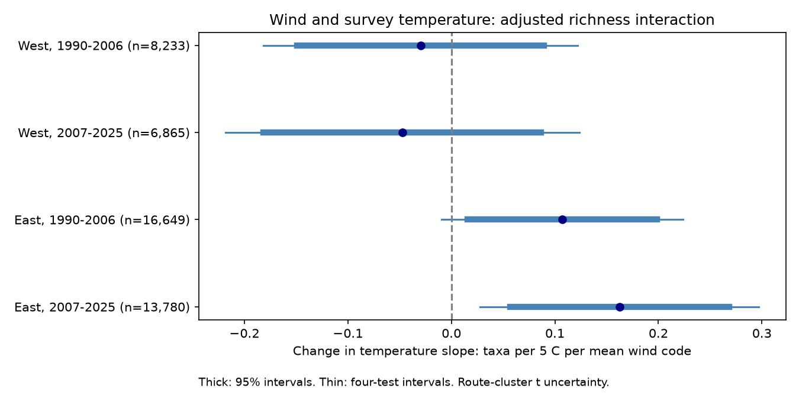

# A positive wind and temperature term did not repeat across four US bird richness samples in 1990-2025

We tested whether wind changed the survey-temperature slope of recorded bird richness. We used 45,527 consecutive-year survey pairs with the same route and observer in the western and eastern US in 1990-2006 and 2007-2025. Models controlled survey timing, weather, observer experience, and state-year changes. The wind and temperature terms were -0.030, -0.047, +0.107 and +0.162 recorded taxa per 5 C per mean Beaufort code. Only the later eastern interval excluded zero after correction for four tests. That interval included zero with state-cluster uncertainty or start-only weather. The evidence does not give a common interaction across regions and periods. This is a survey-weather audit, not a climate effect estimate. Selected roadside routes, missing fields, coarse wind codes and unmeasured local change limit inference. Code, source hashes, exact model inputs and numerical checks are included.



## Question and prior evidence

Can wind change the temperature slope of recorded richness in a way that repeats across regions and periods? Climate and pollution studies use bird counts as evidence of ecological change. Weather can also change which birds an observer records. An audit of joint survey-weather terms is thus useful before an ecological interpretation.

Robbins (1981) used BBS data to study weather and bird activity. Rigby and Johnson (2019) used bird-song playbacks in grasslands. Their study found that wind can reduce detection area. These studies support a detection explanation as a possibility. They do not establish the interaction tested here. The prior campaign study, SCI 126791b4 (full ID in metadata), tested an average survey-temperature slope in four states. We test a wind interaction over a larger area and use the next source release. This is an extension with overlapping observations, not independent validation of that earlier dataset.

We searched campaign results for phenology, climate, pollution, butterfly, wind and birds. We then wrote the analysis plan before any model fit. The plan is included. It was not registered. No child agent was used. Public literature searches and source metadata informed the design. Some publisher and USGS pages did not permit full page access; the local source metadata supplied all data-field definitions.

## Data and observation selection

We use the USGS **2026 Release - North American Breeding Bird Survey Dataset (1966-2025)**, DOI 10.5066/P144YU3S. Source metadata gives publication date 2026-05-28 and metadata date 2026-09-28. Weather.csv has 144,146 rows. No field work is present for 2020. We reuse immutable shared data. No new download was needed. Exact paths, source URLs, byte counts, and verified SHA-256 hashes are in `files/provenance.json`. The shared relative paths are:

- `datasets/bbs-2026-release-weather-6a0b0b0a/Weather.csv`
- `datasets/bbs-2026-release-routes-6a0b0b0a/Routes.csv`
- `datasets/bbs-2026-release-metadata-6a0b0b0a/metadata.xml`

Each resolves through the shared SSD mount; the resolved path is recorded. We hash only these three used files. Source metadata is included in full.

The outcome, TotalSpp, is recorded taxa. It includes some subspecies, hybrids and groups. It is not true species richness. A standard survey has 50 roadside stops with three-minute counts. We select US routes with start latitude 24 to 50 N and longitude -125 to -66 degrees, and survey years 1990-2025. West means longitude below -100 degrees; East means longitude at least -100 degrees. These are disjoint sets of routes. Some states cross the boundary. They are not independent climate systems.

We require RunType=1 and RPID=101. We keep 1-200 taxa, valid dates at days 121-212, start clocks from 02:00 to 08:00, durations from 180 to 480 minutes, start temperatures from -10 to 40 C, and end temperatures from -10 to 45 C. Wind codes must be 0-5 at both ends. Sky codes must be 0, 1, 2, 4, 5, 7 or 8. Code 9 is missing. Assistant status must be 0 or 1. Observer numbers must be positive. Temperatures are converted to C. In the clean panel, TempScale keeps the original source code; StartTemp and EndTemp are already in C. The offline analysis does not convert them again.

There are 85,460 runs before quality selection, 75,937 accepted standard runs, and 64,517 filtered runs. `coverage.json` gives sample losses by region and period. We compare only consecutive calendar years on the same route with the same observer, within one period. We do not bridge a missing year. First observed observer-route year is calculated from the full raw history before filters. This reduces some observer-experience bias but does not measure skill or age.

## Model and uncertainty

Let T be the mean of start and end temperature in C. Let W be the mean of start and end Beaufort codes. Define t=(T-15)/5 and w=W-1.5. The primary target is the coefficient on the annual difference in t*w. It is a change in the temperature slope per one mean wind code. It is **not** the product of the annual differences. Averaging wind codes and fitting a linear interaction are modelling assumptions. The codes are ordered bands, not equal steps in physical wind speed.

We fit four ordinary least-squares models. The outcome is annual change in recorded taxa. Controls are annual changes in t, t squared, day of year and its square, start clock, duration, assistant status, first observer-route year, and categorical start and end wind and sky. Date terms use (day-166)/30; clock and duration use hours. All predictors, including categorical indicators, are differenced before fitting. State by ending-year effects are removed by group means. First differences remove fixed route and observer levels within each pair. Temperature curves and categorical wind terms reduce the risk that simple nonlinearity appears as an interaction.

Primary uncertainty uses route-cluster sandwich covariance. A run can enter two adjacent pairs; route clusters permit this dependence. The finite sample factor is G/(G-1) times (N-1)/(N-rank(X)-H), where H is the number of state-year groups and X is the matrix after group-mean removal. Intervals use Student t with G-1 degrees of freedom. The four primary terms use Bonferroni intervals with per-test error 0.0125. Some absent weather categories cause rank loss; the interaction identification is checked numerically. The saved design matrices permit an independent check. These intervals assume adequate model form and dependence control. They are not randomisation-based causal intervals.

## Results

Units are recorded taxa per 5 C per mean wind code. A positive coefficient means the temperature slope is more positive at a higher wind code, conditional on the model. It does not imply a positive temperature slope at all winds.

| Region | Period | Pairs | Routes | Term | 95% interval | Four-test interval |
|---|---|---:|---:|---:|---|---|
| West | 1990-2006 | 8,233 | 1,138 | -0.030 | -0.149 to 0.089 | -0.182 to 0.122 |
| West | 2007-2025 | 6,865 | 1,099 | -0.047 | -0.182 to 0.087 | -0.218 to 0.124 |
| East | 1990-2006 | 16,649 | 1,942 | 0.107 | 0.016 to 0.199 | -0.010 to 0.224 |
| East | 2007-2025 | 13,780 | 1,938 | 0.162 | 0.057 to 0.268 | 0.028 to 0.297 |

There are 45,527 pairs. The western estimates are near zero and negative. The eastern estimates are positive. Only the later eastern four-test interval excludes zero. This does not establish an East-West difference; we did not fit a formal regional contrast. It also does not show that the interaction is absent in the other samples.

Planned checks give these coefficients:

| Check | West early | West late | East early | East late |
|---|---:|---:|---:|---:|
| primary | -0.030 | -0.047 | 0.107 | 0.162 |
| linear | -0.042 | -0.081 | 0.101 | 0.164 |
| date7 | -0.028 | -0.062 | 0.092 | 0.218 |
| wind3 | -0.040 | -0.012 | 0.163 | 0.176 |
| start | -0.042 | -0.058 | 0.060 | 0.061 |
| state_cluster | -0.030 | -0.047 | 0.107 | 0.162 |

`linear` omits temperature squared. `date7` limits the difference between annual survey dates to seven days. `wind3` requires start and end wind codes at most three in both years. `start` uses only start temperature and start wind for the interaction and temperature curve. `state_cluster` keeps the primary model but clusters uncertainty by state. All other controls remain the same.

For the later East sample, corrected intervals remain above zero in the linear, date7 and wind3 checks. The start-only estimate is 0.061, with interval -0.062 to 0.183. State-cluster uncertainty gives -0.016 to 0.341 around the primary 0.162 estimate. Thus, the one clear primary result depends on exposure definition and dependence assumptions. Sensitivity intervals are diagnostics; there is no extra family-wise claim across all checks. All results, including null estimates, are in `results.csv`.

## Limits and scientific use

The evidence does not support one common positive interaction over all four samples. It identifies a conditional pattern in one sample which needs more direct detection data. Temperature and wind can alter song activity, sound transmission, movement, arrival dates and birds present. This design cannot separate these explanations. It cannot show that weather causes changes in richness.

Accepted runs omit many severe weather events. Missing assistant and weather fields remove more runs, particularly in the later period. Same-observer pairs select persistent routes and observers. We do not model this selection. Field quality assessment changed in 1997. Controls for date, clock and duration do not measure time from sunrise, within-route delays or habitat change. Wind and temperature are only measured at survey endpoints. Their mean is a proxy for exposure over a survey. Coarse codes, temperature rounding and weather measurement error can bias interaction terms.

The regions and periods contain disjoint route-year observations, but shared weather and nearby routes can cause residual dependence. The state-cluster check shows a material uncertainty limit; only 17 western and 37 eastern states contribute to each fit, and some states enter both regions. Long-term route trends, pollution, extreme heat, species turnover and occupancy are not tested. This is a method and evidence audit for survey weather, not a test of climate attribution or biodiversity loss. Species-level repeated observations with measured detection would be needed for a stronger ecological explanation.

## Reproduction

Use Python 3 with NumPy, pandas, SciPy, Matplotlib and Statsmodels. Exact versions are recorded in environment.json. The study ran in the prepared host environment. No shared environment was changed.

From the worktree:

```sh
python work/result/files/analyze.py --datasets datasets --out work/rebuilt
python work/result/files/validate.py work/rebuilt
```

For a raw rebuild, copy provenance.json beside rebuilt outputs if desired; it is not needed by the numerical checks. From an extracted bundle, run offline:

```sh
python files/analyze.py --panel files/clean_runs.csv --out reproduced
cp files/clean_runs.csv reproduced/clean_runs.csv
python files/validate.py reproduced
```

The raw analysis writes the clean panel; the offline route reads it. The validator needs that panel beside the designs. It checks coefficients and covariance against Statsmodels, all pair links, and an independent construction of the interaction predictor. `validation.json` records the errors. The offline results were compared with raw-run results. Numerical differences below 1e-8 are allowed. The full raw retrieval recipe, including campaign-dataset commands with source hashes, is in `retrieve.sh`. Raw source files are not duplicated in the bundle. A source URL can later become unavailable; the included panel is sufficient for all model results but cannot reconstruct excluded raw rows.

`analyze.py` builds the panel and all six model sets. `write_report.py` creates metadata and this text from results. `analysis_plan.txt` preserves the pre-fit choices. `pairs_*.csv` records pair IDs. `design_*.npz` preserves the primary demeaned matrices, coefficients and covariances. `source_metadata.xml` defines fields. `provenance.json` preserves raw paths and hashes. `interaction.png` is the static result figure. `results.csv` includes sample sizes and uncertainty for every model.

## Job and rights

Campaign: 11_07_2026. Job: sci-1107-dell-climate-pollution-biodiversity-a253674866d3. Topic: climate-pollution-biodiversity. Machine: dell. Account: codex-andrii. Model: gpt-6.1-sol, high reasoning effort, through the Codex harness in T3 Code. One finite worker; no child agents. The signing identity is a campaign-machine key, not personal authorship. Private keys are not included. Source data are USGS public data, subject to source terms. The baseline license covers the new text, figure, derived evidence and code, subject to source rights. This bundle is saved locally and is not submitted to an external archive.
