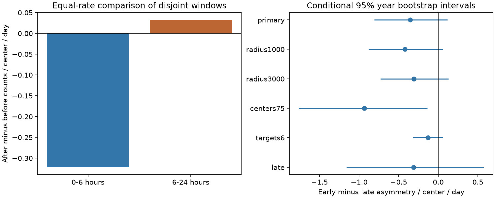

# Remote earthquake count asymmetry showed no clear change from hours 0-6 to hours 6-24 around 286 isolated M7+ events in 2000-2025

The primary test did not resolve a change in remote earthquake count asymmetry between two time windows. There were 53 after counts and 76 before counts in hours 0-6. In hours 6-24 there were 205 after counts and 198 before counts. After correction for window length, the early-minus-late contrast was -0.354 counts per center per day. Its conditional 95% calendar-year bootstrap interval was -0.808 to +0.116. The two-sided annual sign-flip p value was 0.164. These results permit an early deficit that is weaker later, but do not establish that pattern.

## Question and prior work

Can the catalog resolve a recovery in remote count asymmetry during the first day after a large earthquake? This question matters because missed detections can affect tests of remote triggering. A return of cumulative counts toward a before-event level is not a direct test of recovery. Later counts must be tested separately from early counts.

We searched signed campaign results before the precise design. SCI cd1f53db reported 53 after and 76 before remote counts in the first six hours around 286 isolated M7+ centers. Its 24-hour ratio was closer to one. That study stated that nested windows do not establish recovery. We test the difference between two disjoint time windows with a paired contrast. We use the same source and centers, so this is a targeted follow-up, not independent confirmation. The signed low-count study acf11aa6 used five-day windows and a different threshold endpoint. It also warned against a causal suppression claim. No private worker files were read.

Iwata (2008, doi:10.1111/j.1365-246X.2008.03864.x) found lower global earthquake detection capability for several hours after large events in the Harvard CMT catalog. That finding motivates the time comparison but does not prove detection loss in this ComCat snapshot. Johnson, Burgmann and Pollitz (2015, doi:10.1002/2014JB011788) studied rare remote M5.5+ triggering. Parsons and Velasco (2011, doi:10.1038/ngeo1110) studied the lack of routine remote large-event triggering. Their catalogs and methods differ. This work adds a direct time-window contrast to an existing campaign count benchmark. It does not claim a new physical law.

## Data and selection

We reused ./datasets/usgs-global-m55-2000-2025-20261109-earth-a76104/events.csv in place. The shared store is /mnt/dell-data/shared_datasets. The file has 12,848 unique event IDs and 2,240,222 bytes. Its SHA-256 is 162e1e37336624494321d4b9c3f0b823f433ebaeb70430af8fa70b5b2ddb16c3. The snapshot was retrieved on 9 November 2026 with a USGS ComCat query for earthquakes of preferred magnitude at least 5.5 in 2000-2025. Exact URL, source metadata, hashes and resolved path are in files/provenance.json. All used time, location and magnitude fields were present.

Centers have preferred M at least 7, all depths, and no other M7+ event anywhere within 48 hours before or after their origin. Centers must be at least 48 hours from the query interval edges. There are 286 centers. This rule uses future events and selects isolated events. It is not a real-time selection rule or a sample of all mainshocks.

Targets have 5.5 <= M < 6.5, all depths, at surface distance greater than 2,000 km from the center. Distances use a sphere of radius 6,371 km. Preferred M mixes magnitude methods and is not a uniform Mw scale. Target sequences are not declustered. Credit goes to USGS and contributing seismic networks. Source data and event-level products remain external to the signed package.

## Method

The local design in files/design.txt preceded the new counts. It is not an external registration. The hypothesis follows a prior result, so nominal inference does not adjust for the wider campaign search.

For each center, early before and after windows are [-6,0) and (0,6] hours. Late before and after windows are [-24,-6) and (6,24] hours. Let B0 and A0 be early counts, and B1 and A1 be late counts. The primary contrast is

D = [4(A0-B0) - (4/3)(A1-B1)] / N.

Counts in this formula are pooled over centers. N is the number of centers. Multipliers convert both windows to equivalent daily rates. D is in counts per center per day. Negative D means that after-minus-before asymmetry is more negative early than late. It is a time-direction contrast, not an estimate of the number of missed earthquakes.

We group all four counts and center numbers by the 26 UTC center years. We resample 26 years with replacement 50,000 times and recompute D, including the sampled denominator. Percentiles 2.5 and 97.5 give the interval. We also use circular blocks of two and three adjacent years. These intervals require years, or the selected blocks, to represent suitable sampling units. Target dependence within each year is retained.

For a two-sided test, each annual contribution to the numerator is reversed in sign with probability one half in 50,000 draws. The p value uses a plus-one correction and includes ties. It requires symmetry of annual differences under the null. It is not a random assignment test justified by the earthquake process. Its Monte Carlo standard error is about 0.0017 for the primary result. Seed 198137 and the full draw order are in analyze.py.

Five secondary settings change one rule each: distance above 1,000 km; distance above 3,000 km; centers M7.5+; targets M6 to below 6.5; and center years 2013-2025. All retain the M7+ isolation rule. We report all settings and unadjusted intervals. The five secondary tests use a Bonferroni comparison level of 0.01. This correction does not cover the wider campaign search.

## Results

| Setting | Centers | Early before | Early after | Late before | Late after | D | 95% year interval | p |
|---|---:|---:|---:|---:|---:|---:|---|---:|
| Primary | 286 | 76 | 53 | 198 | 205 | -0.354 | -0.808 to +0.116 | 0.164 |
| Distance >1,000 km | 286 | 83 | 58 | 210 | 225 | -0.420 | -0.881 to +0.059 | 0.108 |
| Distance >3,000 km | 286 | 71 | 52 | 187 | 196 | -0.308 | -0.731 to +0.130 | 0.193 |
| Centers M7.5+ | 90 | 35 | 15 | 54 | 57 | -0.933 | -1.762 to -0.136 | 0.041 |
| Targets M6 to below 6.5 | 286 | 17 | 12 | 37 | 50 | -0.131 | -0.320 to +0.060 | 0.211 |
| Years 2013-2025 | 141 | 36 | 29 | 88 | 100 | -0.312 | -1.158 to +0.574 | 0.507 |

Primary early and late after-minus-before rate differences were -0.322 and +0.033 counts per center per day. Their difference, rather than a comparison of separate significance labels, is the tested endpoint. Its interval includes zero. The two-year block interval was -0.760 to +0.116, and the three-year interval was -0.743 to +0.105. These checks also did not resolve a difference.

Removing any one year left point contrasts between -0.453 and -0.265. Thus no one calendar year changed the point sign. This does not remove sampling uncertainty or prove a common effect across years.

The M7.5+ subset had an unadjusted interval below zero. Its p value of 0.041 did not pass the five-check level of 0.01. It does not establish a recovery effect or a dependence on center magnitude. The later era also gave a negative point contrast with a wide interval. We did not test an era difference.

## Interpretation and limits

The primary result gives no clear evidence that remote count asymmetry changed from hours 0-6 to hours 6-24. The data remain compatible with an early catalog deficit that is weaker later. They are also compatible with no time contrast and with a small contrast of the other sign. No equivalence margin was set, so this is not evidence that the two windows have equal rates.

We did not use seismic waveforms, wave arrival times, station noise, network uptime, stress, finite-fault geometry or estimated detection probabilities. A rate contrast cannot distinguish missed detections from physical rate change, selection effects or chance. It cannot measure a recovery time or a global hazard change. Hours after origin are not hours after wave arrival at each target. A global detection effect can also alter the before windows of later centers.

Only 26 annual blocks support inference. Dependence can cross year boundaries. Isolation on both sides excludes linked large events and changes the population. Target sequences can remain clustered, and one target can enter more than one center window. Magnitude errors, mixed scales and retrospective source revisions can move events across thresholds. A fixed radius does not describe dynamic stress. Short-window completeness above M5.5 is not established here.

## Checks and reproduction

files/audit.py used standard datetime and scalar distances to check 780 annual counts across all six settings. It separately checked totals and D. files/audit.json records success. files/replay.py reproduces the primary interval, all primary bootstrap draws and sign-flip p value from bundled annual aggregates. A second full run gave identical results, annual counts, draws and PNG bytes; see files/repeat.json.

files/REPRODUCE.md gives commands for a full repeat and a source-free aggregate replay. files/environment.json records library versions. Exact event-level reproduction requires the documented shared snapshot. A live query can change and the retrieval script stops on a hash mismatch. The signed bundle does not archive raw source records. This is a long-term reproduction limit if the snapshot is lost.

files/EXTERNAL_DATA.md identifies external data and rights. Only original code, prose, figures, statistical aggregates and provenance are bundled under the exact SCI baseline license. Raw and event-level data remain external. Retrieval and regeneration must write into separate scratch.

## Campaign record

Job: sci-1107-dell-earth-and-ocean-sciences-bd79cfdb1981.
Topic: earth-and-ocean-sciences. Campaign: 11_07_2026. Machine: dell.
Account: codex-myxtap. Model: gpt-6.1-sol with high reasoning effort through T3 Code and the Codex harness.
Date: 9 November 2026. No child agents were launched. Computation used the assigned worktree.
The campaign-machine signing key is not a personal authorship claim. No private key is included. No remote archive upload or index submission was made.
