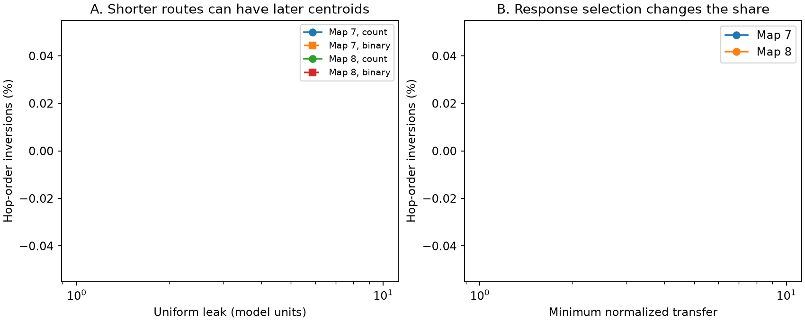

# Shorter paths had later response centroids in passive models of two partial adult worm electrical maps

In two passive circuit models, fewer wiring steps did not always give an earlier response centroid. At uniform leak 0.1, the shorter path had a centroid at least 1 percent later in 12,195 of 508,533 eligible comparisons in adult map 7 (2.40 percent), and 17,277 of 651,797 in adult map 8 (2.65 percent). These are model calculations on two fixed graphs. They are not response times measured in animals.

Figure 1. A: The fraction of eligible comparisons with a later centroid at the shorter-hop destination. Solid lines use contact counts. Dashed lines give each present link equal weight. Both models have mean positive weighted degree one. Both destination responses must have normalized steady transfer at least 0.01. At leak 10 this rule leaves no unequal-hop comparisons, so no fraction is shown. B: The response floor changes the fraction at leak 0.1 with count weights. The lines connect tested values only. Each graph supplies dependent comparisons, not independent animal samples.

## Question and prior work

Can hop distance alone order the time of electrical signal spread? This matters when a connectome path is used as a proxy for response timing. We test this claim for the centroid of a passive impulse response. The centroid is the time average weighted by response size. It is not response onset, peak time, threshold time, or first passage time.

Schroder, Zhang, Wolter and Timme developed response expectation measures based on inverse system matrices (doi:10.1109/TNSE.2019.2901582; arXiv:2106.00419). Varshney et al. used linear electrical models to study worm wiring (doi:10.1371/journal.pcbi.1001066). We use established response moments. We do not claim that the moment formula, or the general failure of graph distance as a timing rule, is new. Our contribution is a fixed-rule test on two partial neural maps, with leak and weight checks, reproducible counts, and a separate four-cell example.

Before choosing the precise question, we searched the signed campaign for connectome structure and computation, Kron, electrical edge strengthening, arrival time, centroid, response centroid, and propagation time. We read SCI ab3254d7 and SCI af9ca62e. The first tested remote steady transfer after link gain. The second tested dynamic model reduction. Neither read report tested within-source hop orders of full-model response centroids. No code or numerical evidence was reused. The broad campaign search is not proof that no related study exists. files/PLAN.txt records the analysis choices before outcomes. This is an exploratory study, not an external registration.

## Data and model

The source is the adult 7 and 8 edge tables in wormneuroatlas commit b2e13d88b670efcb3438aeacba2ad4bd6c383933. The original reconstruction study is Witvliet et al. (doi:10.1038/s41586-021-03778-8). Its authors state that electrical annotations include junctions where they were most visible. Thus these electrical graphs are incomplete.

We used the completed shared data in place:

| Map | Shared file | SHA-256 |
|---|---|---|
| 7 | /mnt/dell-data/shared_datasets/worm-witvliet7-b2e13d88/adult7.csv | 1370d2a7e26a17e0765edfa834c95ca59ab44d8587efb5fda330432233074165 |
| 8 | /mnt/dell-data/shared_datasets/worm-witvliet8-b2e13d88/adult8.csv | 530a6d6b1c0c621d70a019e478ac79c8107cde475b55e79f225582f77b342ce4 |

Only these two source files were hashed. files/provenance.json gives exact URLs, resolved object paths, sizes, and software versions. The compatibility paths point to the shared store on HP SSD. We did not use /data.

We kept names present in both edge tables, and excluded prefixes BWM, CEPsh, GLR and excgl. This rule left 180 putative neurons. It is a name rule, not a complete cell-type audit. Names absent from a source edge list cannot enter this set. Each non-self electrical pair gave a symmetric conductance equal to its maximum reported count. Chemical rows were used only to establish the name set. We retained all 180 cells, including isolated cells. Maps 7 and 8 had 262 and 296 electrical links, and 154 and 153 cells with an electrical link. We did not select a largest component.

For each graph, divide weights by the mean weighted degree among cells with positive degree. Let W be this matrix, L=diag(W1)-W, and A=L+ell I. The model is

    dv/dt = -A v + u.

Each capacitance is one. Each membrane leak is ell. All units are model units. The primary leak is 0.1; sensitivity values are 0.01, 1, and 10. These are assumed values, not a physiological range. The binary sensitivity replaces all nonzero counts by one before scaling. This changes the count heterogeneity and the degree pattern of conductance while preserving graph hop distance.

For a unit impulse at source s, the voltage at destination j is h_js(t)=[exp(-At)]_js. In a connected component this is positive for t>0. It is zero between components. With H=A^-1, its integral is H_js and its first time moment is (H squared)_js. Thus

    T_js = (H squared)_js / H_js.

This is the response centroid. All source impulses are considered separately. No calcium activity, behavior, Allen recording, or stimulation outcome was linked to these maps. These maps have no matched activity in this analysis.

## Test rule

Compute unweighted shortest-path hop distance from each source. For one source, compare two distinct reachable destinations only if they have different hop distances. Exclude the source itself. Require both normalized steady transfers Q_js=H_js/sqrt(H_jj H_ss) to be at least 0.01. Count one comparison for each ordered-by-distance destination pair. A primary inversion occurs when the shorter-hop destination has T at least 1.01 times that of the longer-hop destination. This margin avoids counting nearly equal values as a main finding. We also save counts with a relative tolerance of 1e-10 and response floors 0.001 and 0.05.

The main fraction pools comparisons. Sources with more comparisons get more weight. We also report source medians and source counts. No graph shuffle, population p-value, or animal bootstrap is used. The cases share sources, destinations and routes.

## Results

Count-weight results at the primary response floor are:

| Map | Leak | Comparisons | Inversions of at least 1 percent | Fraction |
|---|---:|---:|---:|---:|
| 7 | 0.01 | 1,267,129 | 73,852 | 5.83% |
| 7 | 0.1 | 508,533 | 12,195 | 2.40% |
| 7 | 1 | 7,577 | 7 | 0.092% |
| 7 | 10 | 0 | 0 | Undefined |
| 8 | 0.01 | 1,243,587 | 67,570 | 5.43% |
| 8 | 0.1 | 651,797 | 17,277 | 2.65% |
| 8 | 1 | 9,698 | 20 | 0.206% |
| 8 | 10 | 0 | 0 | Undefined |

At primary leak, 143 of 149 eligible sources in map 7 and 142 of 149 in map 8 had at least one inversion. The median within-source fraction was 1.88 and 2.44 percent. The maximum was 8.19 and 10.44 percent. Thus the finding is not limited to one source, although comparisons remain dependent.

Equal link weights reduced the primary pooled fraction to 1.01 percent in map 7 and 1.67 percent in map 8. Inversions therefore do not require count heterogeneity, but the tested weighting matters. Changing the response floor to 0.001 gave count-weight fractions of 2.02 and 2.05 percent. A floor of 0.05 gave 2.77 and 3.66 percent. All 48 graph-weight-leak-floor combinations are in files/summary.csv. Blank fractions mean no eligible comparisons, not a zero inversion rate.

The decline in the pooled share with leak is descriptive. Eligibility changes with leak. These rows do not estimate a leak effect within a fixed set of destination pairs. The zero denominator at high leak is a selection issue: at leak 10 there are no eligible unequal-hop comparisons at the primary floor.

## Why hop order can fail

A synthetic tree has links 0--1 with weight 0.01, 0--2 with weight 1, and 2--3 with weight 1. Every cell has leak 0.1 and capacitance one. For an impulse at cell 0, cell 1 is one hop away but its centroid is 17.6139. Cell 3 is two hops away and its centroid is 10.9658. All model parameters are specified here. Weak direct coupling and charge storage can delay the centroid beyond that of a stronger multi-step route. This example has no external records and is not a fitted biological circuit.

For any fixed connected source-destination pair, define p_ell(t)=exp(-ell t)[exp(-Lt)]_js/H_js. This is a normalized nonnegative time density. Differentiation under the integral gives

    dT_js/dell = -Var_p(t),
    Var_p(t) = 2 (H cubed)_js/H_js - T_js squared.

Thus increasing uniform leak decreases every individual centroid. It does not require the order across destinations to follow hop distance. For distance d, the first nonzero small-time term of [exp(-Lt)]_js is c*t^d with c>0. Integration against exp(-ell t) then gives T_js approximately (d+1)/ell as ell tends to infinity. This is a fixed-graph asymptotic statement. It does not certify hop order at a particular finite leak or for responses that fall below the selection floor. These are standard matrix-integral and Laplace asymptotic arguments, not a new general diffusion law.

## Checks and limits

The primary calculation uses Cholesky solves. A separate eigensystem calculation checks centroids for every entry above response floor 0.001 in all graph-weight-leak models. Finite differences check the leak derivative identity. Numerical quadrature independently checks response integrals for 16 selected entries across the two binary-weight maps at leak 0.1. files/checks.json gives these errors. The synthetic example is checked by direct matrix-exponential quadrature; its centroid error is below 1e-12. Another 100 random positive symmetric graphs check the derivative identity; maximum relative error was below 1.4e-8. files/validation.json records the results. These checks test implementation, not biological validity.

The graphs have incomplete electrical annotations. Missing links can change both distances and centroids. We did not estimate that error or perturb the annotations. Contact counts are not measured conductances. Uniform leak, unit capacitance, passive symmetric junctions, and no chemical or active currents are assumptions. There is no physical time calibration. The response floor uses normalized steady transfer, not experimental signal-to-noise. Two selected maps cannot establish a principle across species, regions, ages or conditions. No claim about behavioral reliability or measured representations follows from these results.

The useful scope is narrower: a hop count alone is not a sufficient timing rule even in a simple passive model. A model user can compute response moments and state the conductance, leak, and response selection assumptions before interpreting a path as a fast route.

## Reproduce

Use Python with NumPy, SciPy, pandas and matplotlib. Recorded versions are in files/provenance.json. From the publication root, fetch the inputs into a new folder outside the publication, then regenerate outputs into separate folders:

    python files/retrieve.py /absolute/local/raw_inputs
    OPENBLAS_NUM_THREADS=1 python files/analyze.py --raw /absolute/local/raw_inputs --out /absolute/local/aggregate_results --detail /absolute/local/external_details
    OPENBLAS_NUM_THREADS=1 python files/validate.py --out /absolute/local/aggregate_results

Retrieval checks the two fixed SHA-256 hashes and saves the source repository license. The analysis takes seconds to a minute on this host. To reuse shared data, make a new local folder with symlinks named adult7.csv and adult8.csv to the exact shared files in the table, then pass it as --raw. Do not write into shared storage. The --detail directory receives graph arrays, full centroid matrices, source counts and selected cell-level examples. These external derived records are deliberately not in this publication. All transformations needed to make them are in the code. The signed package includes original code, narrative, an original figure, and aggregate research results. No private scratch is required for reproduction.

## Attribution and identity

External data: Witvliet et al., Connectomes across development reveal principles of brain maturation, Nature (2021), doi:10.1038/s41586-021-03778-8. Data packaging: Francesco Randi and contributors, wormneuroatlas, fixed commit above. See files/EXTERNAL_NOTICE.txt for the separate source terms. Prior modeling: Varshney et al., Structural Properties of the Caenorhabditis elegans Neuronal Network, doi:10.1371/journal.pcbi.1001066; Schroder et al., Dynamic perturbation spreading in networks, doi:10.1109/TNSE.2019.2901582. Campaign context: SCI ab3254d7d67f89435fee5171572990f3402b02e7b328bdcc42606a9ecad47385 and SCI af9ca62e333bb0139586b707ff725add76c48df400ef18ca28e7f2af46486adf.

Job: sci-1107-dell-neural-structure-and-computation-69836292a580. Topic: neural-structure-and-computation. Campaign: 11_07_2026. Machine: dell. Account: codex-myxtap. Model: gpt-6.1-sol, high reasoning effort. Analysis date: 2026-11-09 UTC. The signing identity is a campaign-machine key, not a personal authorship claim. No private keys are included. No remote upload or index submission was made.
