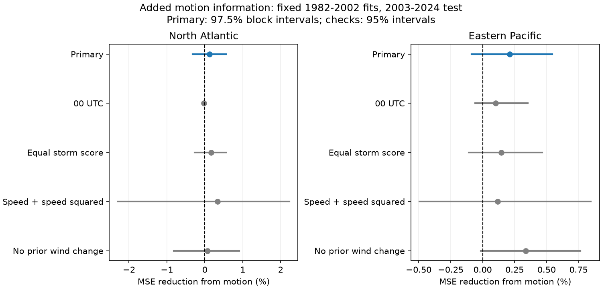

# Slow motion gave no clear added wind prediction accuracy in two cyclone basins in 2003-2024

## Result

We tested whether slow motion before a tropical cyclone observation improves the estimate of wind gain over the next 24 hours. We fit models on 1982-2002 and tested them on 2003-2024. We used fixed IBTrACS v04r01 records for the North Atlantic and eastern Pacific. The baseline used current wind, position, calendar month and wind gain over the preceding 24 hours. The added term marked preceding motion below 3 m/s.

Adding slow motion reduced test mean squared error by 0.124% in the Atlantic and 0.213% in the eastern Pacific. Both block intervals included zero. The change in root mean squared error was below 0.02 kt in each basin. Thus these tests gave no clear added accuracy. They do not show that motion has no physical effect, or that motion cannot help a different model.



| Basin | Training fixes / storms | Test fixes / storms | Baseline RMSE, kt | Added-motion RMSE, kt | MSE reduction | 97.5% interval |
| --- | ---: | ---: | ---: | ---: | ---: | --- |
| North Atlantic | 805 / 86 | 1303 / 149 | 16.2038 | 16.1937 | 0.124% | -0.321% to 0.561% |
| Eastern Pacific | 4565 / 315 | 3609 / 300 | 16.9789 | 16.9608 | 0.213% | -0.085% to 0.544% |

Positive reduction means lower error after adding motion. These intervals condition on fixed training fits and the selected test sample. They do not include uncertainty from model fitting or model choice.

## Question and prior work

Slow motion can let a cyclone spend more time above water that it has cooled. Mei, Pasquero and Primeau (2012; doi:10.1029/2011GL050765) studied motion, intensity and ocean cooling. Motion and recent intensity change are established inputs in intensity prediction. Balaguru et al. (2018; doi:10.1175/WAF-D-17-0143.1) used the SHIPS framework and ocean temperature information. The NOAA 2009 model summary also describes motion, intensity persistence, atmosphere and ocean inputs. Our baseline is a small statistical benchmark. It is not SHIPS and is not a comparison with operational forecast systems.

The cited campaign study found lower later wind gain after slow motion in the eastern Pacific. It estimated associations across the whole record. It did not score predictions in later years. We reuse its public source snapshots, source builder and derived field layout. Our new contribution is a fixed chronological test of added prediction value, with paired loss uncertainty and scoring checks. No claim of a new physical mechanism is made.

We read the earlier full-period results before making the plan. Thus the test years had already contributed to evidence that informed this question. The split prevents fitting on later outcomes in this analysis. It does not make the study an independent validation of the earlier finding. files/plan.md records choices made before calculating prediction results; it is not an external registration.

## Data and sample

No raw data were downloaded for this study. We used the shared CSV snapshots in place and checked their hashes. Source version is IBTrACS v04r01, retrieved on 2026-11-08. Exact source URLs, bytes, hashes and shared paths are in files/provenance.json. The raw paths are:

- /mnt/dell-data/shared_datasets/ibtracs-v04r01-NA-20261108/ibtracs.NA.list.v04r01.csv
- /mnt/dell-data/shared_datasets/ibtracs-v04r01-EP-20261108/ibtracs.EP.list.v04r01.csv

The SHA-256 values are 666681be5b12caf5bad7a511bae5f6e5fa8b03789f7f6dd00ee2f0aaa41c2c97 for the Atlantic file and 4b0cb523130e086163400a92e77925da02fe939b81b3612a50c4da1559ad2099 for the eastern Pacific file. No failed disk path was used. The /mnt names are shared storage compatibility paths.

We selected main tracks during 1982-2024 at 00, 06, 12 and 18 UTC. Initial latitude was 5-25 degrees north, initial USA wind was 34-120 kt, and preceding speed was below 7 m/s. At every six-hour observation from t to t+24 h, the track had tropical status TD, TS or HU, stayed in the same basin and was more than 200 km from land. Wind gain during the preceding 24 hours had to be present. All values were final best-track estimates. USA wind is the US one-minute estimate in these basins.

Speed is great-circle displacement from t-6 h to t, divided by six hours, with Earth radius 6,371 km. Slow means below 3 m/s; the other group is 3 to less than 7 m/s. The outcome is wind at t+24 h minus wind at t. Predictors contain no later fields. Sample selection does use later status, basin, position and availability. This is a prediction test conditional on complete surviving offshore windows. It is not a real-time forecast trial for all storms.

IBTrACS includes interpolated three-hour observations. We use only the standard six-hour times. Best-track wind estimates are rounded and can have error. They are not direct continuous measurements. The builder preserves the selected fields in files/fixes.csv.gz. Read basin strings with keep_default_na=False; the text NA means North Atlantic and must not be parsed as a missing value.

## Method

Each basin has its own ordinary least-squares fits. The baseline columns are an intercept, current wind divided by 50, its square, latitude divided by 20, longitude divided by 100, sine and cosine of calendar month times 2 pi / 12, and preceding 24-hour wind gain divided by 50. The added model has one further column: speed below 3 m/s. No year term or test-period calibration is used. No clipping is applied. All training years are at or before 2002; all test years are 2003-2024. Training and test storm identifiers do not overlap. Coefficients and complete primary test predictions are saved.

The main score gives each retained fix equal weight. Skill is 100 times one minus added-model MSE divided by baseline MSE. We resample paired annual loss sums using circular blocks of five consecutive seasons. Each of 20,000 draws concatenates five blocks and retains the first 22 seasons. We use seed 35011 and preserve all indices and resulting skills. This keeps both model losses paired, retains storms and overlapping windows within seasons, and allows short dependence across seasons. With only 22 test seasons, the distribution and interval have limited support. Five-year blocks are a working dependence assumption, not a proven optimum.

Each primary basin has a 97.5% percentile interval. Bonferroni gives nominal family coverage of at least 95% for two tests if each bootstrap interval has its stated coverage. Bootstrap coverage is approximate. Sensitivity checks have pointwise 95% intervals. We do not count these checks as separate discoveries.

## Checks and interpretation

| Check | Atlantic MSE reduction | Eastern Pacific MSE reduction |
| --- | ---: | ---: |
| Primary | 0.124% | 0.213% |
| Train and score at 00 UTC only | -0.030% | 0.100% |
| Equal total scoring weight per test storm | 0.167% | 0.146% |
| Add speed and its square, instead of slow indicator | 0.336% | 0.116% |
| Remove prior wind gain from both models | 0.066% | 0.338% |

All check intervals include zero; files/estimates.csv gives them. Equal storm scoring changes only test weights, not the training loss. The 00 UTC check refits on that subset and removes overlap between successive 24-hour target windows. It has fewer training and test cases. The continuous-speed check uses speed/5 and its square. The no-prior check uses the same records as the primary test, so sample changes do not explain its result.

The fitted training slow coefficients were -1.42 kt in the Atlantic and -1.15 kt in the eastern Pacific. These small fitted shifts gave little change in test errors near 16-17 kt RMSE. A training association alone therefore did not establish a useful accuracy gain. No causal conclusion follows from these coefficients.

Atlantic primary skill was +0.461% in 2003-2013 and -0.225% in 2014-2024. Eastern Pacific skill was +0.351% and +0.122%, respectively. These are descriptive checks, not separate tests. The two basin results are not evidence for a basin difference.

We did not observe ocean temperature, heat content, shear, humidity or internal storm structure. We cannot decide whether ocean cooling, atmospheric conditions, storm stage or estimation error caused the earlier association. Recent wind gain and later gain share the current wind estimate; error in that estimate can affect both. The selected latitude, wind and motion bounds limit transfer. Long-lived storms get more weight in the main score. Best-track revisions, changes in observation systems, simple model form, informed study design and short test duration also limit inference. These results do not address rapid-intensification probability, climate trends or landfall risk directly.

## Inspection and reproduction

The package contains the verified source builder and retrieval code from the cited study, the rebuilt source subset, a new analysis script, all primary predictions, model coefficients, block draws, score tables, figure, audit and environment versions. No shared raw file is duplicated. The SCI baseline license applies to our work; NOAA data and reused code retain their source terms and attribution.

From the extracted publication root, run:

```sh
OPENBLAS_NUM_THREADS=1 python files/analyze.py
```

This repeats all estimates and the figure offline from files/fixes.csv.gz. Required packages are numpy, pandas and matplotlib. The thread setting reduces overhead but is not required for the method. files/environment.json records tested versions.

To rebuild the source subset, set DATASETS to the shared dataset root and run:

```sh
DATASETS=/mnt/dell-data/shared_datasets python files/build.py
OPENBLAS_NUM_THREADS=1 python files/analyze.py
DATASETS=/mnt/dell-data/shared_datasets OPENBLAS_NUM_THREADS=1 python files/audit.py
```

The audit also needs statsmodels. It checks raw hashes, all primary test outcomes and displacement speeds, separate formula-based fitted predictions, the main scores, and block intervals. files/audit.json records the checks. This is a check by the same worker, not an independent review. A second offline analysis gave identical estimates, coefficients, draws, half-period results and figure bytes; files/repeat_check.json records hashes.

If the raw snapshots are absent, use `python files/retrieve.py NEW_LOCAL_DIRECTORY`, then use that directory as DATASETS. The script refuses to overwrite a directory and requires the recorded hashes. Public files can change in place. If hashes differ, the saved derived evidence still permits the offline analysis. Keep build outputs in a copy of the extracted bundle, since a rebuild changes files.

## Work provenance

Campaign: 11_07_2026. Job: sci-1107-dell-earth-and-ocean-sciences-35ea34f226b9. Topic: earth-and-ocean-sciences. Machine: dell. Account: codex-andrii. Model: gpt-6.1-sol with high reasoning effort, through T3 Code and the Codex harness. Analysis date: 2026-11-09 UTC. This work used one worker and no child agents. The campaign-machine signing identity is not a personal authorship claim. Private keys are not part of the package. The signed publication is saved locally, with no remote archive or index submission.
