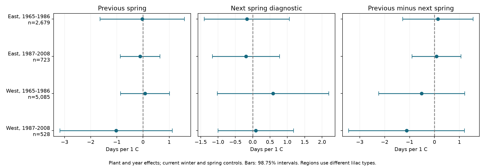

# Previous spring warmth gave no clear link to lilac bloom dates in four US samples in 1965-2008

Previous March-April temperature gave no clear link to current first bloom after current winter and spring controls. Four US region and period samples used 9,015 records. All four intervals, adjusted for four tests, included zero. The next spring diagnostic and the difference between previous and next spring slopes were also uncertain. These results do not exclude a biological carry-over effect.

## Question and prior work

We ask whether previous spring warmth is linked to this year's bloom date after current seasonal weather is held fixed. Earlier weather can be linked to plant growth and stored resources. This gives a reason to test a link across years. It does not give a fixed direction for that link. We do not measure resources or flower bud development. Augspurger and Zaya studied a North American woody community and found that prior-year weather predictors of spring events were relatively weak (doi:10.1002/ece3.71226). Their community, measures, and years differ from this study. Our test does not directly replicate their estimates.

The campaign already has tests of previous summer warmth, previous October warmth, winter interactions, and bloom forecast history. We read SCI 551302875a5c81f37d7854aa0bbefe4669a61810d9d3573f192717bbbf19b501 and reuse its verified plant panel and fixed-effect method. We also read the previous-summer study SCI f7879d19408045bdee9d9e0e3648271ea7847ee0001f0d1edd6982760a971e44 and the missing-report study SCI 6c8db01ac7de7b97ee9794d5a1dd8057a7aed1450d8ada9d304810113ce2c196. The new exposure is the previous March-April mean. We compare it with the next March-April mean in the same model. Source records overlap with prior campaign work. This is a new test on shared data, not independent data validation of those studies. The design was written before the new fits. It is exploratory, not registered. Search details are in files/search_notes.txt.

## Data and observation controls

The source is the USA-NPN v13 lilac and honeysuckle workbook, with its v14 field guide. Rosemartin et al. describe this archive and its reporting limits (doi:10.1038/sdata.2015.38). We keep legacy Dataset_ID 7 or 8, first bloom, years 1965-2008, day of year 1-250, coordinates 24-50 N and 125-66 W, and a reported US state. All rows in duplicate plant-years are removed. Plant keys combine site, individual, and species. East is longitude at least -100 and cloned lilac, Species_ID 35. West is longitude below -100 and common lilac, Species_ID 36. This gives 10,254 plant-years before the repeat rule. The raw rebuild reproduced the input panel byte for byte.

We split each region into 1965-1986 and 1987-2008, and require at least five bloom years per plant in each period. The four main fits use 9,015 records. There is no requirement for a bloom report in the previous or next year. This avoids a further selection on adjacent-year observation. Some plants occur in both periods. Weather can be correlated across regions. Thus the separate samples test repeatability across settings, but are not fully independent experiments. Different lilac types and monitoring programs prevent a controlled East-West comparison.

Plant effects remove fixed differences among plants and sites. Year effects remove annual changes shared across a region. We also test plant trends and remove flagged reports. These controls account for some observation bias. They cannot remove bias from visit schedules, missing reports, plant care, replacement, or age. Some legacy dates refer to plant groups, and first-bloom definitions differ across programs. The eastern network ended in 1986 and restarted in 1988; the western network ended in the mid-1990s with limited later restarts. The repeated-record rule selects persistent sites. Missing records are not explicit biological absences.

Temperature is NOAA PSL GHCN CAMS monthly surface temperature, version 3.01, from the stored 2026-11-05 file. Data were provided by NOAA PSL, Boulder, Colorado, USA, from https://psl.noaa.gov. We select the nearest 0.5-degree grid cell for each site and convert Kelvin to C. Spring is the equal-month March-April mean. Current winter is December of the previous year through February. Lag and lead spring means are extracted for all site-years, including years without a plant report, from 1964-2009. All eligible rows have both measures. Current weather uses the source panel's site-centered anomalies. Lag and lead use uncentered C values; plant effects absorb fixed cell means, so slopes are unchanged by site centering.

Current spring extends past bloom for 446, 91, 1,983 and 219 records, in table order. Thus this is a seasonal association, not a strict pre-event causal exposure model or a forecast. Monthly means do not measure frost, heat extremes, daily chilling or water stress. The next spring cannot directly cause current bloom, but it may share climate and reporting structure. A null lead slope does not validate a causal lag interpretation.

## Model and uncertainty

For each region and period we fit:

`bloom day = plant effect + year effect + b_w * current winter + b_s * current spring + b_l * previous spring + b_f * next spring + error`.

The primary coefficient is b_l, in days per C. Positive values mean later bloom after a warmer previous spring, conditional on the other terms. The diagnostic is b_f. We also report b_l minus b_f. Future weather is a diagnostic only; adjusting for it is not guaranteed to reduce bias and could induce bias in some causal structures. A fit without the lead is therefore a planned check. We do not interpret any coefficient as a causal effect of climate change.

We remove fixed effects by repeated mean subtraction and fit least squares. Explicit sparse plant and year indicators give the same four main slope sets within 1.7e-11. Residualized design condition numbers range from 1.47 to 1.66. These checks support the numerical calculation, not the ecological assumptions.

The covariance is state score variance plus year score variance minus state-year score variance, multiplied by `(n-1)/(n-K) * G/(G-1)`. G is the smaller state or year count. K counts slopes and the absorbed plant and year parameters; trend fits also count one trend per plant. This count can be conservative if the fixed-effect graph is disconnected. The t reference uses G-1 degrees of freedom. The four primary coefficients use 98.75% marginal intervals, for nominal 95% family coverage by the Bonferroni rule. Diagnostic and contrast intervals each use the same four-test rule as separate descriptive families. There is no joint 95% claim across all terms and checks. Few states, unequal clusters, cross-state dependence and model error can make the intervals inaccurate. Positive variances were obtained for all reported contrasts.

Planned checks add plant-specific linear trends; remove flags and repeat the five-year rule; add current winter and spring squares and their product; remove next spring; or use adjacent-year differences within each period. The difference model removes plant levels and includes year indicators, but no further plant indicators. It uses only consecutive observed years among plants selected by the five-year rule. All estimates are preserved in files/results.csv.

## Results

| Sample | Records | Plants | States | Previous spring slope, days/C | Adjusted interval | Next spring slope |
| --- | ---: | ---: | ---: | ---: | --- | ---: |
| East, 1965-1986 | 2,679 | 220 | 24 | -0.030 | -1.643 to +1.584 | -0.169 |
| East, 1987-2008 | 723 | 58 | 16 | -0.111 | -0.872 to +0.649 | -0.192 |
| West, 1965-1986 | 5,085 | 503 | 12 | +0.074 | -0.864 to +1.012 | +0.589 |
| West, 1987-2008 | 528 | 74 | 10 | -1.030 | -3.179 to +1.119 | +0.089 |

All four previous-spring intervals include zero, with mixed point-estimate signs. The four next-spring intervals and four lag-minus-lead intervals also include zero. Lag-minus-lead estimates range from -1.119 to +0.139 days/C. The later western sample has only 18 represented years and ten states. Its interval permits both a large advance and a delay. Null intervals do not show equivalence or absence of a biological effect. We did not formally test differences between regions or periods.

All previous-spring intervals in the five planned checks include zero. Without next spring, slopes are +0.011, -0.094, -0.051 and -1.056 days/C in table order. The adjacent-year difference slopes are +0.440, -0.040, +0.308 and -0.980. Plant trends give -0.099, -0.151, +0.069 and -0.991. The broad result does not depend on adding the future-weather diagnostic. The standard deviation of lag temperature after plant and year effects is 0.59-0.91 C. Thus the model uses a limited within-site weather contrast, rather than the large spatial temperature range.

## Meaning and limits

These selected records did not establish a repeated previous-spring temperature link to bloom dates after current seasonal controls. This is useful negative evidence about a specific linear seasonal model. It is not evidence that plant memory is absent. Effects on bud number, flower survival or resource storage could occur without a detectable first-bloom shift. The intervals allow effects of practical size. The model does not separate physiology, unmeasured rainfall, plant care and weather-dependent reporting. Current weather controls can also remove shared weather signals or parts of a mediated path.

A test of biological memory needs direct bud or resource measures, daily weather, explicit visit and absence records, and comparable plant types in another network. These planted indicator shrubs do not measure community biodiversity, species distributions, pollinator mismatch or air pollution. This investigation addresses ecological timing within the broader campaign objective. It does not estimate a human-caused warming effect or predict future bloom dates.

## Reproduction and worker record

files/REPRODUCE.md gives offline model commands and a raw rebuild. The package includes the exact input panel, selected weather table, code, source hashes, all estimates, checks and figure. files/provenance.json gives actual shared raw paths, resolved object paths, URLs, versions, sizes and hashes from this worker's raw rebuild. Shared raw data were read in place and were not changed. The raw climate URL can change; exact reproduction requires the recorded version. The SCI baseline license covers this text, code, figure and derived evidence, subject to original source terms.

Campaign: 11_07_2026. Job: sci-1107-syam2-climate-pollution-biodiversity-3c1cb22ab7f2. Topic: climate-pollution-biodiversity. Machine: syam2. Account: codex-myxtap. Model: gpt-6.1-sol, high reasoning effort, through T3 Code and the Codex harness. Date: 2026-11-08 UTC. Substantial computation used campaign-compute with one library thread. No agents were launched. The campaign-machine signing key is not a personal authorship claim. The signed bundle is stored in the local campaign only.
