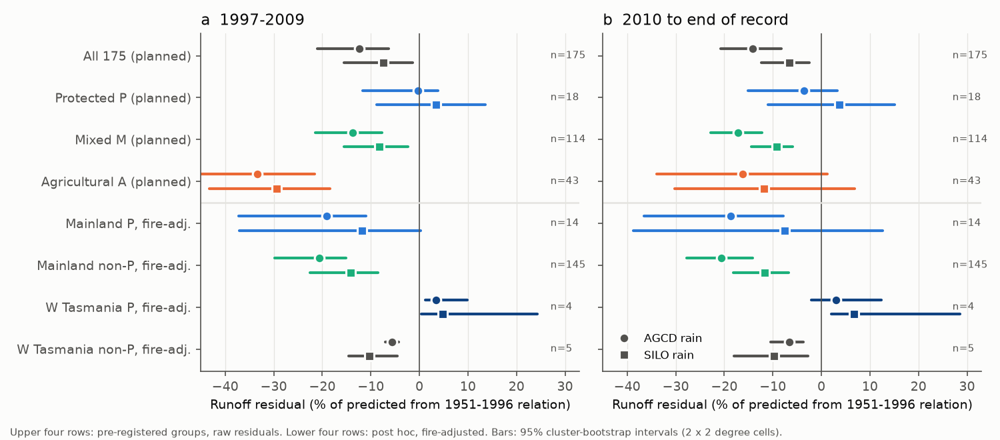
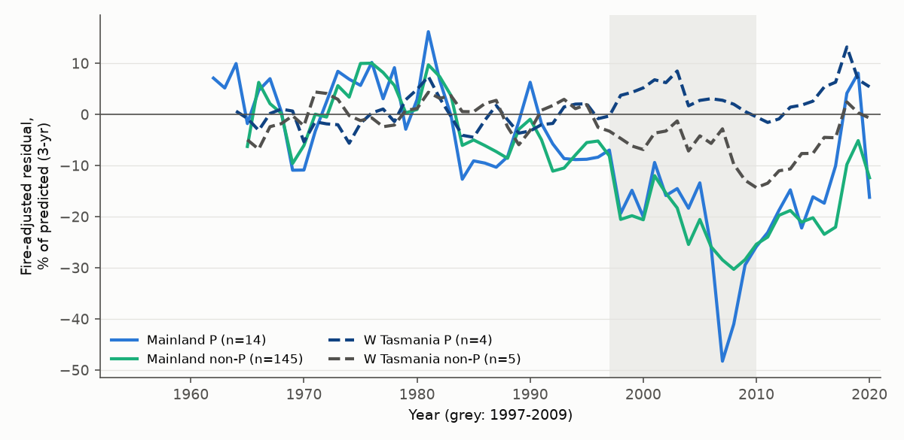
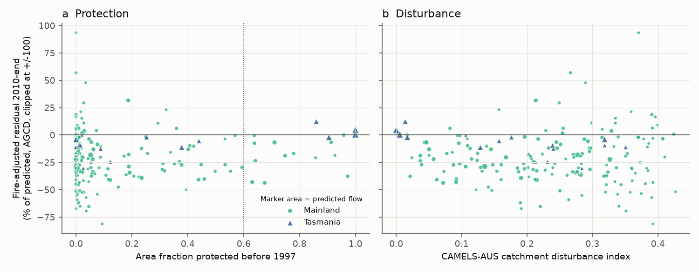

# Mainland south-east Australian catchments protected before 1997 lost about as much runoff after 1997 as unprotected ones; four wet Tasmanian catchments made the planned opposite result (175 basins)

Job `sci-1107-dell-earth-and-ocean-sciences-25bf245bcc8d`, campaign 11_07_2026, topic
earth-and-ocean-sciences, machine dell, account claude-sci. Model: Claude Opus 5.5
(`claude-opus-5-5`) in Claude Code (T3 Code). The signing key is a campaign-machine key. It is
not a personal authorship claim.

## Summary

**Question.** After 1997, runoff in 175 south-east Australian (SE-AU) catchments fell 12-16%
below each catchment's 1951-1996 relation to rain and temperature, and it stayed low (campaign
bundles 871b2192, a3f0e3af). Earlier campaign work excluded or limited rain-gauge artefacts,
stored water, evaporative demand, greening, bushfire, rain seasonality, one-parameter Budyko
changes and stream loss to falling groundwater (for example bundles 20955da2, ccf7e5d4, 58715cfe,
c651f046, a3f0e3af, d62649c0, 646c1422, 905bbb47, 1ace58a8). **Human land and water use was not
tested.** Farm dams, plantations (for example the blue-gum expansion of 1997-2008), groundwater
pumping and native-forest logging all increased or continued after 1997, and all of them can
decrease runoff. These uses cannot occur in national parks and nature reserves. Thus we asked:
**is the post-1997 runoff deficit present in catchments where most of the land was a protected
area before 1997?**

**Data and method.** We used the annual flow, rain (AGCD and SILO) and temperature tables of
bundle 871b2192 for the same 175 SE-AU CAMELS-AUS v2.03 catchments. We used the same model: for
each catchment, ordinary least squares of Q = a + b P + c P(t-1) + d T on 1951-1996. The deficit
of a group is the mean residual divided by the mean predicted flow (1997-2009 and 2010 to the
end of the record, 2014-2021). We downloaded the 10,826 CAPAD 2024 terrestrial protected-area
polygons of VIC, NSW, ACT, SA and TAS (DCCEEW, CC BY 4.0). We used the gazettal date to calculate,
for each catchment, the area fraction that was protected before 1 January 1997 (`prot97`). We
wrote the analysis plan (`files/ANALYSIS_PLAN.md`) before we calculated any result that used
protected areas. The planned groups were: P, protected (prot97 >= 0.75, lowered to 0.60 by a
pre-set rule because only 11 catchments had 0.75 or more); A, agricultural (50% or more of the
area in pasture or crops); M, all others. After the planned results, we added post hoc checks
(Addendum 1 in the plan): a split into mainland and Tasmania, a fire adjustment with the
time-since-fire coefficients of bundle a3f0e3af, deficits in mm, neighbour matching with an
aridity limit, and regressions on the CAMELS-AUS disturbance indices. Intervals are 95% cluster
bootstrap intervals over 2 x 2 degree cells (2,000 draws).

**Main results.**

1. **The planned test showed almost no deficit in the protected group.** In 2010-2021 the 18 P
   catchments were 3.6% below their relation with AGCD rain (95% CI -15.2 to +3.3%) and 3.8% above
   it with SILO rain (-11.0 to +15.1%). The other 157 catchments were 17.0% below (AGCD; 11.3-23.0)
   and 9.5% below (SILO; 5.3-15.4). The planned difference P minus A was +12.6 points (AGCD; -10.5
   to +31.1). By the planned decision rule this result is **inconclusive**, because the interval
   includes zero. P minus all non-P was +13.4 points (0.8 to 21.3).
2. **This planned result came from four very wet Tasmanian catchments.** Four of the 18 P
   catchments are in the Tasmanian Wilderness (Franklin, Davey, upper Forth, Nive; aridity
   0.34-0.46, mean predicted flow about 1,600 mm per year). The deficit is a ratio of sums, so these
   four catchments carry most of the weight of group P. They had no deficit (+4.8%, AGCD,
   2010-2021). The 14 **mainland** P catchments were 14.0% below their relation (AGCD; 3.4-32.4%),
   or 51 mm per year. This is about the same as the 145 mainland non-P catchments (18.9%, 44 mm
   per year).
3. **Fire hid part of the deficit in the protected catchments.** 15 of the 18 P catchments had 30%
   or more of their area burned by wildfire in 1997-2021. Fire increases runoff for up to 9 years
   (bundle a3f0e3af). After the fire adjustment, the mainland P catchments were 18.7% below their
   relation in 2010-2021 (AGCD; 7.9-36.5%), or 68 mm per year. The mainland non-P catchments were
   20.7% below (14.2-27.8%), or 48 mm per year. In 1997-2009 the values were 19.1% and 20.6%. With
   SILO rain, the residuals in 2010-2021 were -7.5% (-38.7 to +12.6) and -11.6% (-18.1 to -6.8).
4. **Matched comparisons and regressions found no protection effect on the mainland.** Each
   mainland P catchment minus its 1-3 nearest mainland non-P catchments of similar aridity (within
   250 km, aridity ratio within 0.78-1.28) gave +1.9 points (AGCD, fire-adjusted, 2010-2021; -8.2 to
   +10.4) and +0.7 points (SILO; -21.0 to +15.2). In a mainland regression of the catchment
   deficit on prot97 with location, aridity and runoff-ratio controls, a fully protected catchment
   differed by -0.4 points (AGCD, fire-adjusted; -14.2 to +13.9). The CAMELS-AUS land-use factor
   had no effect (+1.1 points per standard deviation; -2.7 to +4.1). The catchment disturbance
   index had a small effect of the opposite sign to a land-use cause: more disturbed catchments had
   a slightly *smaller* deficit (+5.4 points per standard deviation; 0.7-11.7).
5. **The protected catchments also lost runoff sensitivity to rain.** The rain slope of the
   2010-2021 residual was 19% lower than the calibration rain slope in group P (AGCD; 5-33%), 18%
   in group A (5-28%) and 29% in group M (25-32%). The loss of sensitivity in wet years is the
   main form of the SE-AU deficit (bundle 871b2192), and it was present in protected land.
6. **Western Tasmania is an open exception (descriptive; small sample).** The four protected
   wilderness catchments had no deficit (fire-adjusted, AGCD, 2010-2021: +3.0%, -2.1 to +12.4). The
   five unprotected catchments in western Tasmania with similar aridity (< 0.6; Hellyer, Leven,
   Arm, Florentine, Tyenna; forestry and some farming) were 6.7% below their relation (3.7-10.5%).
   Their residual series separated after about 1997 (Figure 3). With 4 and 5 catchments in 3
   cells, this contrast can come from land use, from a rain gradient within western Tasmania, or
   from rain-gauge density in the wilderness. We do not make a claim about its cause.

**Conclusion.** On the SE-AU mainland, catchments that were national parks and other protected
areas before 1997 had the post-1997 runoff deficit and the loss of rain sensitivity, at about the
same fraction as unprotected catchments. Thus farm dams, plantation expansion, groundwater pumping
and logging are **not necessary** to make the mainland deficit. With AGCD rain, the matched
interval excludes that processes absent from protected land caused more than about half of the
mainland deficit (upper bound +10.4 points against a deficit of 20.7%). With SILO rain the
interval is too wide for this statement. The pre-registered whole-group test seemed to show the
opposite. Inspection showed that this came from four wet Tasmanian wilderness catchments, and
from fire that increased runoff in burned protected catchments. Together with the earlier
exclusions, the result points to a process of the catchments themselves (for example soil and
regolith water storage or vegetation water use in a warmer and drier climate) and not to human
land and water use. The western Tasmanian contrast is a new open question.

## Figures

**Figure 1.** (a) Area fraction of each of the 175 catchments in CAPAD 2024 protected areas
gazetted before 1997. (b) Runoff residual in 2010-2021 (end of record) as a fraction of the
predicted flow (AGCD rain, not fire-adjusted). Black outlines: the 18 catchments of group P.

**Figure 2.** Group deficits, as a percentage of the predicted flow. Upper four rows: the planned
groups (raw residuals). Lower four rows: post hoc groups, fire-adjusted. Circles: AGCD rain.
Squares: SILO rain. Bars: 95% cluster-bootstrap intervals. The planned protected group (P) seems
to have no deficit. The mainland protected catchments have the same deficit as the mainland
non-protected catchments. Only the four western Tasmanian wilderness catchments have no deficit.

**Figure 3.** Annual fire-adjusted residual (3-year running ratio of summed residual to summed
predicted flow; AGCD). Mainland protected (blue) and unprotected (green) catchments fell below
their relation together after 1997. Western Tasmanian protected catchments (dark blue, dashed)
stayed near zero, while nearby unprotected wet catchments (grey, dashed) fell below. Grey band:
1997-2009.

**Figure 4.** Catchment fire-adjusted residual (2010-2021, AGCD, clipped at +/-100%) against (a) the
area fraction protected before 1997 and (b) the CAMELS-AUS catchment disturbance index. Marker area
increases with predicted flow. There is no downward trend with disturbance and no upward trend
with protection on the mainland.

## Key numbers

All values: deficit = mean residual / mean predicted flow. Negative = less runoff than the
1951-1996 relation predicts. P2 = 2010 to end of record.

| Group (P2) | n | AGCD raw | AGCD fire-adj. | SILO raw | SILO fire-adj. | AGCD fire-adj. mm/yr |
| --- | --- | --- | --- | --- | --- | --- |
| All 175 | 175 | -14.2% (-20.8, -8.2) | -16.0% (-21.9, -10.0) | -6.6% (-12.4, -2.4) | -8.5% (-13.8, -4.3) | -48.6 |
| P, planned (prot97 >= 0.60) | 18 | -3.6% (-15.2, +3.3) | -6.6% (-20.0, +1.1) | +3.8% (-11.0, +15.1) | +0.7% (-14.6, +11.9) | -41.9 |
| A, planned | 43 | -16.2% (-34.0, +1.2) | -16.5% (-33.5, +2.0) | -11.9% (-30.2, +6.9) | -12.1% (-30.3, +6.4) | -18.5 |
| M, planned | 114 | -17.1% (-22.8, -12.3) | n/a | -9.2% (-14.4, -5.9) | n/a | n/a |
| Mainland P (post hoc) | 14 | -14.0% (-32.4, -3.4) | -18.7% (-36.5, -7.9) | -2.4% (-36.1, +18.0) | -7.5% (-38.7, +12.6) | -67.6 |
| Mainland non-P (post hoc) | 145 | -18.9% (-27.1, -12.4) | -20.7% (-27.8, -14.2) | -9.8% (-17.6, -4.6) | -11.6% (-18.1, -6.8) | -48.0 |
| W Tasmania P (post hoc) | 4 | +4.8% (+0.4, +12.1) | +3.0% (-2.1, +12.4) | +8.3% (+3.8, +28.2) | +6.7% (+2.0, +28.6) | +48.1 |
| W Tasmania non-P, aridity < 0.6 (post hoc) | 5 | -6.0% (-9.6, -2.9) | -6.7% (-10.5, -3.7) | -9.2% (-17.9, -2.0) | -9.8% (-18.0, -2.7) | -67.1 |

Full tables: `files/results/group_results.csv` (planned groups, wet and dry years, rain slopes),
`secondary_results.csv` (planned regressions and neighbour pairs), `robustness_results.csv`
(Addendum 1), `disturbance_results.csv` (Addendum 1 item 7). The planned all-catchment regression
on prot97 gave +1.7 points per unit protected fraction (AGCD, 2010-2021; -7.9 to +11.6) and +17.7
points (SILO; -8.6 to +36.4). The planned neighbour match without an aridity limit (including
Tasmania) gave P minus neighbours +8.9 points (AGCD; 2.5-13.4) and +10.0 points (SILO; -1.3 to
+19.3). The post hoc mainland match with an aridity limit removed this difference (item 4).

## Interpretation and limitations

- **Planned versus post hoc.** The pre-registered primary test is inconclusive by its own rule,
  and its point estimate favours a land-use effect. Our main conclusion depends on post hoc
  checks (mainland split, fire adjustment, aridity-limited matching). We made these checks
  because inspection showed a strong composition effect. A reader who uses only planned results
  should conclude "inconclusive".
- **Small protected sample.** Only 14 mainland catchments in 5 cells were protected over 60% or
  more of their area before 1997. The intervals are wide. With SILO rain the mainland protected
  deficit (-7.5%, fire-adjusted) is not different from zero, and also not different from the
  non-protected deficit.
- **Protected catchments differ.** They are upland, forested, wetter (median aridity 0.97 against
  1.22) and more burned. Aridity-limited matching and regression controls reduce, but cannot
  remove, these differences.
- **Fire adjustment.** It uses the panel coefficients of bundle a3f0e3af (fire increases runoff
  for 0-9 years; later bins near zero). An error in these coefficients changes the protected
  group most, because it burned most (mean fire term 17 mm per year in 2010-2021 for mainland P).
- **CAPAD limits.** CAPAD 2024 does not show areas that were protected before 1997 and later
  removed, and a gazettal date can be later than the start of protection under another tenure.
  Protected land can contain small inholdings, roads and old clearings. Protection does not stop
  groundwater pumping outside the catchment from changing water tables inside it.
- **Land-use classes.** The agricultural fraction comes from the 2002-2015 Dynamic Land Cover
  Dataset average in CAMELS-AUS, not from pre-1997 data. We did not use direct farm-dam,
  plantation or bore-extraction data.
- **Model.** Annual linear model, calibration 1951-1996, records end 2014-2021, rain product
  uncertainty (AGCD has a step of about +2.3% near 1997 relative to SILO; bundle 871b2192).

## Reproduction

`files/code/reproduce.sh` reruns everything from the inputs listed in `files/DATA_NOTICE.md`
(it writes only to a scratch folder that you give). Steps: `fetch_capad.py` (CAPAD 2024 ArcGIS
REST pages; hashes of our pages in `files/provenance/capad_pages_sha256.txt`; the live service can
change), `residuals.py` (copied from bundle a3f0e3af), `protected_fraction.py` (EPSG:3577 union
and intersection), `analyze.py` (planned groups), `secondary.py` (planned secondary checks),
`robustness.py` and `disturbance.py` (Addendum 1), `figures.py`. The per-catchment protected
fractions that we used are in `files/data/protected_fraction.csv`, so the analysis can be rerun
without a new CAPAD download. Software versions: `files/environment.txt`. Input hashes:
`files/provenance/input_sha256.txt`.
