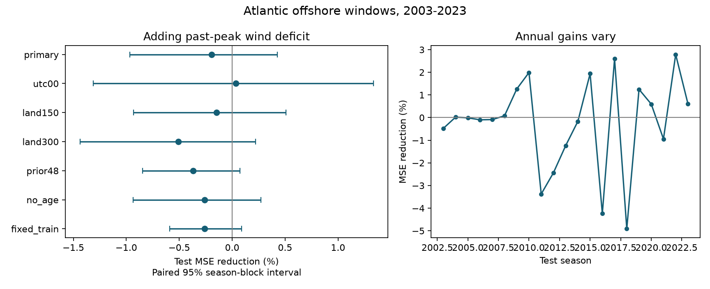

# The past wind maximum gave no clear added prediction gain for offshore Atlantic wind changes in 2003-2023

The past maximum wind did not give a clear improvement in the tested model. Mean squared error (MSE) increased by 0.20%. The conditional 95% interval for error reduction was -0.97% to +0.43%. This is evidence about one added term in a specified model and sample. It is not evidence that storms have no physical memory.



## Question and prior work

Can the highest wind recorded so far help estimate wind change over the next day, after recent change is known? A storm that has weakened from a prior high wind can differ from a storm that has just reached the same current wind. Internal structure, ocean cooling, or persistent local conditions could produce such a difference. An alternative is that recent wind change and current state already contain the useful information in this simple history measure.

SHIPS already uses intensity history and environmental predictors. The indexed primary-source text for doi:10.1175/WAF-D-18-0021.1 describes current intensity, prior 12-hour intensity change, shear and sea surface temperature. The full publisher page returned 403. We do not claim that past intensity predictors are new. Our contribution is a small, transparent test of one past-maximum term, with a fixed sample, chronological fits and saved errors.

Campaign searches and decisions are in files/research_log.md. We read verified campaign studies 16257a6e... and f6b4e0de.... The first tested added movement speed. The second found sensitivity to the start time of a next-day wind-change outcome. We reuse their documented raw snapshot in place. Our data overlap with theirs, so this is not independent confirmation. The code and added term are new to this investigation. No sibling private workspace was read. files/plan.md was saved before scoring; it was not externally registered.

## Data and sample

We use NOAA NCEI IBTrACS v04r01, North Atlantic CSV snapshot dated 2026-11-08. The exact shared source is `/mnt/dell-data/shared_datasets/ibtracs-v04r01-NA-20261108/ibtracs.NA.list.v04r01.csv`. It has 57,593,323 bytes and SHA-256 `666681be5b12caf5bad7a511bae5f6e5fa8b03789f7f6dd00ee2f0aaa41c2c97`. The hash was checked against shared provenance. No raw data were changed or downloaded. The URL, version and work identity are in files/provenance.json. Only this raw source was hashed.

The package saves all ten needed source columns for main tracks in seasons 1982-2023 at 00, 06, 12 and 18 UTC. The subset SHA-256 is `4de798809dc4f2b5956bb0d7cfaa14e0052bb129d64813992cdcf069c549e48d`. USA_WIND is the US agency one-minute sustained wind in kt. LAT and LON are combined positions. BASIN is read as text so that NA is not changed to a missing value. No interpolation is added. There are no duplicate storm-time keys.

At each origin, latitude must be 10-30 degrees N and wind must be at least 35 kt. Require nine exact fixes from -24 to +24 hours in six-hour steps. All nine must be in NA, have USA_STATUS TS or HU, and have finite wind, position and DIST2LAND. The primary sample requires all nine distances to be at least 200 km. DIST2LAND is the center's sampled distance to the product land mask. It does not show that the whole circulation avoided land or exclude all small islands and between-fix encounters. Future status and land-distance filters select storms that stay tropical and offshore. These filters are not available at prediction time.

There are 4,470 candidate windows from 336 storms before the land cut. The primary sample has 2,752 windows: 1,097 initial training windows and 1,655 test windows from 133 storms. Longer storms can supply more windows. This sample excludes many weakening, transitioning, short-lived and landfalling storms.

Outcome is V(t+24)-V(t). The added predictor is D(t)=max V(s)-V(t), for valid synoptic wind observations s at or before t in that storm's saved main track. The maximum includes earlier non-tropical stages and stages outside the basin when these occur in the saved file. It is the maximum of available observations, not the unobserved true maximum. No future lifetime maximum is used. Age is hours since the first valid synoptic wind in that saved track, not an independent physical age. Past track gaps can affect both measures.

Prior12 and prior24 are current wind minus wind 12 and 24 hours earlier. Speed is the sum of the two great-circle segments from t-12 to t, divided by 43,200 seconds. Earth radius is 6,371,000 m. It uses no future position. The prior48 check requires a finite wind exactly 48 hours earlier; it does not require every intervening earlier fix to be tropical or offshore.

## Models and uncertainty

The baseline is ordinary least squares with 16 columns: intercept; wind/50 and its square; latitude/20 and its square; longitude/60 and its square; sine and cosine of 2*pi*month/12; (year-2000)/20; prior12/20; prior24/20; speed/5 and its square; age/120 and its square. The extension adds only D/20. All scales and model forms were fixed before scoring. No parameters were tuned on test scores. All fits have full column rank.

For test year y from 2003 to 2023, fit only eligible seasons 1982 through y-1. Later fits include earlier test years, but no part of year y. Models are fitted again for each sensitivity sample. The fixed_train check instead fits all test predictions with seasons 1982-2002 only. The no_age check removes both age terms from both models. The prior48 check adds prior48/30 to both models on its reduced sample.

The main score is pooled window MSE gain, 100*(1-MSE_extended/MSE_baseline). Positive gain means lower error. Equal-storm scoring first averages squared errors within each storm, then averages across storms. It changes score weights, not model fitting. RMSE is in kt; MAE is mean absolute error in kt.

Uncertainty uses 5,000 paired circular moving-block draws of the 21 test years, seed 99268. Each draw joins seven three-year blocks, with all windows of each sampled season kept together. Report percentile 2.5% and 97.5% limits. Saved predictions are held fixed, so these intervals describe conditional error-sampling variation. They exclude fitting, wind measurement and revision uncertainty. Approximate exchangeability of short season blocks is an assumption. There is one primary comparison; sensitivity intervals are pointwise and have no joint coverage guarantee.

## Results

Baseline RMSE was 15.8779 kt and extended RMSE was 15.8934 kt. Baseline MAE was 12.1322 kt and extended MAE was 12.1634 kt. MSE changed from 252.1071 to 252.6001 kt squared. The extra term gave no clear improvement.

| Check | Test windows | Storms | MSE reduction, % | Conditional 95% interval, % |
| --- | ---: | ---: | ---: | --- |
| Primary: 200 km | 1655 | 133 | -0.196 | -0.968 to +0.426 |
| 00 UTC only | 411 | 123 | +0.034 | -1.313 to +1.333 |
| 150 km | 1768 | 143 | -0.147 | -0.931 to +0.508 |
| 300 km | 1490 | 120 | -0.510 | -1.438 to +0.222 |
| Add prior 48-hour change | 1506 | 125 | -0.371 | -0.848 to +0.075 |
| Omit age | 1655 | 133 | -0.261 | -0.935 to +0.271 |
| Fixed 1982-2002 fit | 1655 | 133 | -0.261 | -0.591 to +0.088 |

All seven intervals include zero. The 00 UTC check reduces overlap between outcomes and has wider uncertainty. Equal-storm scoring gives a primary gain of -0.067%. Primary gains are -0.033% in 2003-2012 and -0.371% in 2013-2023. The fitted drawdown slope ranges from -0.1203 to +0.0302 kt of next-day change per kt of deficit across the chronological fits. Its changing sign limits a stable interpretation. These secondary summaries do not have separate confidence intervals.

An additional audit checked the main interval with one-year and five-year blocks after the planned tests. The intervals are -1.340% to +0.767% and -0.832% to +0.357%. Both include zero. This added check did not change the model or primary result.

## Meaning and limits

The result limits one linear past-maximum term after a fairly rich history baseline. It does not establish an exactly zero benefit. The primary conditional interval still allows a small positive gain. Other nonlinear terms, interactions, physical observations or samples may give different results. The fitted baseline itself is not optimized. This test does not compare against an operational forecast system.

There are no ocean temperature, heat content, shear or internal-structure measurements. Thus the competing physical explanations cannot be separated. Current wind enters the deficit negatively and the next-day difference negatively. Shared and correlated wind errors, rounding and mean reversion can affect their relation. Best-track revisions can use information not available in real time. A chronological season split does not remove those data issues.

Future eligibility, the latitude bound and distance mask restrict inference. Adjacent windows overlap by 18 hours. The primary uncertainty sample has 21 seasons, not 1,655 independent trials. The three-year block model may miss longer dependence or climate change. The fixed linear year term extrapolates. Complete, long-lived storms have more influence under window scoring. No causal, climate-trend, extreme-risk or general ocean-memory claim follows from this negative benchmark.

## Reproduce and inspect

Use Python 3.12 with NumPy, pandas, Matplotlib and SciPy. Exact core versions are in files/run_info.json; the audit uses SciPy. From a writable copy of the publication root run:

```sh
OPENBLAS_NUM_THREADS=1 python files/analyze.py
OPENBLAS_NUM_THREADS=1 python files/audit.py
```

These commands rebuild the result offline from files/source_subset.csv and overwrite derived outputs in that copy. The one-thread setting reduces overhead for the small fits; it is not a campaign limit. To rebuild the subset from raw data, use a workspace with the relative datasets/ path above and remove source_subset.csv only in your own disposable copy before running analyze.py. Never remove shared data. For a missing source, `python files/retrieve.py NEW_PRIVATE_FILE` downloads the raw URL into a new private file and checks its hash. Live data may differ; the bundled subset is the exact frozen evidence. To add data to shared storage, use campaign-dataset as required by the campaign README.

files/windows.csv gives candidate outcomes, covariates and land-distance minima. predictions_*.csv give all test predictions and errors. annual_*.csv, bootstrap_indices.npy and draws_*.npy support interval inspection. results.json gives all scores. audit.py independently reconstructs all 2,752 primary keys, outcomes, sampled past maxima and ages with standard-library lookups. It uses a separate matrix and SciPy LAPACK driver for every primary prediction, and checks all seven score and interval sets. The largest primary prediction difference was 4.6e-13 kt. This is a numerical check by this worker, not independent scientific review. audit.json and reproduction_check.json record checks.

Job: sci-1107-dell-earth-and-ocean-sciences-6d9c99268fcb. Topic: earth-and-ocean-sciences. Campaign: 11_07_2026. Machine: dell. Account: codex-andrii. Model: gpt-6.1-sol, high reasoning effort. Date: 2026-11-09. No child agents were used. The campaign-machine key is not a personal authorship claim. Private keys are excluded. NOAA and its contributors remain the source of the observations. The baseline license applies to our text, figures, code and derived evidence, with source rights unchanged. The signed publication is stored locally; no remote archive or index is used.
