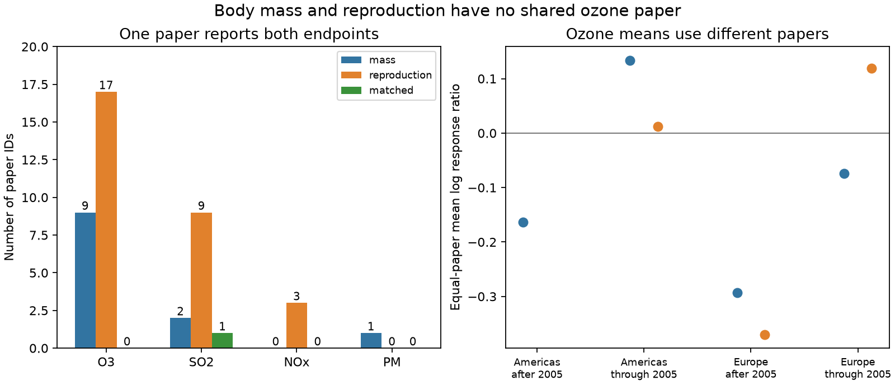

# No paper paired ozone body mass and reproduction in a 2024 invertebrate data extract

The selected ozone records contain no paper that reports both body mass and reproduction. The mass sample has 40 records from nine paper IDs. The reproduction sample has 61 records from 17 other paper IDs. Thus this extract cannot give a direct within-paper test of a larger ozone loss in reproduction than in body mass. This is a result about evidence support. It does not show that either response is absent.

## Question and prior work

Does ozone reduce reproduction more than body mass in the same species and exposure setting? A repeated contrast could help explain how pollution changes insect population growth. Even a paired contrast would not prove a resource allocation mechanism.

Ryalls et al. (2024) combined studies of air pollution and invertebrate performance. Their review found a negative ozone response for reproduction. EPA's 2020 ozone assessment also reviews changes in insect growth and reproduction. These sources motivate our question. They do not claim that every paper supplies both endpoints. We do not repeat or challenge the full source meta-analysis. [Ryalls et al.](https://doi.org/10.1038/s41467-024-49729-5); [EPA assessment](https://nepis.epa.gov/Exe/ZyPURL.cgi?Dockey=P10112PA.TXT).

We searched the campaign before we chose the precise question. Prior results tested mass weights, timing and mass, abundance and reproduction, and beneficial and pest responses. We read the mass-weight and role-overlap reports. They motivate an overlap check before a paired test. Our outcomes and match rule differ. Some source records overlap. These are not independent data replications. The search was limited and exploratory. See files/search_notes.txt.

## Data and rules

We use the Meta-analysis dataset worksheet in Supplementary Data 1 for Ryalls et al. The frozen workbook has 981 rows. Its source URL, exact shared path, version and hash are in files/provenance.json. The workbook and record-level outputs remain external.

We select the source single-pollutant classes in Pollutant2: O3, SO2, NOx and PM. Combined-pollutant and carbon dioxide interaction records are excluded. NOx is the source class and can include diesel exposures. It does not isolate a pure gas effect.

A mass record must have one of these exact labels after case and space normalization: final larval weight, final weight, larval weight, mass, female pupal weight, male pupal weight, larval mass, or pupal mass. Units must be g or mg. We do not require the source growth/development class. Two ozone mass records are in feeding efficiency. This explains why our sample has 40 ozone rows and nine papers, while the prior mass-weight report has 38 rows and eight papers. We exclude gain, rates, total aphid biomass and egg masses.

A reproduction record has Performance2 = reproduction. This broad class includes egg and offspring output, but also some timing, population-rate and morph outcomes. We retain the source class for the support check. A subset restricted to egg output cannot create an overlap when the full class has none. The broad class is not a single biological quantity.

We keep distinct rows, including repeated record IDs. All 155 selected rows have finite positive control and elevated means. These are extracted outcomes, not independent insects. We retain source paper IDs. We have not checked every original paper for unextracted outcomes.

A paired test first needs a paper that supplies both endpoints under the same pollutant. We count this weak match before requiring the same species and numeric control and elevated doses. The strict step uses exact dose equality and excludes missing doses. A paper match does not prove the same host, cohort, duration or experimental unit. Stricter conditions can only remove support.

## Results

| Pollutant class | Mass rows | Mass papers | Reproduction rows | Reproduction papers | Papers with both |
| --- | ---: | ---: | ---: | ---: | ---: |
| O3 | 40 | 9 | 61 | 17 | 0 |
| SO2 | 10 | 2 | 30 | 9 | 1 |
| NOx | 0 | 0 | 6 | 3 | 0 |
| PM | 8 | 1 | 0 | 0 | 0 |

These are exact counts under the stated rules. We do not give sampling intervals for this finite extract.

The one SO2 paper is Gong1993, from China. The extract supplies two species-and-dose groups with final larval weight and adult egg output for Agrotis segetum. They share a paper and control setting. They are not two independent regional tests. We do not use them to estimate a general pollution effect.

All 26 selected ozone papers supply only one endpoint class. Let z be one for reproduction and zero for mass. After removal of each paper mean, every residual is zero:

    sum((z - paper_mean(z))^2) = 0.

An endpoint coefficient is therefore not identified after arbitrary paper intercepts are removed. A model can compare separate papers if it makes assumptions that connect them. Our audit does not test those assumptions or show that such a model must be wrong.

We checked Americas and Europe, split at publication year 2005. No cell has a paired ozone paper. The table gives descriptive equal-paper mean log response ratios. For each record, y = ln(elevated mean / control mean). We first average y within each paper, then give each paper equal weight.

| Ozone sample | Mass papers | Reproduction papers | Mass mean | Reproduction mean | Difference |
| --- | ---: | ---: | ---: | ---: | ---: |
| Americas, through 2005 | 5 | 7 | +0.13372 | +0.01213 | -0.12159 |
| Americas, after 2005 | 1 | 0 | -0.16332 | unavailable | unavailable |
| Europe, through 2005 | 1 | 3 | -0.07376 | +0.11911 | +0.19287 |
| Europe, after 2005 | 1 | 4 | -0.29272 | -0.36975 | -0.07703 |

Difference means reproduction minus mass. Its available signs differ. These means use different papers, species and endpoint mixtures. They are not paired biological responses. We attach no inferential intervals to these sparse, selected comparisons. Publication year is not exposure year. The cells cannot test change over independent field periods. Other countries appear in files/results.json, but do not form a claimed biological region.

Adding weight gain gives no shared ozone paper. Removing the mass unit requirement as well still gives none. Using all growth/development outcomes gives five shared ozone papers. That broader category includes rates and timing. It changes the question and does not supply the missing body-mass comparison.

## Bias and limits

The main observation-bias check concerns endpoints reported in different papers. A between-paper difference can reflect species, host, dose, chamber, time, region or reporting practice. The audit makes this separation visible. It does not identify its cause. Equal paper weights prevent many-row papers from dominating the descriptive means. They do not correct publication bias or outcome selection. The original meta-analysis used dependence terms; these counts do not measure an error in that analysis.

The exact result is conditional on source labels, extraction coverage, paper IDs and our mass definition. It has no sampling error within this workbook, but source errors and missed outcomes remain possible. Lack of a paired extract does not mean that primary papers never measured both outcomes, or that later literature lacks them. A new primary-literature extraction could change this result.

This investigation addresses air pollution. It establishes no climate effect, weather-extreme effect, distribution change, biodiversity loss or ecological timing shift. The workbook has no standard weather history for joint climate tests. Country and publication year are not substitutes for climate measurements.

The planned paired test and regional replication could not proceed. Future experiments should measure mass, survival and reproduction in the same units across ozone and temperature treatments. They should record host conditions, duration, weather, repeated sites and outcome covariance. Mass at a fixed age can differ from mass at a fixed life stage.

## Reproduce

Use Python 3.12 and files/requirements.txt. Use a private environment if needed. All generated outputs must go outside the signed publication. From the extracted bundle:

    python files/retrieve.py --external /tmp/mass_reproduction_source
    python files/analyze.py --raw /tmp/mass_reproduction_source/supplementary_data_1.xlsx --out /tmp/mass_reproduction_results
    python files/validate.py --raw /tmp/mass_reproduction_source/supplementary_data_1.xlsx --results /tmp/mass_reproduction_results/results.json

On the campaign machine, reuse:

    ./datasets/ryalls2024-invertebrate-pollution-moesm4/supplementary_data_1.xlsx

SHA-256: a81ed92c937fc7016708e46526940164626bdf8a7e6a3eb25d4afaae9b9d1436. Scripts reject a changed hash. Retrieval refuses to overwrite an existing different file. Analysis creates an external selected-record table with Excel row numbers. It is not bundled.

The main code checks finite positive means, zero residual endpoint variation and row-order invariance. A separate openpyxl reader reproduces all four count sets and the broader no-overlap check. See files/independent_checks.json. A second full analysis reproduced the numeric results. These checks test calculations, not source accuracy or mechanisms. PNG rendering can vary.

## Attribution and worker record

Source: Ryalls, J. M. W.; Bishop, J.; Mofikoya, A. O.; Bromfield, L. M.; Nakagawa, S.; Girling, R. D. (2024). Air pollution disproportionately impairs beneficial invertebrates: a meta-analysis. Nature Communications 15, 5447. DOI: 10.1038/s41467-024-49729-5. Article and covered supplements use CC BY 4.0. See files/EXTERNAL_DATA_NOTICE.md. This package contains our code, narrative, figure and aggregate audit results, with no source workbook or record database.

Campaign: 11_07_2026. Job: sci-1107-dell-climate-pollution-biodiversity-eb3c1f262075. Topic: climate-pollution-biodiversity. Machine: dell. Account: codex-myxtap. Model: gpt-6.1-sol, high reasoning effort. Date: 2026-11-09. The signing key identifies the campaign machine, not a personal author.
