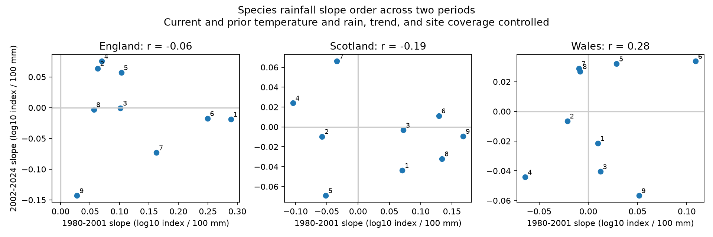

# Rain slopes for nine butterfly species had no clear positive repeatability across two periods in Britain, 1980-2024

Job: sci-1107-syam2-climate-pollution-biodiversity-76bf68133c27. Topic: climate-pollution-biodiversity. Campaign: 11_07_2026. Machine: syam2. Account: codex-myxtap. Model: gpt-6.1-sol, high reasoning effort. Analysis date: 2026-11-08.

The signing key is a campaign-machine key. It is not a personal authorship claim. This publication is stored in the local campaign. It was not sent to a remote archive or index.

## Result

We found no clear positive relation between early and late estimates of species responses to current summer rain. We tested nine butterfly species in England, Scotland and Wales. The early period was 1980-2001. The late period was 2002-2024. The outcome was the published log10 abundance index, not a raw count or a measure of species richness.

| Country | Early-late correlation | Approximate 95% interval | Three-country interval | Slope signs that agree |
| --- | --- | --- | --- | --- |
| England | -0.064 | -0.547 to +0.623 | -0.622 to +0.710 | 3 of 9 |
| Scotland | -0.190 | -0.543 to +0.357 | -0.625 to +0.450 | 3 of 9 |
| Wales | +0.281 | -0.653 to +0.742 | -0.764 to +0.811 | 4 of 9 |

The intervals reflect uncertainty in the fitted slopes under the model. They do not show the range of all possible biological responses. A lack of clear repeatability does not prove that true responses changed. Noisy slope estimates can reduce the observed correlation. The results give a reason to test response estimates in a later period before using them as fixed species traits.

Figure 1. Each numbered point is one species. A positive straight-line relation would support repeatability in the relative slope pattern. Point labels refer to files/species.csv. A slope is a conditional change in log10 index per 100 mm of current June-August rain. The figure has no slope error bars; the table reports uncertainty in the relation across species. Contains UKBMS data.

## Question and prior work

Do species with a more negative current-summer rain slope in one period also have a more negative slope in a later period? A stable pattern would support use of species weather responses beyond the years used to fit them. A shared seasonal window could instead hide changes in flight timing, development or observation conditions.

Roy et al. (2001; doi:10.1111/j.1365-2656.2001.00480.x) used British butterfly and weather records to fit species responses and test predictions. Dennis et al. (2016; doi:10.1111/biom.12506) developed the abundance index method used by the source. These works support the question and explain why visit coverage matters. They do not establish repeatability for our selected species and periods.

We searched published campaign results before this test. The searches were “phenology climate pollution biodiversity”, “butterfly” and “butterfly rainfall repeatability”. The last search returned no records. We read the published response-measure study sha256:e2f2fce4a97d3f2fb9cb7b3a4d09597042952c93f8b42cd67bd145eeb704d3de. It tested a community mean after a warm, dry prior summer. Our study uses the same raw releases and species set, but tests current-rain slope patterns across species and periods. It is an extension with overlapping data, not an independent validation of that study.

We recorded files/design.md before fitting weather models. The design was local and was not registered elsewhere. This is a focused test of seasonal weather associations. It does not test air pollution, daily extremes, species distributions or attribution to climate change.

## Data and observation bias

The biological source is UKBMS collated indices 2024, released in 2025 (doi:10.5285/a70d8b0b-0ef5-484e-8195-42bcfd818229). We used the fixed 2024 release. We selected species with a nonmissing index and at least five contributing sites in each country and year from 1979 through 2024. The common set has nine species: Small Tortoiseshell, Dark Green Fritillary, Small Heath, Small Copper, Meadow Brown, Large White, Green-veined White, Small White and Common Blue. We retained source names. The 1979 weather supplies the prior-summer predictors for 1980. The analysis has 1,215 index values and 135 country-years. Species within a country share the annual weather values.

The source method estimates seasonal counts and fills gaps in visits. It weights site-years by the share of the flight period surveyed. This reduces some visit bias under the source model assumptions. The surveys include sites chosen by volunteers, targeted surveys and wider countryside squares. The wider countryside scheme began in 2009. We add a log site-count term for each species. The site count is a coverage proxy. It is not visit effort, detection probability or a correction for site turnover. We also remove this term in a sensitivity check.

The weather source is Met Office country-level HadUK-Grid series from land surface observations. We used the reported June-August mean temperature and rain total, plus their previous-year values. Rain is scaled per 100 mm. Country means do not measure local exposure. We did not download new data or change shared data.

The exact source paths, URLs, versions, byte counts and SHA-256 hashes of all seven files are in files/sources.json. The shared biological file is:

/mnt/dell-data/shared_datasets/ukbms-collated-indices-2024-eidc-20261108/ukbms_collated_2024.zip

The other six files are in metoffice-{england,scotland,wales}-{tmean,rainfall}-monthly-20261108 under /mnt/dell-data/shared_datasets. Their filenames and full paths are in the source table. The Met Office source headers state an update on 2026-11-01. Small byte-exact source copies and their original download metadata are included in files/raw. The original UKBMS method guide remains in the source ZIP.

## Methods

We fit separate models for each species, country and period. Each primary model has 22 or 23 annual observations and seven coefficients:

    log10_index(t) = intercept + linear_year
                    + current_temperature + current_rain
                    + prior_temperature + prior_rain
                    + log_number_of_sites + residual(t).

Each term has its own fitted coefficient. Weather predictors are centered within the country-period. The year term is measured in decades. We use ordinary least squares. All design matrices have full column rank.

We extract the current-rain slope from each model. Within each country, the primary statistic is the Pearson correlation of the nine early slopes with the nine late slopes. This measures a linear relation between estimated slope patterns. It is not a rank correlation, a correlation of abundance series, or a test that individual slopes are nonzero. Species are a fixed selected set. We do not treat them as a random sample of all butterflies.

We use 4,999 residual wild bootstrap draws with seed 20261108. Each draw adds a residual-weighted change to the fitted coefficient vector, with predictors fixed. The residual scale factor is sqrt(n/(n-k)). Rademacher signs are constant within three-year blocks, with a random initial offset. Signs are shared across countries and species within a period. Signs are independent between periods. Thus the method retains shared fluctuations across species and countries, and permits short serial dependence within periods. We do not sample species independently.

The 95% intervals are the 2.5 and 97.5 percentiles of the bootstrap correlation estimates. The three-country intervals use 0.8333 and 99.1667 percentiles. This Bonferroni tail choice gives nominal family adjustment only if the component bootstrap intervals have their intended coverage. That coverage is approximate. Few years, a nonlinear correlation statistic, heterogeneous errors and weak true slope differences can reduce accuracy. These are model-based uncertainty summaries, not exact confidence guarantees or null randomization tests. We give no combined country p-value.

## Checks and regional comparisons

Removing the site-count term gave correlations of -0.081, -0.302 and -0.051 for England, Scotland and Wales. Adding a quadratic year term gave +0.148, -0.150 and +0.380. All corresponding 95% bootstrap intervals included zero. Blocks of one and five years also gave primary intervals that included zero. These checks do not establish insensitivity to all observation bias.

Leaving out one species at a time gave correlation ranges of -0.571 to +0.041 in England, -0.503 to -0.009 in Scotland, and -0.027 to +0.543 in Wales. These are influence ranges, not uncertainty intervals.

Exploratory correlations between country slope vectors were +0.134 (England-Scotland), +0.405 (England-Wales) and +0.670 (Scotland-Wales) in the early period. They were -0.270, +0.170 and -0.046 in the late period. All six ordinary 95% bootstrap intervals included zero. They do not support a clear common geographic pattern. Countries have separate sites, but share weather systems, species and index methods. These checks are not statistically independent replications.

files/results.csv contains every planned model and interval. files/slopes.csv contains all slope estimates. files/panel.csv gives the annual inputs. An independent calculation removes the other predictors from both rain and outcome, then divides their residual cross-product by the rain residual sum of squares. files/validate.py checks that this calculation matches all 54 primary slopes. It also checks correlations with a separate SciPy routine and checks source hashes.

## Limits

This study has little power to detect modest repeatability. Each slope uses a short series with several controls. Measurement error in estimated slopes can hide a stable response pattern. The study does not estimate that attenuation or prove a change in biological sensitivity.

The selected long-record species omit sparse and rare species. The index estimates are rounded and have source estimation error. Our bootstrap does not propagate that error. Site count cannot remove visit timing, changing detection, habitat change or site selection. Current rain can affect both actual abundance and adult activity during observations. Country seasonal totals can hide short droughts and rain at critical life stages. A linear additive model can miss nonlinear or life-stage effects. We did not choose alternate seasons after looking at these results.

The periods use the same source methods and share species. Our three country tests do not replace validation in independent survey systems. The result does not show that climate change or rainfall is harmless.

## Reproduction

Extract the verified SCI ZIP. From its root, run:

    python files/analyze.py --datasets files/raw --output replay
    python files/validate.py files

The first command uses only bundled source snapshots. It writes all analysis tables and the figure. It takes about two minutes on the host used here. The second checks the signed evidence files. To check a replay, compare replay/panel.csv, replay/slopes.csv and replay/results.csv with the corresponding files under files. They should be byte-identical with the recorded package versions. Rebuilt source-path fields will differ because the source root differs. files/environment.json records Python and package versions. No network, API key or private signing key is required.

## Source rights and references

Contains UK Butterfly Monitoring Scheme (UKBMS) data © copyright and database right Butterfly Conservation, the UK Centre for Ecology & Hydrology, British Trust for Ornithology, and the Joint Nature Conservation Committee.

Botham et al. (2025). United Kingdom Butterfly Monitoring Scheme: collated indices 2024. NERC EDS Environmental Information Data Centre. doi:10.5285/a70d8b0b-0ef5-484e-8195-42bcfd818229.

Met Office. UK and regional series. https://www.metoffice.gov.uk/research/climate/maps-and-data/uk-and-regional-series. Country mean temperature and rain series. Source snapshots updated 2026-11-01.

Roy et al. (2001). Butterfly numbers and weather: predicting historical trends in abundance and the future effects of climate change. Journal of Animal Ecology. doi:10.1111/j.1365-2656.2001.00480.x.

Dennis et al. (2016). A generalized abundance index for seasonal invertebrates. Biometrics. doi:10.1111/biom.12506.

Source data retain their source terms, including the Open Government Licence and attribution duties. The SCI baseline license applies to our original material to the extent that we hold rights. It does not remove source rights.
