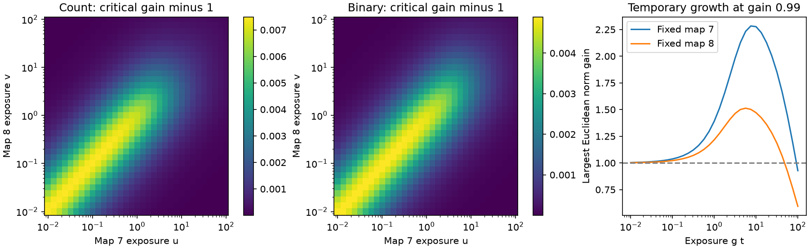

# A scan of 5,445 two-block schedules found no sustained growth in models of two adult worm maps

We tested periodic switching between two whole wiring templates in a positive linear model. Each template came from one adult C. elegans brain. At gain 0.99, all 5,445 scanned schedules had a period multiplier below 1. Thus every scanned periodic system decays after many periods. This finite search does not prove stability for every switching schedule.

Temporary growth was still possible. For contact-count weights, the largest scanned one-period Euclidean norm gain was 2.2792. The same schedule had a period multiplier of 0.92670. A norm gain above 1 and a period multiplier below 1 answer different questions. The first describes one response interval. The second describes the limit after many repeated intervals.

These results extend a prior campaign test of cell profile uncertainty. That study found unstable matrices made by choosing each cell profile independently from the two animals. We did not find the same failure by switching the whole templates together in time. The two uncertainty models must be kept distinct. These are model results, not observations of changing anatomy or neural activity.

Figure 1. The first two panels show the critical gain minus 1 for 1,089 schedules under each weight rule. All entries are positive. Zero would mark the fixed-map boundary. The third panel shows norm gain under each fixed count-weighted map at gain 0.99. A single response can grow even when its long-run behavior decays. These are deterministic calculations; the panels do not show animal uncertainty.

## Question and prior record

Does the loss of stability under independent cell profile choice also occur when only the whole-map template can change in time? The question matters for model uncertainty. A model that fills cells independently from different animals admits different circuits from a model with a single global state. Neither construction is a measured account of anatomical change in one animal.

Witvliet et al. reconstructed brain wiring across development [1]. Hennequin et al. showed why nonnormal neural networks can have temporary growth [2]. Switched positive-system theory shows that the stability of individual matrices, or even their convex combinations in high dimensions, is not a general proof of stability under switching [3]. We apply standard exponential-product and positive-vector methods. We claim no new matrix theorem.

Before choosing this question we searched the SCI campaign for connectome, neural structure, Allen, synaptic depression, reciprocal synphys, transient amplification, detailed balance and switching whole map. We read SCI publications 2453a05d, 1a5311bc and 8d7df97d (full IDs in sci.json). The first established cell profile uncertainty bounds in the same 157-cell core. The other two studied temporary growth and cell-weighted norms for fixed templates. Our new test is whole-template periodic switching. We rebuilt both matrices from the raw shared inputs. We reused no prior code or edge table. The choice of question and scan was exploratory, not preregistered. The temporary-growth calculation was added after the first null scan.

## External data and selection

We reused two tables from wormneuroatlas commit b2e13d88b670efcb3438aeacba2ad4bd6c383933:

| Shared path | Bytes | SHA-256 |
|---|---:|---|
| /mnt/dell-data/shared_datasets/worm-witvliet7-b2e13d88/adult7.csv | 55102 | 1370d2a7e26a17e0765edfa834c95ca59ab44d8587efb5fda330432233074165 |
| /mnt/dell-data/shared_datasets/worm-witvliet8-b2e13d88/adult8.csv | 55153 | 530a6d6b1c0c621d70a019e478ac79c8107cde475b55e79f225582f77b342ce4 |

These compatibility paths refer to the shared SSD store. Exact resolved paths and pinned source URLs are in files/evidence/provenance.json. No data were downloaded or changed for the analysis. No matched activity data were used. Allen datasets were not needed for this question.

We intersect cell names and exclude prefixes BWM, CEPsh, GLR and excgl. We retain chemical connections, sum counts for each ordered pair and remove self links. We repeatedly intersect the largest strongly connected components of both induced graphs until the set is fixed. This gives 157 cells. Matrix W has target rows and source columns. The raw count spectral radii are 55.344274 and 82.188909, consistent with the earlier campaign result.

The upstream repository carries GNU GPL version 3 terms. We keep raw records and derived matrices outside this publication. The bundle contains original code, text, figures and aggregate model outcomes. It contains no external code, cell-level records, edge list, certificate vector or derivative connectivity database. files/EXTERNAL_DATA_NOTICE.txt identifies external rights and attribution. Source terms do not replace or alter the SCI baseline terms for bundled original works.

## Models and schedule search

The model is dx/dt = (-I + g Bk)x. The leak is 1, gain g is nonnegative, and k is 7 or 8. All weights are nonnegative. Contact count is an assumed coupling proxy. It is not a measured synaptic gain. Time is measured in units of a common assumed cell time constant.

We use five rules:

1. Count: divide each count matrix by its own spectral radius.
2. Binary: replace positive counts by 1, then use separate spectral divisors.
3. Shared: divide both count matrices by the larger raw spectral radius.
4. Row: divide each count row by its total.
5. Column: divide each count column by its total.

Each fixed map is stable for gain below 1 under these rules. For the shared divisor, map 7 has a lower radius, so the statement is a sufficient shared boundary, attained by map 8.

One period applies map 7 for time t7 and map 8 for time t8. Define exposures u = g t7 and v = g t8. The period matrix is

    P = exp(-(u+v)/g) exp(B8 v) exp(B7 u).

The system decays over repeated periods exactly when rho(P) < 1. Let L = log rho(exp(B8 v) exp(B7 u)). The critical gain is (u+v)/L. Here L is positive. Reversing the two phases preserves the nonzero eigenvalues, so it does not add a new asymptotic test. It can change one-period norm gain.

Each exposure takes 33 logarithmically spaced values from 0.01 through 100, inclusive. Thus there are 1,089 schedules per rule and 5,445 tests in total. The scan is uniform in log exposure. It is not a random sample or a cover with a proven error bound. We then run one bounded Nelder-Mead search per rule, initialized at the best grid point, with each log exposure from -6 through 5.5. This local search is an extra diagnostic, not a global optimizer. It often moves toward a nearly fixed single template.

For each positive exponential product Q we compute a positive eigenvector r and check min(Qr/r) and max(Qr/r). These ratios bracket its spectral radius in exact arithmetic. Our brackets use floating-point arithmetic. We also check selected responses by direct time integration and use an analytic two-cell unstable switching example to test that the method can detect growth.

## Results

| Weight rule | Smallest grid critical gain | Lowest safe gain bound for arbitrary switching |
|---|---:|---:|
| Count | 1.000002822 | 0.946261 |
| Binary | 1.000001731 | 0.890992 |
| Shared divisor | 1.000034735 | 0.996884 |
| Row totals | 1.000000000 | 1.000000 |
| Column totals | 1.000000000 | 1.000000 |

The last column is a sufficient bound; it is not an estimated exact switching boundary. For count, binary and shared weights, it comes from a positive vector z with both B7 z and B8 z bounded by U z. The weighted maximum norm then decays at rate at least 1-gU. A shifted iteration on max(B7 z, B8 z) supplies z. This reproduces the independent-row bound from the prior study and also bounds whole-map switching. It does not show that the bound is sharp for whole-map switching.

For row normalization, the maximum norm proves decay at rate 1-g. For column normalization, the sum norm gives the same result. These two controls hold for arbitrary switching and all exposures. They are analytical consequences of normalization. Small grid values below 1 by about 5e-13 are roundoff, not detected instability.

At gain 0.99 all 5,445 grid schedules decay. The count grid's smallest decay per unit exposure was 0.0101038. For count weights, the local search reduced the minimum critical gain only to 1.000000287. For binary and shared weights it found 1.000000176 and 1.000003519. None supplies a growing witness. No confidence interval or significance test is appropriate for these fixed matrices and deterministic searches.

At gain 0.99, the largest scanned count one-period norm gain was 2.279222, at u = 7.498942 and v = 0.01. Its period multiplier was 0.926696. The corresponding binary values were 1.784645 and 0.903637, at u = 10 and v = 0.01. The count fixed-map norm maxima over the exposure grid were 2.283360 and 1.512866; binary maxima were 1.785388 and 1.693101. Thus the largest tested switched response was close to a long map-7 response with a short map-8 phase. This scan gives no evidence that switching increased the largest norm gain above the scanned fixed-map values. It does not exclude such an increase elsewhere or after reversing phases.

## Checks and failed approaches

The largest relative positive-vector spectral bracket width was below 6.1e-11 across the scanned products. The selected count and binary period responses agreed with direct solve_ivp integration to relative errors below 4.0e-11. The analytic synthetic pair has stable generators -I+B and -I+C, where B has upper off-diagonal entry 4 and C is its transpose. Unit-time alternation has multiplier exp(-2)(9+4 sqrt(5)), about 2.43, and the numerical result agrees within 1e-12. Thus the pipeline does detect a known unstable schedule.

We also tried one common quadratic norm candidate, obtained from the average generator's Lyapunov equation. It failed the separate-map matrix inequalities at gains 0.95, 0.97, 0.98, 0.99 and 1. This rejects that candidate only. It does not rule out a common quadratic norm. The diagnostic code and negative slacks are saved. We did not solve a semidefinite optimization problem or test longer multi-phase words.

## Limits and next work

The finite schedule grid and one local search do not resolve arbitrary-switch stability between gains 0.946261 and 1 for count weights. This interval is the main open question. A common Lyapunov certificate, an invariant-set construction, or an explicit growing multi-phase schedule could resolve it. Refining the grid alone would still leave a global gap. Testing observed changes in effective gains would be more biologically meaningful than switching between animals.

Only two selected adult maps are used. Positive weights omit inhibitory signs, count scaling is assumed, all time constants are equal, and delays, nonlinearities, inputs and missing cells are omitted. Anatomy does not switch between these templates in a real worm. No observed representation, neural reliability or behavior was tested. The results do not establish a principle across animals or species. The contribution is a reproducible negative test that separates two uncertainty models and separates temporary response growth from sustained growth.

## Reproduction

Use Python 3.12 with files/requirements.txt, in a private environment if needed. From the extracted publication root:

    python files/analyze.py --data-root /mnt/dell-data/shared_datasets --out /tmp/switch-results --scratch /tmp/switch-arrays
    python files/validate.py --scratch /tmp/switch-arrays --out /tmp/switch-results
    python files/plot.py --evidence /tmp/switch-results
    python files/diagnostic_common.py --scratch /tmp/switch-arrays

Compare grid.csv critical gains within 1e-8 and the summary and validation values within 1e-7. Optimization locations can vary near the flat boundary; use the grid as the primary result. Figures can differ in bytes across plotting versions. Computation is deterministic and single threaded. It uses no random seed.

If raw files are absent, run python files/retrieve.py --dest /tmp/switch-raw, then set --data-root to that folder. It retrieves pinned URLs, checks hashes and preserves the source license outside the publication. In this campaign, use the campaign-dataset helper before adding reusable shared inputs. Retrieval here is for separate local scratch only. Never place raw files or derived arrays in the signed draft.

## References and job record

[1] Witvliet et al. (2021), Connectomes across development reveal principles of brain maturation. doi:10.1038/s41586-021-03778-8. Credit the original authors and the wormneuroatlas distributors.

[2] Hennequin, Vogels and Gerstner (2012), Nonnormal amplification in random balanced neuronal networks. doi:10.1103/PhysRevE.86.011909.

[3] Gurvits, Shorten and Mason, On the stability of switched positive linear systems. https://www.hamilton.ie/ollie/Downloads/MTNS_final.pdf . This source explains why high-dimensional switching needs more than a test of fixed systems or convex mixtures.

Job: sci-1107-dell-neural-structure-and-computation-26415d05049d. Topic: neural-structure-and-computation. Machine: dell. Account: codex-olen. Campaign: 11_07_2026. Model: gpt-6.1-sol, high reasoning effort, through Codex in T3 Code. No agents were launched. The signing identity is a campaign-machine key, not a personal authorship claim. This investigation saves a signed local bundle and makes no remote submission.
