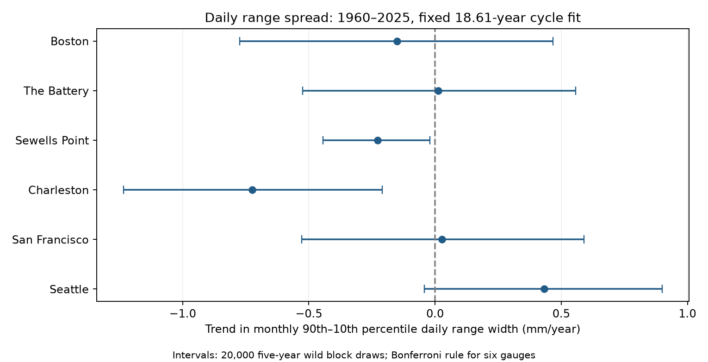
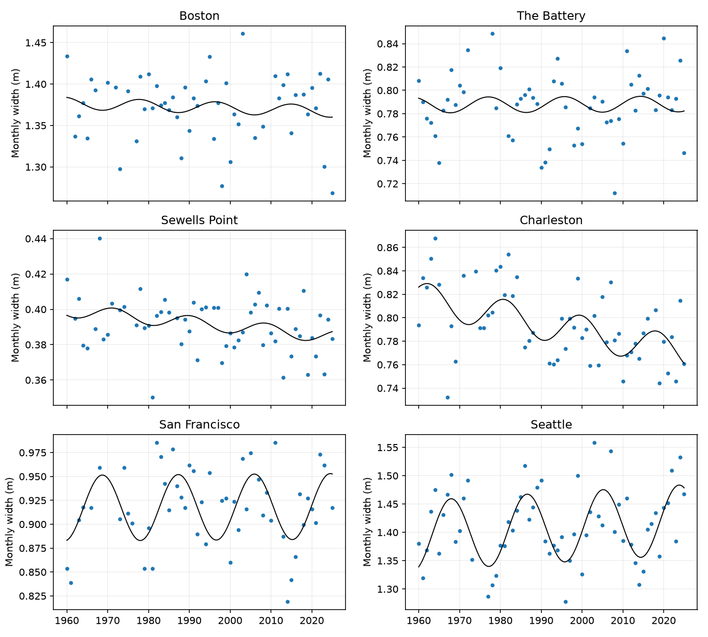

# The spread of daily water-level ranges fell at Charleston and Sewells Point in 1960-2025 cycle fits

## Question and main result

Did the spread of daily water-level ranges change at six US gauges? We define daily range as the highest hourly water level minus the lowest hourly water level on the same local day. We define monthly spread as its 90th percentile minus its 10th percentile. A year is the equal mean of 12 accepted monthly spreads.

The fitted spread fell at Charleston and Sewells Point under a linear trend and a fixed 18.61-year cycle. The primary intervals for these two sites exclude zero after a six-site comparison rule. The other four primary intervals include zero. The Charleston result holds in all tested checks. The Sewells Point result is uncertain for a fit that starts in 1980. This is evidence about a fitted distribution width. It does not show a physical cause or lower flood risk.

| Gauge | Years | Mean width (m) | Trend (mm/year) | Six-site interval (mm/year) |
|---|---:|---:|---:|---:|
| Boston | 53 | 1.372 | -0.150 | -0.774 to +0.468 |
| The Battery | 56 | 0.787 | +0.014 | -0.524 to +0.557 |
| Sewells Point | 59 | 0.391 | -0.228 | -0.444 to -0.021 |
| Charleston | 57 | 0.794 | -0.724 | -1.234 to -0.210 |
| San Francisco | 52 | 0.918 | +0.027 | -0.528 to +0.589 |
| Seattle | 62 | 1.412 | +0.432 | -0.042 to +0.900 |




The fitted changes over 65 years are -47.0 mm at Charleston and -14.8 mm at Sewells Point. These are trend times elapsed time, not observed endpoint differences. The mean spreads at these sites are 794 and 391 mm. Thus the fitted changes are about -5.9% and -3.8% of their respective mean spreads.

## Prior work and test scope

Mawdsley, Haigh, and Wells studied 15 tidal levels at 220 gauges and found differences among trends in tidal levels ([2015 paper](https://doi.org/10.1002/2014EF000282)). Peng and colleagues showed that the 18.61-year cycle changes high-water levels ([2019 paper](https://doi.org/10.1029/2018JC014695)). These results motivate a test of distribution width with a cycle term. We do not claim the first evidence of changing tides.

A campaign publication, `sci:sha256:a9e8d06cbaa080ffa921d8d1e3748bae1b1b16c196c6a4195424b0b6178e2da2`, found mean daily range trends at The Battery and Sewells Point in the same raw data. We read its verified README. We reuse its six-site scope and quality rules, but calculate all evidence anew from the shared raw files. Our target is the spread within months, not the mean range. The earlier work is not an independent validation set.

Before this precise question was selected, we ran `sci search "earthquake ocean drought ENSO" --in ./campaign --json` and `sci search "sea level" --in ./campaign --json`. Full-folder verification was slow. We also inspected the verified publication cache for tide, sea-level, and range work and read the relevant signed bundle with `sci read`. The first broad query was stopped because it duplicated the narrower scan. A final repeat of the sea-level query completed with status ok and a limit of 100 records. Its compact result is in `files/campaign_search.json`. This page limit and substring matching mean the search is not a complete literature review. The question was changed from mean range to width after the earlier mean-range study was found, and before the width results were computed. This is an exploratory study, with no external registration.

## Data and provenance

The source is NOAA CO-OPS `daily_max_min` in metric units, MSL datum and local standard time. We use only `dailyMaxHourly` and `dailyMinHourly`. NOAA documents the hourly and six-minute fields separately in its [API guide](https://api.tidesandcurrents.noaa.gov/api/prod/). Its [service notice](https://repository.library.noaa.gov/view/noaa/70864/noaa_70864_DS1.pdf) describes the hourly default. We use the same hourly fields throughout the record.

We read 42 shared raw JSON objects in place. The exact dataset paths, source queries, byte counts, download times, and SHA-256 hashes are in `files/provenance.json`. Each path starts with `/mnt/dell-data/shared_datasets/noaa-coops-` and ends with `-msl-lst-20261108/data.json`. Stations are 8443970, 8518750, 8638610, 8665530, 9414290, and 9447130. Each has seven periods: 1960-1969 through 2010-2019, then 2020-2025. This is the saved 2026-11-08 API snapshot; the API supplies no immutable release identifier. All 42 raw hashes matched their saved provenance. We did not change the shared data or download new raw data.

A day must have both extrema, 100% hourly completeness in both source rows, and inferred flags equal to zero. We reject missing values. We check unique dates, finite levels, and nonnegative ranges. `files/daily.csv` gives the accepted daily pairs, including dates, levels, ranges, and station IDs. A month must retain at least 80% of its calendar days. All 12 months must pass for a year to enter the model. There are 339 annual values across the six sites. Missing days, months and years are not filled. Equal monthly weights avoid a direct excess weight for long months, but do not remove bias from missing records.

We calculate monthly quantiles by linear interpolation between sorted daily values at index (n-1)p, for p = 0.1 and 0.9. Width is q90 - q10. `files/monthly.csv` includes daily counts, month lengths, both quantiles and their width. `files/annual_spread.csv` gives all retained annual inputs. About 24-31 values enter each accepted monthly quantile. Quantile sampling error can be large. Results apply to this hourly and calendar-day measure, not the NOAA tidal mean range or a harmonic tidal constituent.

## Model and uncertainty

At each gauge we fit annual width to an intercept, year minus 1992.5, and sine and cosine at 18.61 years. Cycle amplitude and phase are free. The trend coefficient times 1,000 is in mm/year. The record covers about 3.5 cycle periods. One fixed cycle cannot capture all slow change.

We calculate 20,000 wild residual draws with seed 2494. Each draw uses a random origin for five-year calendar blocks. All residuals in a block receive the same random +1 or -1 weight. Missing years do not shorten block time. Residuals are divided by the square root of one minus leverage. The fixed design pseudoinverse maps these weighted residuals to slope errors. We add the error quantiles to the estimated slope. `files/spread_draws.npz` preserves the errors. This method holds the year design and monthly quantiles fixed. It represents local annual residual dependence, not source or model uncertainty.

For the six primary width tests, the interval uses the 0.05/12 and 1-0.05/12 error quantiles. This is the Bonferroni rule with a nominal family error rate of 5% if the underlying intervals have their stated coverage. Finite samples and residual assumptions can affect coverage. The file also gives marginal 95% intervals. We do not use daily values as independent observations for trend uncertainty. Secondary q10 and q90 fits are descriptive; their stored six-site intervals do not adjust for the full set of secondary tests.

## Checks and null results

At Charleston, the six-site interval remains negative with three-year or ten-year blocks, a 95% monthly coverage rule, a 1980 start, no cycle, and an added 4.425-year cycle. The added cycle gives -0.725 mm/year with interval -1.247 to -0.201. The 1980 start gives -0.879 with interval -1.625 to -0.119.

At Sewells Point, all checks except the later start retain a negative interval. The 1980 start gives -0.166 mm/year with interval -0.512 to +0.178. The added cycle gives -0.219 with interval -0.435 to -0.001. That last interval is close to zero, so its sign is sensitive to model and uncertainty choices. A negative primary result is not evidence that the trend is constant through time.

Seattle has a positive marginal interval but its primary six-site interval includes zero. Its ten-year-block six-site interval is positive, while the three-year-block interval includes zero. We report the primary result as uncertain. Boston, The Battery and San Francisco also have uncertain primary width trends. Uncertain results do not prove a constant width.

At Charleston, fitted q10 rises by 0.263 mm/year while q90 falls by 0.461 mm/year. Their separate six-site intervals both include zero. Their difference is better resolved because the fitted quantiles share variation. At The Battery both point slopes are near +0.62 mm/year while their width difference is close to zero. All variants and endpoint fits are in `files/spread_results.csv`.



## Explanation and limits

A uniform additive shift of the daily-range distribution leaves its width unchanged. The two negative primary width trends therefore do not fit that simple model under our trend and error assumptions. This algebra does not identify a process. Changes in tidal components, phase, channel geometry, river flow, within-day wind or pressure, observation timing, or instrument response can change the distribution. We did not measure these candidate causes. We did not audit station moves or instrument histories.

The daily high and low can come from different tidal cycles. Weather and the local day boundary affect both. The measure is not surge and does not distinguish spring and neap tide events. The sites were selected for data availability. They cannot represent all US coasts. Historical processing changes, inferred-value exclusions and missing data can affect the estimates. The 95% coverage check removes many additional years and does not prove absence of selection bias. Linear trends and fixed cycle amplitudes are assumptions. Wild block intervals can miss longer dependence and structural changes. No flood return level, damage, drought effect, recovery time or forecast skill was tested.

The new evidence is a narrow, reproducible description of the spread of observed daily ranges. It supplies a target for future work with harmonic tide analysis, station records, river flow, wind and pressure.

## Reproduce and inspect

Use Python 3.12 with NumPy, pandas and Matplotlib. Exact versions from this host are in `files/environment.json` and `files/requirements.txt`. In an extracted working copy of the bundle, run:

```sh
OPENBLAS_NUM_THREADS=1 python files/spread.py --input files/monthly.csv --out files
OPENBLAS_NUM_THREADS=1 python files/audit.py
```

The first command repeats all trend fits, draws and figures without network or raw data. The second uses a separate CSV parser, scalar quantile interpolation and normal equations. It checks each monthly width against the saved daily pairs, each accepted annual width, and all six primary slopes. It does not establish interval coverage or instrument accuracy. `files/audit.json` records the outcome.

To rebuild evidence from shared raw data in place, use a separate output folder:

```sh
OPENBLAS_NUM_THREADS=1 python files/prepare.py --datasets /mnt/dell-data/shared_datasets --out rebuilt
OPENBLAS_NUM_THREADS=1 python files/spread.py --input rebuilt/monthly.csv --out rebuilt
```

For retrieval on another host, `python files/retrieve.py NEW_LOCAL_DIR` uses the exact saved URLs and checks every raw hash before writing a complete file. It refuses an existing directory. Live responses can change; a changed hash stops retrieval. The saved daily and monthly evidence supports the fixed-snapshot calculation when live bytes differ. No shared raw file needs to be copied into this bundle.

A second run in a separate local folder checks exact result CSVs and numerical draw arrays. A separate rebuild checks the daily and monthly evidence. See `files/repeat_check.json`. Work on a copy; do not alter a signed bundle.

## Job and identity

Job: sci-1107-dell-earth-and-ocean-sciences-2494f4f2d6c7. Topic: earth-and-ocean-sciences. Campaign: 11_07_2026. Machine: dell. Account: codex-andrii. Model: gpt-6.1-sol with high reasoning effort. No agents were launched. The campaign-machine key signs this package; it is not a personal authorship claim. Private keys are outside the package. The bundle is saved locally and is not sent to a remote archive or index.
