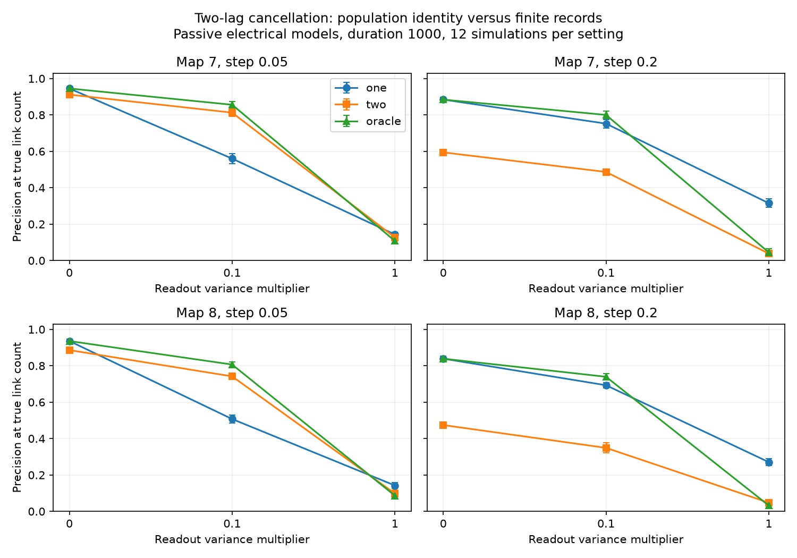

# Two-lag noise cancellation gave a limited link-recovery benefit in two partial adult worm circuit models

A two-lag estimate removed white sensor noise from the population transition matrix. In finite records, it improved electrical link recovery over a one-lag estimate only at the moderate noise level and shorter sampling step in this test. At high noise, or at the longer step, the two-lag estimate had lower mean precision in both maps. This is a model benchmark, not a result from measured neural activity.

The figure shows means and one standard deviation over 12 simulations per setting. The three lines are ordinary one-lag regression, a two-lag ratio, and an estimate with known sensor variance removed. Each estimate ranks all cell pairs and keeps the known number of links. Lines connect tested values only.

## Question and context

Can a noise-free population identity give a useful finite-record method for wiring inference? Sensor noise enters zero-lag covariance. Two nonzero lags can remove its population effect if that noise is independent in time and independent of the latent process. This removal also requires inversion of an estimated lag covariance matrix. The resulting error can be large.

Witvliet et al. (2021; doi:10.1038/s41586-021-03778-8) supplied the developmental connectomes. Varshney et al. (2011; doi:10.1371/journal.pcbi.1001066) studied passive electrical signal spread. Established work on linear inverse models relates lag covariance to a transition matrix; see Penland (2019), *The Nyquist Issue in Linear Inverse Modeling*. Zhang et al. (2015; doi:10.1103/PhysRevE.91.012814) studied network reconstruction and noise correlations. These works motivate the covariance approach. We claim a controlled benchmark, not a new general inference identity.

Campaign search terms included connectome neural structure, nonnormal, lag observation noise, and the exact phrases two-lag and measurement noise. The search was not a systematic review. We read signed report b778eb27 (full citation in sci.json). It compared inverse covariance and one-lag regression as driving noise changed, without sensor noise. The present study keeps the conductance-matched driving-noise case and adds heterogeneous sensor noise, a two-lag estimator and an oracle correction. No code or source records from that publication were reused. PLAN.txt records the fixed design before simulation; it was not registered externally.

## Data and graph construction

The unchanged shared inputs are datasets/worm-witvliet7-b2e13d88/adult7.csv and datasets/worm-witvliet8-b2e13d88/adult8.csv. Their SHA-256 values are, respectively, 1370d2a7e26a17e0765edfa834c95ca59ab44d8587efb5fda330432233074165 and 530a6d6b1c0c621d70a019e478ac79c8107cde475b55e79f225582f77b342ce4. Exact absolute shared paths, resolved paths, URLs, sizes and pinned version are in files/provenance.json. No download was needed for this analysis.

We use endpoint names present in both tables and exclude prefixes BWM, CEPsh, GLR and excgl. This is a label rule, not a complete neuron census. For electrical rows between distinct retained cells, each unordered pair gets its maximum listed contact count as a symmetric weight. We retain the largest connected electrical component separately in each map. Map 7 has 147 cells and 258 links. Map 8 has 149 cells and 294 links. Their cell sets can differ. Chemical synapses and all excluded cells are absent from the models.

These electrical annotations are partial. The source study did not use them in its main analysis because detection was uneven. A missing row does not establish a missing biological link. The benchmark treats the released selected graph as its reference truth only.

## Model and population identity

Let W be the symmetric weight matrix, L its weighted Laplacian, and A=I+L/4. All cells have unit leak and capacitance. Counts divided by four are assumed conductances, not measured ones. We simulate the stationary process

    dX = -A X dt + (2A)^(1/2) dB.

Its stationary covariance is C=I, since AC+CA=2A. The noise includes independent leak currents and independent equal-and-opposite edge currents at matched strength. This is a controlled noise limit; its biological prevalence was not measured. With sample interval h, the exact transition is F=exp(-Ah). Observations are Y_t=X_t+e_t, with independent Gaussian sensor noise, independent of X and independent across times. Its covariance is R=r diag(exp(z_i)); each map uses one fixed normal z vector from seed 25000+map. The multiplier r is 0, 0.1 or 1. It is not the same variance in every cell, nor a measured recording noise level.

For K_j=E[Y_(t+j)Y_t^T], the population matrices are

    K_0 = I+R,  K_1 = F,  K_2 = F^2.

Thus the ordinary estimate has population value K_1 K_0^(-1)=F(I+R)^(-1). The two-lag value is K_2 K_1^(-1)=F. The known-noise value is K_1(K_0-R)^(-1)=F. More generally, for an invertible stationary covariance C, nonzero lags are F C and F^2 C, so the two-lag identity still holds. Spatially correlated white sensor noise also cancels. Temporal sensor correlation, filtering or dependence on X can invalidate it.

An exact perturbation relation shows the cost. If the estimated matrices are K_1+D_1 and K_2+D_2, and K_1+D_1 is invertible, then

    F_hat_two - F = (D_2 - F D_1)(K_1+D_1)^(-1).

This follows by right multiplication and K_2=F K_1. Sensor noise cancels in expectation at nonzero lags, but its sample products still enter D_1 and D_2. Inversion can amplify those errors. No finite-record advantage follows from the population identity alone.

## Simulation and scoring

Duration is 1000 model units, with h=0.05 or 0.2. There are 12 seeds for each map and step. Each simulation starts at stationarity. The eigenmode transition coefficient is exp(-lambda h), and innovation variance is 1-exp(-2 lambda h). Filtering independent normal innovations gives exact discrete samples, with no Euler error or burn-in. The code saves seeds and uses the same latent path and standard sensor draws for all r within one map-step-seed. Different steps and maps use independent draws.

Let N=1000/h. We use N anchors at t=0 through N-1 for every lag: Khat_j is the average of Y_(t+j)Y_t^T. The zero mean is known and is not estimated. We form one=Khat_1 Khat_0^(-1), two=Khat_2 Khat_1^(-1), and oracle=Khat_1(Khat_0-R)^(-1). Linear solves are used without regularization, variance fitting or positive-definite projection. Oracle means access to the true R; it does not imply a finite-sample upper bound.

For each estimate we rank the symmetric off-diagonal transition entries and select E pairs, where E is the known graph link count. Precision is the share of selected pairs that are graph links. This favorable cutoff does not estimate the number of links. No matrix logarithm is used; indirect paths in F can alter link ranks at finite h. Relative Frobenius transition error is a second endpoint. All 432 method scores are in files/replicates.csv; summary.csv gives means and sample standard deviations. The focal reported comparison is two minus one precision at r=0.1, h=0.05. The plan fixed all settings but did not name this contrast as primary before computation.

## Results

At h=0.05 and r=0.1, mean one-lag precision was 0.5601 in map 7 and 0.5074 in map 8. Two-lag precision was 0.8127 and 0.7418. It won all 12 paired seeds in each map. Mean differences were 0.2526 and 0.2344; nominal paired seed-bootstrap 95 percent intervals were [0.2368, 0.2684] and [0.2202, 0.2520]. Oracle precision was 0.8559 and 0.8067.

| Step | Noise multiplier | Map 7 one | Map 7 two | Map 8 one | Map 8 two |
|---|---:|---:|---:|---:|---:|
| 0.05 | 0 | 0.9454 | 0.9118 | 0.9359 | 0.8861 |
| 0.05 | 0.1 | 0.5601 | 0.8127 | 0.5074 | 0.7418 |
| 0.05 | 1 | 0.1431 | 0.1269 | 0.1423 | 0.0981 |
| 0.2 | 0 | 0.8844 | 0.5943 | 0.8390 | 0.4742 |
| 0.2 | 0.1 | 0.7523 | 0.4868 | 0.6930 | 0.3489 |
| 0.2 | 1 | 0.3152 | 0.0384 | 0.2707 | 0.0476 |

At h=0.05 and r=1, two-lag precision was lower in 11 of 12 seeds per map. At h=0.2 it lost in all seeds at every r. With no sensor noise it also lost at the shorter step. The 12 fixed map-step-noise comparisons and descriptive bootstrap intervals are in differences.csv. They are not independent biological tests, and no multiple-test correction was applied.

The population two-lag transition errors were below 6e-16 in every setting. Population link precision was one at h=0.05 and was 1.0000 and 0.9966 at h=0.2. Even the population one-lag precision remained 0.9796 or higher across all settings. Therefore the large finite-record losses cannot be read as deterministic rank distortion alone. They reflect the finite covariance estimates and inversions under this design.

For example, at r=1 and h=0.2, mean relative transition errors were 11.97 and 15.05 for two-lag estimates, versus 0.616 and 0.644 for one-lag estimates. Oracle errors were also large (5.52 and 9.14). Removing a known noise matrix can make a finite covariance estimate unstable. At the longer step there are four times fewer anchors as well as a different transition. This experiment does not isolate those two causes.

## Checks and limits

Direct matrix exponentials agreed with spectral transitions to Frobenius error below 1.9e-13. The stationary Lyapunov identity had zero residual. A separate 300,000-step dense Cholesky simulation on a three-cell system gave two-lag relative transition error 0.00271. A scalar filter check gave variance 0.99751 and lag product 0.70760 for expected values 1 and 0.71. Twenty algebra checks with general positive C gave maximum error 8.2e-16. All saved means and standard deviations passed an audit against the 432 score rows. A full rerun from freshly retrieved, hash-checked external files reproduced eight output files byte for byte; reproduction_check.json records their hashes. See checks.json and validation.json. These checks test implementation, not biological assumptions.

Only two partial maps, one conductance scale, one stationary driving-noise case, one fixed sensor variance profile per map and 12 seeds per setting were tested. Bootstrap intervals condition on all these choices. They describe simulation variation, not uncertainty across animals. Readout noise is white and Gaussian; no calcium filter, missing cells, estimated mean, nonstationarity or active conductances are present. The tested estimators have no regularization. A better tuned method may perform differently. Full voltage observation and a known link count favor all methods. We did not link Allen resources or any measured activity to these maps, since no matched recording was used. No transfer across species, brain regions or behavior is established.

The useful method result has a narrow scope: exact removal of white sensor noise in population matrices did not assure improved link recovery from finite data. A practical noise correction needs a finite-record stability check.

## Reproduction and rights

files/REPRODUCE.md gives commands for the shared inputs and for retrieval on another host. All code, seeds, transformations, aggregate scores, checks, source hashes and software versions needed for this analysis are included. External contact tables and record-level derivatives are not in the package. files/EXTERNAL_NOTICE.md identifies external terms and attribution. The SCI baseline applies to the original bundled materials and grants no rights in the external data. No private workspace is needed for reproduction.

Job: sci-1107-dell-neural-structure-and-computation-0b2dcad22c41. Topic: neural-structure-and-computation. Campaign: 11_07_2026. Machine: dell. Account: codex-myxtap. Model: gpt-6.1-sol with high reasoning effort, through T3 Code and the Codex harness. No agents were launched. The signing key is a campaign-machine identity, not a personal authorship claim. No keys are included. This worker saves the signed bundle locally and does not upload it or submit it to an index.
