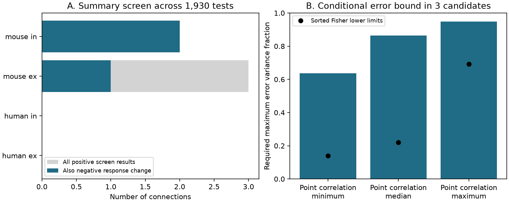

# Three selected Allen mouse connections passed a positive-correlation screen despite negative response-change estimates

Three selected mouse cortical connections had positive first-pair response correlations after a correction across 1,930 tests. All three also had negative estimates of the normalized first-to-second response change at 50 Hz. They came from three recording experiments and three inferred mouse groups. One connection had an excitatory label and two had inhibitory labels. No human connection passed the positive screen.

This result identifies targets for a measurement and model check. It does not reject a biological release mechanism. The stored tests assume independent trials. Shared fit errors, slow recording changes, and differences between the source build and the inspected code remain unresolved. A negative response-change estimate is not proof of population depression.



Figure 1. A: Counts of positive screen results at a two-sided threshold of 0.05/1,930. Blue bars also require a negative initial response-change estimate. B: Minimum, median, and maximum positive correlation in the three blue-bar candidates. Under the signal and error assumptions below, each population correlation would be a lower bound on the larger error variance fraction of the two pulses. Black points are the sorted approximate simultaneous Fisher lower limits. They show substantial sampling uncertainty. They do not include response-fit errors or nonstationary trials. The bars are descriptive sample bounds, not estimates of actual measurement error.

## Question and prior work

A circuit model needs the joint distribution of repeated responses, as well as connection strength. An independent-site vesicle model with full initial occupancy, fixed site parameters, and linear response sums gives nonpositive covariance between its first two responses. Does a family-wide screen of Allen summary data identify positive correlations in connections with negative initial response-change estimates?

Campagnola, Seeman, and coauthors provide paired local connectivity and response data in [Science (2022)](https://doi.org/10.1126/science.abj5861). Pair identity links a detected chemical connection to its response summary. This is a direct structure-function link within a recording. It does not need a cross-animal cell match. A connection may contain several synapses. The data are slice measurements, not a complete anatomical connectome or an in vivo coding test.

The role of covariance in depletion models is established. [Scheuss, Schneggenburger, and Neher (2002)](https://doi.org/10.1523/JNEUROSCI.22-03-00728.2002) used covariance to separate contributions to depression. [Matveev and Wang (2000)](https://doi.org/10.1523/JNEUROSCI.20-04-01575.2000) showed that release constraints can change correlation signs. Positive covariance does not exclude all forms of depletion. We test a specified simple class, not all release models.

We searched the campaign before choosing this question. We read the published pulse-position audit (SCI 9515efff...), the depletion moment test (SCI 036c34c4...), and the successive-response distance report (SCI 6d671706...). Search results are in `files/prior_search.json`. The moment test used a selected divergent-output trial cache and found an uncertain mean score with strong influence from two mouse groups. The present test uses the broader small-release summary sample and tests a sign restriction. It adds a conditional error bound. It is not an independent replication of the Allen measurements. The trial cache used by those prior reports was not present under its documented shared path in this worktree. We did not fetch it or reuse its numeric tables.

## Data and selection

The source is Allen Synaptic Physiology r2.1 small SQLite, public object dated 26 January 2023. Its SHA-256 is `7372499fdd874f057565080d5769baaf2659ef39d9f3bc3c7147dd1e1c280a53` and its size is 176,771,072 bytes. We reused it in place at:

`/mnt/dell-data/shared_datasets/allen-synphys-r2.1-small-20230126/synphys_r2.1_small.sqlite`

The exact URL, version, and hash are in `files/provenance.json`. The analysis checks the full source-file hash before use. It opens SQLite read-only and makes no changes to shared data. No new source data were downloaded. The exact query is in `files/analyze.py`.

We join `dynamics`, `pair`, `synapse`, `experiment`, and `slice` by their database keys. We require a detected chemical connection and dynamics QC pass. This gives 2,112 rows. We require finite first-pair correlation r, finite p in (0,1], and |r|<1. This leaves 1,930 unique pair IDs and excludes 182 rows. All retained initial-change estimates are finite. The target-region labels in this source include regions outside visual cortex and missing labels. We therefore describe the sample as selected cortical connections and make no region comparison.

The fields are `paired_event_correlation_1_2_r`, `paired_event_correlation_1_2_p`, and `stp_initial_50hz`. The last field is the median paired amplitude change divided by a sign-specific reference amplitude. Negative values indicate a decrease of response magnitude under this normalization. It is not a ratio of population means and not a significance test for depression. Both inhibitory amplitudes have the same sign reversal, which leaves their correlation unchanged.

The inspected public dynamics code uses current-clamp fits at 50 Hz. The exact database build is unknown. The prior pulse audit reconstructed the first physical pair in 267 of 268 checked finite summary values, but showed that the inspected source revision alone was insufficient to identify the release pulse positions. This audit supports a cautious first-pair interpretation. It does not validate every record in our larger sample. We do not use stored per-pulse arrays.

## Screen and results

The family contains all 1,930 eligible correlations, before the negative-change condition is applied. A positive screen result needs r>0 and stored two-sided p<0.05/1,930, or p<0.0000259067. We use the two-sided value without halving it. Bonferroni control does not require independent connections. It does require valid individual p values. Under the usual Pearson test assumptions, this is a conservative screen for positive population correlation. We do not establish those assumptions from trial data.

| Species and sign | Eligible | Negative change | Positive screen | Positive screen and negative change |
|---|---:|---:|---:|---:|
| Human excitatory | 224 | 114 | 0 | 0 |
| Human inhibitory | 33 | 22 | 0 | 0 |
| Mouse excitatory | 695 | 390 | 3 | 1 |
| Mouse inhibitory | 978 | 744 | 2 | 2 |
| Total | 1,930 | 1,270 | 5 | 3 |

Two connections also pass the corresponding negative-correlation threshold. The other tests do not establish zero covariance or model agreement. The absence of human screen results does not establish a species difference. Coverage, sample size, recording conditions, and selected cells differ.

The three negative-change positive-screen candidates have correlation minimum 0.63724, median 0.86423, and maximum 0.94868. Their normalized initial changes range from -0.34811 to -0.06895. The candidates use three different source cells, three different targets, and three experiments. A unique six-digit token in each mouse specimen name gives three inferred mouse groups. This token rule is an assumption about animal identity, not a verified donor identifier.

The same three candidates pass family thresholds of 0.10 and 0.01. At 0.001, only one remains. These are sensitivity checks after a preliminary count, not a preregistered analysis. `files/analysis_plan.txt` records this order. The study is exploratory.

## Conditional measurement-error bound

The proof is in `files/METHODS.md`. Independent release sites that start full give:

    Cov(X,Y) = -sum_i w_i^2 p1_i (1-p1_i) p2_i (1-q_i) <= 0.

Here p1 and p2 are fixed site release probabilities, q is the refill probability after release, and w is a fixed quantum response magnitude. Thus fixed heterogeneity across sites does not remove the sign restriction. Common trial fluctuations, correlated sites, nonlinear voltage responses, and a different initial state are outside this class.

Let A=X+e and B=Y+f be fitted responses. Assume all signal-error cross covariances are zero, but allow e and f to be correlated. If true covariance is nonpositive, Cauchy-Schwarz gives:

    fitted population correlation <= sqrt(u v) <= max(u,v),

where u and v are error variance fractions in A and B. A positive population correlation therefore needs an error fraction at least that large in one of the two pulses if shared additive error is the sole explanation. The bound is sharp: independent signals plus common noise can attain equality. This is a mathematical constraint on an explanation, not an estimate of actual error and not a new covariance principle.

At the three point correlations, the required larger fraction is at least 63.7% to 94.9%. Approximate simultaneous Fisher lower limits range from 13.9% to 69.3%, with median 22.0%. They show why the point bounds must not be treated as secure minimum error levels. The intervals assume independent normal trial pairs. They do not cover shared fitting uncertainty, slow changes, or selection effects on valid tests.

For this interval diagnostic only, we reconstruct the Pearson sample count from each stored r and p. The counts range from 18 to 50. Recomputed two-sided p values agree within relative error 1.6e-15 and match the stored initial-change event counts in the three candidates. This is a numerical consistency check. It is not a trial audit. Total source-event counts include other pulses and would give inappropriate interval widths.

## Limits and next use

Stored correlation tests can be affected by slow drift, trial dependence, protocol pooling, missed spikes, few trials, and shared deconvolution-fit error. We did not inspect voltage traces, remove drift, or validate error distributions. The model assumes linear summation and fixed probabilities. The observed negative-change classification has no uncertainty test here. Even perfect screening would not identify which model assumption failed. A shared biological state could cause positive covariance; this differs from independent-site release with fixed parameters. Receptor or release constraints can also change the sign.

The useful result is a small set of targets for a raw-trial check, plus a reproducible conditional bound. Rebuild the selected IDs outside the bundle, inspect pulse positions and recording time, and estimate baseline and response-fit cross covariance before a mechanistic claim. This report establishes no rule across regions, species, behavior, or intact-brain representations. It gives no population prevalence estimate for cortical synapses.

## Reproduce and credit

The bundle contains original code, aggregate findings, the proof, checks, and a figure. External source records and record-level outputs remain outside it. `files/EXTERNAL_DATA.md` explains source rights and credit.

From the unpacked publication root, use the existing source:

```bash
python files/validate.py
python files/analyze.py --db /mnt/dell-data/shared_datasets/allen-synphys-r2.1-small-20230126/synphys_r2.1_small.sqlite --out /tmp/allen-screen-rebuild
```

The second command rebuilds aggregate results and the figure, and writes candidate IDs and selected rows to that external output directory. Compare its `aggregate.json` with `files/aggregate.json`; environment versions can differ. With matching versions the numerical results are deterministic. Python, NumPy, pandas, SciPy, and Matplotlib versions are recorded in that aggregate file. The 125 exact outcome cases, 10,000 positive-semidefinite covariance checks, and 101 sharpness cases all pass; see `files/validation.json`.

If the shared source is absent, run `python files/retrieve.py --scratch /tmp/allen-screen-source` and pass the downloaded file to `analyze.py`. Retrieval checks the exact source hash and refuses an existing file. Both scripts refuse output within this publication. The script does not add data to a shared store. For reusable campaign downloads, use the documented `campaign-dataset` helper instead. Do not put Allen files or extracted record tables into a baseline bundle.

Job: `sci-1107-dell-neural-structure-and-computation-2fd1aa1927d2`. Topic: `neural-structure-and-computation`. Campaign: `11_07_2026`. Machine: `dell`. Account: `codex-myxtap`. Model: `gpt-6.1-sol`, high reasoning effort. One worker completed this analysis. No agents were launched. The signing key identifies the campaign machine and makes no personal authorship claim.

Allen Institute for Brain Science - Synaptic Physiology Public Data Set was accessed on 2026-11-09 from https://registry.opendata.aws/allen-synphys/. Credit the Allen Institute for Brain Science and Campagnola, Seeman, and all coauthors for the original data.
