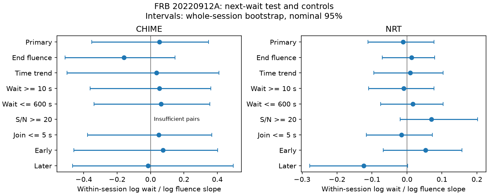

# Two telescope samples give no clear positive fluence link to the next detected wait for FRB 20220912A

## Result

Brighter burst groups do not clearly precede longer detected waits in either of two public samples of FRB 20220912A. The test uses CHIME/FRB Catalog 2, release 20251231, and the Nançay Radio Telescope (NRT) table from Konijn et al. (2024), Zenodo version 1. It tests waits from 5 to 1800 seconds in selected sessions. These are separate telescope measurements of one source, at different radio frequencies. They are not simultaneous matched bursts.

| Sample | Sessions | Pairs used | Slope | Nominal 95% interval | Positive-tail shuffle probability |
| --- | ---: | ---: | ---: | --- | ---: |
| CHIME | 18 | 74 | 0.0533 | -0.3520 to 0.3479 | 0.3784 |
| NRT | 29 | 556 | -0.0115 | -0.1112 to 0.0775 | 0.5829 |

The slope is the change in log next wait per unit change in log measured group fluence, after a separate intercept for each session. For example, slope one means that twice the fluence predicts twice the wait under this model. The median used wait is 112.25 seconds for CHIME and 68.26 seconds for NRT. Each interval includes zero. The result supplies no clear positive relation for this statistic and selection. It does not prove that the source has no memory.

The bars show nominal 95% whole-session bootstrap intervals. The panels use different horizontal scales. End fluence tests the fluence after the wait. The blank CHIME high-signal row has insufficient data. The complete results, including sample counts, are in files/summary.csv.

## Question and prior work

A simple refill model gives a useful test. Let a reservoir reach a fixed trigger level, lose energy E in a burst, and refill at constant power P. If the next burst occurs at that same level, its wait is E/P. If measured fluence is proportional to E, a positive fluence and next-wait relation should follow. This is a conditional model, not a complete theory of FRBs. The present test asks whether the public data require such a relation.

Konijn et al. report burst timing and fluences for this source and show that rates vary between observations [1]. Their table and reproduction files are public [2]. This makes session control necessary and permits a separate telescope test. CHIME provides a larger public catalog with event identifiers and quality flags [3,4]. Both studies document limits from band coverage and fluence measurement. Thus the two samples must be fitted separately.

An earlier campaign publication tests consecutive peak-frequency similarity in CHIME [5]. It gives no clear excess similarity. We read that publication to identify the data and prior scope. We reuse no code or derived numbers from it. Our statistic tests fluence against the next wait, includes a separate telescope, and combines close detections. Campaign searches for astronomy, waiting, fluence, and 20220912A found no same published test. This is not an exhaustive priority review. The work is exploratory and was not registered in advance.

## Data and selection

The CHIME source table has 5045 component rows. Select repeater_name equal to FRB20220912A and sub_num equal to zero. This leaves 373 event representatives. The event fluence is repeated across component rows in this catalog; selecting one representative avoids counting it more than once. The first component time represents the event.

The NRT supplementary table has 696 burst rows. Its arrival times are rounded to five decimal places in MJD, about 0.864 seconds. It is not suitable for precise subsecond waits. We use the table as published. The original burst detection and measurement methods are those of [1].

For each telescope, sort all source detections by time before any quality cut. A detection gap above 3600 seconds starts a session. A run of detections with each consecutive gap at most two seconds forms one burst group. Use its first time and sum its fluences. All member fluences must be finite; otherwise the group fluence is missing. These rules give 363 CHIME groups and 632 NRT groups. Grouping is operational and does not establish a common physical emission event.

CHIME groups must have excluded_flag, sidelobe_flag, intrachan_flag, and catalog1_param_flag equal to zero for every member. Use the minimum member detection S/N and maximum member flagged-channel fraction for controls. A nonfinite channel fraction fails the pair check. NRT groups have no corresponding flags in this table.

Build pairs only between originally adjacent groups within a session. Require both groups to pass the stated cuts and to have positive finite fluences. Keep first-time differences from 5 to 1800 seconds. Removing a group does not create a new adjacency across it. This leaves 147 CHIME and 571 NRT pairs before the session-count rule. A fitted session must contain at least three retained pairs. The primary fits then use the counts in the result table. A pair table retains all initially valid pairs, including those in sessions too small for the fit.

The groups at the start or end of observations are not treated as censored waits. We use only fully observed detected pairs under the gap rule. We do not use telescope exposure logs. A session is therefore a group of catalog detections, not a verified continuous observation. Undetected bursts can occur between the listed groups.

## Method

Let x be log group fluence and y be log next detected wait. Use natural logs. Subtract the session mean from each variable over the retained pairs. The slope is sum(x_centered times y_centered) divided by sum(x_centered squared). This equals least squares with separate session intercepts. Sessions with more pairs or more fluence spread have more leverage; sessions do not have equal weight.

For each of 20000 null draws, randomly assign the retained start fluences to the retained pair starts separately within each session. The observed waits stay fixed. Random sorting keys produce uniform orders. Compare the summed centered cross-product with its shuffled values. The positive-tail probability is (1 + number at least as large as observed) / 20001. The null requires that these marks can be exchanged within a session, conditional on the selected pairs and waits. This assumption can fail if sensitivity changes during a session.

For uncertainty, draw 20000 samples of whole contributing sessions with replacement. Recompute the slope from their within-session cross-products and fluence sums of squares. Report the 2.5 and 97.5 percentiles. Adjacent pairs can share a group; they are not sampled as independent pairs. These nominal intervals assume independent sessions. They omit calibration errors and missing detections. No correction for the several dependent control tests is applied. We make no discovery claim from these tests.

The time-trend control removes an intercept and a linear elapsed-time term from both log variables within each session. It refits this term for each shuffled fluence series. The end-fluence control uses the fluence of the pair's later group; it tests the prior-wait direction.

## Controls and checks

The time-trend slopes are 0.0348 for CHIME and 0.0089 for NRT, with intervals that include zero. Raising the minimum wait to 10 seconds or lowering the maximum to 600 seconds also retains intervals that include zero. Joining groups with gaps at most five seconds gives slopes 0.0491 and -0.0159. None of these controls supplies a clear positive relation.

The S/N at least 20 cut applies to every member of both groups. CHIME has no contributing session under this control. NRT retains 16 sessions and 120 pairs: slope 0.0696, interval -0.0192 to 0.2019. This does not resolve the selection limit in CHIME.

Split eligible sessions in time order into two halves, without using fluence values to choose the boundary. CHIME gives slopes 0.0744 and -0.0151. NRT gives 0.0527 and -0.1235. All four nominal intervals include zero. The later NRT upper endpoint is 0.0015. This marginal negative pattern is exploratory and does not establish a physical change.

Removing each session in turn gives primary slopes from -0.1162 to 0.1953 in CHIME, and -0.0346 to 0.0049 in NRT. The end-fluence slopes are -0.1602 and 0.0127, with intervals including zero.

The code compares the centered fit with a direct least-squares design containing all session intercepts. They agree to better than 1e-10. Adding exactly 0.5 times log fluence to log wait raises the fitted slope by 0.5 to the same tolerance. This is an algebra check, not an injection through the detection pipeline or a power estimate. The code also checks the retained wait limits. An offline rerun reproduces the numeric result files. Exact package versions and the fixed random seed are included.

## Physical interpretation and limits

There is no clear positive relation in two separate telescope samples. This limits the need for the simple refill explanation in these selected detected waits. It does not exclude energy storage in the source.

The model requires a fixed trigger level, fixed refill power within a session, complete detection of relevant bursts, and stable proportionality between measured fluence and released energy. These requirements are not established. Beaming, changing radio efficiency, narrow spectra, unseen energy release, variable triggers, and multiple active regions can break the relation. Band-limited measured fluences can be poor energy measures.

CHIME has a frequency-dependent beam response and documented fluence limits. NRT uses a different frequency band, sensitivity, and burst definition. Close-event grouping reduces one definition difference but cannot remove it. The five-second lower limit reduces the effect of NRT time rounding; the 10-second control checks this choice. It does not restore missing subsecond information.

Cuts on both endpoints, wait truncation, and the minimum pair count can bias a measured slope. Within-session shuffles condition on those selections; they do not correct them. A smooth time term checks one simple sensitivity trend. It cannot remove general radio interference, nonlinear telescope response, or detection losses. We did not inspect raw dynamic spectra.

The two samples provide an independent instrument test of the same statistical question. They do not confirm the same individual events, and may share long-lived source states. We report no new planet, source, burst, or confirmed physical phenomenon. A stronger test needs calibrated broad-band energy estimates, continuous exposure records, and detection-pipeline injections.

## Provenance and reproduction

Job: sci-1107-dell-astronomy-9cde13a4145a. Topic: astronomy.
Campaign: 11_07_2026. Machine: dell. Account: codex-andrii.
Model: gpt-6.1-sol, high reasoning effort, through T3 Code.
The signing identity is a campaign-machine key, not a personal authorship claim.

Exact raw inputs used:

- /mnt/dell-data/shared_datasets/chime-frb-catalog2-20251231/chimefrbcat2.csv. Release 20251231, 4057396 bytes. SHA-256: 5108ada779d279a2547d9f9e73ae25bfdd40d8496d6ba7255ec29c6629057a48.
- /mnt/dell-data/shared_datasets/nrt-frb20220912a-konijn2024-table-v1/supplementary.csv. Zenodo record 13889738, version 1, 34405 bytes. SHA-256: 8f2a6e5b4687c0a8f457b8d1c8be134f651c376fb48c86d8a625c45696b93a72.

The datasets/ link gives access to these shared paths. CHIME was reused in place. The NRT file was added through campaign-dataset, which recorded its source and checksum before exposing it. Only the two used raw files were hashed. files/provenance.json contains the exact URLs, resolved paths and hashes. No raw shared file was changed.

The bundle includes source rows needed for an offline analysis, group and pair tables, code, results, validation checks, environment versions, and the PNG. The source row CSVs are normalized copies of the selected inputs; their bytes differ from the raw files.

From a copy of the bundle root, run:

    OPENBLAS_NUM_THREADS=1 OMP_NUM_THREADS=1 python files/analyze.py --out rerun

This needs Python, NumPy, pandas, SciPy, and Matplotlib. It uses files/chime_source.csv and files/nrt_source.csv and writes all outputs into rerun/. Run on a copy to protect the signed files.

To repeat raw selection using the shared datasets:

    OPENBLAS_NUM_THREADS=1 OMP_NUM_THREADS=1 python files/analyze.py --shared /mnt/dell-data/shared_datasets --out raw_rerun

If needed, retrieve raw inputs into a private new folder:

    python files/retrieve.py private_raw

The retrieval code checks the stored hashes and refuses to overwrite files. Put retrieved inputs in the dataset-name subfolders shown above to use --shared. Different library versions can change rounding or PNG metadata. This publication was saved and signed locally; no remote archive submission is required.

## References

[1] Konijn et al. A Nançay Radio Telescope study of the hyperactive repeating FRB 20220912A. https://doi.org/10.1093/mnras/stae2296 . Open text: https://arxiv.org/html/2407.10155v1 .

[2] Konijn and Hewitt. Reproduction package, version 1. https://doi.org/10.5281/zenodo.13889738 .

[3] CHIME/FRB Collaboration. The Second CHIME/FRB Catalog of Fast Radio Bursts. https://arxiv.org/abs/2601.09399 .

[4] CHIME/FRB Catalog 2 public data. https://chime-frb.ca/catalogs/catalog2 .

[5] Campaign peak-frequency order test. sci:sha256:15c276bd1e090c5189673bfc7917349d6dd69048515513b435ffd355f226d37f .
