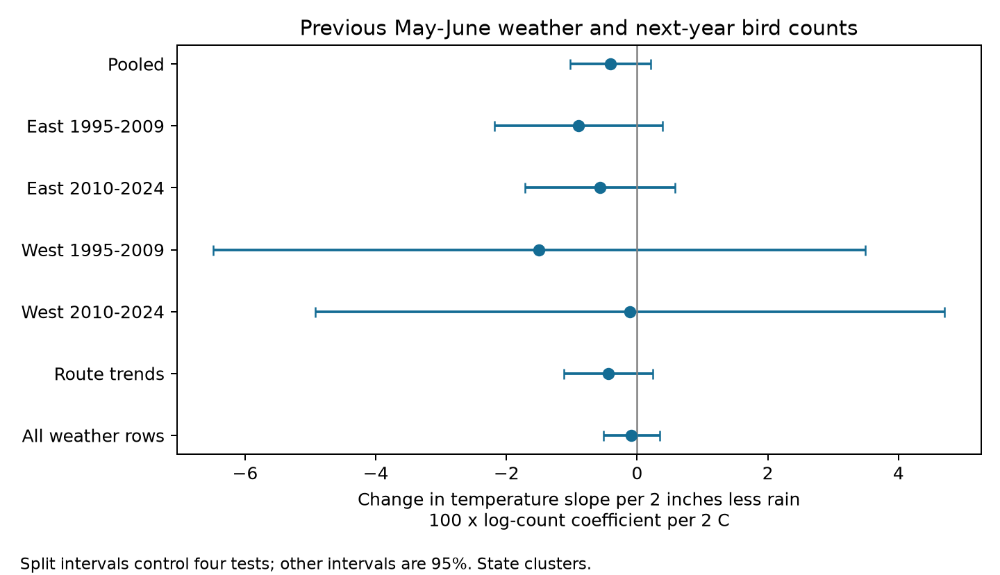

# Low rainfall gave no clear change in the next-year bird-count temperature slope in US surveys in 1995-2024

## Result

We tested whether low rainfall made the relation between previous May-June temperature and next-year recorded bird counts more negative. We reused a verified public panel of US Breeding Bird Survey records, county weather, and ozone. The main sample had 26,815 surveys on 2,134 routes. We used route-observer and state-year effects and survey controls. The interaction was -0.41 in 100 times log-count units per 2 C and 2 inches less rain. Its 95% interval was -1.02 to 0.21. All four East and West, early and late estimates were negative. All four intervals included zero after correction for four tests. Thus, the test did not establish a common negative interaction. Seasonal averages, coarse county exposure, monitor selection, habitat change, and imperfect detection limit the result. The result does not test heat waves, direct drought stress, or a causal climate-change effect. The package includes the input panel, code, all estimates, a numerical check, source hashes, and a figure.



A negative coefficient means that the temperature slope becomes more negative as rainfall decreases. The coefficient is a change in a slope. It is not the full effect of a warm and dry season. Linear and squared main terms also contribute to that effect. We report 100 times the log-count coefficient. This is close to a percent change for small contrasts, but is not an exact percentage.

## Question and prior work

Can reduced water supply make seasonal warmth more harmful to birds? Water stress, reduced food supply, and cooling costs are possible paths. A previous breeding season can also affect the next count through survival or breeding success. These records cannot separate those paths.

Albright et al. (2010, DOI 10.1890/ES10-00057.1) used BBS counts and weather extremes. Their nine-year study found responses to heat and drought that varied among regions. Cohen et al. (2020, DOI 10.1111/gcb.15133) used eBird to test weather responses across species and time scales. Liang et al. (2020, DOI 10.1073/pnas.2013568117) studied ozone and birds. These studies support joint weather and pollution adjustment. They do not establish the result tested here.

We searched the published campaign with `sci search "phenology" --in ./campaign`, `sci search "ozone" --in ./campaign`, and `sci search "heat drought" --in ./campaign`. The parent panel publication tested ozone associations. A later campaign result tested rainfall modification of ozone. This extension tests a temperature by rainfall term while holding ozone fixed. It does not use new biological observations. Overlap with earlier BBS data prevents a claim of independent data replication of those studies. The analysis plan in `files/PLAN.md` was saved before any outcome fit in this job.

## Data and sample

The direct input is `files/data/panel.csv.gz` from the fully verified SCI publication `sha256:2603c41c0fe979d3cf70d08c3bdfb1b052386c2cee04f2e9e054d5c5fa10d6a2`. The exact shared bundle path is `/mnt/dell-data/campaigns/11_07_2026/2603c41c0fe979d3cf70d08c3bdfb1b052386c2cee04f2e9e054d5c5fa10d6a2.zip`. We preserve the exact input bytes as `files/input_panel.csv.gz`. `files/provenance.json` gives its SHA-256 and the shared bundle hash. `files/parent_verification.json` records complete bundle verification.

The source panel joins BBS 1966-2024 (2025 release), EPA AQS daily ozone, NOAA nClimDiv county monthly weather (v1.0.0-20261006), and Census 2020 county internal points. County climate uses the county with the nearest internal point to the route start, rather than a polygon containment rule. Temperature is May-June mean daily maximum temperature in degrees F. Precipitation is May-June total inches. We explicitly convert 3.6 F to 2 C. Ozone is in ppb. Previous ozone covers May-September; current ozone covers April 1-June 15. Each route exposure uses qualifying monitors within 50 km, weighted by inverse distance. No raw data were downloaded for this extension.

The parent source recipe and all raw source URLs and hashes are retained in `files/upstream/` and `files/parent_provenance.json`. In that file, raw shared BBS paths and hashes are inherited records, not new raw-file checks in this job. The raw shared datasets are `/mnt/dell-data/shared_datasets/usgs-bbs-2025-release-states-zip/States.zip` and `/mnt/dell-data/shared_datasets/usgs-bbs-2025-weather/Weather.csv`. We did not open or change them.

We keep RunType 1 surveys in 1995-2024. The parent panel already restricts the standard BBS protocol and lower 48 states. The complete weather and survey-control sample has 52,994 rows on 3,600 routes. Ozone availability reduces this to 26,815 rows on 2,134 routes. Missing assistant or other survey fields also remove records. There are no duplicate route-years. The BBS did not survey in 2020.

| Region and period | Weather and survey rows | Rows with ozone | Above-mean warmth and below-mean rain rows |
|---|---:|---:|---:|
| East 1995-2009 | 17,194 | 10,757 | 2,997 |
| East 2010-2024 | 17,262 | 11,241 | 3,858 |
| West 1995-2009 | 9,399 | 1,744 | 699 |
| West 2010-2024 | 9,139 | 3,073 | 1,645 |

## Method

Let W be previous May-June temperature minus the county mean, divided by 3.6 F. Let D be minus previous May-June precipitation minus the county mean, divided by 2 inches. A larger D means less rain. Each county mean uses unique available county-years of previous-season weather in the input panel, before complete-case or ozone selection. It is a sample reference, not a fixed historical climate normal. `files/county_baseline.csv` preserves all values.

We regress log(1 + total birds) on W times D, W, D, W squared, and D squared. We control current seasonal temperature and rainfall and their squares, current and previous ozone, day of year and its square, start time, the observer's first-year flag, assistant status, start wind, and start sky. Wind and sky use separate categorical terms. Route-observer effects control persistent differences in route and observer pairs. State-year effects control shared annual changes within each state. Route-trend models add a separate linear time term for each route. We do not include a three-way interaction with ozone.

We use sparse least-squares residualization, then least squares for the residual outcome and covariates. A pivoted QR decomposition removes absorbed or redundant control columns at a relative tolerance of 1e-9 before the coefficient and covariance calculation. The interaction term must remain in the design. State-cluster sandwich errors use a CR1 finite-sample adjustment. We count all absorbed columns in the degrees-of-freedom adjustment. This overcounts redundant columns and gives slightly wider intervals. Singleton fixed-effect rows remain in the design and have zero within-group information. Intervals use a t distribution with number of states minus one degrees of freedom. Spatial dependence across state borders and few western clusters make these intervals approximate.

The four split fits use East (longitude greater than -100) and West, each in 1995-2009 and 2010-2024. They use separate, non-overlapping survey rows, but some states cross the region line and some routes occur in both periods. Thus they are separate replication samples, not independent random experiments. We require all four estimates to be negative and all four upper bounds to be below zero after Bonferroni correction for four tests. This rule was not met. This is a strict rule with low power in the West. Failure does not rule out a common small interaction. Sensitivity fits use ordinary 95% intervals. Richness fits are secondary and exploratory.

## All estimates

The following table gives 100 times each log-count coefficient. Richness rows use recorded species per 2 C and 2 inches less rain. Split log-count rows use four-test intervals. All other rows use ordinary 95% intervals. The machine-readable table also gives both interval types, errors, p values, sample sizes, cluster counts, and the degrees-of-freedom count.

| Model | Outcome | Estimate | Interval | Rows | State clusters |
|---|---|---:|---:|---:|---:|
| Pooled | log_total | -0.406 | -1.023 to 0.210 | 26,815 | 48 |
| East 1995-2009 | log_total | -0.895 | -2.181 to 0.390 | 10,757 | 36 |
| East 2010-2024 | log_total | -0.566 | -1.714 to 0.583 | 11,241 | 36 |
| West 1995-2009 | log_total | -1.500 | -6.486 to 3.487 | 1,744 | 15 |
| West 2010-2024 | log_total | -0.112 | -4.930 to 4.707 | 3,073 | 16 |
| Route trends | log_total | -0.437 | -1.118 to 0.244 | 26,815 | 48 |
| No ozone same rows | log_total | -0.415 | -1.030 to 0.201 | 26,815 | 48 |
| All weather rows | log_total | -0.086 | -0.513 to 0.341 | 52,994 | 48 |
| Monitor within 25 km | log_total | -1.032 | -1.921 to -0.143 | 12,243 | 48 |
| Pooled richness | richness | -0.010 | -0.136 to 0.117 | 26,815 | 48 |
| East 1995-2009 | richness | -0.028 | -0.277 to 0.220 | 10,757 | 36 |
| East 2010-2024 | richness | -0.082 | -0.264 to 0.100 | 11,241 | 36 |
| West 1995-2009 | richness | 0.259 | -0.414 to 0.933 | 1,744 | 15 |
| West 2010-2024 | richness | -0.382 | -1.260 to 0.497 | 3,073 | 16 |

All four primary split estimates have negative signs. Their intervals include zero even without correction. The same-row fit without ozone checks adjustment; the broader weather sample checks selection. These comparisons do not prove that monitoring selection has no effect. The broader weather sample gives a smaller pooled estimate. The 25 km monitor subset gives a more negative estimate with an ordinary 95% interval below zero. This subset result is a sensitivity signal, not a confirmed regional result. It has no correction across sensitivity tests and can reflect selected routes as well as exposure error. See the full table for magnitudes.

## Checks and limits

An independent alternating group-mean projection gave a maximum absolute difference of 3.47e-16 across the pooled model coefficients compared with sparse LSMR residualization. It took 671 iterations. `files/diagnostics.json` gives residual fixed-effect score checks and matrix condition numbers for all fits. The script rejects LSMR iteration-limit failures and a numerical-check difference above 1e-6.

This is a conditional association. Ozone adjustment is not a pollution intervention. Ozone and weather can share causes. Holding ozone fixed can remove a weather-related pathway or introduce bias. The analysis cannot establish a causal joint weather effect. County seasonal averages do not measure route heat waves, water balance, or extreme-event duration. The input has rounded weather values. The baseline uses observed sample years and can differ by county. Monitor coverage selects routes, especially in the West. Roadside sampling does not represent all habitats. Survey controls and observer effects reduce observation bias but cannot separate abundance, presence, activity, and detection. Traffic, land use, habitat change, migration, and species turnover are not fully controlled. Total counts can hide opposing species responses. A null interaction does not show safety, stable biodiversity, or no weather effect.

The result limits evidence for a common additional seasonal temperature slope at lower rainfall in this model. It does not contradict studies of daily extremes, specific species, other habitats, or other seasons. A useful next test would use daily temperature and water balance near each route, species-level outcomes, and repeated counts that estimate detection.

## Reproduce

Use Python 3.12 and `files/requirements.txt`. On this campaign host:

```sh
uv venv work/reproduce-venv
uv pip install --python work/reproduce-venv/bin/python -r work/result/files/requirements.txt
OPENBLAS_NUM_THREADS=1 OMP_NUM_THREADS=1 MKL_NUM_THREADS=1 campaign-compute -- work/reproduce-venv/bin/python work/result/files/analyze.py work/reproduced
```

The script reads the packaged input next to itself and writes only to the output argument. Compare `estimates.csv`, `sample.json`, `county_baseline.csv`, and `diagnostics.json` with the packaged files. The figure is `interaction.png`. No network or shared raw data are needed for this analysis. For a raw reconstruction, follow `files/upstream/run_all.sh` and `fetch_data.sh` with source hashes in `parent_provenance.json`. That is the parent's recipe and needs its larger environment, including pyfixest. Raw reconstruction was not repeated here. The present job checks the model on the preserved panel, not every upstream join.

## Job and license

Job `sci-1107-dell-climate-pollution-biodiversity-6f30d1474836`; topic `climate-pollution-biodiversity`; campaign `11_07_2026`; machine `dell`; account `codex-andrii`; model `gpt-6.1-sol` with high reasoning effort in T3 Code. Work date: 2026-11-08. The signing key is a campaign-machine identity. It is not a personal authorship claim. Text, figures, and derived data use the SCI baseline license. Code uses its MIT terms. Source data remain subject to their source terms. No private key is in this package.
