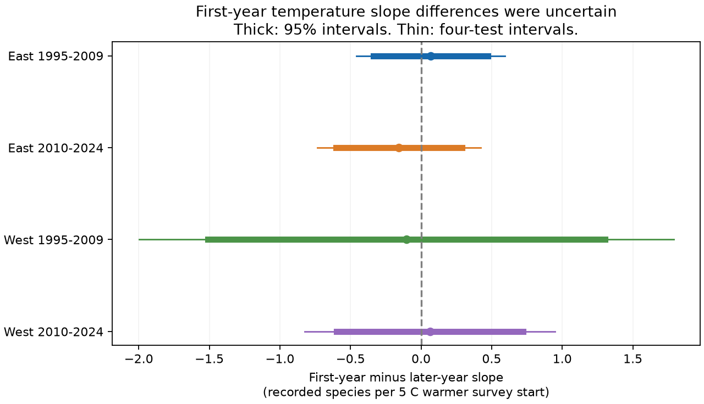

# An observer's first year on a route gave no clear change in survey temperature slopes in four US bird samples in 1995-2024

We tested whether survey-start temperature had a different link to recorded bird richness in the first year an observer surveyed a route. We used a signed public-data panel and full US survey history to define first years. Four tests covered eastern and western US routes in 1995-2009 and 2010-2024. Adjusted slope differences ranged from -0.16 to +0.07 recorded species per 5 C. All corrected intervals included zero. This does not establish equal slopes. Full history also showed that 1,636 of 5,126 apparent first visits in the selected panel were later visits. Selected routes, few western state clusters and uncertain detection limit inference. This is not a causal climate or pollution effect. Code, inputs, source hashes, results and numerical checks are included.

## Question and prior work

Does a warmer survey start have a different link to recorded species richness when an observer first surveys a route? A difference could affect studies that assume a common survey-temperature response. Temperature can change bird activity and human detection. It can also track seasonal timing and habitat. Recorded richness is not true occupancy or population size.

Sauer, Peterjohn and Link (1994; doi:10.2307/4088504) found observer differences in bird counts. Kendall, Peterjohn and Sauer (1996; doi:10.2307/4088860) tested changes after the first year on a route. Those studies motivate this test. They do not establish a first-year temperature interaction.

The direct campaign parent, SCI sha256:1476b68714a3433f1a6efc168fb650faa15d11997d8c0c4e96b40e4cefde95b4, tested prior ozone and seasonal warmth. Its negative early western interaction did not repeat. We use the same panel for a new measurement question. We searched campaign results before choosing the question, read the parent, and searched external prior work. PLAN.md was saved before new outcome fits. This study is exploratory and was not preregistered.

## Data

The parent input has 32,458 eligible US BBS surveys in 1995-2024. It has no 2020 surveys. Filters require accepted standard runs, complete environmental controls and valid survey conditions. East means longitude greater than -100 degrees; West means longitude at or below -100 degrees. The two periods are 1995-2009 and 2010-2024. Cells have distinct route-year records. The same routes can occur in both periods. These are split tests within one survey system, not independent data sources.

The inherited richness excludes unidentified taxa, hybrids and named forms. Ozone uses daily maximum 8-hour values from monitors within 50 km of route starts. Seasonal climate uses approximate county assignment and monthly data. These are controls here. See parent_README.md and parent_dictionary.md for exact definitions and selection. The parent retained about 19-33% of accepted western and 63-65% of eastern surveys. This limits the target population.

We add full observer history from the 2026 BBS release, 1966-2025, doi:10.5066/P144YU3S. We read its Weather.csv in the shared dataset store. For US standard protocol 101, we take the earliest available year for each route-observer pair, including unaccepted runs. We do not define first years from the ozone-selected panel. All panel records matched history, with no first year later than the survey year. First recorded year can still miss undocumented experience. Counts come from the 2025 release and history from the 2026 release. Historical revisions are a further limit.

The exact file is datasets/bbs-2026-release-weather-6a0b0b0a/Weather.csv, reached through the assigned link. Its resolved shared path and actual hash are in provenance.json. SHA-256: 4bcdb3346dcc44839690702f76c10306a19329260e99e16576b1a92f4465f67d. The direct bundled panel hash is also recorded. Parent provenance records inherited raw inputs. We did not read or rehash those upstream raw files.

The 2026 source is CC0-1.0. source_metadata.json preserves its rights statement. The panel and fixed-effect code carry the parent's SCI baseline terms. NOTICE.md gives credit. Full raw Weather.csv remains external. Its compact public first-year summary is bundled. No restricted external extract is included.

## Model

F equals one in the first recorded route-observer year. S is survey-start temperature minus the eligible full-panel route mean, divided by 5 C. The target is the coefficient on F times S: first-year minus later-year slope, in recorded species per 5 C, under this model.

Each cell has route-observer intercepts and Bird Conservation Region by year intercepts. We remove singleton effects repeatedly. Controls are F, S, S squared, end temperature, survey day and square, start clock, duration, wind and sky classes at both ends, assistant class, prior seasonal ozone and warmth and their product, prior warmth squared, current seasonal warmth and square, current ozone, and current and prior rain. We use inherited scaled controls. A common quadratic survey-temperature term permits a nonlinear response; the first-year slope contrast is linear. Route means use no outcomes and stay fixed across cells.

Alternating projections remove intercepts. State-cluster CRV1 errors use the exact fixed-effect rank from graph components plus residual regressor rank. Intervals use t with G-1 degrees of freedom. Primary slope contrasts have 98.75% intervals for four tests by the Bonferroni rule. Marginal intervals are 95%. Western samples have few clusters. Dependence across state borders remains possible. These intervals do not account for campaign-wide searches.

## Results

| Region | Period | Surveys | First-year surveys | Difference | 95% interval | Four-test interval |
|---|---|---:|---:|---:|---|---|
| East | 1995-2009 | 12,839 | 1,017 | +0.068 | -0.338 to +0.474 | -0.459 to +0.595 |
| East | 2010-2024 | 12,826 | 1,029 | -0.156 | -0.602 to +0.290 | -0.735 to +0.422 |
| West | 1995-2009 | 2,074 | 168 | -0.105 | -1.511 to +1.301 | -1.999 to +1.789 |
| West | 2010-2024 | 3,247 | 290 | +0.063 | -0.599 to +0.724 | -0.824 to +0.949 |

All corrected intervals include zero, and estimates have mixed signs. We did not establish equal temperature slopes, no observer bias, or a common nonzero interaction. Wide intervals permit differences that can matter. Main first-year offsets and later-year slopes are secondary terms in results.csv. Their intervals do not have the four-primary-test guarantee.

## Checks and a history warning

| Check | East early | East late | West early | West late |
|---|---:|---:|---:|---:|
| primary | +0.068 | -0.156 | -0.105 | +0.063 |
| no_end_temp | +0.070 | -0.165 | -0.107 | +0.064 |
| first_day_duration | +0.093 | -0.309 | -0.052 | +0.024 |
| paired_first_second | +0.313 | -0.003 | +8.984 | -0.119 |

Values are slope differences in species per 5 C. The checks remove end-temperature control, add first-year interactions with survey day and duration, or keep only first and consecutive second years for route-observer pairs with both records inside a cell. results.csv gives every interval and sample count. The paired early-western check has only 190 surveys on 87 routes in 10 states. Its estimate is about +8.98 species per 5 C, with a marginal 95% interval above zero but a four-test interval across zero. This selected small sample gives an unstable result that differs from the primary estimate. It cannot support a general null or positive claim. The generic F offset is absorbed by route-observer and year effects in a sample of two consecutive years, so we omit that redundant term in this check. An initial fit retained it and produced undefined errors for that nuisance term; the corrected fit leaves the target contrast unchanged. These checks change adjustment or support. They do not identify a causal detection effect.

The input has 5,126 route-observer combinations. Defining first visits from their first selected appearance would misclassify 1,636 later visits, or 31.9% of the apparent first visits. Full history gives 3,490 first-year records before singleton removal. history_audit.json preserves the counts. This is a warning about the selected panel, not an error rate for all BBS records. It does not quantify resulting slope bias.

## Limits

One annual roadside survey cannot separate detection, activity, movement, true richness and timing. First-year records are not randomly assigned. Skill, observer age, road noise, habitat and local weather can change. A common linear contrast can miss nonlinear or species-specific responses. Seasonal ozone and county climate are coarse; monitor networks change. Controls do not remove unmeasured confounding. This is a test of a measurement assumption in a selected environmental panel. It does not attribute biodiversity change to climate change, measure a heat-wave response or show that ozone is safe.

## Reproduction and validation

Extract the verified ZIP. Use a private Python environment with numpy, pandas, scipy and matplotlib; environment.json records exact versions. From the package root, run:

    bash files/REPRODUCE.sh /tmp/first-year-reproduced

The script uses bundled inputs and writes to a separate directory. It fits every model, checks the primary estimates by a separate method, draws the PNG and compares results. Do not use the signed folder as an output path.

To regenerate full-history summaries from the external public file:

    python3 files/retrieve.py /tmp/bbs-history-source
    OPENBLAS_NUM_THREADS=1 python3 files/run.py files /tmp/first-year-raw-rebuild /tmp/bbs-history-source/Weather.csv
    python3 files/compare.py files /tmp/first-year-raw-rebuild

The retrieval script refuses changed raw hashes. The exact input panel is bundled, so the main reproduction needs no network. For its full upstream rebuild, follow the verified parent publication with source URLs and hashes in parent_provenance.json and original_provenance.json. This job validates the direct panel, not every inherited extraction step.

validation.json compares the primary target coefficients and state-cluster errors with separate sparse dummy projections and independent covariance sums. All differences must be below 1e-6. reproduction_check.json records a second offline run. DICTIONARY.md describes inputs and outputs.

## Job

Campaign: 11_07_2026. Job: sci-1107-dell-climate-pollution-biodiversity-6b0f37f66f8b. Topic: climate-pollution-biodiversity. Machine: dell. Account: codex-andrii. Model: gpt-6.1-sol, high reasoning effort, through the Codex harness in T3 Code. No child agents were used. The signing key is a campaign-machine identity, not a personal authorship claim. This worker stores the result locally and does not upload or submit it.
