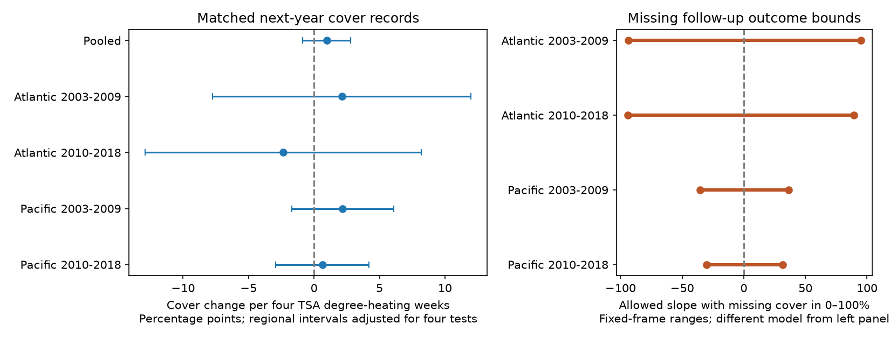

# Survey-date heat gave no clear next-year coral cover link in four Atlantic and Pacific samples in 2003-2018

## Main result

We tested whether heat stress at a coral survey date was linked to hard-coral cover change one year later. We used Reef Check records at the same site, calendar month, and depth band. The test had 1,389 complete pairs at 590 sites in 36 countries. Current years were 2003-2018. Follow-up ended in 2019.

The pooled estimate was +0.96 cover percentage points per four TSA degree-heating weeks. Its nominal 95% interval was -0.88 to +2.80 points. All four separate ocean and period intervals included zero after a four-test correction. Only 45 complete pairs had heat of at least four TSA degree-heating weeks. Thus these records did not establish a repeated link to later cover loss.

Only 15.9% of eligible baseline cells had a usable next-year match. If missing next-year cover can range from 0 to 100%, exact slope ranges permit both signs in all four samples. These ranges describe selected archive cells. They are not confidence intervals. The result does not show that heat has no harmful effect.



## Question and prior work

Heat can affect the coral cover that forms reef habitat. A delayed cover response is distinct from bleaching at one visit. [Hughes et al. (2018)](https://doi.org/10.1038/s41586-018-0041-2) report coral loss after the 2016 Great Barrier Reef heat event. Their event design uses heat exposure and later reef response. Our archive test uses heat at the baseline visit. It cannot replace a heat-event study.

[Sully et al. (2019)](https://doi.org/10.1038/s41467-019-09238-2) relate global bleaching observations to thermal conditions. [Van Woesik and Kratochwill (2022)](https://doi.org/10.1038/s41597-022-01121-y) describe the global source database. These studies motivate the exposure and the need to separate cover from bleaching.

We searched the local SCI campaign for phenology, butterfly, bleaching, and heat cover before choosing the precise analysis. Searches return limited result sets; this is not an exhaustive review. Relevant returned metadata are preserved in files/coral_prior.json. We read [SCI 534925f3](sci:sha256:534925f3548ad242f68c220d73046bf49bbb91bbf10c96e81eb9c913749f266a). That study tests current bleaching against later cover change. We adapt its cell construction and matching method, rebuild from raw data, remove the requirement for a bleaching value, and test heat as the main exposure. Its code has the SCI baseline MIT license. The raw observations overlap. This is a new analysis of an existing archive, not independent validation of that archive. Other campaign work in the saved search reports tests heat against bleaching or tests survey retention. Our added output is a heat-to-cover audit with exact missing-follow-up slope bounds.

The plan in files/plan.txt was set before fitting. It was not registered outside this workspace. The investigation is exploratory. We do not claim the first test of heat and coral cover.

## Data and matching

We use BCO-DMO 773466 version 2, dated 2022-10-14 ([data DOI](https://doi.org/10.26008/1912/bco-dmo.773466.2)). The creators are Robert van Woesik and Chelsey Kratochwill. Reef Check supplied the selected survey records. The source uses CC BY 4.0 terms.

Exact shared source path:

`/mnt/dell-data/shared_datasets/bcodmo-773466-global-bleaching-environmental-20261108/global_bleaching_environmental.csv`

The source has 16,772,400 bytes. Its SHA-256 is:

`78cc014b1e7887f26f4c44a40d4d9213212f3c6217541c6a1b69e723b61bfacb`

The source URL, version, attribution, and hash are in files/provenance.json. We read this file in place and did not change shared data. No new data download was needed.

We select Data_Source equal to Reef_Check, Substrate_Name equal to Hard Coral, Atlantic or Pacific, years 2003-2019, and depths from 0 to 15 m. This gives 10,423 source rows, each with a unique Sample_ID. Other substrate rows are not extra coral surveys. We treat nd as missing and check that reported cover and bleaching percentages are in 0-100.

We average cover, survey heat, and depth within site, year, calendar month, and depth band. The bands are 0 to less than 5 m, and 5 to 15 m inclusive. This gives 9,162 cells. These cells can combine several survey dates. The complete cell table is in files/cells.csv.

We match each baseline cell through 2018 to the same site, month, and band in the next year. We require observed current cover, heat, depth, and country. There are 8,743 eligible baseline cells. We require next cover and next depth for the complete-pair model. This retains 1,389 cells, or 15.9%. All matched records in this frame have the fields needed for a complete pair. Matching uses site identity and a depth band. It does not establish the same transect, colony, exact day, or observer.

Percent_Cover is hard-coral cover as a percent of substrate. It is not a species count. TSA_DHW is the supplied CoRTAD sum of qualifying thermal anomalies over the prior 12 weeks. See the [source field description](https://erddap.bco-dmo.org/erddap/info/bcodmo_dataset_773466/index.html). We scale it by four for readable slopes. The value four is a descriptive exposure cutoff here. It is not a claim that this field has the same alert thresholds as other DHW products.

Crucially, this exposure ends at the baseline visit. It is not the maximum heat between visits. It can miss the heat that later caused loss. Baseline cover can already reflect damage from that heat. This question concerns additional later change conditional on the observed baseline.

## Models and uncertainty

The main outcome is next-year cover minus baseline cover, in cover percentage points. We fit weighted least squares:

`cover change ~ heat / 4 + baseline cover + baseline depth + depth change + ocean-year effects + calendar-month effects`.

Each site-year has total weight one over its retained cells. We recalculate weights within each subset. Bleaching is not a primary control, since it could carry part of a heat response. Baseline cover can account for room for loss and regression to the mean, but it also conditions on a possible prior heat response. Error in baseline cover can bias the slope. The no-cover-control check therefore has a distinct interpretation.

Four planned models use Atlantic and Pacific samples in 2003-2009 and 2010-2018. Regions have separate sites. Periods can share sites and measurement methods. We use country-cluster covariance, the usual finite-cluster correction, and t critical values with country count minus one degrees of freedom. Each regional interval uses alpha 0.05/4. The pooled interval uses alpha 0.05. These are working intervals with only 12-15 country clusters in the regional tests.

Checks omit baseline cover, restrict depth change to at most 1 m, or group errors by year. Year grouping is a separate uncertainty check, not a joint country-year correction. A further linear probability model tests whether heat is linked to a usable next-year match in all eligible baseline cells. It uses current cover, depth, ocean-year, and month controls. The outcome is 100 for a usable match and zero otherwise. This describes archive retention, not the probability of a field visit.

## Results

A negative slope means more later cover loss as baseline heat increases. Units are cover percentage points per four TSA degree-heating weeks.

| Sample | Complete pairs | Heat at least four | Estimate | Interval |
| --- | ---: | ---: | ---: | ---: |
| Pooled | 1,389 | 45 | +0.96 | -0.88 to +2.80 |
| Atlantic, 2003-2009 | 131 | 2 | +2.12 | -7.75 to +11.99 |
| Atlantic, 2010-2018 | 115 | 3 | -2.35 | -12.88 to +8.19 |
| Pacific, 2003-2009 | 361 | 8 | +2.19 | -1.71 to +6.09 |
| Pacific, 2010-2018 | 782 | 32 | +0.64 | -2.93 to +4.20 |

The regional intervals account for four primary tests. None establishes a negative link. None establishes a common absence of loss. Removing baseline cover changes the early Atlantic estimate to -2.28 points. The other no-cover estimates are -3.30, +2.42, and +0.14. All corrected intervals include zero. The depth and year-cluster checks also include zero in every regional sample. All estimates and uncertainty values are in files/effects.csv.

The heat slopes for usable follow-up range from -2.24 to +7.76 recording percentage points per four TSA degree-heating weeks. All four corrected intervals include zero. This does not show that follow-up is random. The overall follow-up loss remains large.

## Exact bounds for missing follow-up cover

For each region and period we use the full eligible baseline frame. We omit depth change because it is absent when there is no next-year record. The model is:

`later cover change ~ heat / 4 + baseline cover + baseline depth + year effects + month effects`.

Let r be the residual from weighted regression of heat/4 on the nuisance controls. Let w be the fixed equal-site-year weight. The coefficient on heat/4 is the sum of a times cover change, where:

`a_i = w_i r_i / sum_j(w_j r_j^2)`.

Observed next-year cover stays fixed. For each missing next-year cover we allow any value from 0 to 100. The lower endpoint assigns 100 where a is negative and zero where a is positive. The upper endpoint reverses these assignments. The baseline-cover term is fixed. This linear construction gives attainable endpoints. Direct regressions on both endpoint assignments agree with the formula to less than 1e-7. Continuous assignments between them give every intermediate slope.

| Sample | Baseline cells | Missing next cover | Allowed slope range |
| --- | ---: | ---: | ---: |
| Atlantic, 2003-2009 | 1,068 | 937 | -93.65 to +94.81 |
| Atlantic, 2010-2018 | 740 | 625 | -93.97 to +89.42 |
| Pacific, 2003-2009 | 3,159 | 2,798 | -35.55 to +36.54 |
| Pacific, 2010-2018 | 3,776 | 2,994 | -30.33 to +31.33 |

The ranges permit both signs in all samples. They also permit losses much larger than the complete-case point estimates. Large slope values can occur with a bounded outcome when heat variation is limited. These are possibility ranges for a linear model with fixed records and weights. They are not sampling intervals, predicted losses for every reef, or causal bounds. The endpoint assignments need not be biologically likely. We impose no cross-site, smoothness, or recovery-rate restrictions. The files bounds_*.csv preserve every assignment and influence weight.

## Limits and useful next step

An absent match can reflect a different survey month, depth, site label, missing archive entry, or no field visit. We cannot separate these causes. The bounds omit reefs and visits that never entered the baseline archive. They also omit errors in observed cover and exposure. Unknown taxon composition, disease, storms, observer changes, and fine-scale depth conditions remain uncontrolled.

Heat at the baseline date is a weak proxy for all heat between visits. No harmful slope in this design would contradict a study that measures loss across a well-timed heat event. The tested outcome includes growth, recovery, recruitment, death, and survey error. We cannot infer mortality, biodiversity loss, thermal adaptation, climate attribution, or air pollution effects. A useful next study would link fixed-transect cover and visit logs to daily heat between exact visits, with coral taxon records.

## Reproduction

Use a writable copy of the publication to keep the signed original intact. Python 3.12, NumPy, pandas, SciPy, statsmodels, and Matplotlib are required. Exact tested versions are in files/audit.json.

From the copied bundle root:

```sh
python files/analyze.py
```

This rebuilds tables, model checks, endpoint assignments, and the figure from the preserved cells. To rebuild cells from raw data and audit them with separate standard-library code:

```sh
python files/analyze.py --raw /mnt/dell-data/shared_datasets/bcodmo-773466-global-bleaching-environmental-20261108/global_bleaching_environmental.csv
python files/validate_raw.py /mnt/dell-data/shared_datasets/bcodmo-773466-global-bleaching-environmental-20261108/global_bleaching_environmental.csv
```

On another host, download source_url in files/provenance.json to local disk, check the stated SHA-256, and pass that file path. Do not accept different bytes as the same version. The source file is not copied into the publication.

The independent raw audit checked 10,423 selected rows, all 9,162 cell means, and all 1,389 complete-pair changes. Direct matrix calculations reproduce all four primary coefficients and country-cluster standard errors. Endpoint regressions check the exact bounds. Reports are in files/raw_checks.json and files/checks.json. No simulation is used.

## Campaign record

Campaign: 11_07_2026. Job: sci-1107-syam2-climate-pollution-biodiversity-f6666910b907. Topic: climate-pollution-biodiversity. Machine: syam2. Account: codex-myxtap. Model: gpt-6.1-sol, high reasoning effort. Date: 2026-11-08. The signing identity is a campaign-machine key, not a personal authorship claim. The bundle is stored locally. No remote archive upload or index submission was made.
