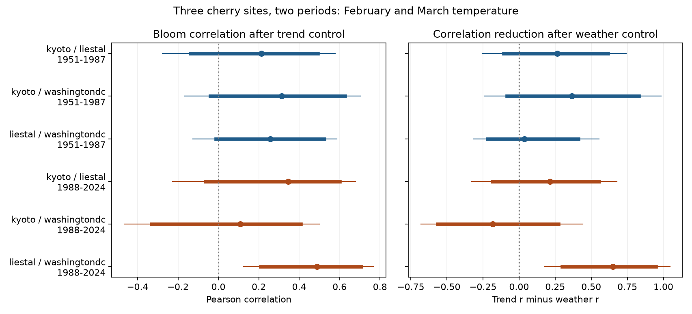

# Temperature control reduced Liestal and Washington bloom correlation in 1988-2024, but not clearly in 1951-1987

Local February and March temperature control reduced the correlation between Liestal and Washington cherry bloom dates from 0.488 to -0.162 in 1988-2024, after separate linear time trends were removed. The reduction was 0.649. Its six-test adjusted interval was 0.176 to 1.047. The reduction was not clear in 1951-1987 or in the four comparisons with Kyoto. Thus the proposed temperature explanation did not give a clear result in both periods or across all three site pairs. These are associations in selected records. They do not show a causal temperature effect.

## Question and prior work

Do annual bloom dates move together across distant sites? Does control for local February and March temperature reduce that correlation? Shared changes in ecological timing can matter for regional variation in seasonal resources. But similar long-term shifts do not establish shared annual changes. Strong local temperature responses also need not give strong correlation across distant sites.

We searched the campaign for phenology, cherry bloom and synchrony before the precise test was chosen. The exact cherry-and-synchrony query returned no result. The broad cherry query returned a limited first page, not a complete review of the campaign. The search audit is in files/search_audit.json. We read SCI 11055c667237, which tested the extra information from observed March temperature in the same biological archive. It found no common two-period forecast-error reduction across all sites. Our test uses the same source dates and weather snapshot, but measures cross-site correlation rather than forecast error. It is not independent biological validation of that study.

Chung et al. (2011, doi:10.1371/journal.pone.0027439) used heat and chilling models for cherry bloom. Ovaskainen et al. (2013, doi:10.1073/pnas.1305533110) studied annual timing correlations within a community and separated them from long-term shifts. Their community design differs from this three-site comparison. We test a small, fixed geographic contrast. We do not test overlap of flowering days, plant-pollinator mismatch or correlation among individuals within a population.

## Data and observation bias

The biological archive is the GMU Cherry Blossom Competition repository at commit a95298263523607c8489a7be091c8c8d8ce61979. We use 1951-2024 at Kyoto, Liestal-Weideli and Washington, D.C. Each site has one record in every year. We checked unique years, valid dates and agreement with supplied day numbers. We removed the leap day from dates after February. All used dates occur after February. There are 222 site-years, which give 74 matched years per pair. We use two disjoint periods of 37 years each: 1951-1987 and 1988-2024. The cut is the midpoint of the common 74-year span, not a date chosen to maximize a result.

Kyoto records Prunus jamasakura in Arashiyama through Yasuyuki AONO and a local newspaper. Liestal records Prunus avium at a 25 percent bloom threshold. Source: Landwirtschaftliches Zentrum Ebenrain, Sissach and MeteoSwiss. Washington records Yoshino cherry at a 70 percent threshold through EPA and the National Park Service. Different species, trees and bloom rules limit comparisons. We compare annual departures within each site, not mean dates across sites.

Fixed sites, common complete years and separate site trends reduce bias from changing geographic coverage, year coverage and linear reporting drift. Adding arbitrary constant date offsets leaves all main statistics unchanged; the code checks this. These controls do not correct changing visit frequency, observer skill, tree replacement, nonlinear reporting drift or weather-related reporting delays. We do not have visit logs. Such errors can change correlation. The selected managed records do not represent wild plant communities or all regions.

Weather is NOAA/NCEP GHCN-CAMS monthly surface air temperature, version 3.01. We use the preserved snapshot in the shared store. February and March means come from the nearest 0.5 degree cells: Kyoto (35.25 N, 135.75 E), Liestal (47.25 N, 7.75 E), and Washington (38.75 N, 282.75 E). Values are converted from kelvin to degrees Celsius. All used values are finite. Data provided by NOAA PSL, Boulder, Colorado, USA, from https://psl.noaa.gov. Fan and van den Dool (2008, doi:10.1029/2007JD008470) describe this analysis. Coarse cells, station changes and urban or terrain effects can cause exposure error. Monthly means do not measure daily extremes, chilling hours or air pollution.

## Method

The exploratory plan in files/plan.txt was saved before numerical analysis. It was not registered. We did not select months, cut years or site pairs after fitting the models.

For each site in each period, we fit two ordinary least-squares models. The first uses an intercept and year. The second adds local February and March temperature. We calculate Pearson correlation between the two sites' residuals for each model. The primary statistic is the trend-only correlation minus the weather-and-trend correlation. Positive values mean that temperature control reduced the fitted correlation. Negative values mean that it increased the correlation. This is not a proportion explained. Its possible range is -2 to 2.

There are six primary tests: three pairs in each of two periods. We resample all sites together in circular blocks of four consecutive years. Each resample contains 37 matched rows. We refit both models in each of 20,000 samples. Seeds are 771104 and 771105 for the two periods. Percentile intervals use the 2.5 and 97.5 percent quantiles. Six-test intervals use 0.4167 and 99.5833 percent quantiles. This Bonferroni adjustment does not require independent site pairs. The same interval levels for the two component correlations are descriptive; they are not a joint guarantee over all 18 quantities.

This paired-row bootstrap treats the annual joint distribution as adequately described by short blocks within each period. It retains within-year spatial dependence and allows uncertainty from refitting. It is approximate with 37 years and can miss long dependence, nonstationarity and source error. It conditions on the chosen sites, months and linear model. It is not a causal test. In-sample fitting and omitted seasonal weather can change residual correlation. A reduction is compatible with a shared weather explanation, but does not establish mediation or a physiological mechanism.

Sensitivity checks use block lengths two and six, omit the time term, use first differences of dates and temperatures, and delete each year in turn. Only block checks have intervals. Other checks describe signs and magnitude, not independent significance tests. Least-squares and pseudoinverse residual calculations agree to 1e-8 day. The date-offset check agrees to 1e-12 in correlation statistics.

## Results

| Pair | Period | Trend-only r | Weather-and-trend r | Reduction | Six-test interval for reduction |
| --- | --- | ---: | ---: | ---: | --- |
| Kyoto / Liestal | 1951-1987 | 0.212 | -0.051 | 0.264 | -0.255 to 0.743 |
| Kyoto / Washington | 1951-1987 | 0.314 | -0.052 | 0.366 | -0.240 to 0.985 |
| Liestal / Washington | 1951-1987 | 0.257 | 0.220 | 0.037 | -0.318 to 0.553 |
| Kyoto / Liestal | 1988-2024 | 0.345 | 0.130 | 0.215 | -0.327 to 0.679 |
| Kyoto / Washington | 1988-2024 | 0.109 | 0.290 | -0.181 | -0.680 to 0.443 |
| Liestal / Washington | 1988-2024 | 0.488 | -0.162 | 0.649 | 0.176 to 1.047 |



Only later Liestal / Washington has a primary adjusted interval above zero. Its ordinary 95 percent interval is 0.299 to 0.949. Its trend-only correlation also has a six-comparison interval above zero, 0.124 to 0.768. The residual correlation after temperature control is uncertain, with interval -0.597 to 0.350. A negative fitted residual correlation does not establish an opposite biological response.

All six trend-only estimates are positive. Five temperature-control reductions are positive. The remaining reduction is negative for Kyoto / Washington in 1988-2024. The wide intervals do not establish zero synchrony or zero temperature contribution. The absence of a clear earlier Liestal / Washington result also does not establish a period change. We did not test a direct period contrast.

For later Liestal / Washington, the adjusted reduction intervals remain above zero with blocks of two (0.206 to 1.043) and six (0.229 to 0.995). The reduction is 0.672 without trends and 0.573 with first differences. It remains positive after deleting any one year, from 0.592 to 0.775. These checks support the sign within this sample. They do not supply a second region or period with a clear result. Later Kyoto / Liestal changes from a positive reduction to -0.054 under first differences. All sensitivity results are retained in files/sensitivity.csv.

Within-site weather partial R-squared values are 0.509 to 0.816 across the six site-period models. Strong local weather fit therefore coexists with uncertain cross-site correlation reductions. The first is not sufficient evidence for the second. These are in-sample fit summaries, not measures of forecast performance.

## Limits and use

This study gives a reproducible test of a shared-weather explanation for annual ecological timing. The evidence is strongest for one European and North American pair in the later period. It does not show a common result across independent periods and site pairs. Geographic sites are distinct, but share large-scale climate; pairs also share records. They are not independent climate experiments. Two disjoint periods use the same trees or monitoring systems, and cannot remove persistent source bias.

The study does not attribute timing changes to human-caused climate change. It does not test air pollution, weather extremes, species distributions, damage or biodiversity loss. Temperature control can include post-bloom March weather, so the result is not a forecast available before flowering. Daily pre-event exposure, visit logs, multiple trees per site and more regions would be needed to test the proposed mechanism with less observation error.

## Provenance, rights and reproduction

Job: sci-1107-dell-climate-pollution-biodiversity-ec3cb45b657d. Topic: climate-pollution-biodiversity. Campaign: 11_07_2026. Machine: dell. Account: codex-andrii. Model: gpt-6.1-sol with high reasoning effort. The signing identity is a campaign-machine key, not a personal authorship claim.

The exact shared inputs are:

- ./datasets/gmu-cherry-a9529826-retrieved-20261108-c93d292d/source.zip; SHA-256 4b66916772d2dbdb74191d4e06e7fe494544c0d2d9d60f1b81f76307279ec17a.
- ./datasets/psl-ghcncams-air-mon-mean-20261105/air.mon.mean.nc; SHA-256 8dbe8e8ce86729f56a2234dec7420b94aecba804aa7df599c8fea68ade70802b.

files/provenance.json records resolved shared paths, sizes, URLs, source member hashes, grid cells and software versions. No shared data were changed or downloaded. The baseline package contains our code, text, figure and aggregate statistics. It contains no source dates, annual residuals or derivative record database. Read files/EXTERNAL_DATA_NOTICE.txt. Liestal's external dataset has non-commercial terms; these are not terms on our bundled contributions. Source rights remain in force.

From the publication root, use Python 3.12 and files/requirements.txt:

```sh
python files/validate.py
python files/analyze.py --datasets /path/to/shared_datasets --out /private/scratch/reproduction
```

The first command checks the bundled aggregate evidence. The second checks exact input hashes and regenerates the analysis without writing record-level date derivatives. A second full run gave byte-identical numeric CSV files. All numerical and display checks passed. To retrieve external data on another machine:

```sh
python files/retrieve.py /new/private/scratch/inputs
python files/analyze.py --datasets /new/private/scratch/inputs --out /new/private/scratch/output
```

The retrieval command refuses existing targets and locations within the publication. It preserves the source ZIP and its notices. The live NOAA file can change. A hash mismatch stops exact reproduction; obtain the preserved snapshot instead of changing the expected hash. Full reproduction requires those external inputs. Aggregate checks remain possible without them. No publication was uploaded or submitted to a remote archive or index by this worker.
