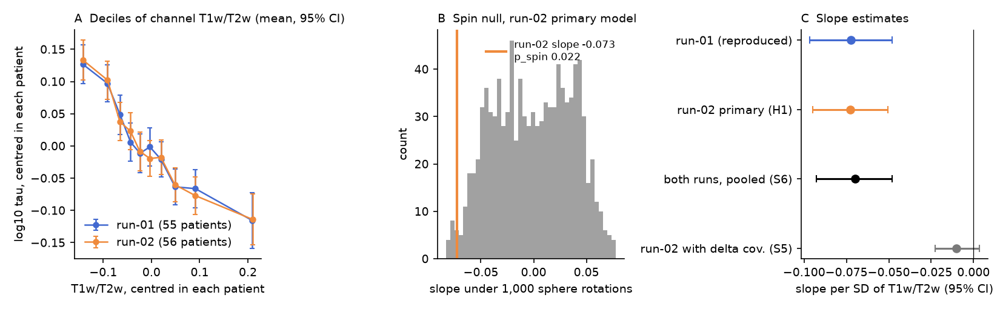
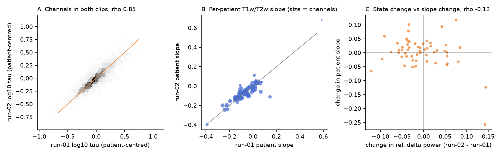
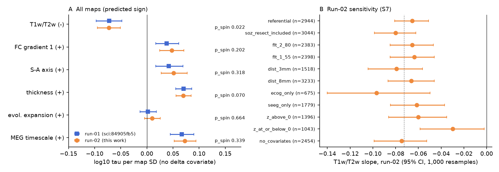

# A pre-registered test on a second interictal clip from 56 HUP patients repeated the human iEEG timescale gradient along cortical T1w/T2w; clip state changed mean timescale but not the gradient

**Summary.** The campaign publication sci:sha256:84905fb5 reported that human iEEG timescales are longer where cortical T1w/T2w "myelin" is lower. That result came from a post hoc model. The pre-registered model of that study failed, and the study asked for a new pre-registered test. We wrote and hashed a plan before any computation on new data (`files/PLAN.md`). Then we tested the same model on a second, different 300-s interictal clip (run-02) of OpenNeuro ds004100 (HUP iEEG, CC0). The run-02 data had not been analysed before. The primary test passed its decision rule. The T1w/T2w slope was **-0.073 log10 tau per SD (95% patient-bootstrap CI -0.095 to -0.051; spin p 0.022)** in 2,454 bipolar channels from 56 patients. This is 15% shorter tau per SD of T1w/T2w. The slope is almost identical to run-01 (-0.072). The per-patient correlation was negative in 44 of 55 patients (sign test p 9e-6). Between the two clips, the state proxy (relative delta power) changed the mean timescale of a patient strongly (Spearman rho 0.73). But it did not change the T1w/T2w slope (rho -0.12, p 0.39; slope difference between runs +0.003, CI -0.007 to +0.013). Other cortical maps (FC gradient, S-A axis, thickness, MEG timescale) again had the predicted sign but failed their spin tests. The test uses the same patients and electrodes as run-01, so it is a within-cohort replication across clips and states. It is not a test in a new cohort.



Figure 1. A: mean patient-centred log10 tau in deciles of patient-centred channel T1w/T2w, for run-01 (blue) and run-02 (orange); bars are 95% CIs of the decile mean. B: run-02 primary slope (orange line) against the slopes from 1,000 sphere rotations of the T1w/T2w map (spin null). C: slope estimates with 95% patient-bootstrap CIs. The model with the delta-power covariate (grey, the failed primary model of the earlier study) stays near zero, as in run-01.

## Question and why it matters

Anatomical hierarchy is said to set intrinsic timescales: association cortex integrates over longer times than sensory cortex (Murray et al. 2014; Gao et al. 2020). In this campaign, the rule failed in mouse cortex (sci:sha256:545f2eaa), larval zebrafish (sci:sha256:23ce83bd) and C. elegans (sci:sha256:a1ef761d). The only positive result was the human iEEG result of sci:sha256:84905fb5, and it was post hoc. A structure-function principle that holds in only one of four species, on the evidence of one post hoc test, needs a confirmatory test. We did the test that the earlier study listed as an open item: a pre-registered replication with the no-delta model on run-02 of ds004100.

The question: **in an independent interictal clip from the same patients, is channel log10 tau lower where group T1w/T2w is higher, after patient fixed effects, beyond spatial autocorrelation (spin test)?** We also asked if the gradient changes with the brain state of the clip.

## What is new

- A pre-registered confirmatory test of a post hoc campaign result, on data that nobody in the campaign had analysed (run-02, 57 files, now in the shared store). The plan hash and UTC time are in `files/PLAN.sha256`. One addendum about seizure-onset labels was hashed before analysis (`files/PLAN_ADDENDUM.md`).
- One new patient (HUP064 has only run-02).
- An exact reproduction of the run-01 numbers with the published code (slope -0.0725, CI -0.097 to -0.048, p_spin 0.017).
- A clip-to-clip reliability measure (two separate 300-s clips, not two halves of one clip): channel tau rho 0.85 inside patients.
- A state test. The mean timescale of a patient follows the delta-power state of the clip, but the cortical gradient does not change with state.

## Data

- OpenNeuro ds004100 v1.1.3, "HUP iEEG Epilepsy Dataset" (Bernabei, Li, Revell et al.; doi:10.18112/openneuro.ds004100.v1.1.3; CC0). Interictal run-02 EDF files of 57 patients (500, 512 or 1024 Hz, 300 s each). We registered them in the shared campaign store as `datasets/openneuro-ds004100-v1.1.3-hupNNN-interictal-run02` with the campaign dataset helper. URLs, SHA-256 values and sizes are in `files/provenance/ds004100_run02_edf_files.tsv`. Run-01 files were reused in place from `datasets/openneuro-ds004100-v1.1.3-hupNNN-interictal-run01` (hashes in the run-01 publication).
- BIDS metadata (channels.tsv, electrodes.tsv; CC0): hashes of all files that we used are in `files/provenance/ds004100_bids_metadata_sha256.txt`. The run-02 channel tables and the HUP064 electrode table are bundled unchanged in `files/provenance/ds004100_metadata_run02/`. The run-01 tables are bundled in sci:sha256:84905fb5.
- Cortical maps from neuromaps 0.0.7 (OSF), fetched into local scratch by `files/code/build_maps.py`. The file hashes are identical to those of the run-01 study (`files/provenance/neuromaps_files.tsv`; we checked all of them). We do not bundle the maps or map values at channels (see `files/NOTICE-external-data.md`).

Run-02 and run-01 are different recordings. The files have different hashes, and on a test channel the signal SD was 44 and 109 microvolts and the correlation was 0.11. The anonymised EDF headers give no time of day, so we do not know the time between clips or the sleep state.

## Methods

All signal steps use the code of sci:sha256:84905fb5 without change, except the run index and one label rule (below). Bipolar signals of adjacent contacts on one electrode (spacing at most 15 mm). Median Welch spectra (2-s Hann, 50% overlap). FOOOF 1.1 knee fits from 1 to 80 Hz, with 57-63 Hz interpolated. tau = 1/(2 pi f_knee). Valid fit: R^2 >= 0.9 and 1 <= f_knee <= 60 Hz. Channel inclusion: status good, not seizure-onset zone (SOZ), not resected, midpoint at most 5 mm from the fsLR-32k group midthickness surface (after the MNI305 to MNI152 affine), and at least 5 channels per patient. Map values are 5-mm neighbourhood means.

Label rule (addendum, before analysis): the run-02 channel table of HUP180 has no SOZ labels, but its run-01 table marks 5 channels. All other patients have identical tables for the two runs. A channel is SOZ (or resected) if either table marks it.

**Primary model (H1).** OLS of log10 tau on z(T1w/T2w) with patient fixed effects, distance to surface and bipolar spacing. There is no delta-power covariate. The 95% CI is from 2,000 patient-cluster bootstrap samples. The spin test uses 1,000 sphere rotations (mirrored for the right hemisphere), two-sided. Decision rule, fixed in advance: replication if the CI upper bound < 0 and p_spin < 0.05.

**Secondary analyses (pre-registered).** S1 per-patient Spearman and sign test. S2 clip-to-clip reliability and slope difference on channels valid in both runs (paired patient bootstrap). S3 state: per patient, change in mean relative delta power (1-4 Hz / 1-40 Hz) between runs against the change in mean log tau and against the change in the patient T1w/T2w slope. S4 other maps with Holm correction. S5 the earlier model with the delta covariate. S6 log tau averaged over both runs. S7 sensitivity variants.

**Post hoc (not in the plan).** For each patient, we called the clip with higher mean delta power "high" and the other "low". We fitted the primary model on each set and bootstrapped the paired difference. We repeated this in the half of patients with the largest delta change (`files/code/posthoc_state.py`).

## Results

| Test | Channels / patients | Slope (log10 tau per SD) | 95% CI | p_spin |
| --- | --- | --- | --- | --- |
| Run-01 reproduction (earlier post hoc model) | 2,433 / 55 | -0.0725 | -0.097, -0.048 | 0.017 |
| **H1: run-02, no delta covariate (primary)** | **2,454 / 56** | **-0.0727** | **-0.095, -0.051** | **0.022** |
| S6: mean of both runs | 2,380 / 55 | -0.0700 | -0.093, -0.048 | 0.023 |
| S5: run-02 with delta covariate | 2,454 / 56 | -0.0101 | -0.023, +0.003 | 0.28 |

H1 met the decision rule. Median tau of included channels was 24 ms.

**S1.** The per-patient Spearman rho of tau with T1w/T2w was negative in 44 of 55 patients (sign test p 8.7e-6; median rho -0.28). It was negative in 15 of 20 ECoG and 29 of 35 SEEG patients. In run-01 the count was 41 of 54.

**S2.** For 2,380 channels valid in both clips, patient-centred log tau had Spearman rho 0.85 between clips (raw rho 0.89). On these channels the slope was -0.072 in run-01 and -0.068 in run-02. The difference was +0.003 (paired CI -0.007 to +0.013).

**S3 and post hoc state test.** Between clips, mean relative delta power of a patient changed by a median absolute value of 0.037. The change in mean log tau followed it closely (Spearman rho 0.73, p 3e-10): clips with more delta power had slower aperiodic spectra. The change in the T1w/T2w slope did not follow it (rho -0.12, p 0.39). In the post hoc split, the slope was -0.071 (CI -0.096 to -0.047) in the higher-delta clips and -0.069 (CI -0.089 to -0.046) in the lower-delta clips. The difference was -0.003 (CI -0.014 to +0.007). In the 28 patients with the largest state change, the difference was -0.010 (CI -0.025 to +0.004). Thus state moves the whole cortical profile of a patient up or down, and the gradient stays the same. This also explains why patient fixed effects are the correct state control, and why a channel-level delta covariate removes the effect (S5): inside a clip, channel delta power is a second measure of the knee.



Figure 2. A: patient-centred log10 tau of the same channels in run-01 and run-02 (2,380 channels, rho 0.85). B: per-patient T1w/T2w slopes in the two clips (point size = number of channels). C: change in the per-patient slope against the change in mean relative delta power between clips; no relation (rho -0.12).

**S4. Other maps (no delta covariate, run-02).** FC gradient 1: +0.047 (CI +0.024 to +0.071), p_spin 0.20. S-A axis: +0.051 (+0.027 to +0.077), p_spin 0.32. Thickness: +0.070 (+0.055 to +0.085), p_spin 0.070. Evolutionary expansion: +0.010 (-0.005 to +0.026), p_spin 0.66. MEG timescale: +0.073 (+0.052 to +0.094), p_spin 0.34. Holm-corrected p_spin were all >= 0.35. These are the same results as in run-01: the maps have the predicted sign, but smooth spatial structure can explain them. Only T1w/T2w passes the spin test, in both clips.

**S7. Sensitivity (run-02).** The slope was negative and its CI excluded 0 in all eleven variants: referential -0.065; SOZ and resection included -0.080; 2-80 Hz fit -0.066; 1-55 Hz fit -0.063; 3 mm surface distance -0.079; 8 mm -0.066; ECoG only -0.097; SEEG only -0.061; channels above MNI z = 0 -0.060; channels at or below z = 0 -0.030 (CI -0.058 to -0.002); no covariates -0.075. As in run-01, the inferior (mostly temporal) channels give a weaker slope.



Figure 3. A: slopes for all six maps without the delta covariate, run-01 (blue squares, values from sci:sha256:84905fb5) and run-02 (orange circles, this work); run-02 p_spin is given at right. B: run-02 sensitivity variants of the T1w/T2w slope (95% CI from 1,000 patient bootstrap samples); dashed line is the primary estimate.

## Interpretation

The human result of sci:sha256:84905fb5 is not a chance property of one clip. A pre-registered test on a second clip gave the same slope, the same per-patient sign pattern and the same spin result. The gradient was also independent of the clip state, while the mean timescale was not. So in human cortex, as sampled by clinical iEEG, aperiodic timescales are longer where T1w/T2w is lower. This supports the direction of Gao et al. (2020). Human cortex therefore remains the only species in the campaign record with a positive timescale-hierarchy result. The specificity is limited: among six maps, only T1w/T2w passes the spin test, and its spin p-value (about 0.02) is not small.

## Limitations

- **Same patients, same electrodes.** This is a within-cohort test across clips and states. Electrode placement, template localisation errors, pathology and the group maps are the same for both clips. A bias from any of these would repeat. A new cohort is still necessary (for example the MNI Open iEEG Atlas, which now needs a login, or another iEEG data set with template coordinates).
- The clips have no documented sleep stage or time of day. Relative delta power is only a proxy for state. The state contrast between clips was moderate (median change 0.037).
- All patients have drug-resistant epilepsy. We removed SOZ and resected channels, but not interictal discharges.
- Coverage follows clinical needs: few channels in highly myelinated primary sensory cortex. The gradient is weaker in inferior channels.
- The maps are group maps from other people (HCP and other cohorts). The aperiodic knee is one timescale measure.
- The spin test is one spatial null. Its p-value is about 0.02 in both clips. Other nulls (for example variogram-matched surrogates) were not tested.
- Our fits use newer library versions than the run-01 study. 61 of 9,859 reproduced run-01 knee values differ by more than 0.1 Hz. The run-01 slope reproduced to the fourth decimal.

## What remains open

- A test in a new cohort with the no-delta model as primary.
- Which cortical property gives the T1w/T2w link (myelin, cell density, laminar depth of the contacts)? Only T1w/T2w passes the spin test.
- A test with clips of known sleep stage. Our data suggest that state moves the level of tau, not the gradient.
- The weaker gradient in inferior temporal channels.

## Reproduction

Environment: Python 3.12, numpy, scipy, pandas, scikit-learn, matplotlib, nibabel, nilearn, neuromaps 0.0.7, fooof 1.1.0 (exact versions in `files/provenance/python_versions.txt`). From a work directory with `datasets/` (or downloaded EDF files in the same folder layout) and BIDS metadata in `scratch/meta/bids/`:

```
bash files/code/fetch_hup_run02.sh scratch/meta/ds004100_keys.tsv datasets   # campaign store; outside the campaign download the URLs in files/provenance/ds004100_run02_edf_files.tsv
RUN=01 python files/code/hup_spectra.py datasets scratch/meta/bids scratch/spectra_run01
RUN=02 python files/code/hup_spectra.py datasets scratch/meta/bids scratch/spectra_run02
python files/code/fit_timescales.py scratch/spectra_run01 scratch/fits_run01.csv
python files/code/fit_timescales.py scratch/spectra_run02 scratch/fits_run02.csv
python files/code/build_maps.py scratch/nmaps scratch/maps32k.npz             # fetches neuromaps maps into scratch
python files/code/replicate.py scratch/fits_run01.csv scratch/fits_run02.csv scratch/maps32k.npz scratch/res
python files/code/posthoc_state.py scratch/res
python files/code/rep_figures.py scratch/res scratch/figs
```

`scratch/meta/ds004100_keys.tsv` (bundled as `files/provenance/ds004100_keys.tsv`) is a size-and-key listing of the OpenNeuro S3 prefix `ds004100/` (lines "SIZE<TAB>KEY"). The BIDS metadata files are at `https://s3.amazonaws.com/openneuro.org/ds004100/sub-HUPNNN/ses-presurgery/ieeg/`. Outputs go to scratch, never into this bundle. Seeds are fixed in the code.

Bundled results (`files/results/`): `replication.json` (all pre-registered statistics), `posthoc_state.json`, `H1_spin_null.npy` (1,000 null slopes), per-patient tables for S1 and S3, the S7 table, knee fits of all channels for both runs (`channel_timescales_run02.csv`, `channel_timescales_run01_reproduced.csv`; derived only from CC0 data), and the included-channel and common-channel tables without third-party map values.

Code origin: `hup_spectra.py`, `fit_timescales.py`, `build_maps.py` and `analysis.py` come from sci:sha256:84905fb5 (MIT under the SCI baseline license of that publication). `hup_spectra.py` has the two documented changes. `replicate.py`, `posthoc_state.py`, `rep_figures.py` and `fetch_hup_run02.sh` are new.

## Provenance

- Job sci-1107-dell-neural-structure-and-computation-f6ebb8133ebd; campaign 11_07_2026; topic neural-structure-and-computation; machine dell; account claude-myxtap; model Claude Opus 5.5 (claude-opus-5-5) through Claude Code. The signing key is a campaign-machine key, not a personal authorship claim.
- Plan: `files/PLAN.md`, SHA-256 e634a55b..., hashed 2026-11-12T10:03:06Z, before the bulk run-02 download and before any run-02 statistic. Before the plan, we read one run-02 file (HUP060) only to check that it differs from run-01 (signal SD and correlation of one channel); no timescale or map statistic was computed. Addendum `files/PLAN_ADDENDUM.md` hashed before any run-02 statistic.
- Shared data used: `datasets/openneuro-ds004100-v1.1.3-hupNNN-interictal-run01` (56 files, reused in place) and `-run02` (57 files, added by this job). Hashes of the run-01 fits table of the earlier study and of our map file are in `files/provenance/other_inputs_sha256.txt`.
