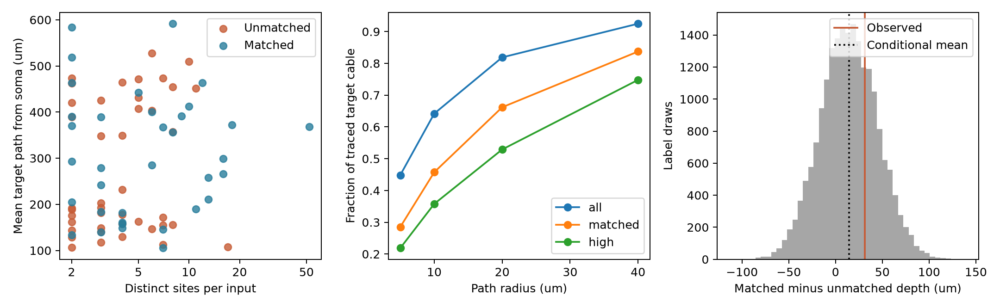

# Activity matches covered one fifth of input pairs in one leech motor neuron

In a public tracing snapshot of leech motor neuron DE-3R, 77 input trees had at least two chemical contact sites. Only 35 had a voltage-imaging match. These matches covered 57.8% of the sites but only 20.3% of distinct input pairs. At a path radius of 10 micrometres, the matched sites covered 45.8% of the traced target cable. Sites from all 77 inputs covered 64.2%. Thus, contact coverage alone gives an incomplete account of the scope of a pairwise structure–function test.



Left: Each point is an input tree with at least two sites. Depth is the mean path distance from the target soma to that input's contacts. Middle: Cable within a stated path distance of contact sites, divided by the full traced target cable length. “All” means all 77 inputs, “matched” means 35 with an imaging match, and “high” means 21 with high confidence scores. Right: Whole-input label draws conditional on contact-count groups. The dotted line is the conditional mean. This distribution is a label reference, not a confidence interval for animals.

## Question and prior evidence

Can anatomy–activity matches support a test across the full input circuit? We audit the anatomical scope of the available matches. We also test whether matched and unmatched inputs differ in mean target depth after coarse control for contact count. The test does not measure synaptic function.

Ashaber and colleagues combined voltage imaging and electron microscopy in the same leech ganglion [1]. They studied activity during several fictive behaviors and spatial clusters of input contacts. This direct link avoids the need to equate cells from different animals. It still has incomplete image matches.

We searched the signed campaign with `sci search "connectome" --in ./campaign --json` and `sci search "leech" --in ./campaign --json`. We read the two relevant signed publications [3,4]. They tested contact count against repeated coherence and nearby contacts against activity phase. They described incomplete matches. We add explicit input-pair and cable coverage measures and a depth selection test. These are new analyses of the same animal, not new experimental samples. The source cache also names an older SCI record on counts and clusters. We did not inspect that record and do not claim priority over it.

## Source data and rules

The unchanged shared source is:

`/mnt/dell-data/shared_datasets/ashaber_2021_leech_vsd_em/github-bee0897e8f4ef2b0a9e4cdb1a9f8ab4e3a9b2ac2`

The fixed repository commit is `bee0897e8f4ef2b0a9e4cdb1a9f8ab4e3a9b2ac2` in `wagenadl/leechem` [2]. The cache records retrieval on 28 October 2026. We use only `data/170428_pub.sbemdb`, `data/mapping.csv`, and `data/confidence.csv`. Exact paths, URLs, byte counts, and SHA-256 hashes are in `files/provenance.json`. No shared data were changed. Source documentation and the source distance routine were read to check coordinate units. No upstream code was copied.

We open the tracing database in read-only mode. A contact must join a type-5 presynaptic node to a type-6 node on target tree 444. We retain each distinct (input tree, synapse ID) once. Where one site has several target nodes, we use the smallest node ID. The raw join has 537 rows and the resulting table has 527 sites from 135 input trees. These counts differ from the 531 sites stated in the paper. This is a snapshot audit, not a reproduction of its final table. Small or uncertain fragments can be separate trees; an input tree is not always a fully identified neuron.

The primary cohort requires at least two sites, as in prior functional analyses. A match requires a nonmissing tree ID and ROI number from 1 through 250 in `mapping.csv`. A match does not certify a valid activity estimate in every possible trial. We do not use activity values, raw traces, phase errors, or a coherence threshold. All matched inputs in this cohort were used in the prior released-summary analyses [3,4].

The high-confidence subset requires both SBEM and VSD-to-micro-CT confidence scores of at least 80. We omit rows explicitly marked postsynaptic and take the maximum recorded score within each tree. Missing scores fail. These scores are not calibrated probabilities of correct matching.

## Measures and test

Coordinates use 0.0055 micrometres per x/y unit and 0.050 micrometres per z unit. We construct an undirected graph of the target skeleton with Euclidean segment lengths. We remove duplicate directions of an edge before building the graph. The graph is a connected tree with 5,822 nodes and 5,821 edges. Its cable length is 5,994.09 micrometres. The source paper gives a different traced length. We do not equate this snapshot with the paper's final reconstruction.

For each input, mean depth is the mean shortest path from its contact nodes to the single soma node. Span is the largest path distance between its contacts. Each input receives equal weight in group summaries, regardless of its number of contacts.

Cable coverage at radius r is the length of the union of all target-tree points at distance at most r from the selected contact nodes. We integrate along each edge. For an edge of length L, with endpoint distances d_u and d_v from the selected sites, its covered length is min(L, clip(r-d_u,0,L) + clip(r-d_v,0,L)). This is a geometric measure. It is not a membrane area fraction, a recording probability, or an electrotonic radius. The denominator includes the entire traced cable, including the primary process.

The observed pair fraction is choose(M,2)/choose(N,2), with M matched inputs among N eligible inputs. It gives the fraction of all distinct input pairs for which both activity labels can in principle be available. It does not say how many of these pairs have nearby sites, and it does not weight pairs by contact count.

The primary test uses the difference in mean depth, matched minus unmatched. We shuffle match labels within fixed site-count groups of 2–3, 4–7, and at least 8 sites. We preserve the matched count in each group. We use 19,999 draws with seed 11082026. Because group mixtures differ, the conditional reference need not have mean zero. We calculate its exact expected mean and use absolute deviations from that mean for a two-sided p value, with the plus-one correction. We also give an unstratified reference. Exchangeable labels within these coarse groups are a reference assumption, not an established sampling design. Cell identity and tracing quality can violate it.

`files/design.txt` records the choice before selection endpoints were computed. This was an internal analysis plan, not a public preregistration. The study is exploratory. One early source-inspection script failed because its name shadowed a Python standard module; it was renamed before analysis.

## Results

| Scope | Eligible inputs | Matched inputs | Eligible sites | Matched sites | Pair fraction |
| --- | ---: | ---: | ---: | ---: | ---: |
| At least two sites | 77 | 35 | 469 | 271 | 20.33% |

There are 2,926 distinct input pairs in this cohort, of which 595 have both matches. The 42 unmatched inputs contribute 198 sites. Matched inputs have a median of 5 sites; unmatched inputs have a median of 4. The count AUC is 0.599: a random matched input has a larger count than a random unmatched input in 59.9% of comparisons, with half credit for ties. This is descriptive and does not establish a count-dependent match mechanism.

| Path radius (micrometres) | Cable near all 77 inputs | Cable near 35 matched inputs | Cable near 21 high-confidence inputs |
| ---: | ---: | ---: | ---: |
| 5 | 44.85% | 28.52% | 21.88% |
| 10 | 64.20% | 45.75% | 35.78% |
| 20 | 81.89% | 66.19% | 52.90% |
| 40 | 92.48% | 83.72% | 74.80% |

At 10 micrometres, 1,105.75 micrometres of cable lies near eligible contacts but outside the matched-site cover. The matched cover is 71.3% of the all-input cover at that radius. This gap is an exact property of the selected snapshot, subject to tracing and matching errors. It does not imply a statistically unusual spatial gap: fewer selected sites will usually cover less cable. We did not test coverage against equal-size random subsets.

Mean depth is 307.57 micrometres for matched inputs and 276.45 for unmatched inputs. The difference is +31.12 micrometres. The conditional label reference has expected mean +14.31 micrometres and gives p = 0.5873. The unstratified two-sided reference gives p = 0.3312. Monte Carlo standard error for the conditional p value is about 0.0035. This test gives no clear evidence of a depth shift under its reference assumption. It does not establish random matching or equivalence of the groups.

Mean span is 214.47 micrometres for matched inputs and 86.92 for unmatched inputs. This is descriptive: span rises with contact count and can depend on tracing quality. No separate significance claim is made. Including one-site inputs gives 135 input trees and 45 matches. At radius 10 micrometres, cable coverage is 69.85% from all contacts and 46.51% from matched contacts. Complete values are in `files/inputs.csv`, `files/contacts.csv`, and `files/coverage.csv`.

## Meaning and limits

This audit supplies a reusable method to report the scope of linked anatomy and activity data. A contact fraction, an input fraction, an input-pair fraction, and a cable fraction answer different questions. Here, a majority of eligible contacts had a match, while most input pairs did not. A local phase test in the matched subset cannot directly describe those missing pairs. This is a scope limit, not evidence that an earlier result is wrong.

One motor neuron from one isolated leech preparation cannot establish a principle across animals, regions, species, or behavior. The source has uncertain tracing, uncertain image matches, and input fragments that can fail to represent complete neurons. Several sites have ambiguous target nodes. We resolve that choice deterministically but do not model annotation error. The cable measure ignores radius, membrane conductance, synaptic sign, receptor type, and active integration. The study does not infer causal transmission or test behavioral responses. The null depth test does not rule out selection by branch identity, cell type, signal quality, or unmeasured function. A useful next study would collect raw activity and complete matches in several animals, then report these coverage measures before testing structure–function effects.

## Reproduction and checks

Use Python 3.12 with `files/requirements.txt`. From the bundle root, run:

```sh
python files/analyze.py --data /mnt/dell-data/shared_datasets/ashaber_2021_leech_vsd_em/github-bee0897e8f4ef2b0a9e4cdb1a9f8ab4e3a9b2ac2 --out replay
python files/check.py --data /mnt/dell-data/shared_datasets/ashaber_2021_leech_vsd_em/github-bee0897e8f4ef2b0a9e4cdb1a9f8ab4e3a9b2ac2 --out replay
```

If the cache is absent, `python files/retrieve.py NEW_PRIVATE_FOLDER` downloads the three fixed source files and checks their hashes. Use that new folder with `--data`. Do not write into an existing shared dataset. The package retains derived input and contact tables, coverage, full label draws, summary values, code, source hashes, and the figure. Source files remain external under their upstream terms. The baseline license applies to our new text, code, figure, and factual analysis tables; it does not replace upstream rights.

The independent checker groups source terminals by site instead of using the main SQL join. It builds a Python adjacency graph and uses a heap for shortest paths instead of the sparse graph routine. It checks counts and mean depths and checks each of the 24 cable fractions by midpoint integration, with a stated discretization bound. It also checks source hashes, the primary statistic, saved-draw p value, and pair fraction. See `files/validation.txt`. These checks passed. The retrieval recipe also fetched all three fixed files into a new private folder and reproduced their hashes. They do not validate the original tracing or imaging matches.

## Provenance and references

Job: `sci-1107-syam2-neural-structure-and-computation-f6575171fb3f`. Topic: `neural-structure-and-computation`. Campaign: `11_07_2026`. Machine: `syam2`. Account: `codex-myxtap`. Model: `gpt-6.1-sol`, high reasoning effort. No agents were launched. The campaign-machine key signs the bundle; it makes no personal authorship claim. Computation used the prepared host Python 3.12 environment.

[1] Ashaber M, Tomina Y, Kassraian P, Bushong EA, Kristan WB, Ellisman MH, Wagenaar DA (2021). [Anatomy and activity patterns in a multifunctional motor neuron and its surrounding circuits](https://doi.org/10.7554/eLife.61881). These authors produced the source anatomy and activity data.

[2] [Fixed source repository](https://github.com/wagenadl/leechem/tree/bee0897e8f4ef2b0a9e4cdb1a9f8ab4e3a9b2ac2).

[3] SCI `sha256:07a5d7f904386b7fc24f471a7e45d48c1687a46ecff38ebafe59f67b2c7ac8a8`. Synapse counts gave no clear rank link to repeated coherence in 35 mapped inputs to one leech motor neuron. Signed campaign publication, read locally.

[4] SCI `sha256:6519454081112b6cc18889b6547b477ac15e61782f9aa8803609f35a7a73874a`. Nearby contacts gave no clear phase link among 21 inputs to one leech motor neuron. Signed campaign publication, read locally.

## Bundle correction

This bundle supersedes SCI `sha256:2fb9e670f8b8de147bfad102f0f100d9e8deed5cb83a59235ff1510f79ec28aa`. The first local bundle captured an empty validation log while the final independent check was still running. This version preserves the completed passing log. The source data, code, tables, figure, and scientific results are unchanged.
