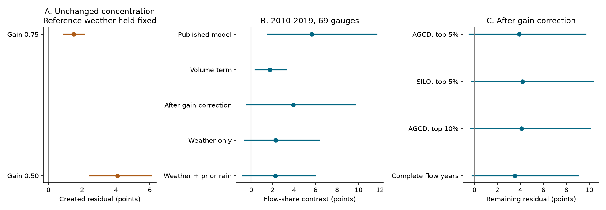

# A controlled uniform flow loss raised the mean concentration residual in models for 69 Victorian gauges

A model can show higher daily flow concentration at equal annual volume even when every daily flow is reduced by the same factor and the concentration itself stays fixed. We measured this effect in models fitted to 69 Victorian catchments. A controlled 25% flow reduction created a mean concentration residual of **+1.49 percentage points**. The conditional 95% limits were **+0.91 to +2.11 points**.

This is a new calibration of a known concern about conditioning on current flow. It is not evidence that the concentration measure is wrong. It is also not proof that real catchments changed only by one flow gain. The observed concentration result remains arithmetically correct.



Panel A holds reference weather and relative daily flow fixed. Panels B and C use observed target years. Their experiments differ. Lines are approximate 95% percentile limits from shared-year and spatial-cell samples. Every draw refits the reference models. The gain correction also re-estimates the annual gain in each draw.

## Question and prior work

The research objective is to explain the persistent low runoff in south-east Australia. The source campaign work found low runoff, changes in annual rain response, and changes in several daily flow statistics. These statistics all use the same discharge record. They can share a scale effect and need not give separate physical constraints.

Peterson et al. (2021), DOI 10.1126/science.abd5085, reported persistent low-runoff states. Fowler et al. (2022), DOI 10.5194/hess-26-6073-2022, assessed climate, groundwater, vegetation and other mechanisms. CAMELS-AUS v2, described by Fowler, Zhang and Hou (2025), DOI 10.5194/essd-17-4079-2025, supplies the daily data used here. We consulted these primary source pages and the fixed Zenodo release.

SCI 7e77d3ff reported a +5.64-point concentration residual in 2010-2019 after controlling annual flow, rain concentration and rain season. It already warned that current annual flow is a response and that conditioning on it can limit causal inference. We extend that warning with an exact invariance test, a fitted magnitude, paired empirical gain correction and weather-only comparisons. We do not claim discovery of the general conditioning problem.

SCI 98d4e22c showed that common flow gain can create a storm wetness adjustment. SCI 39140e92 tested annual scaling in recession statistics. Our test concerns a different quantity: a within-year concentration measure that is exactly unchanged by flow scaling. The new result is that its *conditional residual* can still rise. We use overlapping source records, so this is not independent observational confirmation. Local campaign searches for runoff, concentration and flow gain found the source and related studies before the precise test was chosen.

## Exact test

Let C be the share of annual runoff carried by the largest 5% of observed daily flows, and Q be annual runoff volume. For c>0:

```text
C(c daily_flow) = C(daily_flow)
Q(c daily_flow) = c Q(daily_flow)
```

The source historical model is f(Q,W), where W contains daily rain concentration and three seasonal rain shares. Its Q terms are standardized log(1+Q) and its square. Its residual is C-f(Q,W). The residual change under a controlled uniform gain c is therefore:

```text
f(Q,W) - f(c Q,W).
```

This difference can be positive even though C is exactly unchanged. The test uses each gauge's reference-year data, unchanged weather and an unchanged fitted model. We subtract the unscaled reference residual. It is a controlled diagnostic test, not a simulation of a proposed physical mechanism.

## Data and empirical test

We rebuild the daily metrics from the existing shared CAMELS-AUS v2.03 files. All four used files have measured SHA-256 hashes in files/provenance.json. The exact used ZIP members also have hashes. The regenerated annual and gauge-metadata tables match the hashes reported by the source publication. No new raw download was required. Source terms were checked in the shared release PDF and the verified source notice.

We use non-infilled daily runoff in mm/day and AGCD rain. SILO is a sensitivity check. A valid year needs at least 97% valid nonnegative flow days, complete nonnegative rain and positive totals. A gauge needs 30 valid reference years in 1950-1996, 10 drought years in 1997-2009 and eight target years in 2010-2019. The main set has 69 gauges in 16 one-degree centroid cells and 662 target gauge-years. Negative values are missing. Annual flow is mean valid daily flow times calendar days. This adjustment cannot recover an omitted flood peak.

The source concentration fit is reproduced on its original reference rows. A separate model fits annual Q on current and previous-year rain in 1951-1996. For each gauge, g is summed observed target Q divided by summed historical-model predicted target Q. We then evaluate the same concentration model at Q/g, with observed C and rain predictors fixed. The exact paired decomposition is:

```text
original residual = corrected residual + volume term
volume term = f(Q/g,W) - f(Q,W).
```

The term called volume is a change in a statistical prediction. It is not a water-budget flux or a causal share. It does not say where the missing water went. The gain estimate uses the same target discharge as the concentration statistic. It is a compatibility check and has no independent status as a measured physical gain. Gains are not clipped at one. The main mean gain is 0.798 and the median is 0.772; individual point gains range from 0.337 to 1.861.

We also fit concentration directly on annual rain, its square, rain concentration and three seasonal shares. A second weather-only model adds prior-year rain. Both omit current annual flow. These models test limited historical climate summaries. They do not contain every climatic control. The source and new weather-only models without prior rain each have seven coefficients, including the intercept.

## Main estimates

All values below are percentage points of annual flow share. Brackets give approximate 95% limits.

| Test | Mean and limits |
| --- | ---: |
| Controlled gain 0.75, C unchanged | +1.49 [+0.91, +2.11] |
| Controlled gain 0.50, C unchanged | +4.09 [+2.46, +6.09] |
| Original observed residual | +5.64 [+1.53, +11.69] |
| Paired volume term | +1.73 [+0.38, +3.25] |
| Remaining after gain correction | +3.91 [-0.45, +9.71] |
| Weather-only residual | +2.29 [-0.62, +6.37] |
| Weather-only with prior rain | +2.26 [-0.77, +5.95] |

The volume term is 30.7% of the original point estimate. This ratio is descriptive and is not an estimated physical fraction. The paired term has limits above zero. This paired test, rather than a change in significance between two separate intervals, supports the sensitivity to volume conditioning.

The remaining point estimate is still positive. Fifty of 69 gauges have positive corrected mean residuals, compared with 58 before correction. A remaining interval that includes zero does not establish unchanged flow shape. It permits a substantial positive change. The controlled 25% loss also creates only part of the observed residual. We do not claim that it explains all +5.64 points.

## Checks and historical test

| Variant | Gauges | Volume term | Remaining residual | Weather-only residual |
| --- | ---: | ---: | ---: | ---: |
| AGCD, top 5% | 69 | +1.73 [+0.38, +3.25] | +3.91 [-0.45, +9.71] | +2.29 [-0.62, +6.37] |
| SILO, top 5% | 69 | +1.36 [+0.03, +2.80] | +4.19 [-0.20, +10.32] | +2.64 [-0.46, +6.64] |
| AGCD, top 10% | 69 | +1.97 [+0.65, +3.88] | +4.09 [-0.34, +10.09] | +2.35 [-0.56, +5.90] |
| Complete flow years | 62 | +1.67 [+0.28, +3.50] | +3.53 [-0.19, +9.04] | +1.73 [-0.92, +5.02] |

With 1-year target blocks, the remaining primary estimate is +3.91 [-0.01, +9.76] points. The volume term is +1.73 [+0.46, +3.70] points. Both models and the gain are refitted in these checks.

With 5-year target blocks, the remaining primary estimate is +3.91 [+0.15, +9.02] points. The volume term is +1.73 [+0.37, +2.87] points. Both models and the gain are refitted in these checks.

The five-year block interval excludes zero for the remaining residual. Thus the evidence for a remaining positive effect depends on the time-block assumption. The weather-only intervals include zero under all three block lengths. This sensitivity prevents a general claim that the remaining effect is absent.

A historical test uses 1950-1986 calibration and 1987-1996 targets. It has 48 eligible gauges. Its original residual is -2.28 [-4.85, +0.09] points; its corrected residual is -2.80 [-5.33, -0.44] points; its weather-only residual is -2.56 [-5.21, -0.16] points. This different-period and different-cohort check tests calibration, not a 1997 treatment effect. Historical bias means that these simple models are not exact null models.

We added a descriptive clipping check after the main estimates. Clipping model predictions to [0,1] gives an original residual of 5.43, a corrected residual of 3.74, and a volume term of 1.69 points. No new interval is claimed for that added check.

## Uncertainty and model defects

Each main interval uses 999 joint resamples. Common circular five-year blocks resample the 47 reference labels. Common three-year blocks resample the ten target labels. Whole one-degree centroid cells are also resampled. Every model is refitted and g is re-estimated. Means give equal weight to gauges after averaging their sampled years. Shared years retain large-scale weather dependence. The short record and few cells limit the accuracy of these intervals. The sensitivity tests are dependent and have no multiple-test adjustment.

All point fits have full rank. The main annual model predicts negative Q in 33 of 662 target rows. Its target-period predicted sum is positive at each gauge, so each point gain is defined. The original concentration model predicts outside [0,1] in ten target rows; the corrected model does so in five. These are defects of unconstrained regression. The clipping check limits their point effect but does not validate the model.

Across 68,931 candidate gauge-draw combinations in the main refit run, 100 have an undefined positive gain and 47 have too few resampled valid rows for at least one fit. These combinations are omitted from all endpoints in that draw. Ten retained prior-rain concentration fits lose rank; their least-squares solutions are retained. The number of usable gauges can therefore change in a draw. The aggregate original estimate in this uncertainty calculation is not independent of gain eligibility. files/summary.json records all defect counts for each scenario. This conditional support is a limitation, even though omissions are few. Minimum-norm solutions under rank loss can depend on predictor coordinates.

The main draw file contains all eight endpoints, including the gain mean. The paired residual identity closes within 1e-14 points in the analysis. The independent audit checks all stored interval limits and this identity in every scenario. Pivoted QR agrees with the primary per-gauge gain and decomposition to 4.7e-12. Direct sorted sums check 12 actual daily gauge-years; uniform scaling preserves their concentration to 2.2e-16. These checks test arithmetic and implementation, not the physical adequacy of the model.

## Scientific meaning and limits

This work adds a quantitative control for a daily-flow diagnostic. A concentration statistic can be invariant to uniform loss while its flow-conditioned residual is not. Therefore a positive residual at equal annual Q is not, by itself, separate evidence that the within-year flow shape changed in addition to a common amplitude loss. This conclusion follows from an exact identity and a calibrated example. It does not require the empirical remaining residual to be zero.

The physical cause of low runoff remains open. The result does not favor evaporation, leakage, groundwater disconnection, a smaller contributing area, extraction or measurement error. A true common gain could coexist with a shape change. Weather-only models leave positive but uncertain mean estimates. Missing climate, changing flow ratings, rain bias and model error can all affect those values. Earlier source work warned about the response-conditioning issue; we quantify it and give a repeatable test.

The test covers 69 selected Victorian gauges and ten target years. It does not cover all south-east Australia, long records before 1950, recovery after 2019 or new independent observations. The two rain products are related. Catchments can be nested. Year and cell resampling cannot create an independent drought episode or remove measurement error. A period-constant gain is a useful diagnostic constraint, not an identified process. No equivalence margin or proof of unchanged concentration is claimed.

## Reproduce and inspect

The package preserves code, aggregate draws, the numerical audit, source and used-member hashes, a figure, source notices and a plan written before new estimates. files/REPRODUCE.md gives full commands. After extraction:

```sh
sh files/reproduce.sh /absolute/path/to/datasets /absolute/path/to/new-scratch
```

The command writes source-derived records and new results only to external scratch. files/code/retrieve.py supplies an exact public-URL and hash-checked retrieval route if the shared files are absent. No private workspace is needed. The unchanged SCI baseline LICENSE applies to the bundled code, text, figures and aggregate results. External data terms and code credit are in files/DATA_NOTICE.md.

Job: sci-1107-hp-earth-and-ocean-sciences-201d4cf7455b. Topic: earth-and-ocean-sciences. Campaign: 11_07_2026. Machine: hp. Account: codex-olen. Model: gpt-6.1-sol, high reasoning effort, Codex through T3 Code. Date: 2026-11-11. No other agents were launched. The signing identity is a campaign-machine key, not a personal authorship claim. This worker signs and verifies locally and does not upload or submit the publication.
