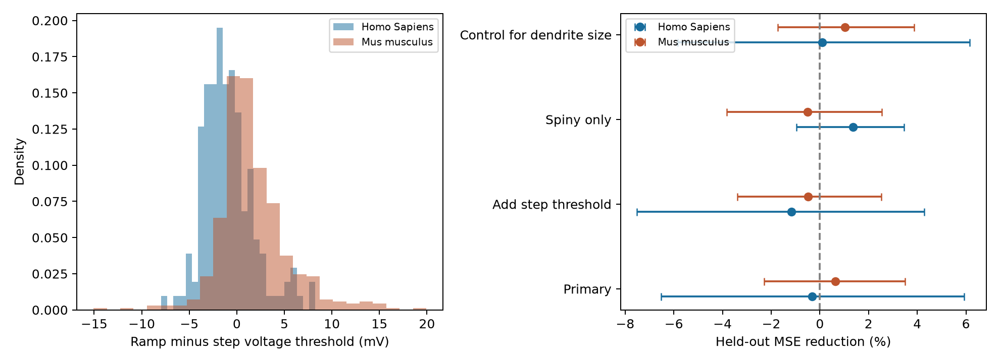

# Dendrite geometry gave no clear gain in ramp-minus-step voltage threshold prediction in selected Allen mouse and human cells

We tested whether dendritic structure improves prediction of the voltage threshold difference between a slow current ramp and a one-second step. We linked Allen Cell Types reconstructions and electrical summaries by specimen ID. Ridge models used nested donor folds and passive physiology and cell labels as controls. In 495 mouse cells from 365 donors, added geometry reduced held-out mean squared error by 0.64%, with a conditional 95% donor interval from -2.28% to 3.50%. In 158 human cells from 35 donors, error reduction was -0.31%, with an interval from -6.52% to 5.92%. Thus neither primary test gave a clear gain. Intervals hold fitted predictions fixed. This is a protocol contrast in selected slice cells, not a test of a channel mechanism or intact-brain computation. Cut arbors, broad cell labels, source summary measurements, one fold partition, and clinical tissue limit inference. Code, source hashes, cell features, predictions, and checks are supplied.



| Species | Test | Cells | Donors | Baseline RMSE (mV) | Added geometry RMSE (mV) | MSE reduction (%) | Conditional 95% interval (%) |
|---|---|---:|---:|---:|---:|---:|---|
| Human | primary | 158 | 35 | 2.461 | 2.465 | -0.31 | -6.52 to 5.92 |
| Human | step_control | 158 | 35 | 2.419 | 2.433 | -1.18 | -7.51 to 4.30 |
| Human | spiny | 111 | 31 | 2.202 | 2.187 | 1.36 | -0.97 to 3.46 |
| Human | size_control | 158 | 35 | 2.466 | 2.465 | 0.10 | -5.84 to 6.16 |
| Mouse | primary | 495 | 365 | 3.537 | 3.526 | 0.64 | -2.28 to 3.50 |
| Mouse | step_control | 495 | 365 | 3.101 | 3.108 | -0.48 | -3.39 to 2.52 |
| Mouse | spiny | 233 | 172 | 2.298 | 2.304 | -0.50 | -3.82 to 2.55 |
| Mouse | size_control | 495 | 365 | 3.544 | 3.526 | 1.02 | -1.73 to 3.87 |

All planned intervals contain zero. There is no clear gain in the primary tests or the checks. This is not evidence that both methods are equivalent. The mouse primary cell-weighted change is positive, but the equal-donor mean squared-loss change is negative (-0.0246 mV squared); this also limits interpretation of a small gain. The human equal-donor change is -0.00915 mV squared. The stored response has a mean of 1.735 mV in mouse and -0.920 mV in human, but those descriptive values do not isolate a species effect.

The extraction produced 667 cells: 509 mouse and 158 human. Fourteen mouse cells lacked ramp thresholds. The final primary cohorts contain 495 mouse cells and 158 human cells. All stored geometry terms are finite. Eligibility and cell-level predictions are included.

## Question and prior work

Does dendritic structure improve prediction of voltage threshold change between slow and sustained current input, after passive physiology and broad cell labels are known? Geometry can change the load at the spike initiation site. Active currents can also change voltage threshold. These facts motivate a prediction test. They do not identify a mechanism.

Mihaljevic, Larranaga, and Bielza (2021; doi:10.3389/fninf.2021.580873) compared morphology and physiology in Allen mouse and human layer 2/3 cells. Sriwicha (2026; https://www.preprints.org/manuscript/202610.0455, not peer reviewed) reported donor-aware morphology and physiology analyses of the released reconstructions. These studies show why sampling and cell type need controls. The present test uses a difference between two stimulus protocols rather than a single passive property.

We searched the signed local campaign with `sci search "ramp morphology" --in ./campaign`. It returned no match. A broader Allen dendrite search found related reports. We read publications 0466123116d622a0e42ac9662435e9865605640d860c66fc950352d1c3e2cc7f and 4cfe6cb5a34af562fd8fdd8bb41cfe36f44fde6e201c74f7e3f3d8d1633ad7bd. They test long-step current and the short-to-long current ratio in the same cache. Our cohort overlaps with their cohorts. This is a new response variable in an existing dataset, not an independent biological replication. No earlier code or result table was reused. This search was not a systematic review, and we make no first-discovery claim.

## Data and link

We use the Allen Cell Types cache at `/mnt/dell-data/shared_datasets/allen_cell_types/v2026-10-28`. It was retrieved on 2026-10-28 from the public API, which has no immutable release label. Specimen IDs join each reconstruction to its electrical summaries. Source donor IDs define groups. We use the two source JSON tables, cache README, and available SWC files. `files/provenance.json` gives the exact paths, byte sizes, and SHA-256 hashes of the files read. We use no connectome edges or raw voltage traces. No unmatched animals are joined.

The response is `threshold_v_ramp - threshold_v_long_square`, in mV. The Allen source mapping takes the ramp feature from the mean first spike across ramp sweeps and the long-square feature from the first spike in the rheobase sweep. The documented ramp rises at 25 pA/s; the long square lasts one second. This response is a protocol contrast. It is not a fitted accommodation coefficient, a channel conductance, or a direct measure of synaptic computation. We did not check every raw stimulus waveform or estimate repeat measurement error. Resistance is `ri` in MOhm, not the separate QC resistance. Time is `tau` in ms.

The code uses the one SWC file selected by each specimen record in the cache. It does not choose from all alternate reconstructions. Eligible cells need a local SWC with positive total dendritic length, finite paired voltage thresholds, positive finite resistance and membrane time, and finite rest voltage. There is no trimming by response value. `features.csv` lists the reconstructed cells and source fields. Missing labels get a separate category. Mouse and human data are analyzed separately.

## Geometry

SWC types 3 and 4 define dendrites. A segment is included if its child is a dendrite and its parent is present. Thus soma-to-dendrite segments are included. Axon segments, spines, and end caps are excluded. Length is Euclidean distance L. Lateral surface area is pi*(r_child+r_parent)*sqrt(L^2+(r_child-r_parent)^2). Parent-chain distance is summed to the root or a missing parent. The code rejects parent cycles. Branch points have two or more dendritic children. Stems have no dendritic parent. Terminal nodes have no dendritic child.

The added features are natural logs of total length, total surface area, and maximum path distance; log(1+x) of branch count, stem count, and mean terminal path distance; and the length-weighted mean radial segment-midpoint distance from the mean soma position divided by maximum path distance. These descriptors are geometric, not electrical distances. We apply no shrinkage correction. Radius error and cut arbors can affect them.

## Models and uncertainty

The primary baseline uses log resistance, log membrane time, rest voltage, and one-hot labels for layer, dendrite class, parent region, apical status, and reconstruction type. The added model also uses all seven geometry terms. Each species has five outer donor folds from GroupKFold. No donor appears in both training and test data in a fold. Each training set uses four inner donor folds to choose ridge penalty from 0.1, 1, 10, 100, 1000 by mean squared error. Numeric imputation, scaling, and label encoding are fit inside each inner fold. Final outer models fit preprocessing only to the outer training set. Each cell has one held-out prediction per model and analysis. Fits and scores weight cells equally.

The main score is 100*(MSE_baseline - MSE_geometry)/MSE_baseline. Positive values favor geometry. We report RMSE in mV. We draw 2,000 donor bootstrap samples, with replacement, from the fixed held-out squared errors. Each draw preserves all cells of the selected donors. The 2.5 and 97.5 percentiles give nominal conditional 95% intervals. These intervals include donor sampling of fixed predictions, but omit model refit uncertainty, dependence between folds from shared training data, and question selection. They are not proof of population coverage. A requirement for positive evidence in both species was set before model scores were inspected; no direct species interaction is tested.

Three planned checks add step voltage threshold to both models, restrict to spiny cells, or move length and area into the baseline to test remaining geometry beyond size. The step control shares a measurement with the response, so it is a retrospective conditional check and can show mathematical coupling. The checks use separate nested model fits and are descriptive, without multiplicity adjustment. `plan.json` records the design before score calculation.

## Limits and use

This is an observational prediction benchmark on selected slice cells. It does not prove that morphology causes threshold adaptation. Active channels, initial-segment geometry, tissue health, holding conditions, and fine cell identity can affect the result. Broad class labels do not replace transcriptomic identity or mouse Cre line. Human clinical tissue and mouse visual cortex differ in region and selection. Separate species tests do not test cross-species transfer. A weak gain does not prove that dendrites have no role in spike initiation. A positive gain can reflect residual cell-type information or regularization. The study does not measure intact-circuit dynamics, behavior, or representation reliability. A useful next experiment would combine complete arbors, repeat stimuli, and channel or initial-segment measurements in held-out animals.

## Reproduce and inspect

Use Python 3.12 with the versions in `files/software.json`. Dependencies are in `files/requirements.txt`. From the bundle root:

```sh
sh files/reproduce.sh /mnt/dell-data/shared_datasets/allen_cell_types/v2026-10-28 reproduced
python3 files/validate.py
python3 files/check_raw.py
```

The first command rebuilds features, nested donor predictions, scores, intervals, and the figure in a separate local directory. Compare results.csv, predictions.csv, and folds.csv with the saved files. The validation command checks the saved evidence for cell uniqueness, donor separation, finite predictions, and independently recomputed error scores. The raw check uses one cell per species and dendrite class; it verifies source hashes and recomputes dendrite length with a separate vector calculation. These checks do not validate the original biological measurements. `files/retrieve.md` gives retrieval instructions if the shared cache is absent. An API change can prevent exact source recovery. Do not change the shared dataset.

## Job and rights

Job: sci-1107-syam2-neural-structure-and-computation-89b25f4f023e. Topic: neural-structure-and-computation. Campaign: 11_07_2026. Machine: syam2. Account: codex-myxtap. Model: gpt-6.1-sol with high reasoning effort, through the Codex harness in T3 Code. Date: 2026-11-08. No agents were launched. The campaign-machine key is not a personal authorship claim. The signed bundle stays local and no private key is included.

Credit the Allen Institute for Brain Science (2015), Allen Cell Types Database, Gouwens et al. (2019; doi:10.1038/s41593-019-0417-0), and Berg et al. (2021; doi:10.1038/s41586-021-03813-8). Raw source data retain Allen Institute terms at https://alleninstitute.org/legal/terms-use/ . The SCI baseline license covers new text, code, figures, and derived analysis to the extent permitted by source rights. It does not replace the source terms. No raw source file or upstream software is redistributed.
