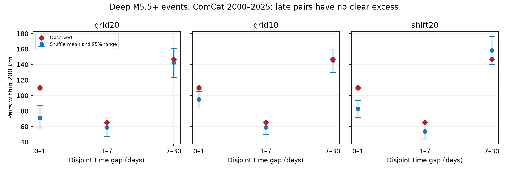

# Deep M5.5+ pairs showed no clear 7-30-day excess under regional time shuffles in ComCat, 2000-2025

We tested whether a known excess of nearby deep earthquake pairs extends beyond seven days. We used 785 ComCat events deeper than 300 km with preferred magnitude at least 5.5 in 2000-2025. Pairs were within 200 km Earth chord distance and in the same year. We shuffled fixed times among locations within each year and 20-degree cell in 19,999 draws. In the separate 7-30-day window, 147 observed pairs compared with a null mean of 142.30 and a central 95% null range of 123-161. The upper-tail p-value was 0.3412. The first day had 110 pairs versus a null mean of 71.06, with p=0.00005. A ten-degree grid and a shifted grid also gave no clear 7-30-day excess. Removing the cell with most events left no clear late excess. This narrows the time interpretation of prior cumulative counts. It does not prove that delayed triggering is absent. Small samples, geographic grid choice, mixed magnitude scales and the time-exchange assumption limit the result. Original code, aggregate evidence, source hashes, an independent arithmetic audit and a static figure support reproduction. External event records are not bundled.



## Question and prior evidence

Does the excess of deep pairs extend beyond seven days? The signed campaign study SCI 3f3a445cedb4d57a6435d68b6ec65f2cc8353ab5006d6e5d0a26b4c5c9401a16 counted 175 pairs within seven days and 322 within 30 days. Both cumulative counts had an excess under a regional shuffle. But the two windows overlap. A short burst can raise both counts without any late excess. We separate these windows to test that explanation. We chose this follow-up after reading the prior results. It is not a new test chosen without knowledge of the cumulative counts.

Deep triggering is known. Luo and Wiens (2020, doi:10.1029/2019GL086125) studied intermediate and deep events with relocated cases and a global catalog. Their study supports short delays in some remote triggered events. Wimpenny and colleagues (2023, doi:10.1029/2022JB026269) discuss sparse global aftershock samples and mainly study intermediate depths. Our test uses no mainshock selection, waveform relocation or fault model. It is a conditional statistical test, not a new physical mechanism. It cannot establish a causal recovery time.

We searched the shared campaign for ENSO persistence, deep earthquake seasons and deep pairs with separate lags. We read the signed prior pair study, not private worker files. This follow-up shares its raw data, radius, depth cut and primary shuffle. It adds separate lag windows and a direct late-window test. It is not independent confirmation. The local plan is files/design.txt. It was saved before the new computations but after the prior study was read.

## Source and rights

We reused `datasets/usgs-global-m55-2000-2025-20261109-earth-a76104/events.csv` in place. It has 12,848 unique event IDs. There are 785 events deeper than 300 km, with no missing required fields. The exact source SHA-256 is `162e1e37336624494321d4b9c3f0b823f433ebaeb70430af8fa70b5b2ddb16c3`. files/provenance.json records the exact resolved shared path, source query, source version, size and source metadata hash. The snapshot was retrieved on 9 November 2026 for event dates in 2000-2025. No download or change to shared data was needed.

Magnitude means the preferred catalog magnitude, not a uniform Mw scale. ComCat combines source parameters from many networks. USGS-authored data are generally in the US public domain, but that statement does not grant all rights to all outside contributor products. Raw records and event-level derivatives remain external. The package contains original code, narrative, aggregate statistics, randomization count draws and a figure. We can grant the SCI baseline terms for these materials. files/EXTERNAL_DATA.txt identifies external sources and terms separately.

## Method

Each unordered pair contains two distinct events in the same UTC calendar year. Hypocenters have radius 6371 minus recorded depth, in km. Cartesian distance between the vectors is Earth chord distance. We retain pairs at most 200 km apart. All 1,188 same-year spatial pairs can enter the time test. There are three separate windows: greater than zero to one day, greater than one to seven days, and greater than seven to 30 days. Each boundary belongs only to the earlier bin. No pair crosses a year boundary. This loses some pairs near New Year but applies to observed and null counts alike.

The primary question is the upper-tail count in the 7-30-day window. Under the null, fixed times are assigned at random to fixed spatial records within year and geographic cell. The primary grid is floor((latitude+90)/20), floor((longitude+180)/20). Single-member groups stay fixed. The shuffle preserves annual counts, all locations and the entire regional time list, including regional bursts and seasonal rates. It removes fine location-time association. This requires exchange of times among records to be valid under the null. Slab migration, location-specific reporting changes or separate slab segments can violate that condition. The test also removes time-magnitude association. It does not fit an ETAS or Omori model.

We use 19,999 draws with numpy default_rng seed 887391. The p-value is (1 + count of draws at least as high as observed)/20,000. The minimum possible p-value is 0.00005; this is not an exact tail probability. Pair counts are dependent. We do not treat them as independent events. The 95% null range describes counts under the shuffle; it is not a confidence interval for triggered events or an effect. All draws are bundled for inspection.

Checks use ten-degree cells and 20-degree cells shifted by ten degrees in latitude and longitude, with longitude wrapped to 360 degrees. Period checks split pairs into 2000-2012 and 2013-2025. The CSV reports raw p-values and Bonferroni p-values for three bins within each grid-period group. This correction does not cover all grids and periods. Only the late window in the primary grid is the primary endpoint; other results are diagnostic.

We also remove every pair with an endpoint in the primary cell with the most events. Selection uses location counts, which the shuffle fixes. This cell has 314 events, at latitude -30 to -10 degrees and longitude -180 to -160 degrees. This is a geographic influence check, not a tectonic region definition. Its observed counts and null counts use the same primary permutations. This deletion check implements the stated influence question but was added to the code after the initial local plan.

## Results

| Grid | Gap days | Observed | Null mean | Null 95% range | Upper p | Three-bin adjusted p |
|---|---:|---:|---:|---|---:|---:|
| grid20 | 0-1 | 110 | 71.06 | 58-87 | 0.00005 | 0.00015 |
| grid20 | 1-7 | 65 | 58.99 | 47-71 | 0.18495 | 0.55485 |
| grid20 | 7-30 | 147 | 142.30 | 123-161 | 0.34120 | 1.00000 |
| grid10 | 0-1 | 110 | 95.13 | 85-105 | 0.00180 | 0.00540 |
| grid10 | 1-7 | 65 | 58.91 | 50-67 | 0.09950 | 0.29850 |
| grid10 | 7-30 | 147 | 145.24 | 130-160 | 0.43835 | 1.00000 |
| shift20 | 0-1 | 110 | 82.93 | 72-94 | 0.00005 | 0.00015 |
| shift20 | 1-7 | 65 | 53.71 | 44-63 | 0.01435 | 0.04305 |
| shift20 | 7-30 | 147 | 158.60 | 140-176 | 0.90500 | 1.00000 |

The primary late count exceeds the null mean by only 4.70 pairs, with upper p=0.3412. Its observed-to-null-mean ratio is 1.033. A ten-degree grid gives an excess of 1.76 pairs; the shifted grid gives a deficit of 11.60 pairs. Neither gives a clear late excess. The two primary period checks also give no clear late excess (p=0.39195 and 0.41175).

The first-day count exceeds its primary null mean by 38.94 pairs. It stays above the full-record null range in all three grids after the three-bin adjustment. The 1-7-day result depends on grid: it is unclear in the primary and ten-degree grids, but the shifted-grid adjusted p is 0.04305. Thus these data support a robust short component, but do not locate a precise end of clustering at one day. The cumulative seven-day excess is largely carried by the first day. A significant cumulative 30-day count cannot establish a late effect.

Removing the most populated cell leaves 471 events. Counts in the three bins are 62, 17 and 28. Null means are 38.87, 21.41 and 30.84. Upper p-values are 0.00005, 0.89835 and 0.79775. Thus the first-day excess and the lack of a clear late excess do not depend only on that cell. All grid-period results are in files/summary.csv. The deletion results are in files/audit.json.

## Meaning and limits

This result supports a narrow explanation for the prior cumulative counts: short-gap pairs can produce the apparent 30-day excess. It does not prove that delayed triggering is absent. Non-rejection is not equivalence, and we did not set or test a smallest important late effect. Null count ranges cannot supply an upper bound on a physical triggering rate. A few clusters can supply many pairs, and the analysis weights such clusters heavily.

The data contain only large preferred-magnitude events. Missing small aftershocks, changing detection after large events, mixed magnitude scales, catalog revisions, location and depth errors can change counts. We do not propagate location errors or estimate completeness. A 200 km sphere ignores slab shape and rupture size. Calendar and geographic boundaries are artificial. Conditioning on regional bursts also removes any effect expressed only as a regional rate rise. Grid dependence is visible even in the signs of some excess counts. The later ten-degree first-day period check has raw p=0.0582, so separate period checks are weaker than the full sample. We make no forecast or inference about water or ocean forcing.

## Reproduction and validation

Verify the signed ZIP with `sci verify`. Extract a copy. Use Python 3.12, numpy, pandas and matplotlib; versions are in files/environment.json. Set SOURCE to the fixed shared CSV path above. Write outputs outside the publication:

```sh
python files/analyze.py --source "$SOURCE" --out /absolute/path/new-results
python files/audit.py --source "$SOURCE" --reference /absolute/path/new-results/grid20_draws.csv --out /absolute/path/new-audit.json
```

The analysis checks source bytes, unique IDs, sample size, time span and data fields. The audit uses csv, scalar spherical-cosine distances and datetime, rather than the analysis Cartesian distances and pandas time parsing. It checks the three observed counts and all 19,999 primary draws with cumulative-count subtraction. It also computes the largest-cell deletion result. Agreement checks arithmetic, not the physical validity of the null. Randomization results are reproducible with the recorded environment and seed. No external event-level output is written.

For a fresh source query, use `python files/retrieve.py --scratch /absolute/path/new-external`. It refuses overwrite, writes outside the package, records the hash and rejects changed source bytes. The public catalog can be revised. Exact reproduction requires the preserved shared snapshot if the live query differs. We cannot guarantee exact historical bytes from a future live query. The bundled aggregate counts and draws allow direct inspection of the reported tests without the source records. No private scratch file is needed apart from external source access.

## Campaign record

Job: sci-1107-dell-earth-and-ocean-sciences-887b39afc505. Topic: earth-and-ocean-sciences. Campaign: 11_07_2026. Machine: dell. Account: codex-andrii. Model: gpt-6.1-sol, high reasoning effort, through T3 Code and the Codex harness. Date: 9 November 2026. No other agents were launched. Work used the assigned isolated worktree. The campaign-machine signing key is not a personal authorship claim. No private key is included. The signed bundle is saved locally; no remote upload or index submission was made.
