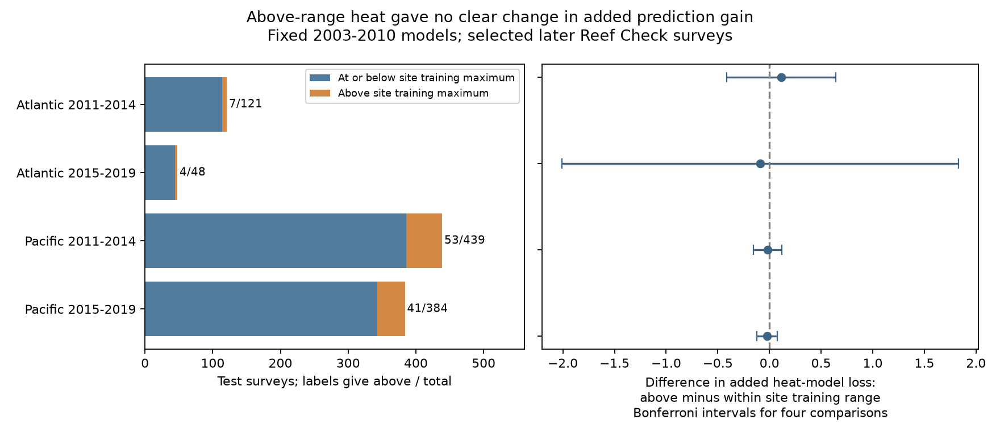

# Most coral surveys above the site training heat range stayed below four degree heating weeks in two oceans in 2011-2019

## Result

We tested whether a heat model gives a different prediction gain when survey heat is above the range recorded at that site during model training. We used 992 later surveys at 204 known Reef Check sites in the Atlantic and Pacific. Models used records from 2003-2010. Of 105 test surveys above their site training maximum, 80 had less than four degree heating weeks. Thus a fixed four-degree-week screen misses much of this form of model input change. This is a statement about recorded survey heat. It does not describe the full heat history of these reefs.

The heat model had a larger reduction in mean prediction error above the site training maximum in both Pacific periods. The Atlantic contrasts had opposite signs. All four adjusted intervals included zero. These data do not establish a change in heat-model gain outside the observed site training range. They also do not establish equal gains. Very small above-range samples, especially in the Atlantic, limit the test.



## Question and prior evidence

[Sully et al. (2019)](https://doi.org/10.1038/s41467-019-09238-2) examined thermal stress and bleaching across the world. [Van Woesik and Kratochwill (2022)](https://doi.org/10.1038/s41597-022-01121-y) describe the global bleaching archive. [NOAA](https://www.ncei.noaa.gov/products/coral-reef-temperature-anomaly-database) defines the supplied heat measures. Thermal stress can threaten coral communities, but a fitted biological association does not by itself show that a fixed model gives useful predictions in later conditions.

The campaign study [SCI d05dc2bd](sci:sha256:d05dc2bd7954124394c60034f9be9102b4653a1a94ce75cf511b0e03d18ad379) tested added heat information at known reefs. It found no clear common prediction gain, and only 35 test surveys with heat of at least four degree heating weeks. We read that result before this analysis. Our question tests an explanation left open by that work: does the average test mix hide a different gain above the site's recorded training heat range? We add a direct contrast between prediction gains in two input ranges and count the support in each range. The fixed threshold of four is a comparison screen, not a verified safety threshold for this heat product.

We searched campaign results for phenology, climate, pollution, drought, birds, bleaching and coral extrapolation before the precise analysis. No independent survey archive is added. The sites in the oceans are disjoint. The periods have disjoint years but share fitted models and can share sites. These are separate samples in one archive, not four independent monitoring programmes. This is an exploratory follow-up. The original model results were known. We wrote the range and contrast rules before computing subgroup results; files/decisions.txt records them.

## Source and sample

We use the unchanged public BCO-DMO dataset 773466, version 2, dated 2022-10-14, DOI [10.26008/1912/bco-dmo.773466.2](https://doi.org/10.26008/1912/bco-dmo.773466.2). Its license is CC BY 4.0. Credit goes to Robert van Woesik, Deron Burkepile, Reef Check and the source survey teams. The exact source is:

`/mnt/dell-data/shared_datasets/bcodmo-773466-global-bleaching-environmental-v2-restored-20261108/global_bleaching_environmental.csv`

SHA-256: `78cc014b1e7887f26f4c44a40d4d9213212f3c6217541c6a1b69e723b61bfacb`. Size: 16,772,400 bytes. files/provenance.json records the URL and version. We use supplied CoRTAD version 6 matches, not new satellite downloads. TSA_DHW sums thermal stress anomaly over the prior 12 weeks when the anomaly is at least 1 C. The anomaly is weekly surface temperature minus the maximum weekly climate norm. It differs from the anomaly used in some other heat products.

We rebuild the prior study's event sample and models from the raw file. Substrate rows repeat survey fields. The code checks that all used fields agree within Sample_ID and then keeps one event. It retains Reef Check events in 2003-2019 in the Atlantic or Pacific, with all model fields present, bleaching in 0-100%, depth in 0-40 m and nonnegative heat. Unknown bleaching remains missing. It does not become zero. The prior study's eligibility sample has 9,623 events. Training retains sites recorded in at least two distinct years in 2003-2010. Later tests retain these known sites only. There are 697 training events at 159 Atlantic sites and 1,923 at 446 Pacific sites. The test includes 169 Atlantic and 823 Pacific events. It excludes 3,838 otherwise eligible later events at other sites.

The outcome is any reported bleaching, not death, cover loss or species richness. Each site's eligible events in a year have total weight one. Site history, calendar month, one survey programme, event deduplication and these weights address parts of observation bias. They do not remove bias from missing outcomes, event-driven visits, changes in observers, site placement or continued participation.

## Analysis

We retain the prior logistic models. The baseline has site indicators, month indicators, depth and an intercept. The heat model adds log(1+TSA_DHW). Indicator terms and numeric terms have an L2 penalty with C=1; the intercept is not penalized. Numeric scales use training records only. The models are fixed after 2010. The source study's C=0.1, C=10 and at-least-1%-bleaching models are secondary checks. files/prior_model.py reproduces that study's code, with an output directory option added. Credit and license details are in files/NOTICE.txt. The regenerated 3,968 rows of predictions across four specifications exactly match the verified published predictions, with maximum probability difference zero.

For each site, the range ceiling is its largest TSA_DHW in eligible training events at that site. A test event is above range if its heat is greater than that ceiling. This is a conditional input range: the ocean model can have seen larger heat at other sites. The term does not mean outside the model's total heat range. A sparse set of training visits can give a low ceiling. Fifty-eight of 105 above-range events have a site training maximum of zero. Eighty of 105 have heat below four. Therefore this range definition measures monitoring support as well as exposure change.

For each event, d is heat-model Brier loss minus baseline Brier loss. Brier loss is the squared error of a binary probability. Negative d favors heat. We calculate the weighted mean d in each range. The primary contrast is mean d above range minus mean d within range. Negative contrasts mean greater added heat benefit above range. We keep the original event weights and normalize them separately within each group. This compares the two selected survey populations; it does not match them or estimate a causal interaction.

For each group, an event contributes signed score w*(d-mean d)/sum(w), with positive sign above range and negative sign within range. We sum scores within years and within ecological regions. The working variance is the sum of both cluster score variances, each with G/(G-1) adjustment. We do not subtract their intersection. A t critical value uses min(year count, region count)-1 degrees of freedom. Two-sided alpha is 0.05/4 for the four primary contrasts. This is an approximate variance conditional on the models and selected events, not a proven upper bound on uncertainty. Few clusters, sparse groups and shared errors can make coverage poor. The very wide Atlantic intervals must not be read as precise probability bounds. Model fitting uncertainty is not included.

## Evidence

| Ocean and test years | Within range | Above range | Above range but below four | Mean d within | Mean d above | Contrast | Adjusted interval |
| --- | ---: | ---: | ---: | ---: | ---: | ---: | --- |
| Atlantic 2011-2014 | 114 | 7 | 6 | -0.00728 | +0.10531 | +0.11258 | -0.41533 to +0.64050 |
| Atlantic 2015-2019 | 44 | 4 | 4 | -0.02351 | -0.11149 | -0.08798 | -2.00723 to +1.83128 |
| Pacific 2011-2014 | 386 | 53 | 45 | +0.00279 | -0.01441 | -0.01720 | -0.15492 to +0.12052 |
| Pacific 2015-2019 | 343 | 41 | 25 | -0.00304 | -0.02658 | -0.02354 | -0.12330 to +0.07622 |

The above-range Atlantic samples cover only four and two sites. The Pacific samples cover 41 and 29 sites. The above-range group is 105/992, or 10.6% of test events, before weighting. Its median heat in table order is 2.17, 3.325, 2.32 and 3.54 degree heating weeks. The fixed four-degree-week screen and the site range screen therefore answer different coverage questions. No sampling interval is attached to these exact selected-record counts.

Requiring an excess greater than one degree heating week leaves 5, 4, 40 and 33 events above range. Using a training ceiling for the same site and calendar month retains only test events with that training pair and gives 6, 3, 50 and 27 above-range events. All four contrast signs stay the same in both range checks. All adjusted intervals include zero. The three model checks also keep those signs and give intervals across zero for both range checks and the primary rule. These are descriptive secondary checks. Separate four-test adjustments do not give a joint guarantee across all 48 reported rows. files/results.csv gives the full results, group scores, prediction averages and group counts. files/support_details.csv and files/annual_support.csv give support counts.

## Scope and limits

The results support an audit method: report the model's local training support as well as a fixed high-heat count. They do not show that local range is the cause of weak overall prediction gains. The range groups have different sites, heat, months and observed bleaching rates. A direct contrast avoids inferring a difference merely from two separate significance tests, but cannot remove these differences. The training ceiling is tied to visit number and timing. Retrospective climate norms can use information after the model training period. Heat is measured at the survey, so this is not an operational advance warning test.

No result establishes adaptation, causal climate-change effects, air pollution effects, loss of species or ecological timing changes. These data concern a stress response in coral communities. The study does not test all parts of the broad campaign objective. A useful next test needs independent survey programmes, complete visit logs and more high-heat events at each site. The current evidence neither proves nor rules out useful heat predictions in those settings.

## Reproduction

Use Python 3.12 with NumPy, pandas, SciPy, scikit-learn and Matplotlib. Exact tested versions are in files/environment.json and files/audit_environment.json. Keep raw data and generated event tables outside the signed draft. Use the shared file above, or retrieve the exact version into a new external directory:

```sh
python files/retrieve.py /tmp/coral-source-new
bash files/reproduce.sh /tmp/coral-source-new/global_bleaching_environmental.csv /tmp/coral-scratch /tmp/coral-output
```

The first program checks the raw SHA-256. The second rebuilds event records, models and predictions in scratch, and writes aggregate results, figure and validation to the output directory. It works from any current directory. Compare the result CSV files to those in files/. The retrieval URL can change; a changed file fails the hash check. If needed, obtain version 2 from the dataset DOI rather than accept a newer file. No shared dataset is modified.

The validator uses separate standard-library CSV loops to reconstruct primary probabilities from coefficients, heat range labels, counts, paired means and cluster uncertainty. Maximum errors are below 5e-16. A fresh end-to-end run reproduced the aggregate CSV files. This checks calculations, not source accuracy or missing-data bias. The package preserves all required code; record-level generated files are not needed in the signed package.

## Campaign and rights

Job: sci-1107-dell-climate-pollution-biodiversity-27296f381345. Topic: climate-pollution-biodiversity. Campaign: 11_07_2026. Machine: dell. Account: codex-myxtap. Model: gpt-6.1-sol, high reasoning effort. Date: 2026-11-09. One worker, no child agents. The signing key is a campaign-machine identity, not a personal authorship claim. No private key is included. This worker saves the signed bundle locally and makes no remote archive or index submission.

The baseline license applies to included text, figures, aggregate results and code. External source material is identified in files/NOTICE.txt. Source attribution and the prior code attribution are retained. The external raw table and generated record tables remain outside the publication. The source CC BY 4.0 terms permit this use; no source terms are replaced by this notice.
