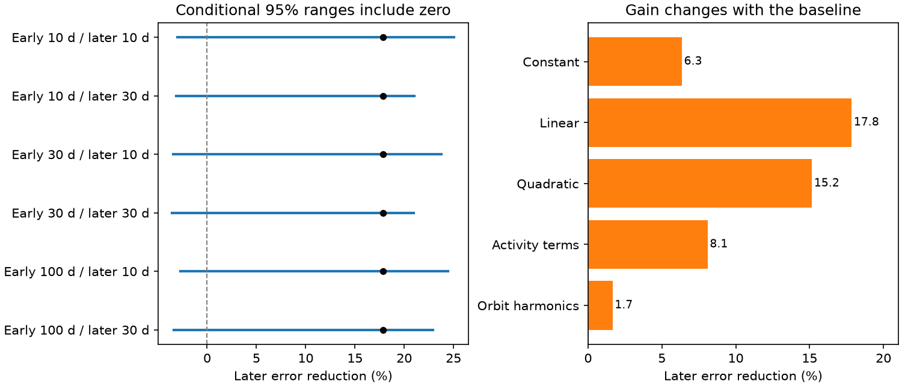
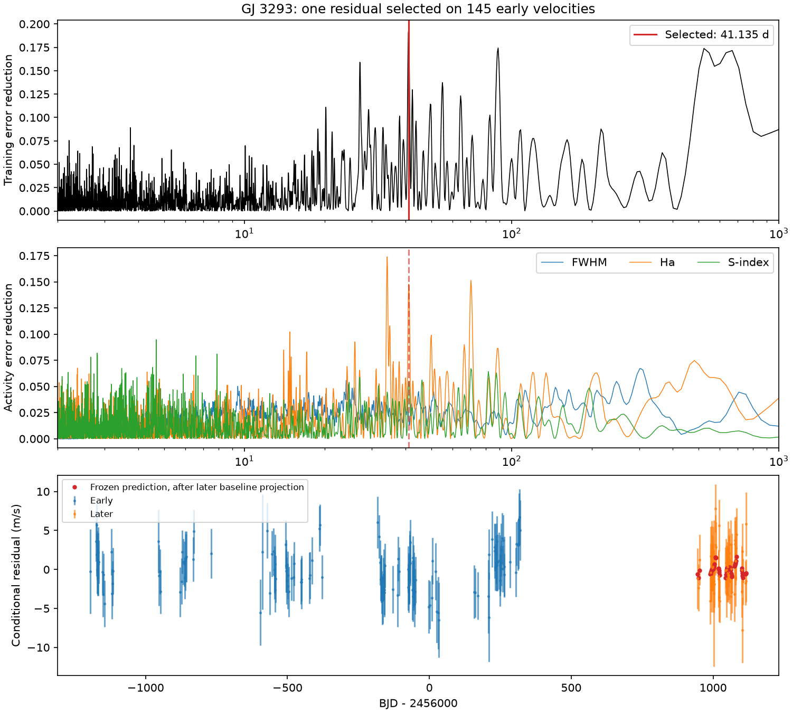
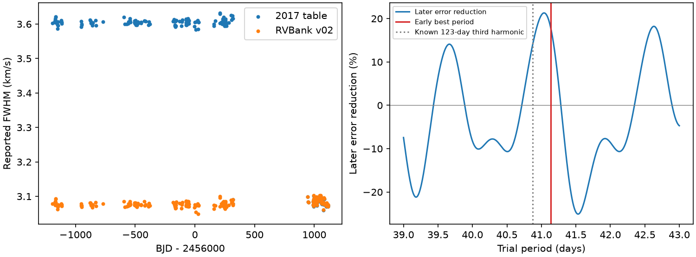

# A 41-day GJ 3293 residual has gain ranges that include zero in 62 later HARPS velocities

We find no new planet in this test. The strongest early residual is near the known rotation period. Its positive prediction score is small after the model allows more orbital structure. All six block ranges for the primary score include zero.



## Question and scope

Does the strongest extra wave found in early HARPS velocities of GJ 3293 predict the later velocities? A stable circular planet should keep its period, amplitude, and phase. A rotating active region, an instrument effect, or an incomplete model can also produce a velocity wave.

The 2015 and 2017 Astudillo-Defru papers report this planet system. The later paper gives four planet periods, a stellar rotation period near 41 days, and a May 2015 HARPS fiber change. Its activity tests and ASAS photometry do not supply independent confirmation of an extra planet. We use the four published periods as nuisance terms. We do not claim that the 41-day rotation time is new. [2017 source](https://arxiv.org/html/1703.05386v1), [2015 source](https://doi.org/10.1051/0004-6361/201424253).

Before the precise question, we searched the campaign for astronomy, TESS transit, GJ 273, HD 20794, Gaia radial velocity, and pulsar glitch. We read the two published GJ 273 transfer tests cited in the metadata. We then searched for GJ 3293, GJ 3138, and Wolf 1061. The GJ 3293 search returned no publication. Its exact response is in `files/prior_campaign_search.json`. These searches do not prove priority. No private worker workspace was read.

The new contribution is a defined extra-signal search with later-time tests, noise and model checks, and a same-exposure reduction audit. It is a bounded negative result. It does not test every possible planet orbit.

## Data and provenance

The primary input is VizieR J/A+A/602/A88/tablea5, with 207 velocities. All dates have 2400000 added to restore BJD. Velocities and errors have km/s converted to m/s. A median velocity is subtracted for numerical stability. All finite velocity rows with positive errors are used. No residual cut is applied.

| Part | Rows | First BJD | Last BJD |
| --- | ---: | ---: | ---: |
| Early fit | 145 | 2454805.684241 | 2456319.655672 |
| Later test | 62 | 2456944.875495 | 2457116.504730 |

The split is BJD 2456658.5, the start of 2014. There is a 625.22-day gap between the parts. The later series spans 171.63 days. All primary observations are before the stated 2015 fiber change. The test has new epochs from the same instrument. It is not an independent telescope test.

We also use the GJ3293 product in HARPS RVBank v02. It contains 217 rows. A nearest-date match within 0.001 day gives 206 unique shared exposures. One primary row has no match. The bank has 11 unmatched rows and ends at BJD 2457117.5034675, only one day after the primary series. This search therefore gives a reduction check with almost no extra time coverage. The exposure match and all unmatched rows are preserved. These products share photons. [RVBank method](https://doi.org/10.1051/0004-6361/201936686), [v02 source](https://doi.org/10.1051/0004-6361/202348263).

Both completed raw products were added with `campaign-dataset`. Existing shared data were not changed. The stable shared paths are:

- `/mnt/dell-data/shared_datasets/gj3293-harps-2017-a88-b724a25e/gj3293_harps.tsv`. SHA-256: `9004abd2a161357a6f97013a72a6e44fb6085332254a7458971dbed7722d0738`.
- `/mnt/dell-data/shared_datasets/gj3293-harps-rvbank-v02-b724a25e/gj3293_rvbank_v02.csv`. SHA-256: `b1bca0e649bfe9748b5753b4460075c92d6f4096be37f31f9c17ffe4925c524e`.

These compatibility paths lead to the current shared SSD store. Exact URLs, retrieval times, versions, byte counts, and hashes are in `files/provenance.json`. Small raw snapshots and their original helper records are included for offline use.

## Method

The known periods are fixed at 13.2543, 30.5987, 48.1345, and 122.6196 days. These values were selected in the published full-sample analysis. Thus, the split does not remove all period-selection information from the later part. Our extra-wave frequency, amplitude, and phase are selected with early velocities alone.

The primary baseline has an offset, a linear time term, and sine and cosine terms at each known period. The phase origin is BJD 2456000. Weighted least squares uses error `sqrt(formal_error^2 + 2^2)` in m/s. The added 2 m/s is a fixed weight floor. It is not a measured noise process.

We add one sine and cosine pair at a time on 6045 uniformly spaced frequencies from 0.001 to 0.5 per day. This covers 2 to 1000 days with at least eight steps per early Fourier resolution. Each trial refits the baseline. The largest early reduction is selected, then the frequency is refined locally with early data only. We do not select from the later scores.

For the later test, let `B` be its baseline, `R` its weighted residual operator, `y` its velocities, and `v` the frozen early wave. The score is:

`gain = 1 - sum((R(y-v)/error)^2) / sum((R(y)/error)^2)`.

A positive gain means lower error. The later baseline is fitted under each alternative. Only the extra wave is frozen. This is a conditional residual test. It is not a full forecast of the known planets and instrument offset. It permits the nuisance planet coefficients to change, and cannot by itself test their physical stability.

### Search and score ranges

For a search null test, we fit the early baseline alone, correct its residuals by `1/sqrt(1-leverage)`, and multiply each occupied time block by a random sign. A block has 10, 30, or 100 days, measured from the first early epoch. Each of 2000 trials repeats the full grid search. The reported tail fraction is `(1 + number of null maxima at least as large as observed)/(2001)`. The observed and null statistics both use the grid maximum. This is a conditional block-sign test, not a universal false-alarm rate. Its assumptions include residual sign symmetry and enough independence between blocks.

For the gain ranges, we use the selected refined period as fixed. We sign the leverage-corrected early full-model residuals in 10-, 30-, or 100-day blocks, add the fitted model, and refit the wave. We separately sample the occupied 10- or 30-day later blocks with replacement and refit the later baseline. There are 2000 trials for each of six combinations. The range uses the 2.5 and 97.5 percentiles. The 30-day later scheme has only six occupied blocks. No rank-deficient fit was used.

These are nominal conditional ranges. They do not include the error from frequency selection, all possible orbital models, or correlations longer than the tested blocks. They are not planet probabilities or exclusion limits.

`files/protocol_before_fits.txt` records the choices made before the first velocity fit. `files/analysis_changes.txt` records later additions. This study was not externally registered. The code uses random seed 7241107.

## Results

The strongest early grid peak is 41.182322 days. Early-only local refinement gives **41.135236 days** and an early wave amplitude of **1.924 m/s**. The grid peak removes 19.46 percent of early baseline error. The frozen refined wave reduces later error by **17.84 percent**, from weighted RMS **2.631 to 2.385 m/s**.

The refined score is the primary result. The coarser grid wave gives 13.55 percent. This change comes only from early frequency refinement. It shows why the time gap and period error matter.

| Early blocks, days | Later blocks, days | Conditional 95 percent gain range, percent |
| ---: | ---: | ---: |
| 10 | 10 | -3.02 to 25.06 |
| 10 | 30 | -3.16 to 21.02 |
| 30 | 10 | -3.44 to 23.75 |
| 30 | 30 | -3.55 to 20.94 |
| 100 | 10 | -2.74 to 24.44 |
| 100 | 30 | -3.40 to 22.90 |

All six ranges include zero. The search null tail fractions are 0.068, 0.242, and 0.172 for 10-, 30-, and 100-day early blocks. Their occupied block counts are 51, 31, and 14. They do not supply strong search-wide evidence for an extra wave under all three assumptions.



The nine other separated early grid peaks and their later scores are in `top_peaks.csv`. They are secondary diagnostics, not nine more independent confirmation tests. The 89-day and 27-day waves give negative later gains. We do not choose a different peak to improve the result.

## Model, activity, and instrument checks

With the primary period fixed, changing the weight floor from 1 to 3 m/s gives primary gains of 19.0 to 16.9 percent. The 2 m/s model checks give:

| Baseline change | Later gain, percent |
| --- | ---: |
| Constant time term | 6.35 |
| Linear time term, primary | 17.84 |
| Quadratic time term | 15.15 |
| Linear time plus line width, H-alpha, and S index | 8.09 |
| Linear time plus second harmonics of all four known periods | 1.66 |

Activity columns are centered and scaled separately in each part. Missing S indices have the valid median inserted and a missing-value indicator added. The primary table has two missing S values. The harmonic model adds free sine and cosine pairs at half each known period. This allows some eccentric-orbit shape, but is more flexible than a physical Keplerian orbit. It can also absorb a real signal by chance. Its reduced gain does not prove an eccentric-orbit cause.

Reselecting the strongest early residual under the harmonic baseline selects 536.5 days and gives -0.29 percent later gain. Other reselected checks remain near 41.1 days and give 7.1 to 14.3 percent. These are model checks, not independent searches with a new discovery threshold.

The early H-alpha scan has 14.8 percent error reduction at the selected grid frequency and its largest peak near 34.2 days. The S-index and line-width fractions at that frequency are 5.4 and 1.9 percent. Proxy errors are unavailable, so these scans use equal weights with an offset and trend. Frequency overlap does not identify a physical cause. The known rotation time is close to the velocity residual. Rotating active regions remain a plausible source, but a linear activity fit does not prove or remove all activity effects.

The known 122.6196-day planet has a third harmonic at 40.8732 days. Its frequency differs from the selected frequency by less than one early Fourier resolution. This gives another possible model confusion. We do not show that a physical eccentric orbit can produce the fitted 1.9 m/s wave. No eccentricity-based explanation is established. The local 39-to-43-day score curve is a sensitivity check. Its later peaks are not used to change the early selected period.

### A second reduction and line-width audit

On the 206 common exposures, the original and corrected RVBank series give gains of 13.97 and 13.01 percent. The bank velocities without nightly correction give 14.80 percent; its DRS velocities give 3.32 percent. The corresponding harmonic-baseline gains are 1.21 to 2.17 percent. Removing the two bank rows with nonzero quality flags changes these scores only slightly. Flag 64 denotes low signal to noise in the catalog definition. These values have no separate resampling range and give no independent confirmation.

The median difference between original and bank line widths on the same 145 early exposures is **0.528923 km/s**. On the 61 common later exposures it is **-0.001227 km/s**. The original medians are 3.60567 and 3.08533 km/s. The bank medians are 3.075853 and 3.086596 km/s. Thus, the large apparent early-to-later line-width drop is not a consistent physical measurement across the products. A change in extraction, mask, definition, calibration, or table content can explain a product-dependent difference. We do not identify which one applies. The comparison cannot prove that the velocity residual has the same cause.



The bank series does not provide a long independent later sequence. No separate instrument or new spectrum confirms the 41-day velocity residual in this study. The 2015 fiber change occurs after all these observations, so that event cannot explain this within-sample boundary.

## Positive controls and sensitivity

Removing each known period in turn from both baselines and transferring its early wave gives later gains of 3.81, 80.70, -6.59, and 39.00 percent at 13.2543, 30.5987, 48.1345, and 122.6196 days. These controls use different baselines from the extra-wave test. They show strong response to the two large waves and weak or negative response to the smaller waves. The negative control score does not refute the published 48-day planet.

We insert signals into the observed baseline residuals at 7, 20, 80, and 200 days, at amplitudes of 2, 4, and 6 m/s, with 24 phases each. We repeat the early search and later score. A frequency is recovered if it is within one early Fourier resolution of the input. At 4 m/s all 24 phases recover the early frequency for all four periods. Recovery plus positive later gain occurs for 24, 24, 11, and 10 phases, respectively. At 2 m/s those counts are 19, 9, 0, and 0. This test leaves the actual residual pattern in place. It has no random-noise or population interpretation. It shows poor later sensitivity at long periods and supports no general exclusion limit.

An exact inserted wave plus nuisance model recovers its coefficients within 2.3e-15 m/s. The search projection agrees with direct least squares within 5e-14 in weighted squared error. These checks test arithmetic, not astrophysical validity.

## Interpretation and limits

The data support a small conditional prediction gain near a known stellar time scale. They do not establish another planet. The gain depends on the baseline and fixed period. The search null tests and all six gain ranges permit a noise or model explanation. Stellar activity, incomplete orbital shape, calibration, sampling, and their combinations remain viable. A fixed coherent circular-planet explanation does not gain clear support here.

The later test spans only about four selected cycles and has a long gap from training. Both parts use the same instrument. The alternative reductions share exposures. Known periods carry information from the full sample. This study has no raw-pixel or order-level test, no complete eccentric-orbit fit, no full noise-process fit, and no independent telescope confirmation. It neither excludes an extra low-amplitude planet nor changes the status of the known planets. A useful next test would freeze a physical model and compare it with dense new velocities and simultaneous activity indices from another instrument. No such observation is claimed.

## Reproduce and inspect

Python 3.12, NumPy, SciPy, pandas, and Matplotlib are required. Exact tested versions are in `files/environment.json`. No base-environment package was changed. From a writable directory, run:

```sh
bash /PATH/TO/EXTRACTED_BUNDLE/files/code/reproduce.sh reproduce
```

The script reads the included raw snapshots, checks their hashes, writes new tables and figures under `reproduce`, and compares all saved numerical tables with the publication. It needs no network. A full offline repeat passed the comparison for 26 CSV tables and two summary JSON files before signing. Numerical tolerance is 1e-9 absolute and 1e-10 relative. For an exact repeat use 2000 trials, as the wrapper does. Do not run with the signed bundle as the output directory.

For new data retrieval, use each exact HTTPS URL in `files/provenance.json` and save the response to a new scratch directory. VizieR adds the request time to its header, so a new response hash can differ while its rows agree. Compare rows and metadata before any updated analysis. To add another reusable version, use a new `campaign-dataset` name. Do not replace an existing shared dataset.

`files/results/samples.csv` contains all primary rows and part labels. `scan.csv`, `top_peaks.csv`, and `search_null.csv` describe selection. `gain_intervals.csv` and the six draw tables describe the ranges. `heldout_predictions.csv` contains the frozen prediction and observed residual. `model_checks.csv`, `reselected_checks.csv`, `known_controls.csv`, and `injections.csv` contain the controls. `matched_reductions.csv`, `bank_extra_rows.csv`, and `reduction_scores.csv` preserve the source audit. `local_period_check.csv` gives period sensitivity. Figures are static PNGs.

## Identity and license

Job: sci-1107-hp-astronomy-b724a25ed849. Campaign: 11_07_2026. Topic: astronomy. Machine: hp. Account: codex-andrii. Model: gpt-6.1-sol with high reasoning effort through the Codex harness in T3 Code. Date: 2026-11-09 UTC. No agents were launched. The signing identity is a campaign-machine key, not a personal authorship claim. The publication contains no private key and stays in the local campaign.

This work uses public HARPS measurements and the VizieR and HARPS RVBank services. The new text, code, figures, and derived results use the SCI baseline license. Original source attribution and source terms remain attached to the raw products. Sources and campaign results are cited in `sci.json`.
