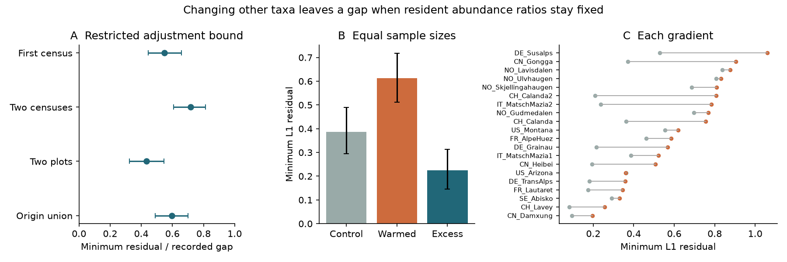

# Initially recorded plant taxa kept an abundance-ratio gap at warm sites in 20 transplant gradients

## Result

Changes in taxa that were absent from the first census cannot by themselves remove the full recorded plant composition gap, if abundance ratios among initially recorded taxa stay fixed. In 40 whole-community transplant contrasts from 20 mountain gradients, the sharp minimum residual averaged 55.0% of the final L1 gap to warm-site controls. The 95% gradient bootstrap limits were 44.6% to 65.8%. This is an empirical bound under a stated restriction, not a causal share due to dispersal.

Small plot samples can produce a large bound even within a control site. We therefore made an exploratory comparison with equal sample sizes, the same initial species set, and the same destination reference. The minimum residual was 0.612 for warmed plots and 0.387 for destination-control plots. The paired excess was **0.225 L1 units (95% gradient bootstrap limits 0.146 to 0.313)**. The L1 scale runs from zero to two. This supports a recorded difference in abundance ratios beyond the variation among the sampled warm-site control plots.

Panel A gives means and 95% gradient bootstrap limits for four definitions of the fixed species set. Panel B uses equal numbers of warmed and control plots and a shared independent destination reference. Panel C gives gradient means for that comparison. Orange marks warmed plots; grey marks control plots. The comparison is descriptive and exploratory.

## Question and relation to earlier work

Weak climate tracking can result from slow arrival, slow change after arrival, or a spatial target that does not describe the future community. The campaign measured low temperature transfer across monitoring networks. This study adds a different test based on experimental plant records. It does not reuse BBS or the 54 network summaries.

Bektaş and colleagues (2024; DOI 10.1111/ecog.07378) established incomplete convergence in this network and showed contributions from new taxa and abundance changes of existing taxa. Their experiments moved whole turfs, including soil, to lower sites. Earlier SCI work measured deviation from a spatial line (66f527a2), reference movement (8849b3e5), and turnover efficiency (41b9df4f). Thus neither incomplete convergence nor the role of resident abundance is a new discovery here.

The addition is a sharp restricted-support bound that allows compositional dilution, an independent linear-program check, and a matched control calibration. The bound asks how close any change outside an initial species set could get while preserving the observed final ratios inside that set. This separates a testable abundance-ratio restriction from a general claim about dispersal.

## Data and selection

The input is the public TransPlant processed RData, OSF file 5tu3n, version 1. The 3,349,148-byte input has SHA-256 e5373fc1e1158d6367a15a7e152da26ad8253ba7aa4cce6b274d5aae00dbc65a. It was reused in place from ./datasets/transplant-network-processed-osf-5tu3n-v1/TransPlantNetwork.RData. Exact absolute and resolved shared paths are in files/provenance.json. Source data and parsed records stay outside the publication. Source terms and attribution are in files/NOTICE-external-data.md.

We selected Warm and LocalControl records with a taxon label and nonnegative measured abundance. We use Cover, and Rel_Cover in Arizona where Cover is unavailable. Within each plot we divide by its total to form relative abundance. The source measurements differ among experiments; the common estimand is relative abundance, not uniform absolute percent cover. Local labels are retained, including unresolved taxa. Taxon matching is only within each gradient. Traits and cross-gradient species matches are not used.

For each origin-destination pair, we require three common census years after establishment, with at least three measured plots in each of the warmed, origin-control and destination-control groups. FR_Lautaret establishment is set to 2016, following the prior campaign source interpretation. We match plot IDs from first to last valid census, and require three matched plots in each group. Missing taxa in a measured plot are zero. A missing whole plot cannot establish bare ground; zero-total plots are excluded.

There are 40 retained contrasts in 20 gradients and eight countries. There are 279 warmed plot histories counted across contrasts, with three to ten plots each. Histories span two to eight years between endpoints. IN_Kashmir and US_Colorado fail the common-year rule. The first census is after transplantation. “Initially recorded” therefore does not mean present before treatment; it can include early colonists.

## Method and proof

For each contrast let w be the final warmed centroid and d the final destination-control centroid. Both sum to one. Let R contain taxa recorded in any matched warmed plot at the first census. Put W_R=sum_R w and D_R=sum_R d.

Permit any new composition z that keeps the ratios of w inside R. The total relative mass in R may change freely. All taxa outside R may also change freely. This set allows new taxa to dilute resident abundance; a simple sum of raw resident deficits would fail to allow that.

For W_R>0, the exact minimum L1 distance in this set is:

    B = sum over s in R of |D_R * w_s / W_R - d_s|

For W_R=0, the minimum is 2D_R. The observed gap is G=sum |w-d|, so 0<=B<=G. files/PROOF.md proves the formula and supplies a worked example. files/validate.py independently solves 1000 random cases by linear programming. Maximum numerical disagreement was 2.22e-16.

We average B/G across contrasts within each gradient, then give each gradient equal weight. This mean of ratios differs from the ratio of mean B to mean G. We use 5000 gradient bootstrap resamples for central 95% limits. These limits describe variation in this selected network, conditional on the observed histories.

The primary species set is from the first warmed census; the primary target is the final destination sample. Checks use the early destination target, a union of the first two warmed censuses, the initial origin pool added to the initial warmed pool, or taxa in at least two initial warmed plots. The two-census check expands the fixed set; it does not require persistence.

## Estimates and control calibration

| Measure | Estimate | 95% gradient bootstrap limits |
|---|---:|---:|
| Final L1 gap G | 1.082 | 0.929 to 1.245 |
| Minimum residual B | 0.540 | 0.442 to 0.636 |
| Mean B/G | 0.550 | 0.446 to 0.658 |
| B/G with early target | 0.589 | 0.485 to 0.689 |
| B/G with first-two-census union | 0.717 | 0.609 to 0.811 |
| B/G with presence in two initial plots | 0.434 | 0.325 to 0.545 |
| B/G with initial origin pool added | 0.595 | 0.488 to 0.700 |

Initially recorded taxa supplied a mean 58.5% of target abundance and 75.2% of final warmed abundance. The raw bound is not entirely a difference caused by transplantation: when we split destination controls and use each subset's own initial species set, the mean B/G is 0.699. This warns against using a large bound ratio alone as process evidence.

After seeing that calibration, we added a stricter paired comparison. For each contrast and each of 1000 random splits, choose n=min(number of warmed plots, floor(number of destination plots/2)). Use n destination plots as pseudo-warmed controls. Use all remaining destination plots as the common target. Draw n warmed plots without replacement. Apply the SAME fixed R, from the first warmed census, to both final centroids. Compare their minimum residuals. Average splits within each contrast before any inference. Split draws are not independent experimental replicates.

| Equal-sample comparison | Estimate | 95% gradient bootstrap limits |
|---|---:|---:|
| Warmed minimum residual | 0.612 | 0.512 to 0.718 |
| Control minimum residual | 0.387 | 0.294 to 0.489 |
| Paired excess residual | 0.225 | 0.146 to 0.313 |

The control comparison measures the same empirical restriction with the same target and species set. It reduces the simple explanation from unequal sample sizes and control heterogeneity. It is not a full correction for measurement error or initial species-set selection.

The excess remained 0.228 (0.141 to 0.316) after excluding Arizona, Damxung and Susalps. Equal-country weighting gave 0.221 (0.112 to 0.331). Leave-one-gradient-out estimates ranged from 0.206 to 0.237. Exponential final-plot weighting followed by gradient resampling gave a central 95% range of 0.446 to 0.662 for the primary raw fraction, conditional on the initial set. Shared plots across contrasts did not receive common weights in this last sensitivity check, so it is not a full design bootstrap.

## Meaning and limits

The evidence rejects an empirical adjustment rule in which all remaining change can occur outside the initially recorded taxon set while final resident ratios remain fixed. The positive matched-control excess makes this more informative than a raw nonzero bound. A fuller response requires changes among initially recorded taxa, a different target, or both.

This does not reject dispersal limitation. Real arrivals can change resident ratios through competition. Such effects are outside the restricted adjustment set. Low propagule supply can also affect a taxon already present. We did not add seeds, remove competitors, separate soil effects, or measure demographic rates. The bound cannot assign the residual to these causes. It cannot be read as the fraction of a thermal tracking deficit caused by local processes.

The warm-site target is an observed reference, not a proved future equilibrium. Downward transplantation changes moisture, soil context and other conditions along with temperature. Early colonisation before the first census is not resolved. Finite samples, missed taxa, local naming practices, different field methods, related gradients, shared controls and selected site histories limit generality. No detection model or unbiased population L1 distance estimator is fitted. The paired calibration is exploratory, and its bootstrap limits are not a randomisation test of warming. No long-term equilibrium or rate of thermal tracking is estimated.

## Reproduce and inspect

Use Python 3.12 and files/requirements.txt in a private virtual environment. Do not put external data or caches inside the publication. From an extracted bundle, use absolute paths:

    python -m venv /path/to/private_venv
    /path/to/private_venv/bin/pip install -r files/requirements.txt
    python files/retrieve.py /path/to/external_scratch
    OPENBLAS_NUM_THREADS=1 OMP_NUM_THREADS=1 MKL_NUM_THREADS=1 python files/analyze.py /path/to/external_scratch/TransPlantNetwork.RData /path/to/external_scratch /path/to/aggregate_output
    OPENBLAS_NUM_THREADS=1 OMP_NUM_THREADS=1 MKL_NUM_THREADS=1 python files/validate.py /path/to/aggregate_output
    python files/figure.py /path/to/aggregate_output

Activate the private environment or use its Python path for all commands. The retrieval script checks the exact input hash. The shared source path can replace the downloaded input. First RData parsing can take minutes. A parsed cache is reused only from your own scratch. Never load an untrusted pickle.

Without source records, the included aggregate estimates can be audited and the PNG rebuilt with validate.py and figure.py against files/ in a working copy. The audit checks all 320 bound rows. Scientific reproduction requires the external source; mathematical and aggregate checks do not.

## Research record

Job: sci-1107-dell-climate-pollution-biodiversity-0338c1966275.
Campaign: 11_07_2026. Topic: climate-pollution-biodiversity.
Machine: dell. Account: codex-olen. Model: gpt-6.1-sol, high reasoning effort.
One worker performed the study. No agents were launched. The campaign-machine signature is not a personal authorship claim.
The source provenance, analysis plan, changes to the plan, original code, proof, aggregate estimates, exclusions, validation and figure are included. No external archive upload or index submission was performed.
