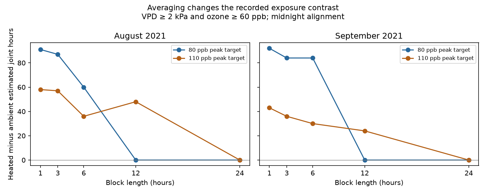

# Daily means removed four joint-exposure contrasts at fixed cutoffs in North Wales domes in August-September 2021

Daily means gave zero joint high-ozone and dry-air exposure in four heated and ambient dome comparisons. The hourly records gave positive contrasts of 43 to 92 hours. This result held for all 24 tested daily block start hours and for two ways to compute vapor pressure deficit (VPD). It applies to fixed diagnostic cutoffs of 2 kPa VPD and 60 ppb ozone. It does not show zero plant exposure or zero plant harm.

## Question and prior evidence

Does averaging before threshold classification preserve a joint-exposure contrast? This is a measurement question for studies of pollution and climate stress on plants. Mean exposure and time above a cutoff are different quantities. A coarse mean can hide an hourly event. It can also classify an entire block as exposed when some hours fail a cutoff.

The Tropospheric Ozone Assessment Report (Lefohn et al., 2018, DOI 10.1525/elementa.279) explains why ozone metrics, averaging periods and data capture matter for vegetation research. Our test concerns a joint VPD and ozone indicator. It does not test a standard plant dose metric or an injury model.

We searched the campaign for phenology, pollution biodiversity, extreme birds, wildflower, Ryalls, ozone aggregation and block averages. We read two closely related publications. SCI sci:sha256:51e63bdcebf6d84f9bdbb679bca8fa4358b41128b862f9ee6588cb023b30f2fa found little overlap beyond hour and weekday schedules in these same records. SCI sci:sha256:ab6f0e8639b533844d854c92a74a67703959f24beaccd4d0ea981325ec7fb122 gave bounds for exposure duration under assumed sensor errors. Neither tested block averaging. We use their source scope and diagnostic cutoffs, but rebuild directly from the external release with new code. This is an exploratory method extension on overlapping records. It is not independent validation of prior biological or climate findings. The analysis plan is preserved in files/PLAN.md.

## Source and observation process

Contains data supplied by UK Centre for Ecology & Hydrology.

Hayes, F.; Sharps, K. (2023). Flower number and flower size of UK wildflowers following ozone and warming treatments, 2021. NERC EDS Environmental Information Data Centre. https://doi.org/10.5285/a33d5ee3-d201-4feb-83b9-765ee5b2c25e . The source release date is 20 December 2023. External data use is under Open Government Licence v3. The external data and hourly derived records are not in this bundle. Source URLs, shared paths and exact hashes are in files/provenance.json. Attribution and external terms are in files/EXTERNAL_DATA_NOTICE.md.

The experiment used potted wildflowers in solardomes at Abergwyngregyn, North Wales. Ozone followed a weekly repeated episode profile. The peak targets were 30, 80 and 110 ppb for the tested ambient and heated pairs. Heating targeted ambient plus 4 C. Dome pairs were 3/6, 1/2 and 5/4, respectively. Ambient weather came from one sensor in dome 7. Heated weather came from each heated dome. There was one dome per treatment combination. The ten pots per species do not provide independent dome replication. We read the supporting document to check these facts. No flower table enters this test.

We drop one row with no hour label. We then use the complete 744-hour August and 720-hour September grids. We check unique date-hours, expected grids, finite readings and physical humidity limits. We do no interpolation. Earlier missing weather from system failure prevents a whole-season test. The source reports gap filling but gives no filled-hour flags. The released hourly means are the reference, not known true exposure. We keep the source time convention and do not make a clock conversion.

## Method

For temperature T in C and relative humidity R in percent, we compute:

`VPD = 0.6108 exp(17.27 T / (T + 237.3)) (1 - R/100)` kPa.

The saturation-pressure formula follows FAO-56, chapter 3, https://www.fao.org/4/X0490E/x0490e07.htm . VPD from hourly means need not equal a subhour mean. A joint hour has VPD at least 2 kPa and ozone at least 60 ppb. These inherited cutoffs are diagnostic values, not species injury thresholds. We also report every combination of VPD 1, 2 and 3 kPa and ozone 40, 60 and 80 ppb.

We partition each month into nonoverlapping blocks of 1, 3, 6, 12 or 24 hours. For length k, phase s runs from 0 to k-1 hours after the month starts. We keep only whole blocks. We drop s hours at the start and the remaining incomplete block at the end. We compare every coarse estimate with the hourly reference on exactly that retained support. Phase zero starts at midnight on the first day; all tested lengths then cover the full month. Other phases omit at most 24 hours in total. Each aggregate uses at least 696 hours. Blocks can cross midnight but cannot cross month edges.

The main method averages hourly VPD and ozone within each block. A block is positive when both means meet the same cutoffs. We assign that block state to all k constituent hours. The resulting count is an estimate of joint hours from a coarse series; it is not a claim that the measurements within the block were constant. A second method computes VPD from block mean temperature and humidity, then applies the same ozone rule. This separates a nonlinear weather transform from the loss of within-block variation.

For hourly state A and block-based state B, we count true positives, false positives (FP) and false negatives (FN). Here false means disagreement with the released hourly indicator, not known sensor error. The exact identity is:

`estimated hours - hourly hours = FP - FN`.

We subtract the ambient count from the heated count for each target, month, length and phase. Thus the contrast error equals the heated count error minus the ambient count error. No independence assumption is required. No probability model, confidence interval or p value is used. Phase ranges are exact ranges over the tested clock alignments. They are not sampling intervals. Thresholds and phases are related checks, not independent tests.

## Results

The main phase-zero contrasts, in hours, are:

| Month | Peak target ppb | Hourly | 3-hour means | 6-hour means | 12-hour means | Daily means |
| --- | ---: | ---: | ---: | ---: | ---: | ---: |
| August | 80 | 91 | 87 | 60 | 0 | 0 |
| August | 110 | 58 | 57 | 36 | 48 | 0 |
| September | 80 | 92 | 84 | 84 | 0 | 0 |
| September | 110 | 43 | 36 | 30 | 24 | 0 |

Daily means give zero counts in every tested dome, month and phase at the main cutoffs, with both VPD methods. For the four high-target comparisons, the hourly same-support contrasts stay positive over all daily phases: 84-91, 54-58, 92 and 43 hours in table order. Thus the daily result is not due to a favorable midnight boundary or only to excluded edge hours. The 30 ppb pair has zero hourly and coarse counts at the main cutoffs. This is a threshold result, not a safety result.

Aggregation does not only lose positive hours. At phase zero, six-hour heated estimates give FP/FN counts of 8/51 and 5/39 in August at targets 80 and 110, and 19/30 and 5/21 in September. Ambient FP/FN counts are 0/12 at both targets in August and 1/4 at both in September. Both types of error contribute to the paired contrast. A small net error can hide many hour classifications that disagree.

Alignment matters for shorter blocks. At the 80 ppb target in September, six-hour contrasts range from 66 to 114 hours across six phases, while the same-support hourly contrast stays 92 hours. Twelve-hour contrasts range from 0 to 132 hours. At 110 ppb in August, the midnight estimate rises from 36 hours at six hours to 48 hours at twelve hours. Therefore neither a downward bias nor a monotone decline with block length is a general rule. The full phase ranges are in files/phase_summary.csv.

The second VPD method changes individual main-cutoff estimates by up to 24 hours across all phases and block lengths. It also gives zero daily counts. Nonlinearity in the weather transform therefore does not alone explain the daily disappearance. Both methods lose within-day structure before classification. At lower cutoffs, daily exposure need not disappear: at 1 kPa and 40 ppb, all eight high-target dome-month cases have positive midnight daily estimates. At 1 kPa and 60 ppb, two of eight do. All nine cutoff combinations, including zeros, are in files/aggregation.csv. We do not claim a cutoff-invariant result.

## Interpretation and limits

In this release, daily averaging can remove the measured joint-exposure contrast even when it is positive at every tested same-support hourly comparison. Six-hour means can understate or overstate that contrast, depending on the clock boundary. Exposure summaries should specify the order of transformation, averaging and threshold classification. Retaining hourly data allows both coarse metrics and hour-level overlap to be checked.

This result does not show a climate-change trend, plant injury, ozone uptake, a change in species timing, or biodiversity loss. Air drying demand can affect stomatal opening; joint high air VPD and ozone is not a measured dose inside a leaf. The chosen diagnostic cutoffs have no tested biological calibration here. Daily metrics can be valid for other scientific questions. This study only tests their use as substitutes for this hourly indicator.

The two months have distinct hours but share domes, sensors and season. They do not provide independent regions, years or treatment assignments. Programmed ozone, dome differences, watering, one ambient weather sensor, unknown source gap filling and missing early weather limit interpretation. We do not quantify sensor error or subhour variation. Uncertainty about the source cannot be resolved by a deterministic computation. Independent field regions and years remain an open test. A next study should use jointly logged weather and ozone with explicit gap flags, preserve hour-level records, and test a biological dose metric against plant outcomes with independent treatment replication.

## Reproduction and checks

See files/REPRODUCE.md. The bundle includes original code, aggregate evidence, a static figure and provenance. Use the shared source archive in place or retrieve it to separate scratch. All regeneration output must stay outside the signed publication. The recorded archive hash and three used-member hashes identify the exact source material. No private workspace is needed to reproduce the analysis.

A separate validator uses only Python standard-library CSV parsing and scalar math. It checks all 9,936 aggregate rows against independently computed hourly and block indicators, including support size, FP and FN. All checks passed. The analysis also checks the error identity, date grid and physical ranges. These checks validate the computation, not the source sensors or ecological meaning.

Job: sci-1107-dell-climate-pollution-biodiversity-cbae06aa94a2. Topic: climate-pollution-biodiversity. Campaign: 11_07_2026. Machine: dell. Account: codex-olen. Model: gpt-6.1-sol with high reasoning effort. Analysis date: 2026-11-11. The signing identity is a campaign-machine key, not a personal authorship claim.
