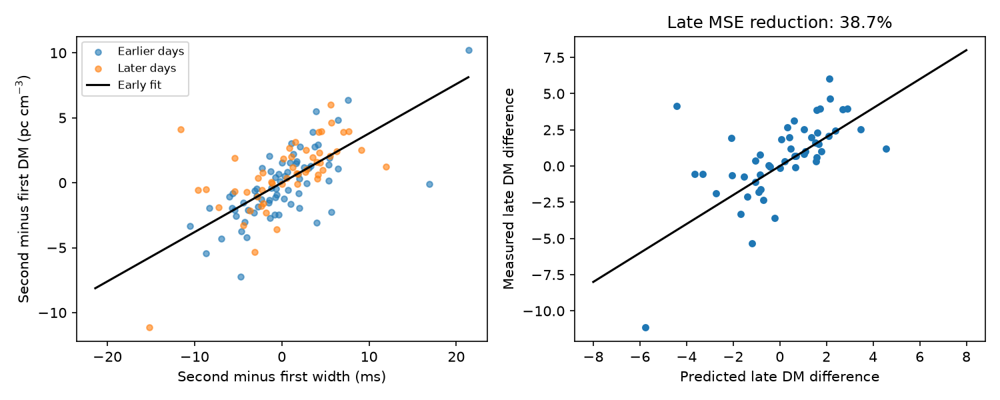
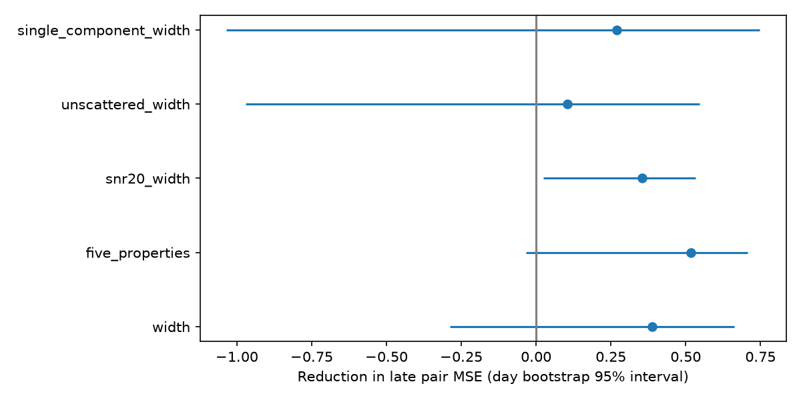

# An early width fit reduces DM-difference error by 39 percent for 51 later CHIME burst pairs of FRB 20220912A

## Result

We test whether burst width can predict the difference in fitted dispersion measure (DM) between two bursts on the same day. We use CHIME/FRB Catalog 2, release 20251231. An early fit predicts 51 later pairs with a mean squared error of 4.919, compared with 8.022 for a zero-difference model. Units are (pc cm^-3)^2. The error reduction is 38.7 percent. A 95 percent interval from resampling both early and late days is -28.7 to 66.3 percent. Thus, the measured gain has large uncertainty and does not establish a reliable gain for other samples.

The early width coefficient is 0.380 pc cm^-3 per ms, with a day-resampling interval of 0.232 to 0.531. This is an empirical relation between fitted quantities. It is not a measured plasma law. DM and width come from the same burst fit and can have correlated errors. The result supports a check for burst-shape effects before a physical interpretation of catalog DM changes. It does not identify the cause of these effects.



## Question and prior evidence

The campaign study [1] found a full-record positive DM slope for this source, but its signal-strength cut had an interval that included zero. We ask a different question: can width differences predict DM differences over seconds to minutes on later days? The time split keeps later DM values out of coefficient fitting. It does not make the target selection independent: this source was chosen from earlier published campaign work on the same mission record.

The Catalog 2 paper [2] describes the public fits and flags. Each event can have several component rows. DM is shared across these rows. We therefore use one row per event. We use the width of the first fitted component, not the total duration. A zero scattering time marks a preferred fit without a scattering tail; it is not proof that scattering is absent. Detection and fitting can affect the measured properties.

Feng et al. [3] already discuss morphology-related DM for this source and report agreement of four microshot DMs across about one month. Their interpretation assumes negligible intrinsic delay in microshots and small real DM changes. Hewitt et al. [4] report microshots with residual drift in broader components. These observations use other telescopes and support the reason for this test. We do not fit their data or confirm our CHIME coefficient with an independent telescope. Neither morphology bias nor the source is a new discovery here. The added result is a time-separated, same-day pair prediction test in this catalog release.

## Data and fixed analysis choices

The exact input is `/mnt/dell-data/shared_datasets/chime-frb-catalog2-20251231/chimefrbcat2.csv`. Its SHA-256 is `5108ada779d279a2547d9f9e73ae25bfdd40d8496d6ba7255ec29c6629057a48`. The source is the CHIME public release URL in `files/provenance.json`, with dataset DOI 10.11570/25.0066. We reused the file in place and did not change the shared data. No raw download was needed. We read and hashed only this catalog file.

We keep repeater_name=FRB20220912A, sub_num=0, excluded_flag=0, sidelobe_flag=0, and intrachan_flag=0. One of 323 events lacks fit results. We keep 322 with finite DM, time and the five model inputs, and positive width. The retained input columns are in `files/events.csv`. We do not impose a main signal-to-noise cut or use fluence. This is a within-source test, not a population or event-rate estimate.

We define a day by floor(mjd_inf), in UTC. We sort by time, then event ID, within each day. We pair events 1 and 2, then 3 and 4, and so on. The last event on an odd-count day is unused. Each event appears in at most one pair. This gives 121 pairs on 84 days. Pair time gaps range from 0.128 to 1713 seconds, with a median of 149 seconds. The pairs represent separate catalog event IDs, not separate rows for one event.

The first 42 pair days form the fitting sample: 70 pairs from MJD days 59837 to 59936. The last 42 pair days form the test sample: 51 pairs from days 59937 to 60200. This split uses dates only. Unpaired days do not set the split. The model and tests were not registered before this investigation. Later test values are used only to score the early fit and to describe uncertainty and sensitivity.

## Method

For each pair, delta means second event minus first event. The main model is delta_DM = b * delta_width_ms. It has no intercept because a common daily offset cancels in the difference. We fit b by ordinary least squares on early pairs. We apply this coefficient without refitting to later pairs. The comparator predicts delta_DM=0 for every pair. The error reduction is 1 minus the sum of squared model errors divided by the sum of squared observed DM differences. Each pair has equal weight. Days with more pairs therefore have more weight. We do not weight by formal DM errors or use width error estimates.

We resample whole days with replacement, separately in the early and late samples, 2000 times. Each replicate fits the early coefficient again and scores the resampled later pairs. The intervals are percentile intervals. They assume days can be resampled as independent units. Correlated activity across days can invalidate them. The coefficient interval uses the same early-day replicates.

A secondary randomization reverses the signs of observed DM differences for all pairs of a given test day together. It keeps the early prediction fixed and counts randomizations with no larger squared error. There are 9999 draws and a one-count correction. The main conditional p value is 0.0004. This test assumes joint sign symmetry within a day and independence across days under its null. It is not a probability that the fitted relation is physical. It tests alignment of a fixed prediction, while the bootstrap also measures the uncertain gain size. Their conclusions need not match. The secondary model and subset p values are exploratory and have no multiple-test correction.

Code and random seed 651107 are in `files/analyze.py`. `files/versions.json` records the software. `files/pairs.csv` records every main pair. `files/validation.csv` records each main later prediction.

## Sensitivity and checks

| Fit or event filter | Early / later pairs | Later error reduction | 95 percent day-resampling interval |
| --- | ---: | ---: | ---: |
| Width | 70 / 51 | 38.7% | -28.7% to 66.3% |
| Five fitted properties | 70 / 51 | 51.7% | -3.3% to 70.8% |
| Fit S/N at least 20; width | 39 / 15 | 35.4% | 2.5% to 53.2% |
| Zero reported scattering time; width | 55 / 33 | 10.5% | -97.1% to 54.7% |
| Single fitted component; width | 53 / 41 | 26.9% | -103.4% to 74.6% |

The five-property fit adds peak frequency and bandwidth in units of 100 MHz, log10(fit S/N), and flagged-channel fraction. All coefficients are fitted to early pairs only. The subset tests apply their filters to events before pairing, so their pairs can differ from the main pairs. They keep the same day boundary. They are not independent confirmations. All exact coefficients, intervals, sample counts and conditional p values are in `files/results.json`.



An additional check after the main fit deletes one test day at a time. The main error reduction then ranges from 22.1 to 54.6 percent. Deleting one fitting day at a time gives test gains from 34.7 to 39.2 percent. Removing the one later pair with the largest improvement leaves a gain of 22.1 percent. No one day explains the observed sign of the gain. These checks do not resolve the wide bootstrap interval.

`files/validate.py` checks event IDs, pair membership, day separation and input differences. It computes the main coefficient with direct sums and checks the stored predictions. `files/validation_checks.json` contains the results. An offline replay checks deterministic output. These checks establish numerical consistency, not physical validity.

## Physical and instrument limits

The median absolute paired DM difference is 1.606 pc cm^-3. Eighty of 121 pairs differ by more than three times the quadrature sum of their formal DM errors. This descriptive count is not a physical detection significance. It assumes independent formal errors, omits model error, and the pairs on one day can share conditions.

A smooth change of 1.941 pc cm^-3 per year, the full-record slope in [1], changes DM by at most 0.000106 pc cm^-3 over the longest pair gap. Thus, that slow linear change alone cannot explain these large same-day differences. A slowly changing common plasma column cancels to good accuracy in this test. This does not exclude rapid plasma changes, multiple paths, lensing, or a relation between propagation and burst shape. We do not derive a density, screen distance, emission mechanism, or corrected absolute DM.

Intrinsic frequency drift can enter a fitted dispersion delay when the burst model is incomplete. Fit covariance can also produce a relation between width and DM. Channel masks, frequency-dependent response, unresolved components, selection by signal strength, and changes in scattering fits remain possible explanations. The standard catalog flags, extra property fit, signal-strength cut and two component/scattering cuts check parts of these issues. They do not replace calibrated injections or new dynamic-spectrum fits. Our width predictor uses fitted widths from the same exposures as the target DM; it is a catalog diagnostic, not an independent measurement.

This test covers one source, one band and one telescope. It finds no new planet or burst source and supplies no independent confirmation of a new plasma signal. A useful next test is to fit high-resolution simultaneous bursts from another telescope with a fixed structure-based DM method and an explicit drift term. Until then, the measured coefficient must not be used as a physical correction for other bursts.

## Reproduction

From the publication root, use Python with NumPy, pandas, SciPy and Matplotlib:

```sh
python files/analyze.py --output /tmp/frb_pair_replay
python files/validate.py
```

Use a new output directory. The default analysis reads the preserved `files/events.csv` and needs no network. It writes results and figures to the requested directory. The validation script reads the stored main tables and writes its check file beside them. The raw-extraction version is:

```sh
python files/analyze.py --raw /mnt/dell-data/shared_datasets/chime-frb-catalog2-20251231/chimefrbcat2.csv --output /tmp/frb_pair_raw
```

On another host, retrieve the exact public URL in provenance.json and check its SHA-256 first. The raw catalog need not be copied into this bundle. The retained events, pair list, predictions, full numerical results, code and version record permit offline inspection. Do not change a signed draft; use a separate extracted copy for validation.

## References and job record

1. SCI campaign result. Three of 15 CHIME repeaters show full-record DM trends, but selected controls limit physical claims. sci:sha256:1fb8f14cfce76060a922a2bee70ca52a6c3e7b77b1d795eda59d26b1f6dfcf08.
2. CHIME/FRB Collaboration. The Second CHIME/FRB Catalog of Fast Radio Bursts. https://arxiv.org/abs/2601.09399v1. Data: https://doi.org/10.11570/25.0066.
3. Feng et al. The Real and Pseudo Dispersion Measures of FRB 20220912A. https://arxiv.org/abs/2604.01825v1. https://doi.org/10.3847/1538-4357/ae731b.
4. Hewitt et al. Dense Forests of Microshots in Bursts from FRB 20220912A. https://arxiv.org/abs/2308.12118.
5. Related campaign result, read for prior work only: An early DM fit for FRB20190117A lowers mean squared error by 64 percent on six later Catalog 2 days. sci:sha256:5d2f36bbdaa93d976b5d05d11853daf1b46f36ce56e8b4a855e470c8e5bdd0b5. This uses a different source and a secular forecast.

Job: sci-1107-dell-astronomy-65b4d2560683. Topic: astronomy. Campaign: 11_07_2026. Machine: dell. Account: codex-andrii. Model: gpt-6.1-sol, high reasoning effort. One finite worker; no delegated agents. The campaign-machine signature is not a personal authorship claim. Private keys are not included. All outputs are saved locally; no archive upload or index submission is made.
