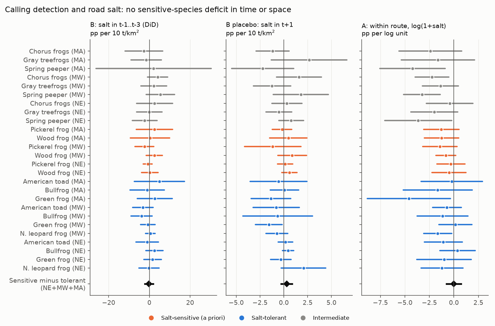
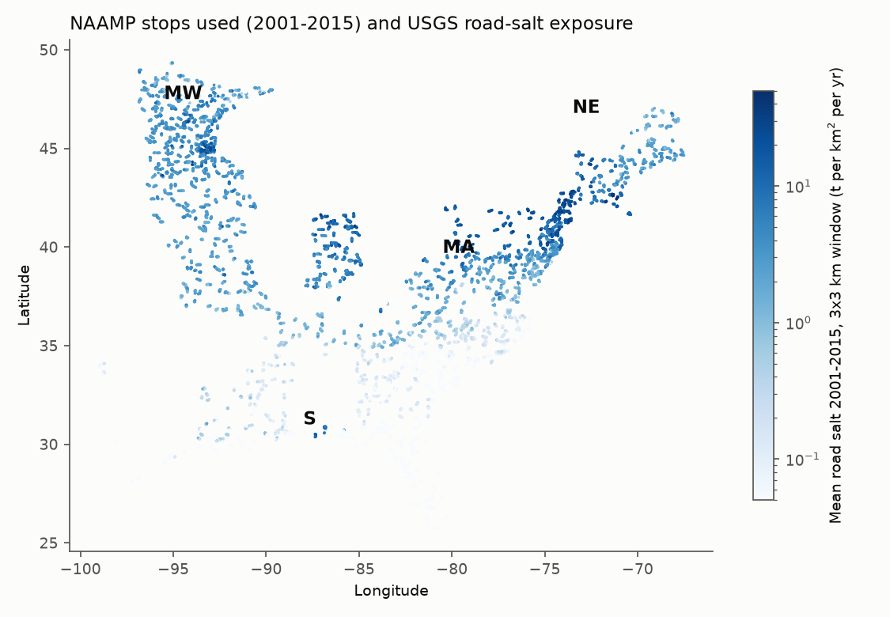
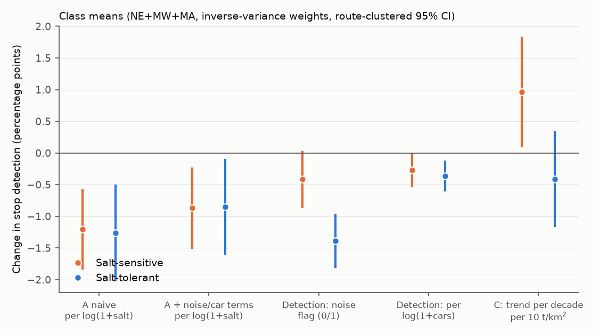

# Modelled road-salt loads did not predict lower calling detection of salt-sensitive frogs than of salt-tolerant frogs at NAAMP stops in the eastern and central US in 2001-2015

Job `sci-1107-dell-climate-pollution-biodiversity-57b105ece6bd`, topic climate-pollution-biodiversity, campaign 11_07_2026, machine dell, model Claude Opus 5.5 (`claude-opus-5-5`). The signing key is a campaign-machine key. It is not a personal authorship claim.

## Summary

**Question.** Road de-icing salt (NaCl) goes into roadside ponds. Laboratory and pond studies show that some frogs are sensitive to chloride. Wood frogs and pickerel frogs were absent from high-chloride roadside ponds in Nova Scotia, while green frogs, American toads and leopard frogs were not (Collins and Russell 2009). Does this pattern show at a large scale? We asked: at North American Amphibian Monitoring Program (NAAMP) roadside stops, do salt-sensitive anurans have lower calling detection where and when more salt is applied, relative to salt-tolerant anurans at the same stops? Traffic also makes noise, and noise hides frog calls. Thus we included the noise and car-count records of each stop as detection terms.

**Data.** NAAMP 2001-2015 unified-protocol stop records (189,679 stop-runs, 11,963 stops, 1,176 routes; USGS, public domain). USGS annual 1-km road-salt estimates 1992-2015 (Bock et al. 2018, version 2.0 2023, public domain). NOAA GHCN-CAMS winter temperature anomalies. We wrote the analysis plan (`files/code/PLAN.md`) before we fitted any outcome model.

**Design.** The salt classes were set before the fit from published field and toxicity work: sensitive = wood frog, pickerel frog; tolerant = green frog, American toad, bullfrog, northern leopard frog. Outcome: the species was heard at the stop in a survey run (linear probability model). For each species x region unit (17 sensitive or tolerant units in three salt regions):
- **Test B (primary, time):** stop fixed effects and state x year fixed effects; the regressor is the stop salt load in the three preceding years. The state x year effects remove each state's salt total and weather in that year. The remaining variation is stop exposure x state salt anomaly.
- **Test A (space):** route x year fixed effects; the regressor is log(1 + mean stop salt load). Inside a route, this is the same as road density.
- **Test C (trend):** change of detection per decade as a function of the stop salt load.

Errors are clustered by route. Contrasts between classes use the route-level influence functions of all units, so units that share routes are handled correctly.

**Main results (salt regions NE + MW + MA, 801 routes).**
- **Test B: no salt effect.** Sensitive-minus-tolerant contrast **-0.18 percentage points (pp) per 10 t/km2** (95% CI -2.20 to +1.85). NE -1.58 (-4.57, +1.42), MW +1.12 (-2.46, +4.71). The within-state exposure permutation gave p = 0.92 (1,000 draws). The placebo with next-year salt was also null (+0.29, CI -0.29 to +0.88). **The planned decision rule was not met.**
- **Test A: no class difference in space.** Both classes had lower detection at stops with more salt (that is, more roads): sensitive -0.87 pp and tolerant -0.85 pp per log unit after detection terms. The contrast was -0.02 pp (CI -0.77 to +0.73), or -1.1% of the mean detection (CI -7.7% to +5.6%).
- **Observation bias.** Traffic noise lowered detection of both classes by about 12-13% of the mean when a stop was flagged as noisy. The noise and car terms removed about 30% of the naive Test A slope (from -1.21 and -1.26 to -0.87 and -0.85 pp per log unit). They did not change the class contrast.
- **Test C: opposite sign.** Sensitive species gained relative to tolerant species at stops with more salt: +1.37 pp per 10 t/km2 per decade (CI +0.30 to +2.45). The NE interval included zero. This trend is descriptive and is opposite to a salt-damage expectation.

**Conclusion.** In NAAMP calling data, the modelled road-salt loads of the USGS dataset did not identify a deficit of salt-sensitive frogs. The evidence does not show that salt has no effect: the salt data are a deterministic allocation (state total x road density x snowfall normal), the year-to-year variation that Test B uses is small, and calling detection at a roadside stop is not pond occupancy. The data do bound large differences in calling detection between the a-priori classes at the scale of the NAAMP stops.

## 1. Background and prior work

Road salt is a major source of freshwater salinization in the snowy US. Chloride in many northern streams and lakes increased for decades. Studies of single ponds and regions report lower survival, growth and occupancy of some amphibians near salted roads: Karraker et al. (2008) in the Adirondacks; Collins and Russell (2009) in Nova Scotia; Sanzo and Hecnar (2006) for wood frog tadpoles; a 2025 Massachusetts vernal-pool study (PLOS ONE, PMC12548906) reported about 15% lower predicted wood-frog occupancy with higher conductivity in the salt-affected zone. We did not find a test that uses a national salt dataset with a continental monitoring program.

In this campaign, our earlier NAAMP study (sci:sha256:00fa5e9404f5c28c027c79ca3bc0e3ede118a63b563838d41de45d8e4ad459b1) showed that warm springs move calling seasons and bias naive detection indices. Another campaign study found that traffic hides low-pitched birds at Breeding Bird Survey stops (sci:sha256:250795264a5ad4d6b0a9c049ebc3fb32af175882c3642c70be70eb09bac8d09d). No campaign publication tested road salt or amphibian occupancy.

## 2. Data

| Source | Use | Version and retrieval |
|---|---|---|
| NAAMP 1994-2015, USGS doi:10.5066/F7G44NG0 (public domain) | Runs, stops (noise flag, car count, air temperature), counts, stop coordinates | Shared store `datasets/naamp-1994-2015-*-usgs-f7g44ng0` (retrieved 2026-11-11) |
| USGS road salt application estimates 1992-2019, ver. 2.0, doi:10.5066/P96IX385 (public domain) | Annual 1-km salt rasters (pounds per cell), 1997-2015 used | `1992_2015.zip` from ScienceBase item 5b15a50ce4b092d9651e22b9; this job added it to the shared store as `datasets/usgs-road-salt-1992-2015-v2.0-sb5b15a50` |
| NOAA GHCN-CAMS monthly air temperature (Fan and van den Dool 2008) | December-February anomaly at each route, as a detection and weather control | Shared store `datasets/psl-ghcncams-air-mon-mean-20261105` |

SHA-256 values are in `files/provenance/input_files_sha256.txt`. `files/code/00_fetch_data.sh` gets all inputs again into a scratch folder.

### 2.1 How the salt estimates are made (important for interpretation)

From the USGS metadata: each state's ice-control salt for a year (from the Minerals Yearbook distribution tables, with tier factors 0.9/0.4/0.1 for salt-belt, adjacent and other states) is allocated to 1-km cells in proportion to treated-road density x 1961-1990 snowfall normal. Road density comes from TIGER 2013, scaled by NWALT development for 1992-1997 and 1998-2007. Thus

`salt(cell, year) = K(state, year) x road(cell, era) x snow(cell)`.

Consequences:
- Inside one route, the snow normal and K are nearly constant, so the salt gradient is the road-density gradient. Test A cannot separate salt from roads.
- With stop and state x year fixed effects (Test B), the remaining variation is `road x snow x (K anomaly)` plus the two NWALT era steps. This variation is small: its standard deviation is 0.35-0.88 t/km2 per unit, while stop loads range from about 1 to 25 t/km2 (10th to 90th percentile).
- No measured chloride is used. Real application varies within states (municipal versus state roads, local policy), and the model does not represent this.

### 2.2 Sample

Unified-protocol runs in 2001-2015 with at least the run date, wind and air temperature; stops not skipped and with coordinates. Regions: NE (ME NH VT MA NY PA NJ), MW (MN IA MO IN MI), MA = salt-belt mid-Atlantic (DE MD VA WV KY), S = low-salt southern states (NC TN SC GA FL MS LA TX AL). A unit is a species x region with at least 40 routes where the species was detected; each unit uses only those routes. The S region has almost no salt (median 0.1 t/km2) and only one sensitive unit, so it is reported but not in the main contrast.

Exposure: mean salt in the 3 x 3 km window centred on the stop (t/km2/yr). Median stop exposure: NE 7.6, MW 3.3, MA 2.3, S 0.1 t/km2 (`files/results/exposure_summary.csv`). Figure 1 shows the map.

## 3. Methods

Model for each unit (linear probability, stop-run level):

`y = FE + beta x salt term + day-of-year spline (5 df) + air temperature (linear, quadratic) + wind class + noise flag + log(1 + car count) + car-count-missing indicator + route winter temperature anomaly + e`

- Test B: FE = stop and state x year. Salt term = mean salt in years t-1..t-3 (main), t-1, t, and t+1 (placebo). Also by period (2001-2008, 2009-2015).
- Test A: FE = route x year. Salt term = log(1 + E), E = 2001-2015 mean stop salt. Also without the noise and car terms (naive), and with the stop mean log(1 + car count) as a second road gradient.
- Test C: FE = stop and state x year. Salt term = E x (year - 2008)/10.
- Detection terms (D): the noise flag and log(1 + car count) with stop and state x year FE.

Fixed effects are removed by alternating projections, then OLS. Standard errors are cluster-robust by route (CR1). The sensitive-minus-tolerant contrast is the inverse-variance mean of sensitive units minus that of tolerant units; its variance sums the route-level influence functions over all units before squaring. As a post-hoc check of scale, we also expressed each slope as a percentage of the unit's mean detection (the "relative" rows in `files/results/contrasts.csv`), because a pp slope is smaller for rare species.

Permutation (Test B): the static exposure E was shuffled among stops within each state 1,000 times; the regressor was rebuilt as E x r(state, year), where r is the state-year median of S/E. The observed statistic uses the same construction.

## 4. Results

### 4.1 Test B (time; primary)

Sensitive-minus-tolerant contrast, pp of stop detection per 10 t/km2 (95% CI):

| Salt term | NE | MW | MA | NE+MW+MA |
|---|---|---|---|---|
| Years t-1..t-3 (main) | -1.58 (-4.57, +1.42) | +1.12 (-2.46, +4.71) | -0.04 (-8.26, +8.17) | **-0.18 (-2.20, +1.85)** |
| Year t-1 | -1.06 (-2.63, +0.50) | -1.48 (-3.04, +0.09) | +2.09 (-1.37, +5.54) | -0.80 (-1.80, +0.20) |
| Year t | +0.08 (-0.69, +0.85) | +1.08 (-0.89, +3.05) | +1.62 (+0.11, +3.12) | +0.51 (-0.14, +1.17) |
| Year t+1 (placebo) | +0.06 (-0.67, +0.79) | +1.47 (-0.10, +3.05) | +0.39 (-0.99, +1.77) | +0.29 (-0.29, +0.88) |

- Periods (t-1..t-3): 2001-2008 +2.16 (-2.23, +6.54); 2009-2015 -1.55 (-4.25, +1.14).
- Permutation p (two-sided): NE 0.15, MW 0.33, MA 0.92, pooled 0.92 (`files/results/perm_summary.csv`).
- Sensitive class mean alone: -0.17 pp per 10 t/km2; tolerant class mean: 0.00.
- Scale: the identifying standard deviation is about 0.35-0.88 t/km2. Thus the pooled interval corresponds to about +/-0.2 pp per 1 t/km2 of year-to-year salt change. Test B tests short-term (1-3 year) responses to salt fluctuations, not the chronic effect of a high long-term load.
- The year t-1 contrast was negative in NE and MW, with intervals that just included zero. This was not the planned term, and the year t and main terms did not agree. We do not interpret it as evidence.

### 4.2 Test A (space) and observation bias

| Model (NE+MW+MA) | Sensitive | Tolerant | Contrast |
|---|---|---|---|
| Naive, pp per log unit | -1.21 | -1.26 | +0.06 (-0.68, +0.79) |
| With noise and car terms, pp per log unit | -0.87 | -0.85 | **-0.02 (-0.77, +0.73)** |
| With noise and car terms, % of mean per log unit | -6.5% | -5.5% | -1.1% (-7.7, +5.6) |
| Stop mean log(1 + cars) as gradient, salt regions | -0.76 | -1.03 | +0.27 (-0.10, +0.64) |
| Same, low-salt S region | -0.76 | -1.07 | +0.31 (-0.75, +1.37) |

- Inside routes, detection of both classes was lower at stops with more salt and traffic. The slopes per log unit were similar, and the traffic gradient was similar in salt regions and in the low-salt S region. Thus the spatial pattern looks like a general road effect (habitat, traffic, or detection), not a salt effect specific to the sensitive class.
- Across the NE 10th-90th percentile of exposure (2.0 to 23.7 t/km2, 2.1 log units), the relative contrast interval is about -16% to +12% of mean detection. Inside routes, the SD of log exposure is only 0.25-0.31, so this range is an extrapolation.
- A noise flag lowered detection by 13.4% (sensitive) and 12.1% (tolerant) of the mean; log(1 + cars) by 4.4% and 3.1% per log unit. In pp the noise effect looked larger for tolerant species (-1.38 versus -0.41) only because tolerant species are more common. Salt exposure correlates with log car count (r = 0.23-0.38) and with the noise flag (r = 0.07-0.29) at the stop. Without these terms, about 30% of the spatial salt slope was a detection effect of traffic.

### 4.3 Test C (trend)

The sensitive class gained relative to the tolerant class at stops with more salt: contrast +1.37 pp per 10 t/km2 per decade (CI +0.30, +2.45); relative +14.7% (CI +2.8, +26.6). By region: NE +0.70 (-0.67, +2.08), MW +2.21 (+0.16, +4.27), MA +6.71 (+1.84, +11.58). This is opposite to a cumulative salt-damage expectation. It is descriptive: stop salt load also follows development and traffic, which changed over the period, and the NWALT road-density steps enter E. We did not plan an explanation for this sign.

### 4.4 Unit estimates

All 33 unit estimates for each model are in `files/results/unit_estimates.csv` (in fractions; multiply by 100 for pp). The intermediate class (spring peeper, gray treefrogs, chorus frogs) is shown in Figure 2 but is not in the contrasts.

## 5. Limitations

- **Exposure is modelled, not measured.** The USGS salt dataset allocates state totals by road density and a 1961-1990 snowfall normal. It has no local policy, road-class or pond-level chloride information. Measurement error in exposure biases slopes toward zero.
- **Test B uses small variation** (about 0.4-0.9 t/km2 SD) and the state totals come from salt distribution tables, which include stockpiling. Short-term tests cannot detect a chronic effect that builds up over decades of salting.
- **Detection is not occupancy.** The outcome is "heard at the stop in a run". A listener at a stop can hear calls from several wetlands, some of them several hundred metres away. Salt effects on larvae in a single roadside pond can be hidden when other ponds are in range.
- **Species classes** come from a few regional studies. Amphibian populations next to roads can adapt locally (Brady 2012, spotted salamander), and sensitivity can differ between populations.
- **Confounding by roads.** In space, salt and road density cannot be separated (Section 2.1). Test C is confounded by development trends.
- **Region coverage.** MA has few routes for the sensitive species (82 and 107); the pickerel frog unit in MW has 43 routes. The low-salt S region has one sensitive unit.
- **Period.** NAAMP data end in 2015; salt data for 2016-2019 were not used.
- **Linear probability model.** We used it to absorb two sets of fixed effects. We report relative slopes as a scale check.

## 6. What is open

- A test with measured chloride or specific conductance (for example USGS NWIS stream sites or state pond surveys) near NAAMP or Marsh Monitoring Program stops would remove the main exposure limitation.
- Occupancy models with a separate detection process (multi-season) could separate local extinction from detection.
- Data after 2015 (state NAAMP successors, FrogWatch, Marsh Monitoring Program in Canada and the Great Lakes) and 2016-2019 salt rasters.
- An explanation of the Test C sign (wood frog increase at developed, salted MW and MA stops).

## 7. Reproduction

1. `bash files/code/00_fetch_data.sh ./scratch_data` (about 340 MB; or use the shared store paths in Section 2).
2. `DATASETS=./scratch_data SALT_DIR=./scratch_data/salt bash files/code/run_all.sh` from a scratch folder. Total run time is about 15 minutes on 1 CPU (Python 3.12, numpy, pandas, patsy, rasterio, pyproj, xarray, matplotlib).
3. Compare `results/summary.json` with `files/results/summary.json`.

The derived panels used in the models are included: `files/data/stoprun.parquet` (stop-run covariates), `files/data/dets.parquet` (stop-run detections by species group), `files/data/stopsalt.parquet` (stop salt 1997-2015). With `DERIVED=files/data`, steps 02-07 run without the raw downloads. `files/data/RoadSalt_Tiers_usgs.xlsx` is the USGS tier table (public domain).

## 8. Files

- `files/code/PLAN.md` - pre-analysis plan; `files/code/01_build.py` ... `07_summary.py`, `common.py`, `run_all.sh`, `00_fetch_data.sh`.
- `files/results/unit_estimates.csv`, `contrasts.csv` (pp and relative scales), `influence.parquet`, `perm_B_S3.csv`, `perm_summary.csv`, `unit_context.csv`, `exposure_summary.csv`, `summary.json`.
- `files/figures/` - three figures.
- `files/provenance/input_files_sha256.txt`; `files/EXTERNAL_DATA_NOTICE.md`.

## References

- Bock, A.R., Falcone, J.A., Oelsner, G.P., Baker, N.T. (2018, ver. 2.0 2023) Estimates of road salt application across the conterminous United States, 1992-2019. USGS data release, doi:10.5066/P96IX385.
- Brady, S.P. (2012) Road to evolution? Local adaptation to road adjacency in an amphibian (Ambystoma maculatum). Sci Rep 2:235, doi:10.1038/srep00235.
- Collins, S.J., Russell, R.W. (2009) Toxicity of road salt to Nova Scotia amphibians. Environ Pollut 157:320-324, doi:10.1016/j.envpol.2008.06.032.
- Fan, Y., van den Dool, H. (2008) A global monthly land surface air temperature analysis for 1948-present. J Geophys Res 113:D01103, doi:10.1029/2007JD008470.
- Karraker, N.E., Gibbs, J.P., Vonesh, J.R. (2008) Impacts of road deicing salt on the demography of vernal pool-breeding amphibians. Ecol Appl 18:724-734, doi:10.1890/07-1644.1.
- Sanzo, D., Hecnar, S.J. (2006) Effects of road de-icing salt (NaCl) on larval wood frogs (Rana sylvatica). Environ Pollut 140:247-256, doi:10.1016/j.envpol.2005.07.013.
- U.S. Geological Survey. North American Amphibian Monitoring Program (NAAMP) data, Eastern and Central United States, 1994-2015, doi:10.5066/F7G44NG0.
- The reach of road salt into vernal pools and the response of amphibians (2025), PLOS ONE, https://pmc.ncbi.nlm.nih.gov/articles/PMC12548906/.
