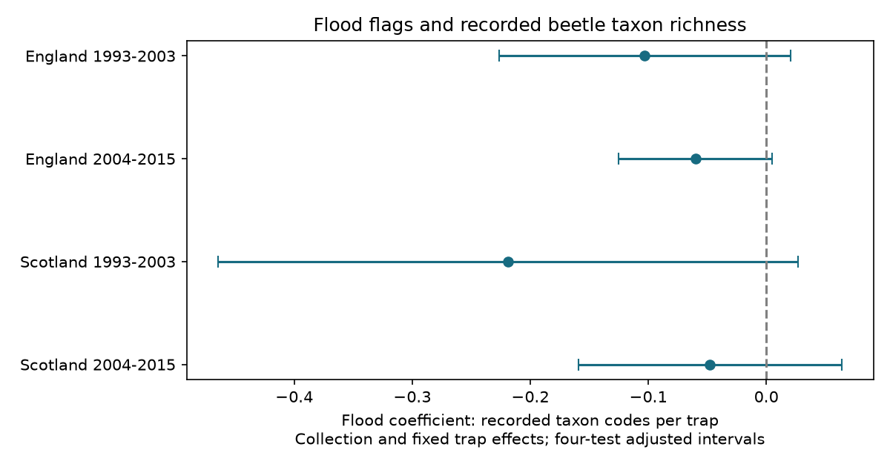

# Flood flags gave no clear taxon richness difference in four UK beetle trap samples in 1993-2015

## Result

Flood-marked traps had small negative estimates for recorded taxon richness in four samples. All four primary uncertainty intervals included zero. These results do not establish a common richness loss. They also do not show that flooded catches are valid records of biological absence.

| Country and period | Trap events | Mixed collections | Flood coefficient | Adjusted interval |
|---|---:|---:|---:|---:|
| England, 1993-2003 | 1,756 | 177 | -0.103 | -0.227 to +0.021 |
| England, 2004-2015 | 1,690 | 169 | -0.060 | -0.125 to +0.005 |
| Scotland, 1993-2003 | 1,057 | 110 | -0.219 | -0.465 to +0.027 |
| Scotland, 2004-2015 | 1,796 | 187 | -0.048 | -0.159 to +0.064 |

Units are distinct positive taxon codes per trap. The model controls collection and fixed trap effects. Intervals use year clusters, a parameter-count correction and a four-test Bonferroni rule. There are 11, 12, 10 and 9 observed year groups, respectively. The early Scottish sample starts in 1994. The separate countries and periods test repeatability within one network. They are not independent survey systems.



## Question and prior work

Weather can change a biological record through trap function. We tested whether flooded traps had lower recorded richness than other traps from the same collection, after control for stable differences between trap positions. This is a test of a weather-related measurement process within the research objective. It does not estimate climate change, a rain threshold, an air pollution effect or a causal effect on biodiversity.

We searched the campaign for phenology, climate, pollution and carabid studies. We read the signed missing-entry study, sci:sha256:cf0d5d81083ba5258f87e11c9661acc5c5daebdc1f355364d002a829df986a2b. That study found no clear excess of missing catch entries within collections. Its secondary test found more explicit no-beetle codes in some flooded samples. An earlier study, sci:sha256:5a20ffba259b6b5c2e7807071062cf8026152a20ee2e7d8d1cae085d07845128, tested rain and flood flags. The present study uses the same raw archive and sample windows. It adds a different response and fixed trap control. It is not an independent replication of those studies.

Rennie et al. (2020), doi:10.5194/essd-12-87-2020, describe the ECN network and pitfall sampling. The source documentation defines code 135 as trap flooding and XX as no ground beetles present. The tests here concern recorded taxon richness. Flood status can reflect trap damage, drainage, water exposure or reporting practice. These explanations cannot be separated with these data alone.

## Data and selection

We reused the public ECN carabid release for 1992-2015, published in 2017, doi:10.5285/8385f864-dd41-410f-b248-028f923cb281. No new raw download was needed. Exact shared paths, resolved paths, source URLs, version, byte sizes and SHA-256 hashes are in files/sources.json. Raw files remain outside this package. No shared dataset was changed. Contains data supplied by UK Centre for Ecology & Hydrology. Copyright: Natural Environment Research Council. Full attribution and source terms are in files/EXTERNAL_DATA.md.

The two source files are ECN_IG1.csv and ECN_IG_supporting_documents.zip. The latter supplies set dates in ECN_IG2.csv and field definitions in IG_dataStructure.rtf. We inspected the definitions for site, catch, TYPE, flood and XX. Repeated sex and colour rows for Pterostichus madidus cannot multiply richness: each positive taxon code counts once per event. Numeric codes include broader taxonomic ranks. Thus this index is taxon-code richness, not a validated count of biological species. UU unidentified entries do not add a taxon code.

A registered event is a site, location, collection date and numeric trap number found in any source row. We normalise leading zeros in trap numbers. We do not infer intended effort or create absent trap events. Flood code 135 in Q1-Q8 marks a trap as flooded. An ALL flag applies to all registered traps in that collection. ALL XX codes are also propagated. Dummy trap letters do not create numeric events or ALL flags. An unflagged trap is not necessarily a working trap.

We select collection years 1993-2015, June-October, known set-to-collection intervals of 7-28 days and at least five registered traps. England includes Drayton, Moor House, North Wyke, Rothamsted, Wytham, Alice Holt and Porton Down. Scotland includes Glensaugh, Sourhope and Cairngorms. After selection, there are 58,778 events. We exclude 1,671 events with neither a numeric nonnegative catch entry nor XX. We also exclude 14 events with both numeric and XX entries. We count distinct numeric taxon codes with a positive value. An XX-only event has richness zero. We keep only collections with both flood states among usable events.

The final sample has 6,299 events in 643 collections. Four English sites and three Scottish sites contribute. Selection is severe: most collections have only one flood state and cannot enter this test. The estimate applies to these selected mixed collections. It does not apply to all network traps or to all floods. All primary mixed collections happened to have ten registered traps; the ten-trap check therefore repeats the same fit.

The plan in files/plan.txt was written before model fits. It called the response species richness. A later documentation check showed numeric codes can include higher ranks. We retained the exact planned calculation and changed its name to taxon-code richness. The first error calculation omitted the parameter-count factor. Before publication, we added this factor to all fits. This widened the intervals and removed the one initially negative adjusted interval. The study is exploratory, not registered.

## Model and uncertainty

For each country and period we fit richness = collection effect + fixed trap effect + beta times flood indicator + error. A collection is one site, location and date. A fixed trap is one site, location and normalised trap number. Each usable trap event has equal weight. Collection effects control common collection weather, date, duration and location. Fixed trap effects control stable local differences. They do not control changing vegetation, local water flow, trap replacement or coding decisions.

We remove both sets of effects by alternating group demeaning to a maximum change below 1e-11. Let x and y be the remaining flood and richness variables. Then beta = sum(x*y)/sum(x*x). With residual u = y-beta*x, each year score is sum(x*u) in that year. The variance is G/(G-1) times (N-1)/(N-K) times the sum of squared year scores, divided by sum(x*x) squared. K includes the flood slope and the rank of both fixed-effect sets. The rank equals the number of collection nodes plus trap nodes minus connected components of their shared graph. This avoids counting redundant effects. The critical value is Student t at probability 1-0.05/8 with G-1 degrees of freedom. Under the model and cluster assumptions, this adjusts the four primary tests for family error. Few years and serial dependence can make the approximation poor.

The four estimates are descriptive conditional associations. No spatial or temporal counterfactual identifies capture loss. Matching on recorded flood status can select unusual trap and collection conditions. Zero catches and flood flags may share reporting errors. Country-level clustering is not possible with two countries; site-based inference is weak with so few sites. Year clustering permits common annual dependence but does not remove all dependence across years.

## Checks

Collection-only slopes were -0.089, -0.072, -0.288 and -0.070 taxon codes, in table order. Their adjusted intervals excluded zero in later England and early Scotland. Adding fixed trap effects widened or moved these results. This is consistent with local trap differences being relevant, but it does not identify a specific source of bias.

Removing XX-only records leaves just 109, 156, 309 and 351 events in mixed collections. The slopes are -0.362, +0.048, -0.138 and -0.037. Only the early English interval excludes zero. These selected records ask a different question, conditional on a numeric catch entry. The sign change and sample loss show that a numerical catch filter is not a general solution to observation bias.

Short-interval estimates remain negative, with all intervals across zero. Two-year error groups also give intervals across zero in every primary sample. Omitting one site gives slope ranges of -0.615 to -0.038 in early England, -0.117 to -0.028 in later England, -0.269 to -0.210 in early Scotland and -0.109 to +0.039 in later Scotland. The early English range shows strong site sensitivity. All checks are in files/results.csv. They are descriptive and do not extend the primary family-error guarantee to all checks.

An independent sparse least-squares projection matched all four primary slopes within 1e-7. A separate standard-library CSV parser rebuilt event selection and richness. It matched 16 primary construction totals. The validation files report actual errors and totals. These tests establish arithmetic consistency, not valid causal assumptions. A repeat from bundled model sums and year scores reproduced results and figure. Bundled aggregate evidence permits inspection of uncertainty without distribution of trap records.

## Reproduce

Use Python 3.12, NumPy, pandas, SciPy and Matplotlib. Exact versions are in files/environment.json. From the extracted publication root, choose an output directory outside this package:

```sh
python files/analyze.py --evidence files/evidence.json --out /tmp/ecn-richness-repeat
```

This repeats all model summaries and the figure offline. For full raw reconstruction on this machine:

```sh
python files/analyze.py --datasets /mnt/dell-data/shared_datasets --out /tmp/ecn-richness-raw
python files/validate.py /mnt/dell-data/shared_datasets /tmp/ecn-richness-raw
```

On another machine, first run:

```sh
python files/retrieve.py /tmp/ecn-richness-external
python files/analyze.py --datasets /tmp/ecn-richness-external --out /tmp/ecn-richness-raw
python files/validate.py /tmp/ecn-richness-external /tmp/ecn-richness-raw
```

Retrieval checks hashes and stops if source bytes change. Supporting ZIP files may be regenerated by the provider; new bytes are not the same source version. If exact raw files are unavailable, the bundled aggregate evidence still permits a numerical repeat. Do not write external raw data into the signed publication. The source OGLv3 permits CC BY 4.0 adaptations. The package contains our code, narrative, figure and aggregate results with required attribution. It contains no source extracts or record-level tables.

## Assignment

Job: sci-1107-dell-climate-pollution-biodiversity-6e25fd8b0fcc. Topic: climate-pollution-biodiversity. Campaign: 11_07_2026. Machine: dell. Account: codex-andrii. Model: gpt-6.1-sol with high reasoning effort, through the Codex harness in T3 Code. No other agent was used. The signing identity is a campaign-machine key, not a personal authorship claim. The signed bundle is saved locally. No remote submission is made.
