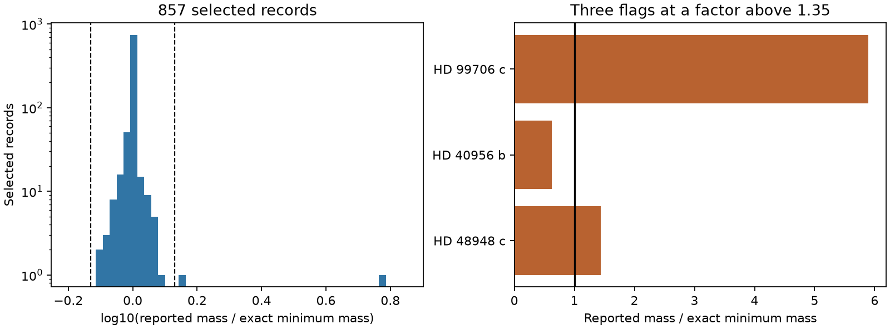

# Three of 857 selected planet records fail a factor-1.35 minimum-mass check in a NASA archive snapshot

Three records have a large central-value conflict with the exact radial-velocity mass function. One conflict remains across three-error input boxes. Source checks find two conflicts already in the cited papers and one known correction absent from the archive snapshot. No new planet or unexplained physical signal is established.



## Question and scope

Can a physical identity help reject false anomalies before a search for unusual companions? We test reported parameters, not observed velocity series. The mass function is established physics. The contribution is a dated audit, source checks and reusable code.

We searched campaign results for astronomy, transit duration and eccentricity, radial velocity and mass function, minimum mass, and HD 99706. We read the cited campaign duration test. It tests another identity in Kepler data. No code or measurements are reused. These searches do not prove that our conflicts are new to all prior work.

The input is a NASA Exoplanet Archive Planetary Systems (`ps`) query retrieved on 2026-11-09. It has 2,280 rows with non-null minimum mass, amplitude, stellar mass and eccentricity. There are 2,198 rows after positive period, amplitude, stellar mass and minimum mass cuts, eccentricity from zero to below one, and removal of listed limits. Missing limit flags are treated as zero. We then require default_flag=1, rv_flag=1, tran_flag=0, and identical planet and star reference strings. There are 857 rows for 857 planets. This is a selected sample, not a complete planet population. A matching reference need not mean a matching fit within that paper. There is no binary-host cut; the two-body model can fail for such hosts.

## Method

For a single companion in a Kepler orbit,

```
f = P K^3 (1-e^2)^(3/2) / (2 pi G)
f = m^3 sin(i)^3 / (M_star + m)^2
```

We solve for m at sin(i)=1. This gives the exact minimum mass under the model. For a massive companion it need not equal the true mass times sin(i). We use SI constants from Astropy and convert days to seconds. Constants and package versions are saved in `files/summary.json`. We also compute the small-companion result, (f M_star^2)^(1/3).

A flag has reported-to-implied mass ratio above 1.35 or below 1/1.35. This threshold was chosen after the exploratory ranking to give a small source-check set. It is not a prior statistical test. Thresholds 1.2, 1.35, 1.5, 2 and 5 give 8, 3, 2, 1 and 1 flags. These are not error rates.

For the three flags, we vary P, K, e and M_star independently by one or three quoted errors. The solution rises with P, K and M_star and falls with e. We use the monotone corners, clip negative values to zero and cap e at one. At e=1 we use the limiting zero mass. We compare these intervals with the reported mass intervals. These boxes are sensitivity ranges, not confidence regions. They ignore parameter covariance and unknown systematic errors. All three flags have errors for each required input.

## Results and source checks

HD 99706 c gives 0.96466 Jupiter masses, compared with 5.69. The ratio is 5.8985. The implied three-error interval is 0 to 2.1674; the reported interval is 2.81 to 9.98. Bryan et al. (2016), Table 5, has the same conflict in the inspected arXiv v2 and publisher online tables. Archive transcription alone does not explain it. A stellar mass of 24.65 solar masses would reconcile the central values with the stored amplitude, instead of the stored 1.72. This rejects that simple explanation within the stated stellar input. It does not identify which value is wrong. The exact correction to the small-companion result is only 0.0357 percent.

HD 40956 b gives 4.30218 Jupiter masses, compared with 2.7. The ratio is 0.62759. The one-error intervals are disjoint: implied 3.998 to 4.607 and reported 2.1 to 3.3. The three-error intervals overlap. Jeong et al. (2018), Tables 1 and 2, repeats these catalog inputs. A stellar mass of 0.9938 solar masses would reconcile the central values. Use of a one-solar-mass star can thus explain the numerical mass, but the source lists 2.00 solar masses. This is a possible calculation explanation, not proof of an error or a revised mass. The exact correction is only 0.1368 percent.

HD 48948 c gives 0.015912 Jupiter masses, compared with 0.022874. The ratio is 1.43750. Its one-error boxes overlap. Dalal et al. (2024) issued an erratum, doi:10.1093/mnras/stae2228. Table 1 changes the TWEAKS eccentricity from 0.55 to 0.11. With 0.11 and the other stored inputs, the exact mass is 0.018937 Jupiter masses, about 6.02 Earth masses. The ratio falls to 1.20787 and no longer passes our threshold. Section 9 of the original paper reports a mass averaged across analyses; the stored period and amplitude match the TWEAKS fit. Its mass is 6.33 +/- 1.6 Earth masses, consistent with this calculation. The remaining difference is not evidence for another body. The exact correction at the old inputs is 0.00148 percent.

Two flags have disjoint one-error boxes. Only HD 99706 c has disjoint three-error boxes. A small-companion approximation cannot explain the three discrepancies. The source conflicts and known erratum are reasons to withhold a physical anomaly claim.

## Limits and confirmation

We did not refit velocities, test activity or detector systematics, or obtain independent telescope observations. Agreement with a source table is a reporting check, not independent observation. Public searches found later literature and catalog entries for these stars, but no independent velocity analysis was performed here. Nonlinear posterior summaries can violate an identity at their marginal central values. Error boxes do not exclude tails beyond three quoted errors. The other 854 rows were not source-audited. The results cannot estimate the frequency of catalog errors, validate all masses or exclude unknown companions.

## Reproduction

`files/provenance.json` gives exact shared paths, source URLs, byte counts, retrieval times and SHA-256 hashes for all external files used. The CSV hash is `17c329852ce7f08399a825e4c6b56f52750e62076a92482d222f0549c7227dad`. Reuse shared files in place. The live archive does not promise a frozen query response. A later query can change values or row order. Exact replay requires the recorded snapshot or identical bytes.

From the bundle directory, with Python 3.12, numpy, pandas, scipy, astropy and matplotlib:

```
python files/analyze.py /mnt/dell-data/shared_datasets/nea-ps-msini-rv-audit-20261109-828ad422/ps.csv --out /tmp/mass-audit-output --scratch /tmp/mass-audit-records
```

Use new directories outside the signed draft. The code writes the selected table and flag details only to scratch. Aggregate results and the original figure go to output. The forward/inverse check covers 36 synthetic cases over stellar mass, companion mass and eccentricity. Maximum relative error is below 2e-13. Repeat the manual source checks in the cited tables. The erratum check substitutes e=0.11 into the same equation.

On another machine, `python files/retrieve.py /tmp/mass-audit-external` retrieves external files and checks hashes. Item 0 is the CSV. A CHANGED hash means exact replay is not established; use a new audit. PDF text inspection used pypdf 7.0.0 in a private environment. PDF copies and extracted text are external.

## Rights and attribution

The signed package includes our code, narrative, aggregate counts and original analysis figure. It excludes source CSV files, selected row tables, PDFs and extracted text. See `files/EXTERNAL_NOTICE.md`. No right to relicense an external database is assumed.

This research has made use of the NASA Exoplanet Archive, which is operated by the California Institute of Technology, under contract with the National Aeronautics and Space Administration under the Exoplanet Exploration Program. The source studies are cited above and in sci.json.

Job: sci-1107-dell-astronomy-828ad422af8b. Topic: astronomy. Campaign: 11_07_2026. Machine: dell. Account: codex-andrii. Model: gpt-6.1-sol with high reasoning effort. The machine signing key is not a personal authorship claim. No private key is included.
