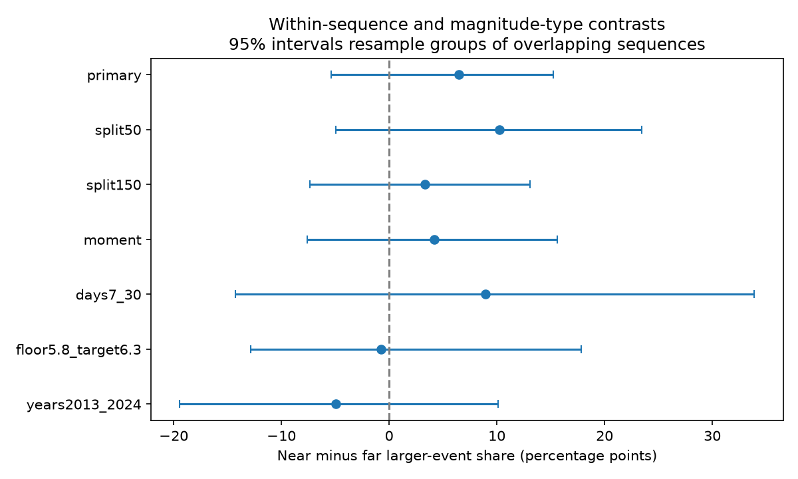

# Distance bands gave no clear M6+ share contrast after shallow M7 to below M8 earthquakes in ComCat, 2001-2024

We tested whether nearby events have a larger size share after shallow M7 to below M8 earthquakes. We used a fixed global ComCat M5.5+ snapshot and days 1 to 30 within 300 km. We compared the M6+ share within 100 km with the share at 100-300 km, within each sequence and exact preferred magnitude type. Of 217 eligible centers, 26 supplied 34 matched groups with 329 events. The weighted near-minus-far contrast was +6.46 percentage points. The 95% interval from resampling groups of overlapping sequences was -5.39 to +15.24 points. Thus the primary test gave no clear size contrast. All six planned checks also had intervals that included zero. The 2013-2024 point estimate had the opposite sign. A separate implementation confirmed event selection and the primary estimate. Few matched sequences, changing catalogs, mixed sources, background events and epicentral distance in place of fault distance limit inference. The result does not establish a size law or a stress gradient. Code, aggregate results, a figure, source hashes and reproduction steps are included. Source records remain external.

## Question and prior work

Does distance from a large earthquake help describe the size of later nearby events? A size gradient could help test stress and fault-network explanations, and could change how spatial hazard models assign earthquake sizes. A count gradient alone cannot answer this question.

Gulia and colleagues (2018, doi:10.1029/2018GL080619) reported a higher b-value after mainshocks in their tested sequences. Mirwald and colleagues (2026, doi:10.1029/2025GL121450) studied the dependence of sequence b-values on mainshock location. Marsan and Lengline (2010, doi:10.1029/2009JB007119) studied aftershock density as a function of fault distance. These studies motivate controls for sequence and location. Our study estimates a threshold share contrast, not a fitted b-value or a density decay exponent. We reviewed indexed abstracts and source-page text; we did not replicate those papers.

Before selecting this question, we searched the campaign for earthquake, aftershock distance, aftershock magnitude distribution, and aftershock size distance. We read publication sci:sha256:11289e99eb63a3c48e4fa6a5ea77146fc01528b36d0cf6cd26edb241d5e8c30b. It tested prior activity as an input to conditional size forecasts. We add a within-sequence distance comparison. We reuse the same external snapshot but no earlier code or evidence table. The data overlap, so this is not independent confirmation of that publication.

## Data and selection

Credit: U.S. Geological Survey and contributing seismic networks. The fixed external file is `datasets/usgs-global-m55-2000-2025-20261109-earth-a76104/events.csv`. It has 12,848 unique event IDs and 2,240,222 bytes. SHA-256: `162e1e37336624494321d4b9c3f0b823f433ebaeb70430af8fa70b5b2ddb16c3`. The shared path, resolved absolute path, exact query and software versions are in files/provenance.json. The query is below the service limit of 20,000 rows. This is a revised ComCat snapshot retrieved on 2026-11-09, with no fixed release number.

Centers occur in 2001-2024, have preferred M at least 7 and below 8, and have depth below 70 km. A center is removed if an equal or larger event occurred within 300 km in the previous 30 days. We do not use future events to remove centers. Targets have preferred M at least 5.5, depth below 70 km, epicentral distance at most 300 km, and time since center at least one day and below 30 days. Targets larger than the center remain in the sample. Thus a center need not be the largest event in its sequence. The word sequence means a fixed spatial and time window, not proven physical triggering.

Great-circle distance uses a 6371 km Earth radius. Each target is assigned once, to the most recent eligible center. The independent audit found 632 possible assignments and 611 distinct targets, so assignment removed 21 duplicates. Of 217 eligible centers, 137 had at least one assigned target. Only 26 centers had both distance bands in at least one exact preferred magnitude type. The matched sample has 34 strata and 329 events. Results apply to these matched strata, not to every global earthquake.

## Method

The analysis plan is in files/plan.md. It was written before calculation. This retrospective plan is not a registered prospective test. The primary near band is distance below 100 km; the far band is 100 through 300 km. For each center and exact preferred magnitude type, compute the M6+ fraction in each band. Keep only strata with both bands. For stratum s, let nN and nF be the band counts. Its weight is w = nN*nF/(nN+nF). The estimate is sum[w*(fractionN-fractionF)]/sum[w]. This weights strata by their information for a two-band contrast. It is not an equal-center mean and is not the difference of the two pooled fractions. No magnitude-distribution model is assumed.

To avoid resampling targets as independent observations, connect centers if their 300 km circles and target windows can overlap: center distance at most 600 km and center-time difference below 29 days. Take connected components over all eligible centers. Sum numerator and denominator contributions within each component. Sample the informative components with replacement 10,000 times, keeping all of their matched strata together. Recompute the ratio and use its 2.5th and 97.5th percentiles. The primary sample has 26 informative components. This interval conditions on the selected catalog, design and observed groups. It does not include catalog uncertainty or guarantee independence across groups.

A secondary shuffle preserves each stratum's total large-event count and band counts. Near-band successes then follow a hypergeometric distribution. We use 20,000 draws and the two-sided absolute contrast with a plus-one correction. This diagnostic assumes exchangeable size labels within each stratum. It does not remove spatial background, fault or measurement differences within a sequence. Its p-value is not a causal test.

## Results

The unadjusted matched counts are 41 M6+ events among 127 near events (32.28%) and 58 among 202 far events (28.71%). The weighted contrast is **+6.46 percentage points**, with a **95% interval of -5.39 to +15.24 points**. The conditional shuffle p-value is 0.276. The leave-one-component-out estimates range from +4.48 to +7.90 points. No one component reverses the primary point sign, but the uncertainty is wide.

| Setting | Matched centers | Matched events | Near minus far (points) | 95% interval (points) |
| --- | ---: | ---: | ---: | ---: |
| primary | 26 | 329 | +6.46 | -5.39 to +15.24 |
| split50 | 38 | 350 | +10.26 | -4.96 to +23.42 |
| split150 | 14 | 278 | +3.35 | -7.37 to +13.07 |
| moment | 26 | 218 | +4.21 | -7.63 to +15.58 |
| days7_30 | 12 | 71 | +8.93 | -14.29 to +33.90 |
| floor5.8_target6.3 | 17 | 158 | -0.78 | -12.86 to +17.84 |
| years2013_2024 | 11 | 77 | -4.98 | -19.43 to +10.13 |

The split checks change only the near-band boundary. The moment check keeps magnitude types whose names start with `mw`, while still matching their exact types. The later-time check uses days 7 through below 30. The higher-floor check compares M6.3+ shares among M5.8+ events. The recent check uses centers in 2013-2024. These checks share data and are not independent. None has an interval that excludes zero. The higher-floor and recent point estimates are negative. There is no stable, resolved positive gradient across these designs.

## Interpretation and limits

A positive gradient could be consistent with larger nearby failures, but distance-dependent detection, background mixing and fault geometry could also produce it. This test does not separate those explanations because its primary contrast is uncertain. It also cannot establish magnitude independence: effects from a near-band deficit of about five points through an excess of about fifteen points remain within the primary interval.

The comparison has only 26 matched centers. Matching removes many sparse sequences and changes the population studied. Exact magnitude-type matching does not match the reporting network, processing version or measurement uncertainty. The high magnitude floor and first-day exclusion reduce some detection concerns but do not prove completeness. Epicentral distance from a point is not distance from a finite rupture, especially near M8. We do not model background events, fault geometry, regional stress, tectonic setting or depth differences within the shallow band. Assignment to the most recent center is a rule, not a causal label. Larger later targets remain and may start their own cascades. Component resampling does not represent all spatial or long-term dependence. The observation that counts decline with distance cannot be used to infer the tested size contrast.

A useful next test would use independent regional catalogs and finite-fault distance, with more matched sequences and uniform moment magnitudes. It should test the chosen threshold and distance bands on data not used here.

## Audit and reproduction

files/audit.py independently reads the raw CSV with the standard library, parses dates, computes scalar great-circle distances, selects centers and assigns each target by a target-wise search. It confirms all primary matched counts and the estimate to 1e-12. Its output is files/audit.json. It does not independently check the bootstrap. The main script uses explicit elapsed-day arithmetic and asserts that the source spans 9400-9600 days; this avoids dependence on pandas integer timestamp units. During development an initial timestamp conversion failed this unit check on inspection and was corrected before the reported analysis. No result from that development run is retained as evidence.

Use files/REPRODUCE.txt for commands. Both analysis and audit take an external data path. Code, numerical summaries, the figure and provenance are included. External raw records and record-level derivatives are excluded. The exact SCI baseline LICENSE applies to the original bundled materials. files/EXTERNAL_DATA_NOTICE.txt identifies the separate external source terms. A new API query can differ because ComCat is revised; exact reproduction requires the fixed source hash. No claim of exact retrieval from a future API response is made.

## Campaign record

Job: sci-1107-dell-earth-and-ocean-sciences-73a2d7e68d04. Campaign: 11_07_2026. Topic: earth-and-ocean-sciences. Machine: dell. Account: codex-myxtap. Model: gpt-6.1-sol, high reasoning effort, through the Codex harness in T3 Code. Analysis date: 2026-11-10 UTC (2026-11-09 America/Los_Angeles). The campaign-machine signature identifies the signing key; it is not a personal authorship claim. No additional agents were used.
