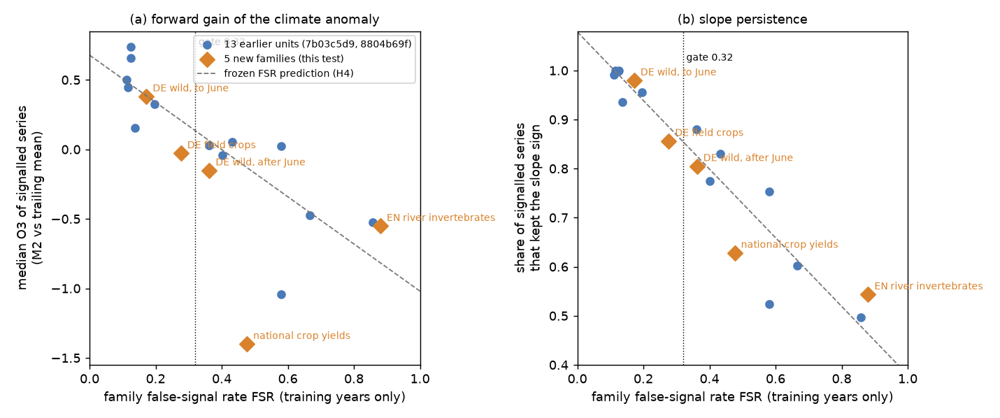
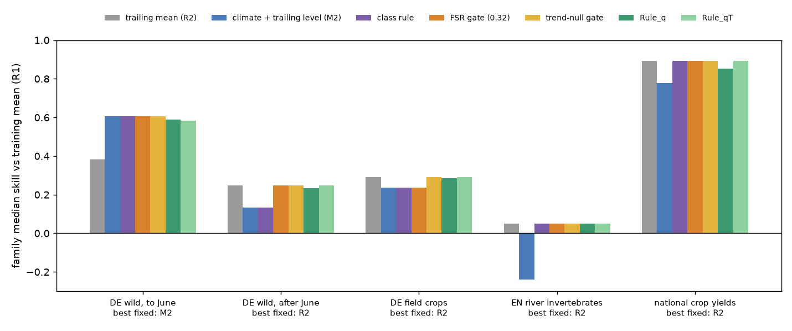
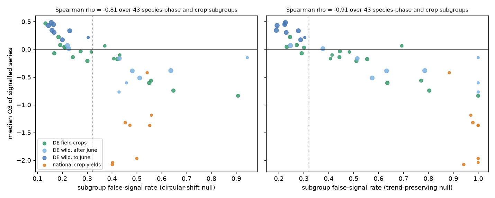

# A training-only false-signal gate beat the response-class rule in five new climate-response families (11,791 series, 2005-2024); a trend-preserving null corrected its one wrong choice

Job `sci-1107-hp-climate-pollution-biodiversity-1688a225f604`, campaign 11_07_2026, topic climate-pollution-biodiversity, machine hp, account claude-olen, model Claude Opus 5.5 (`claude-opus-5-5`). Date 2026-11-11. The signing key is a campaign-machine key. It is not a personal authorship claim.

## Summary

Forward tests in this campaign found that many published climate-response relations lose skill in later years. A response-class rule ("abiotic and timing responses are forecastable; population, production and disease responses are not") fitted 38 earlier tests but failed on new ones (sci:sha256:17f2e323). Campaign publication sci:sha256:8804b69f then proposed a class-free rule that uses only training years: compute the family false-signal rate (FSR) with a shifted-climate null, and use the climate anomaly with a trailing level only if FSR is small. That rule was exploratory. The same publication found that the shifted-climate null cannot see signals that come from a shared trend (dengue).

We tested both ideas prospectively. We froze the gate threshold (tau = 0.32), a new trend-preserving null and six decision rules in a timestamped plan. Then we applied them without change to five new families (11,791 series, training years to 2004, test years 2005 to 2018-2024). We chose the families so that class and signal strength can disagree.

| Family | Class label | Series (clusters) | FSR | FSR_T (trend-preserving null) | Best fixed strategy | Class rule | FSR gate | Trend gate |
|---|---|---|---|---|---|---|---|---|
| DWS: German wild-plant phases to June (DWD) | timing | 2,510 (399 stations) | 0.17 | 0.23 | climate (M2) | M2 | M2 | M2 |
| DWL: German wild-plant phases after June (leaf colour, leaf fall, fruit) | timing | 2,127 (399) | 0.36 | 0.48 | trailing mean (R2) | M2 (wrong) | R2 | R2 |
| DWC: German field-crop phases (wheat, maize, rape, sugar beet) | timing | 3,176 (300) | 0.28 | 0.39 | R2 | M2 (wrong) | M2 (wrong) | R2 |
| EMI: English river invertebrate families (EA data via UKCEH) | population | 3,462 (126 sites) | 0.88 | 0.96 | R2 | R2 | R2 | R2 |
| FAO: national crop yields, 8 crops (FAOSTAT) | production | 516 (124 countries) | 0.48 | 1.00 | R2 | R2 | R2 | R2 |

Main results:

1. **The FSR gate beat the response-class rule (H1 passed).** The pooled score (mean over families of the family median skill against the training mean) was 0.406 for the gate and 0.383 for the class rule: difference +0.023, 95% cluster-bootstrap interval [0.018, 0.029]. The two rules disagreed in one family. In late-season German plant phases (timing class), the gate correctly used the trailing mean (H1b passed). The class rule lost more than 0.05 against the trailing mean in 63% of these series.
2. **FSR again ordered families by forward skill (H2 passed).** Over the five new families, Spearman rho between FSR and the median gain of the climate anomaly over the trailing mean (O3 of signalled series) was -0.90 (one-sided permutation p = 0.042). Over all 18 units of three campaign tests it was -0.88 (p = 0.0001). For slope-sign persistence it was -1.00 and -0.96.
3. **The trend-preserving null improved every comparison (H3a, H3b and H3c passed).** It keeps the linear training trend of each climate predictor and shifts only the residuals. FSR_T was largest relative to FSR in crop yields (0.48 to 1.00), where yields and temperature share trends. FSR_T stayed low for spring phenology (0.23). The trend gate chose the best fixed strategy in all five families. It corrected the one wrong choice of the FSR gate (field crops) and beat it by +0.011 [0.007, 0.016]. The series rule with the trend null (Rule_qT) beat Rule_q by +0.011 [0.006, 0.015]. It lowered the share of series that lost more than 0.05 against the trailing mean in four families and left it at 0% in the fifth (crop yields 26% to 0%; late plant phases 12% to 2%).
4. **Level shifts dominated again (H5 passed).** The 5-year trailing mean beat the training mean in all five families (median skill 0.05-0.89).
5. **Two predictions failed.** The frozen linear FSR equation did not predict the size of the family outcomes better than class means (H4 failed for O3: mean absolute error 0.40 vs 0.36, mostly because crop yields fell far below the line; it passed for slope persistence: 0.054 vs 0.067). The within-family screen did not follow the gate (H6 failed, 3 of 5). In late plant phases and crop yields, training R2_cv still ranked series by forward skill against the training mean, although the family gate was closed.
6. **Exploratory: the trend null repaired the earlier dengue failure without tuning.** We rebuilt three families of sci:sha256:8804b69f from shared data and reproduced their FSR values exactly (dengue 0.5808, lake ice 0.1163, NDVI 0.5804). With the trend-preserving null, dengue FSR_T was 1.00, and Rule_qT used climate in 1 of 72 countries instead of 16; its loss share fell from 21% to 1.4%, and its regret fell from 0.089 to 0. Lake ice was unchanged (FSR_T 0.13). These are hindsight checks.



*Figure 1. Family false-signal rate (training years only) against (a) the median gain of the frozen climate slope with a trailing level over the trailing mean (O3, series with R2_cv >= 0.10) and (b) the share of these series whose test-period slope kept the training sign. Blue: 13 units of sci:sha256:7b03c5d9 and sci:sha256:8804b69f. Orange: the 5 new families of this test. Dashed: the frozen prediction of H4. Dotted: the frozen gate threshold 0.32.*

## Question

Can a forecaster tell, from training years only and without a response-class label, whether the climate terms of a new family of climate-response relations will add forecast skill in later years? And does a null that keeps shared trends remove the false signals that the shifted-climate null misses?

## Design (frozen before any fit)

We wrote `files/plan/frozen_plan.md` after we built the response tables and the climate arrays, and before we computed any relation, diagnostic, null draw or skill for these families.

- Plan SHA-256 `1cea1150452318b79b6e8cb0a17f1a2a18ea57db6e29e5f84788b1ea45d2237a`. FreeTSA RFC 3161 timestamp 2026-11-11 14:00:04 UTC (`files/plan/frozen_plan.tsq`, `frozen_plan.tsr`).
- Verify: download `https://freetsa.org/files/cacert.pem` and `https://freetsa.org/files/tsa.crt`, then `openssl ts -verify -data files/plan/frozen_plan.md -in files/plan/frozen_plan.tsr -CAfile cacert.pem -untrusted tsa.crt`.
- The plan lists the SHA-256 of every analysis script at freeze. All of these scripts are unchanged in this bundle. Scripts written after the freeze are `s16_exploratory.py` (exploratory), `s17_figures.py`, `run_all.sh`, `fetch_inputs.sh` and `retro/run_retro.sh`.

**Engine (unchanged from sci:sha256:7b03c5d9 and 8804b69f; `p04_forecast.py`, SHA-256 89486d26...0907387).** For each series there are 120 candidate predictors: monthly mean temperature or precipitation over 1, 2, 3, 6 or 12 months, ending in one of the 12 months up to the reference month. The model is y = a + b x. Training diagnostics: R2_in, and R2_cv (leave-one-year-out with window reselection in each fold). Test forecasts, one year ahead with observed weather: R1 training mean; R2 mean of the last 5 observed years; M1 frozen model; M2 frozen slope with the level from the same trailing years. Skill = 1 - MSE(model)/MSE(reference). O1 = M1 vs R1, O2 = R2 vs R1, O3 = M2 vs R2, O4 = M2 vs R1.

**Nulls.** Circular-shift null (`n07_null.py` of 8804b69f, new seeds only): the training climate rows are shifted circularly by 5 to m-5 years, and the window search and LOO-CV are repeated. Trend-preserving null (new, `n17_null_trend.py`): each candidate predictor is split into its least-squares linear training trend and residuals; only the residuals are shifted. A shared trend of y and climate therefore stays in the null and cannot count as a climate signal. Both nulls use max(2, ceil(4000/n)) draws per series. FSR = null share / observed share of R2_cv >= 0.10.

**Strategies.** R1, R2, M1, M2 for all series; class rule (M2 for abiotic and timing families, else R2); FSR gate (M2 for all series if FSR <= 0.32, else R2); trend gate (same with FSR_T); Rule_q (M2 if q <= 0.2 and R2_cv >= 0.10, else R2) and Rule_qT (same with q from the trend null). The threshold 0.32 is the midpoint of the interval 0.23-0.41 over which 8804b69f found equal decisions.

**Families.**

- **DWS, DWL (timing):** DWD annual-reporter phenology, 7 wild species (birch, beech, oak, hazel, elder, lilac, rowan). Phases with an all-station training median day of year of at most 181 are DWS; later phases are DWL. Quality bytes 5, 7 and 8 are dropped. 400 random qualifying stations per family. Climate: GHCN-CAMS temperature and CRU TS 4.09 precipitation, nearest 0.5-degree cell (median distance 17 km). Reference month = month of the training median date.
- **DWC (timing):** DWD annual-reporter field-crop phases of winter wheat, maize, winter rape and sugar beet, including sowing and harvest. 300 random stations. Climate as DWS.
- **EMI (population):** UKCEH ChemPop product (EA Biosys macroinvertebrate surveys, 1965-2018). y = mean log10 abundance class (0 absent, 1 = 1-9, ..., 5 = at least 10,000) of a taxonomic family over the samples of a season. Spring (March-May, reference month 5) and autumn (September-November, reference month 11) are separate series. Families present in at least 50% of the training years of the site-season. The log classes make the pre-2002 categorical and later numeric records comparable.
- **FAO (production):** FAOSTAT national yield, log(kg/ha), of wheat, maize, rice, barley, sorghum, soybean, potato and millet. Training-mean harvested area at least 10,000 ha. Imputed (I) and missing (M) values are dropped. Climate: cos(latitude)-weighted mean over the Natural Earth country polygon. Reference month 12.

All series need at least 15 training and 10 test years. Precipitation for 1950 is missing, so training starts in 1951. Test periods end in 2023-2024 (DWD), 2018 (EMI) and 2024 (FAO).

## Results of the pre-registered tests

Full output: `files/results/prereg_tests.json`, `family_summary.csv`, `strategy_comparison.csv`, `h2_points.csv`, `level_capture.csv`, `false_signal_curves.csv`.

| Test | Frozen criterion | Result | Decision |
|---|---|---|---|
| H1 FSR gate vs class rule | pooled difference, 95% interval > 0 | +0.023 [0.018, 0.029]; 1 disagreeing family (DWL) | **Passed** |
| H1b | gate chooses the better of M2 and R2 where rules disagree | DWL: gate R2 = 0.249, class M2 = 0.134 | **Passed** |
| H1 sensitivity | class rule with production as forecastable | +0.046 [0.039, 0.054] | Passed |
| H2 FSR orders families | rho <= -0.5 (5 new) and p < 0.05 (18 units) | rho -0.90 (p = 0.042); -0.88 (p = 0.0001) | **Passed** |
| H2 secondary | slope persistence; median O1 | -1.00 / -0.96; -0.70 / -0.86 | Passed |
| H3a Rule_qT vs Rule_q | lower bound > -0.005 and loss share not higher in >= 4 of 5 | +0.011 [0.006, 0.015]; lower or equal in 5 of 5 | **Passed** |
| H3b | FSR_T - FSR largest in FAO | FAO +0.52 (next: DWL +0.11) | **Passed** |
| H3c | FSR_T(DWS) <= 0.32 | 0.229 | **Passed** |
| H3 descriptive | trend gate vs FSR gate | +0.011 [0.007, 0.016] | (reported) |
| H4 FSR equation vs class means | lower MAE for O3sig (primary) | 0.398 vs 0.364 | **Failed** |
| H4 secondary | lower MAE for slope persistence | 0.054 vs 0.067 | Passed |
| H5 level shifts | median O2 > 0 in >= 4 of 5 | 5 of 5 | **Passed** |
| H6 screen follows gate | as predicted in >= 4 of 5 | 3 of 5 (DWL rho 0.23 and FAO 0.38 above 0 with closed gate) | **Failed** |

Pooled scores against the training mean: trend gate 0.417, Rule_qT 0.413, FSR gate 0.406, Rule_q 0.402, rule without null 0.385, class rule 0.383, trailing mean for all 0.373, M2 for all 0.303, frozen model M1 0.138. Intervals come from a cluster bootstrap (stations, sites or countries resampled within each family, 1,000 draws). The FSR gate and Rule_q did not differ (+0.004 [-0.002, 0.010]).



*Figure 2. Family median skill against the training mean for the fixed strategies R2 and M2 and for the five decision rules. The best fixed strategy of each family is under its label.*

### What the families showed

- **Spring phenology kept its climate signal.** In DWS, 82% of series had R2_cv >= 0.10 (null 14%). The test slope kept its sign in 98% of these, and the median test/training slope ratio was 0.74. M2 beat the trailing mean (median O3 0.34). Temperature windows were selected in 96% of series.
- **Late-season phases and crop phases had weaker, less stable signals.** In DWL, the slope kept its sign in 81% of signalled series, and the median slope ratio was 0.34. Autumn leaf colouring and leaf fall had subgroup FSR 0.43-0.94, but first ripe fruit had 0.22-0.43 (`e2_subgroups.csv`). In DWC, sowing and emergence of winter wheat and winter rape had FSR 0.55-0.91, while flowering and heading had 0.13-0.19. The trailing mean beat the climate anomaly in both families (median O3 -0.20 and -0.13).
- **River invertebrate abundance had no transferable climate signal.** Only 18% of series had R2_cv >= 0.10, against 16% for shifted climate (FSR 0.88). The median slope ratio of signalled series was 0.04, and series with a larger training signal had slightly lower forward skill (rho -0.08 [-0.11, -0.05]). This is the third population family in this campaign (after UK butterflies and US breeding birds) with this pattern.
- **Crop yields showed the trend trap.** Yields rose with technology, and temperatures rose too. The climate window selected on training years mostly tracked this shared trend: 57% of signalled series had no climate signal beyond a linear trend (R2_cv_dt < 0), and the trend alone explained a median 52% of training variance out of sample (`e1_trend_partial.csv`). The frozen model beat the stale training mean (median O1 0.39), but the trailing mean was much better (median O2 0.89), and M2 lost against it in 84% of series. The circular-shift null gave FSR 0.48, which closed the gate correctly but left Rule_q to use climate in 28% of series; the trend null gave FSR_T 1.00 in every crop.
- **Level capture.** The frozen climate terms captured at least half of the test-period level shift in 59% of DWS series, 41-47% of DWL, DWC and FAO series, and 25% of EMI series.


*Figure 3. Median forward skill (O1 blue, O3 orange) in quintiles of the training R2_cv. Dotted: forward skill equal to the training signal. Crop-yield O3 values below -1 are drawn at -1.*

## Exploratory results (not decision rules)

Code: `files/code/s16_exploratory.py`, `files/code/retro/`. Output: `files/results/exploratory.json`, `e1_*.csv`, `e2_*.csv`, `e3_*.csv`, `e4_retrospective.csv`.

- **E1, trend-partialled signal.** The climate signal beyond a linear training trend (R2_cv_dt) ranked series by O3 a little better than R2_cv in all five families (for example crop yields 0.09 vs -0.32).
- **E2, subgroups.** Across 43 species-phase and crop subgroups, subgroup FSR ordered the median O3 of signalled series (rho -0.81; FSR_T -0.91; `fig5_subgroups.png`). Inside crop yields, the circular-shift FSR ordered crops in the wrong direction (rho +0.67) and FSR_T in the right one (-0.41).
- **E3, threshold range.** In the five new families the FSR gate was right in all families for tau 0.18-0.26, and the trend gate for tau 0.24-0.38. The frozen tau 0.32 is inside the trend-gate range but not inside the FSR-gate range. In the three rebuilt earlier families both gates were right for every tau from 0.14 to 0.50.
- **E4, retrospective trend null.** Dengue, lake ice and NDVI of sci:sha256:8804b69f (rebuilt with its unchanged code; the series counts 72, 183 and 1,500 and FSR values match exactly). FSR_T was 1.00, 0.13 and 0.62. In dengue, Rule_qT had median skill 0.778 (best fixed 0.778) against 0.688 for Rule_q.



*Figure 4. Median O3 of signalled series against subgroup false-signal rate for DWD species-phase subgroups and FAO crops, with the circular-shift null (left) and the trend-preserving null (right). Point size grows with the number of series.*


*Figure 5. False-signal rate at each R2_cv threshold with the circular-shift null (circles) and the trend-preserving null (crosses). The family FSR uses the threshold 0.10.*

## Interpretation

1. A family-level false-signal rate is a useful, class-free and training-only guide to whether climate terms will help forecasts in an untested family. Across three campaign tests (18 units), it ordered later forward skill and slope persistence better than the class label. In this test it found the one family where the class label was wrong (late-season plant phases).
2. The circular-shift null misses false signals that come from shared trends. This happened in national dengue cases, in crop yields and in farm-crop phases, where management trends (earlier sowing, new varieties) and warming move together. A null that keeps each predictor's training trend detected these cases. It did not remove the strong interannual signals of spring phenology or lake ice.
3. The gate chooses a strategy for a family. It does not predict the size of the gain (H4 failed), and inside a family training R2_cv can still rank series when the family gate is closed (H6 failed).
4. The trailing mean was the best or near-best simple forecast in four of five families. A practical recipe for an untested family: compute FSR_T from training years; if it is at most about 0.3, use the climate anomaly with a trailing level; otherwise use a trailing mean.

## Limitations

- **Few independent decisions.** The gate and the class rule disagreed in only one of five families. The bootstrap intervals reflect sampling of stations, sites and countries inside families, not uncertainty over which families exist. One more mismatched family could change H1.
- **The trend gate's perfect record is partly a consequence of design.** We chose the trend null after we saw the dengue failure. Its threshold was frozen at the FSR value (0.32) without its own calibration, and its success in the five new families is one prospective test. The retrospective checks (E4) are hindsight.
- Single-window linear models with observed (not forecast) weather and 0.5-degree gridded climate. Process models (thermal time, crop models) can change family results.
- DWD: annual-reporter stations were sampled (400, 400 and 300 of 927, 896 and 692 qualifying stations); observer changes are not modelled; crop phases mix weather responses with farm decisions.
- EMI: sampling methods changed in 2002; the log-class conversion reduces but cannot fully remove this; the test period ends in 2018 (median 13 test years); 126 sites.
- FAO: national yields mix management, reporting changes and climate; country-area climate is a crude exposure; 124 countries.
- Null calibration uses 2-8 draws per series (more for small families); bootstrap intervals do not include null-calibration noise.

## Reproduce

External inputs are not in this bundle (`files/EXTERNAL_DATA_NOTICE.md`). On the campaign host they are in the shared store; elsewhere run `sh files/code/fetch_inputs.sh /path/to/inputs`. Exact paths, sizes, SHA-256 and source URLs: `files/provenance/shared_input_files.csv`. The DWD, FAOSTAT and UKCEH files were added to the campaign store by this job (`dwd-pheno-*-20261111`, `faostat-qcl-all-data-normalized-20251231`).

```
DATASETS=/path/to/inputs SCRATCH=/path/to/scratch BUNDLE=/path/to/out \
PRIOR8804=/path/to/8804b69f_results sh files/code/run_all.sh
```

PRIOR8804 is a folder that holds `p1_points.csv` from sci:sha256:8804b69f (`sci read <zip> --file files/results/p1_points.csv --output p1_points.csv`). Python 3.12 with numpy, pandas, scipy, netCDF4, geopandas, shapely, pyproj and matplotlib. On the hp host with 2 processes the data builds and climate extraction took about 15 minutes, the engine and both nulls for the new families about 5 minutes, the trend diagnostic about 15 minutes and the retrospective rebuild about 20 minutes. Record-level intermediates go to SCRATCH and are not bundled. A second run of `s15_tests.py` from the same scratch files gave byte-identical results.

## Files

- `files/plan/` frozen plan, FreeTSA query and reply.
- `files/code/` all code: `b11_families.py` (builders), `c11_climate.py` (climate; c01 of 8804b69f with new families), `b03_pack.py`, `p04_forecast.py`, `n07_null.py`, `p06_trend_diag.py` (unchanged or seed-only changes, MIT, from 7b03c5d9 / 8804b69f), `n17_null_trend.py` (new), `s15_tests.py` (pre-registered tests), `s16_exploratory.py`, `s17_figures.py`, `run_all.sh`, `fetch_inputs.sh`, `retro/` (unchanged 8804b69f builders for the retrospective check).
- `files/results/` aggregate results and `series_diagnostics.csv` (per-series model statistics and skills; no observed response values).
- `files/provenance/shared_input_files.csv` input hashes and URLs.
- `files/EXTERNAL_DATA_NOTICE.md` sources, terms and required attributions.
