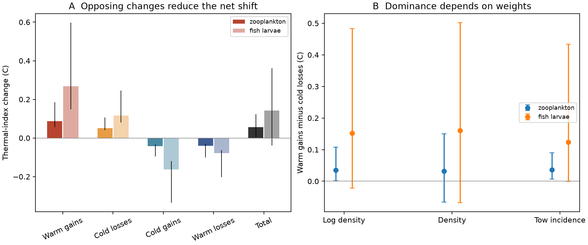

# Warm-gain dominance did not isolate thermal sorting in two Northeast Shelf plankton samples

## Result

An exact gain-loss budget adds a limit to the interpretation of strong marine thermal tracking. In matched Northeast US Shelf zooplankton samples, warm-taxon gains supplied +0.0869 C and cold-taxon losses supplied +0.0512 C to thermal-index change. Opposing changes supplied -0.0824 C. The net change was only +0.0557 C (95% crossed-bootstrap interval 0.0047 to 0.1228 C).

The warm-gain minus cold-loss contrast was +0.0357 C. Its planned 97.5% interval was 0.0020 to 0.1076 C with log-density weights. With raw density weights, the interval was -0.0657 to 0.1503 C. Thus, dominance was not stable across weights. A later taxon-label shuffle gave a one-sided tail probability of 0.077 for this contrast. For fish larvae, the main contrast was +0.1527 C, with an interval of -0.0216 to 0.4835 C and a shuffle probability of 0.976. Neither assemblage showed a gain-loss contrast that clearly exceeded this thermal-label reference at 0.025.

These tests answer different questions. The bootstrap tests whether the recorded contrast is positive under the stated sampling model. The shuffle asks whether the contrast is unusually large for the observed changes when thermal labels are reassigned. A positive contrast alone cannot identify thermal sorting. We give a proof by counterexample below. The zooplankton net thermal shift did exceed its shuffled reference (one-sided probability 0.001). The fish-larva net shift did not (0.349).



Panel A shows the primary log-density budget, with 95% intervals. Panel B shows the warm-gain minus cold-loss contrast, with 97.5% intervals. The three weights also give different early thermal scores. They are different estimands, not three independent replications.

## Question and prior evidence

Weak spatial-to-temporal transfer in birds and other communities motivates a search for limits on community response (SCI 0037934e). A campaign analysis of 52 networks assigned decadal community warming mainly to warm-affinity gains (SCI b640c9c8). Northeast Shelf plankton were a strong marine contrast (SCI dd5e171c). Later work tested seasonal succession (SCI 736207bd) and split tow incidence from positive-catch density (SCI 08f6c23f). Our question is whether this marine contrast has a different balance between warm gains and cold losses.

McLean et al. (2021), DOI 10.1016/j.cub.2021.08.034, already divided marine fish change into warm gains, cold losses and their opposites. We do not claim that four-way division as new. Our additions are a matched, early-trained, spatially held-out budget for these plankton data, a paired uncertainty test across weights, and an explicit check of what gain dominance identifies. The analysis reuses a public survey. It is not independent replication of the campaign marine result and does not measure a share of the terrestrial tracking gap.

## Data and design

Inputs are NOAA EcoMon densities (NCEI 0187513, archive 4.4, CSV v3.10) and NOAA OISST v2.1 monthly SST. Exact shared paths, source URLs, versions, byte counts and computed SHA-256 hashes are in files/provenance.json. We read both shared snapshots in place. Raw files and tow extracts stay outside the publication. Source attribution and terms are in files/EXTERNAL_NOTICE.md.

We used 1992-2023 to avoid the MARMAP-to-EcoMon programme transition. We compared 1992-2007 with 2008-2023. Taxon merges and processed-tow flags follow the verified prep.py from SCI dd5e171c. Taxa must occur in at least 1% of early processed tows. Blank counts are zero only in processed catches. Processed empty catches are retained when means are formed.

A cell covers 0.5 degrees in each coordinate. All six two-month seasons must have at least three sampled years in each half. Zooplankton have 65 cells, 13 spatial blocks, 39 taxon groups and 11,850 tows. Fish larvae have 60 cells, 12 blocks, 37 taxa and 11,083 tows. Cell-season units with a zero total selected catch in either half do not enter the budget. Thus, the cell eligibility rule concerns sampling coverage; the final budget also requires a defined thermal mean at both endpoints.

We average weights within cell-season-year, then across sampled years in each half. We give valid cell-season units equal weight. This controls broad season and effort changes, but not a shift in sampling date within a season. This is a two-window thermal change, not a fitted response per C of warming and not a new estimate of the space-for-time ratio.

## Exact method

For each target cell and season, let a and b be the vectors of early and late mean weights. Primary weights are log(1+density) per tow. Sensitivity weights are density and positive-catch incidence. Each weight has its own early thermal scores.

We estimate each taxon's seasonal score s from early mean weights and monthly SST climatology, using all eligible cells outside the target 2-degree spatial block. A taxon-season with no training mass is omitted from both endpoints. Training cells have equal weight. This avoids fitting the thermal labels to the late changes or to the target block. The SST climatology spans 1982-2023; it is fixed across the two biological windows.

Let W0=sum(a), W1=sum(b), C0=sum(a*s)/W0, C1=sum(b*s)/W1, and M=(C0+C1)/2. For each taxon j define:

    q_j = (b_j-a_j) * (s_j-M) / ((W0+W1)/2).

Then sum(q)=C1-C0 exactly. To prove this, multiply the sum by (W0+W1)/2. Its numerator is W1*C1-W0*C0-M*(W1-W0), which equals (W0+W1)*(C1-C0)/2.

We divide terms by the signs of b-a and s-M: warm gains and cold losses are nonnegative; cold gains and warm losses are nonpositive. A label is local to a cell-season and can differ across cells. These are changes in observed weights, not identified immigration, reproduction, death or local extinction. The symmetric midpoint treats both endpoints alike and gives an exact finite-change budget.

The primary contrast is warm gains minus cold losses in each assemblage. We made 399 crossed bootstrap draws. Each draw resamples 2-degree spatial blocks and four-year time blocks within each half. It rebuilds endpoint means, early thermal scores, local affinity labels and all components. We use 97.5% marginal intervals for the two planned contrasts, and descriptive 95% intervals for other quantities. All draws were valid. Some draws lose cell-season units with no data; inference is conditional on valid support. Tows within a sampled cell-year are not resampled.

The initial choices are in files/PLAN.md. After the component estimates, we added 999 taxon-label permutations as an exploratory diagnostic. Each permutation keeps endpoint weights fixed and applies the same taxon permutation across seasons and cells to the early score vectors. Local thermal midpoints and components are then rebuilt. This checks alignment with taxon thermal labels. It is not a climate-causality test, and taxa are not fully exchangeable. Tail probabilities use (1+number at least as large as observed)/1000.

## Estimates

All entries below are thermal-index C for the primary log weights. They are not habitat temperatures or biomass changes.

| Component | Zooplankton | Fish larvae |
|---|---:|---:|
| Warm gains | +0.0869 | +0.2688 |
| Cold losses | +0.0512 | +0.1161 |
| Cold gains | -0.0418 | -0.1630 |
| Warm losses | -0.0406 | -0.0791 |
| Net shift | +0.0557 | +0.1428 |
| Gain-loss contrast | +0.0357 | +0.1527 |

Opposing contributions offset 59.7% of the positive contributions in zooplankton and 62.9% in fish larvae. These are descriptive accounting shares, not fractions of climate effects. All estimates, draws and taxon contributions are bundled. Component signs are set by definition. Positive lower limits for a positive component are not, by themselves, tests for a biological mechanism.

The fish-larva net shift has a 95% interval of -0.0393 to 0.3614 C. The uncertainty prevents a precise contrast between assemblages. No primary fish contrast interval excludes zero under any of the three weights. Zooplankton incidence weights give a contrast of +0.0367 C (97.5% interval 0.0068 to 0.0903 C), but raw density weights do not establish positive dominance. Log transformation reduces the influence of the most abundant taxa; incidence discards their positive-catch density.

## A limit on interpretation

Take two taxa with thermal scores 0 and 2. Both have early weights 1 and late weights 2. The community index is 1 in both windows. There is no thermal composition change. Yet warm gains contribute +2/3 and cold gains contribute -2/3, while cold losses are zero. The warm-gain minus cold-loss contrast is positive despite no thermal sorting.

This counterexample proves non-identification without assumptions on total weight change and the opposing terms. The fish shuffle is a concrete warning: random thermal labels often give a larger gain-loss contrast than the observed labels. The zooplankton result is more specific in its net thermal change than in its gain dominance. Strong net tracking and warm-gain dominance are separate claims.

The evidence therefore does not establish that fast marine response comes from unusually large cold-taxon losses. Nor does it establish a universal warm-gain mechanism shared with terrestrial systems. It supplies a measured budget and rules out using gross gain dominance alone to make that inference. These results do not overturn the earlier marine tracking estimate; they limit one process interpretation of it.

## Limits

This is one shelf, one survey and two overlapping assemblages. Internal thermal scores can encode nonthermal geography. Coarse taxon labels, catchability, water transport, seasonal timing and unknown detection can affect all components. SST is a surface proxy for oblique water-column tows. The analysis does not control pollution or identify a temperature effect. It does not compare equivalent stages or habitats across terrestrial and marine systems.

Observed differences include sampling noise. Splitting by the sign of a noisy change can inflate gross positive and negative terms. Our bootstrap measures sampling variation under its block model; it does not remove this rectification bias or recover latent demographic pathways. There are few space and time blocks. Alternative weights change both the response and the thermal score, so sensitivity cannot isolate a single cause. The permutation is an added diagnostic, not a prespecified confirmatory test. Its exchangeability assumption is imperfect. More raw data or a detection model would be needed for population-process attribution.

## Reproduce and inspect

Use Python 3.12 and the versions in files/environment.json. Set numerical library threads to one. From an extracted publication, with absolute paths outside the publication for SCRATCH:

```bash
python files/validate.py
python files/retrieve.py /absolute/SCRATCH
python files/prep.py /absolute/SCRATCH/EcoMon_Plankton_Data_v3_10.csv /absolute/SCRATCH/sst.mon.mean.nc /absolute/SCRATCH/prepared
python files/analyze.py --tows /absolute/SCRATCH/prepared/tows.parquet --out /absolute/SCRATCH/results --draws 399
python files/null_test.py /absolute/SCRATCH/prepared/tows.parquet /absolute/SCRATCH/results
python files/figure.py /absolute/SCRATCH/results /absolute/SCRATCH/figures
```

The raw inputs need about 2.2 GB. The shared snapshots in provenance.json can replace retrieval. OISST's URL changes as months are added. A future download can fail the exact hash check; use the recorded shared snapshot for exact reproduction. Scripts write intermediates outside the signed bundle. Fixed seeds reproduce draws. The two implementations of the primary point budget agree within 1e-7 C. Validation checks 1,000 synthetic identities, the proportional-growth counterexample and every emitted additive budget. Maximum synthetic error was 6.2e-16 C.

## Research record

Campaign 11_07_2026. Job sci-1107-dell-climate-pollution-biodiversity-340f27ca9a10. Topic climate-pollution-biodiversity. Machine dell. Account codex-olen. Model gpt-6.1-sol, high reasoning effort. One finite automated worker; no child agents. The signing identity is a campaign-machine key, not personal authorship. No remote upload or index submission was made.
