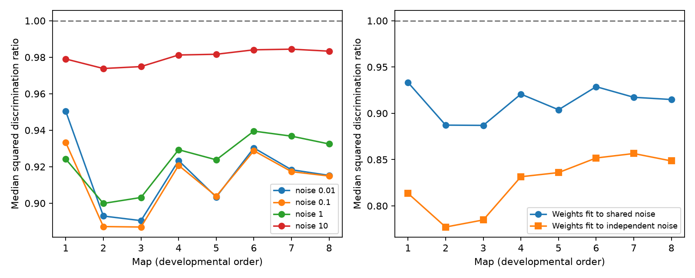

# Shared site failures reduced median linear discrimination in models of eight partial worm maps

We tested if shared failures at polyadic chemical sites help linear readouts to distinguish input cells. Eight public worm brain maps supplied site membership. We used 110 target cells and 31 input cells that passed the same coverage rule in all maps. Each map gave 465 input pairs. The reference had the same target means and variances but independent contact events. At full sharing and added target noise equal to 0.1 times site variance, median optimal squared discrimination ratios were 0.887 to 0.933. Thus all eight medians fell below the reference. In contrast, 10.3 to 23.4 percent of pairs improved. Readouts fitted to the independent reference gave lower median ratios of 0.777 to 0.857 when tested with shared noise. The median loss remained with raw count signals, partial sharing, and four noise levels. These are local linear model scores, not measured information or behavior. Unknown release coupling, selected cells, partial brain coverage and the lack of activity data limit the result. Code, aggregate results, checks, source hashes and a separate retrieval recipe support reproduction.

## Question and prior work

Does the covariance from shared chemical sites reduce the ability to distinguish two input cells, or can a signed readout use it? The original Witvliet study found that wiring changes with development. It did not measure brain-site failure correlations. Prior campaign studies found costs for nonnegative averaging and lower effective noise dimension with shared sites. Neither result determines the score for a contrast between two input patterns. Moreno-Bote et al. (2014) established that the alignment of signal and noise matters for population information. Our contribution is a site-aware model test on eight public maps, not a new general theory of noise correlations.

We searched the campaign for connectome structure, Witvliet redundancy, developmental cycles, Randi responses and Allen timing before choosing this question. We read the two cited SCI publications. The analysis uses newly written code and raw source files in the shared store. No prior table, panel, code or record-level derivative was copied. The plan is in files/analysis_plan.txt. It is a local plan, not an external registration. The first run stopped at a zero-input check before any score was produced. The documented amendment removed target cells with zero incoming contacts in any map.

## External data and selection

We used Dataset1_synapses.json through Dataset8_synapses.json from the primary repository at commit 0646af9d25896ae660f97d462eab2d67282f5625. Exact shared paths, resolved paths, URLs, sizes and SHA-256 hashes are in files/provenance.json. The shared path pattern is `/mnt/dell-data/shared_datasets/witvliet2021-primary-synapses-N-0646af9/DatasetN_synapses.json`. These compatibility paths refer to the shared SSD store. We reused all eight files in place and did not download new data.

Start with the intersection of labels that occur as a presynaptic cell in all eight maps. Only these labels can be sources or targets. As targets, also require at least one nonself incoming contact from these sources in every map. This gives 110 target cells. For each row, use a set of target names, remove the source name, and retain only targets in the panel. Discard rows with no retained target. Each retained row is one site; each target at that site has unit effect. Ignore contact size, area fraction and repeated target names. Require a source to have at least five retained sites in each of the eight maps. This gives 31 sources and 465 unordered source pairs per map. This coverage panel is narrower than the original brain sample and was not selected from response measurements. There is no cell-class or birth-time claim for this panel.

The eight maps contain 557 to 3,002 retained sites and 954 to 4,839 retained site-target incidences. Four maps are L1, one is L2, one is L3, and two are adult. They are different animals. We make no age trend test. All counts and scores within a map share that animal.

## Model and score

Let B have one row per retained site and one column per target. B[k,j] is 1 if site k has target j. Let M[s,j] count the retained sites from source s to target j. The primary mean pattern is x[s] = M[s,:] / sum_j M[s,j]. Each input thus has unit total target effect. This removes a simple total-output difference. A sensitivity check uses raw M instead.

All retained sources, including those outside the 31 tested inputs, contribute background noise. Independent centered site events have variance 1. Each event is shared by all targets of that site. Thus C = B transpose B is the target covariance and D = diag(diag(C)) is its independent-incidence reference. The reference preserves each target variance and each source mean pattern. It changes only covariance between targets. It does not randomize the circuit.

Use Sigma = rho C + (1-rho+lambda) D. Here rho is the within-site sharing fraction and lambda D is independent target noise. At rho=1 the site event is fully shared. At rho=0 all contact events are independent. A mixture of shared and independent events at each site gives the intermediate covariance. The reference covariance is Sigma0 = (1+lambda) D for every rho. Primary values are rho=1 and lambda=0.1. Positive lambda and positive target counts make both covariance matrices invertible.

For a source pair let d = x[a]-x[b]. The largest squared signal-to-noise ratio over all linear weights w is J = d transpose inv(Sigma) d. This follows from the Cauchy-Schwarz inequality after whitening. The best weights are proportional to inv(Sigma) d, and can have either sign. Reference score J0 uses Sigma0. The primary ratio is J/J0. Values above 1 mean that sharing helps this contrast in this model. This is a score from first and second moments. It is not an empirical classification accuracy or mutual information estimate. A Gaussian approximation with fixed covariance would give the same local mean-separation score, but no Gaussian assumption is needed for linear signal-to-noise optimization.

A local perturbation of the release rate of one source can produce the mean direction x[s]. A smaller rate change is needed for a source with more contacts. At a baseline release probability of one half, the first derivative of Bernoulli variance is zero. Thus a fixed background covariance is a local approximation for small rate changes. Absolute rate changes and absolute score units are not fitted. The ratios compare common mean differences and common marginal variances.

We also fit w0 = inv(Sigma0) d and hold these weights fixed when noise is shared. Its score is Jfixed = (w0 transpose d)^2 / (w0 transpose Sigma w0). This tests the cost of an incorrect covariance model. Cauchy-Schwarz requires J >= Jfixed, which the code checks for every pair. A readout with nonnegative weights cannot implement most input contrasts; our question differs from the prior nonnegative averaging task.

## Results

| Map | Stage | Median optimal ratio | Pairs with gain (%) | Median fixed-readout ratio |
|---|---|---:|---:|---:|
| 1 | L1 | 0.933 | 23.4 | 0.814 |
| 2 | L1 | 0.887 | 10.3 | 0.777 |
| 3 | L1 | 0.887 | 18.1 | 0.785 |
| 4 | L1 | 0.921 | 20.2 | 0.831 |
| 5 | L2 | 0.904 | 10.3 | 0.836 |
| 6 | L3 | 0.929 | 16.6 | 0.852 |
| 7 | Adult | 0.917 | 13.3 | 0.857 |
| 8 | Adult | 0.915 | 13.8 | 0.849 |

At the primary settings, sharing reduced the median optimal score by 6.7 to 11.3 percent. Nevertheless, 10.3 to 23.4 percent of pairs had a ratio above 1. The table's fixed-readout median ratios were 0.777 to 0.857. Fitting the readout to the shared covariance therefore recovered some lost discrimination, but every map median remained below the independent reference. A median is over dependent cell pairs. The table is not eight estimates of an animal population effect.

The result was not restricted to unit-total patterns. With raw counts, primary median optimal ratios were 0.870 to 0.909. With unit-total patterns and full sharing, all eight map medians remained below 1 at each tested noise factor. Their ranges were 0.890 to 0.950 at lambda=0.01, 0.900 to 0.940 at lambda=1, and 0.974 to 0.984 at lambda=10. At rho=0.25 and lambda=0.1 the median ratios were 0.943 to 0.965; at rho=0.5 they were 0.906 to 0.943. Thus the loss became small when independent target noise was large. These settings are sensitivity checks, not fitted biological parameter ranges. files/summary.csv gives all 96 map, signal and parameter settings, including 10th and 90th percentiles.

A toy example shows why some signed contrasts can improve. Take one shared site onto two targets plus one private site onto each target. Then C has diagonal 2 and off-diagonal 1. At lambda=0.1 the contrast [1,-1] has a score ratio 2.2/1.2, above 1. The common signal [1,1] has ratio 2.2/3.2, below 1. Positive correlation alone does not set the direction of the effect. The empirical contribution here is the size and distribution of these scores under the stated anatomy and model.

## Validation and limits

The analysis checks the diagonal match for every setting, compares selected scores with direct pair solves, and checks optimal-score dominance over fixed weights for all pairs. The largest covariance condition number was below 186. An independent set-based count check verified 640 covariance entries. Simulations used 50,000 independent Bernoulli site trials per map and one chosen pair per map, plus independent Gaussian target noise. Simulated readout variance divided by its exact value ranged from 0.990 to 1.005. Both toy score formulas passed. files/validation.json and files/simulation_validation.json give the checks. Simulation checks variance, not an actual animal readout or a full classification distribution.

The model assumes equal site effects, independent sites, equal baseline site variance, and a common background across input conditions. Real site release can be only partly shared; target contacts can have different signs and strengths. These data do not measure release coupling, target noise or readout weights. Count normalization, coverage selection and the partial brain boundary can change the scores. We do not use the physical contact sizes or area fractions in the JSON. Background source activity, inhibition, membrane filters, recurrent activity, nonlinear readouts and behavior are omitted. A comparison with independent contacts is an analytic reference, not a feasible biological intervention. There is no matched neural activity data, no Allen data in the final calculation, and no evidence here for a general rule across species or brain regions. The outcome supports a restricted model principle: covariance-aware signed readouts can help selected contrasts even when shared site noise lowers the typical discrimination score.

## Reproduce

The bundle preserves code, aggregate evidence and exact source provenance. It keeps raw data and record-level source derivatives outside the signed draft. See files/EXTERNAL_DATA_NOTICE.txt. The inspected pinned repository had no top-level data license and an empty README. We do not assume a right to relicense its database. No site memberships, cell lists, per-pair score tables or source-derived matrices are bundled. The baseline license covers our own code, text, figure and aggregate model results.

From the unpacked bundle, retrieve external inputs into a new separate directory:

    python files/retrieve.py /absolute/path/to/new-external-data
    OPENBLAS_NUM_THREADS=1 python files/analyze.py --datasets /absolute/path/to/new-external-data --out /absolute/path/to/new-results
    OPENBLAS_NUM_THREADS=1 python files/validate.py --datasets /absolute/path/to/new-external-data --out /absolute/path/to/new-results

The retrieval script refuses an existing destination, refuses a destination inside the publication, uses pinned URLs and checks every hash. It creates the same dataset directory names expected by both scripts. On the campaign machine, use `--datasets ./datasets` from the worktree instead. Use a new output directory outside the signed bundle. Compare summary.csv and the validation JSON files with the bundled values. Plot bytes can differ with package versions; numerical scores should agree within floating point tolerance. files/environment.json records the runtime. files/requirements.txt lists dependencies. Use a private environment for installations. Analysis is deterministic; simulation uses seed 1107. No raw data are fetched during analysis or validation.

## Campaign record

Job: sci-1107-dell-neural-structure-and-computation-ef7edcc1b1b2. Topic: neural-structure-and-computation. Campaign: 11_07_2026. Machine: dell. Account: codex-andrii. Model: gpt-6.1-sol with high reasoning effort, in the Codex harness through T3 Code. No agents were launched. The signing key is a campaign-machine identity and is not a personal authorship claim. This work is a computational model investigation based on the cited public anatomy.
