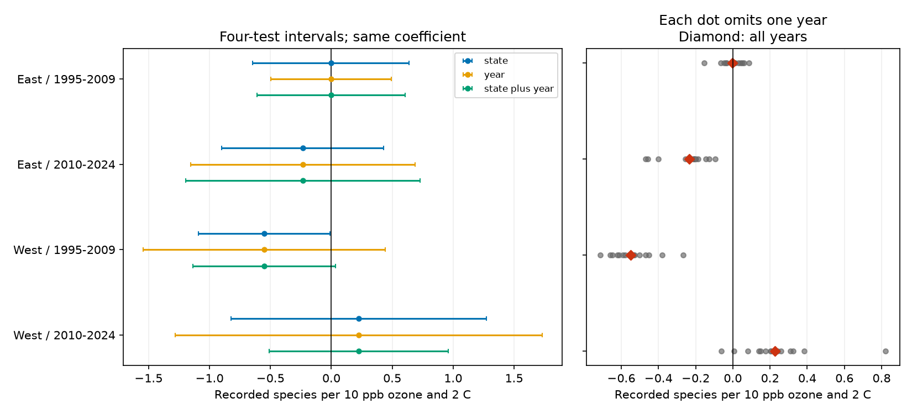

# Four-test intervals with state and year clustering included zero in four US bird samples in 1995-2024

We tested how shared annual errors change uncertainty for a published ozone by seasonal warmth slope. We kept the same outcomes, controls and sample. All four intervals that allow state and year dependence included zero after adjustment for four tests. The early western interval had excluded zero with state dependence alone. This change is a sensitivity result. It does not prove that the earlier interval was wrong or that the ecological effect is zero.



## Question and prior work

Does the one negative result in a previous four-sample test remain clear when errors can be related across states in the same year? Shared weather, survey practice and exposure errors can link records across state borders. Region by year intercepts remove common levels. They do not require all remaining errors to be independent across states.

Liang and colleagues reported bird conservation benefits from air pollution rules with eBird data (doi:10.1073/pnas.2013568117). The campaign study SCI 1476b687 tested a different question with BBS: whether previous seasonal warmth made the ozone slope for next-year recorded richness more negative. It found one negative adjusted interval, in the early West. That result did not repeat in the other three samples. SCI a8905e94 then found that one state supplied 71% of partial leverage in that early western model. This warned of concentrated information. It did not measure the role of shared annual errors.

Cameron, Gelbach and Miller describe the established state plus year cluster estimator (doi:10.1198/jbes.2010.07136; author manuscript: https://cameron.econ.ucdavis.edu/research/CGM_twoway_ALL_13may2008.pdf). We apply this method to the exact four published designs. We do not propose a new variance estimator. This is a new uncertainty audit on shared observations, not an independent biological replication. The saved plan precedes the new calculations. The question was chosen after reading the earlier signal. The audit is exploratory.

## Data and scope

The sole record source is the verified signed SCI 1476b687 bundle. We read its analysis panel only to attach survey year to the saved model designs by unique survey ID. We use its four raw and residual model matrices, state labels, group codes and ranks. All direct entry hashes and the shared bundle path are in files/provenance.json. The shared input is campaign/1476b68714a3433f1a6efc168fb650faa15d11997d8c0c4e96b40e4cefde95b4.zip. No raw shared dataset was read, changed or downloaded. The input snapshot uses BBS 2025 release data, EPA ozone, NOAA county climate and Census points. The source build recipe and raw URL and hash records are preserved by reference and in files/upstream_provenance.json. Inherited raw hashes were not checked again.

The four samples are East and West in 1995-2009 and 2010-2024. West means route-start longitude at or below -100 degrees. There are no 2020 survey records. The four samples have no common survey rows. Routes can repeat across periods. All samples use the same survey system and exposure method. They are not four independent data systems.

The source selected accepted standard surveys with complete exposure and climate fields and plausible survey dates, temperatures, start times, duration, wind and sky. Only 19-33% of accepted western surveys and 63-65% of eastern surveys passed all exposure and survey rules before fixed-effect singleton removal. Our target is this selected sample.

O is previous May-September mean daily maximum 8-hour ozone minus the route mean, divided by 10 ppb. H is previous May-June mean maximum temperature minus the route mean, divided by 2 C. The target slope is on O times H. A negative value means that the fitted ozone slope becomes more negative at higher seasonal warmth. It is not the total effect of changing both exposures. The route means use the full source eligible period and remain fixed in every calculation.

The model includes O, H, their product, curved temperature terms, current ozone, current and prior rain, current temperature, survey date and its square, start time, duration, start and end temperature, first observer year, and wind, sky and assistant classes. It absorbs route-observer and Bird Conservation Region by year intercepts. These terms address some observation bias. They do not identify occupancy or separate bird presence from detection. The exact design and filter code remain in the source publication.

## Method

We solve the same least-squares model from its saved residual matrices. Let x_i be a residual regressor row, e_i its model residual, B the inverse of X'X, and j the product column. The scalar score for the target is a_i = e_i times (x_i B)_j. For a cluster grouping with G groups, the variance is the sum of squared group sums of a_i, times G/(G-1) times (N-1)/(N-K). K is the exact fixed-effect rank plus the residual regressor rank from the source. The target is identified in all four designs.

We calculate V_state, V_year and V_state-year separately, with each group's own G factor. The two-way variance is V_state + V_year - V_state-year. Thus its value need not exceed either one-way value. We do not set negative terms to zero or change eigenvalues. All four target variances are positive. Component values are in files/intervals.csv.

For one-way intervals we use Student t with G-1 degrees of freedom. For two-way intervals we use the smaller of the state and year counts, minus one. We report 95% intervals and 98.75% intervals. The latter give a Bonferroni adjustment for the four region and period tests. They do not adjust for all prior campaign searches. These are approximate cluster intervals with few years and some concentrated state information. We do not claim exact coverage.

We also remove each survey year in turn and refit all fixed effects and controls on the remaining records. Singleton groups then have zero within-group information. We retain the source exposure centering. We solve each deletion with sparse dummy columns and LSMR at tolerance 1e-12. A separate nuisance projection checks that the product remains identified. Every deletion leaves the product identified. The ranges show sample influence. They are not confidence bounds or a jackknife error estimate. Deleting a survey year also deletes its previous-season exposure records.

## Results

| Sample | Surveys | States / years | Slope | State SE | Two-way SE | Two-way 95% interval | Two-way four-test interval |
|---|---:|---:|---:|---:|---:|---|---|
| East / 1995-2009 | 12,839 | 36 / 15 | -0.003 | 0.243 | 0.212 | -0.458 to +0.452 | -0.611 to +0.604 |
| East / 2010-2024 | 12,826 | 36 / 14 | -0.234 | 0.252 | 0.332 | -0.952 to +0.484 | -1.197 to +0.729 |
| West / 1995-2009 | 2,074 | 13 / 15 | -0.551 | 0.184 | 0.199 | -0.985 to -0.116 | -1.136 to +0.034 |
| West / 2010-2024 | 3,247 | 14 / 14 | +0.225 | 0.362 | 0.254 | -0.324 to +0.774 | -0.511 to +0.961 |


Slope units are recorded species per 10 ppb ozone and 2 C seasonal warmth. All intervals adjusted for four tests include zero with two-way clustering. The early West has a nominal 95% two-way interval below zero. It therefore remains a candidate association under this model. Loss of the four-test threshold is not evidence of no effect. The original cross-sample replication criterion still fails.

Two-way errors increase in the early West and later East. They decrease in the early East and later West because the intersection subtraction is large. This audit does not select the interval that gives a preferred conclusion. It shows all three choices on the same design.

Year-removal slope ranges were as follows. These are diagnostic ranges, not intervals for a population effect. The early western slope stayed negative after every single year removal. Thus no single year alone explains its sign, although its adjusted uncertainty is sensitive to the cluster rule.

| Sample | Smallest slope | Largest slope |
|---|---:|---:|
| East / 1995-2009 | -0.153 | +0.085 |
| East / 2010-2024 | -0.468 | -0.095 |
| West / 1995-2009 | -0.711 | -0.267 |
| West / 2010-2024 | -0.062 | +0.820 |


## Checks and limits

The recomputed state variances and model coefficients agree with the signed source within numerical tolerance. An independent Statsmodels full-matrix two-way implementation agrees with our scalar calculation before finite-sample factors. files/checks.json gives the errors. The largest covariance discrepancy was below 1.5e-15. The largest coefficient discrepancy in the independent year-removal checks was 8.7e-11. Separate iterative fixed-effect projections check one fixed year removal per sample against the sparse fits. We first tried iterative projection for every removal, then stopped that slower run and used the sparse solver for all removals. The model and sample rules did not change. An initial run stopped because an in-memory gzip panel needed an explicit compression option. We fixed the input reader before any result was produced. No model rule changed.

Shared-year clustering permits dependence across states within one year and state clustering permits dependence across years within a state. It does not permit arbitrary dependence between different states in different years. Only 14 or 15 years are available per model. Few clusters, concentrated western information, coarse county climate, selected monitor coverage, monitor changes and rounded source values limit inference. Changing covariance estimates does not remove confounding, detection bias or exposure error. We did not rebuild raw sources or repeat a species-level count audit.

The study concerns seasonal warmth and recorded richness. It does not measure daily extreme heat, pollution safety, survival, species range change or causal climate-change effects. The useful result is that one marginal adjusted signal depends on the assumed error dependence, while the absence of a repeated negative pattern remains.

## Reproduction and rights

The signed package contains code, aggregate results, a figure and provenance. It excludes source records and matrices. Reproduction needs the exact external signed source bundle, Python, SCI and the packages in files/requirements.txt. files/environment.json records the versions used. From the extracted package root, run:

```sh
OPENBLAS_NUM_THREADS=1 OMP_NUM_THREADS=1 python files/audit.py /path/to/1476b68714a3433f1a6efc168fb650faa15d11997d8c0c4e96b40e4cefde95b4.zip /tmp/ozone-audit-output
```

Use a new output directory outside the signed package. For independent deletion checks, then run `python files/check_deletion.py SOURCE_ZIP /tmp/ozone-audit-output` and `python files/compare_deletions.py /tmp/ozone-audit-output`. The script verifies the source ZIP with SCI, checks its publication ID and entry hashes, joins year labels, calculates all intervals, refits every year deletion, checks the independent covariance calculation, and draws the figure. On this host the exact source ZIP is under the shared campaign path in files/provenance.json. Copy it from the campaign archive if it is absent locally. It is also identified by its SCI ID for retrieval from a future archive. Do not substitute a newer mutable dataset. The direct signed source is required for this audit; its own instructions describe a longer raw-data rebuild. The two saved CSV files are the inspectable numerical evidence for every plotted estimate.

The exact SCI baseline LICENSE applies to included materials. Source attribution and external-data terms are separate in files/EXTERNAL_DATA.md. The copied projection code is attributed to the prior baseline publication. No restricted record database is included.

Campaign: 11_07_2026. Job: sci-1107-dell-climate-pollution-biodiversity-871938bb3f22. Topic: climate-pollution-biodiversity. Machine: dell. Account: codex-andrii. Model: gpt-6.1-sol with high reasoning effort through T3 Code. No agents were launched. The campaign-machine key is not a personal authorship claim. The publication is signed into the local campaign archive. This worker does not upload or submit it.
