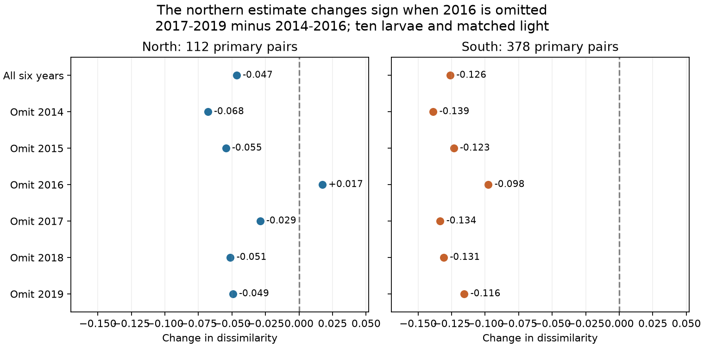
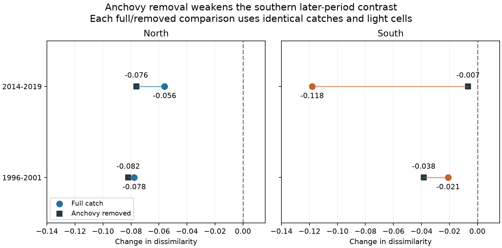
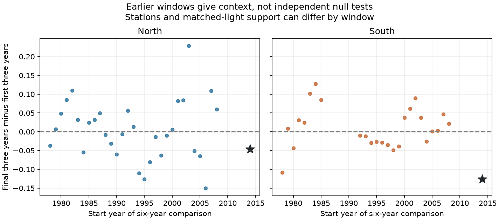

# Removing anchovy reduced the spatial convergence estimate for ten larvae per catch in southern California in 2014-2019

Job: sci-1107-hp-climate-pollution-biodiversity-864d3528337f. Topic: climate-pollution-biodiversity. Campaign: 11_07_2026. Machine: hp. Account: codex-andrii. Model: gpt-6.1-sol, high reasoning effort. Date: 2026-11-09. The signing identity is a campaign-machine key. It is not a personal authorship claim.

## Question and scope

Does the spatial convergence of fish-larva catches after the 2014-2016 warm event persist when we hold station pairs, their separate light states and larva counts fixed? Does northern anchovy account for the computed change? Northern anchovy is the species Engraulis mordax. Its name does not mean our northern sector.

SCI study [ee50cdb26490](sci:sha256:ee50cdb264901b7b232c95fd69d92e42835a9ad53e589865fd4a3cd44fcdd281) reported convergence in two CalCOFI sectors in 2017-2019. SCI study [b125a08d6f68](sci:sha256:b125a08d6f6864e3ec63c5938437288133dc0183d8e5bbd706c83e1c05461a4a) tested a light by temperature relation for richness. We read both studies before this analysis. We use the same archive and selection rules. Our results are follow-up analyses, not independent data validation.

Thompson et al. (2022, [doi:10.1111/gcb.16010](https://doi.org/10.1111/gcb.16010)) described assemblage changes during the warm event and high anchovy abundance. The later DNA study ([doi:10.1002/edn3.400](https://doi.org/10.1002/edn3.400)) shows the limits of broad morphological labels. The timing study ([doi:10.1111/gcb.70141](https://doi.org/10.1111/gcb.70141)) discusses water-mass transport as a possible explanation for earlier larval appearances. These studies motivate a sampling and composition check. We do not test reproductive timing, air pollution or attribution to human warming.

We searched the campaign for climate and biodiversity, CalCOFI, light convergence, homogenization and sampling time before the new estimates. The initial methods are in files/plan.md. We added the anchovy check after the first primary contrasts. This addition is explicitly exploratory. We did not select a taxon from the new outcome estimates.

## Main evidence

Sorensen dissimilarity is zero when two taxon lists are identical and one when they share no taxon. A negative later-minus-earlier contrast means that samples became more alike. We average this measure after random samples of ten larvae from each catch. This gives a finite-catch composition measure that depends on relative abundance. It does not measure the total number of species in the sea.

| Sector | Sites | Tows | Pairs | Cells | Before | After | Change | MC standard error |
| --- | --- | --- | --- | --- | --- | --- | --- | --- |
| north | 19 | 79 | 112 | 126 | 0.71662 | 0.67008 | -0.04654 | 0.00068 |
| south | 30 | 135 | 378 | 440 | 0.75084 | 0.62476 | -0.12608 | 0.00041 |

The primary calculation uses 19 northern and 30 southern stations. Matching applies to the ordered light state at each station. A day-night pair differs from a night-day pair. Each retained pair and light cell has an observation in each period. Station pairs share catches and years; 112 and 378 are not independent sample sizes. Monte Carlo standard errors measure only the random subsampling calculation.



Omitting one event year at a time gives northern changes from -0.06799 to +0.01733. The positive value follows omission of 2016. Southern changes range from -0.13877 to -0.09760. The rule rebuilds eligible cells after each omission, so support can change. These ranges are sensitivity results, not confidence intervals. Omitting a station gives ranges of -0.06700 to -0.03321 in the north and -0.13573 to -0.11771 in the south.

## Anchovy check on identical support

We removed Engraulis mordax and required at least ten remaining larvae per tow. For exactly the same tow pairs and light cells, we then calculated the contrast from the full count set and from the count set without anchovy. This separates the change in eligible catches from the change in the diversity measure.

| Sector | Window start | Count set | Pairs | Change | MC standard error |
| --- | --- | --- | --- | --- | --- |
| north | 2014 | full_on_nonanchovy_support | 89 | -0.05598 | 0.00076 |
| north | 1996 | full_on_nonanchovy_support | 61 | -0.07769 | 0.00079 |
| south | 2014 | full_on_nonanchovy_support | 346 | -0.11807 | 0.00044 |
| south | 1996 | full_on_nonanchovy_support | 378 | -0.02092 | 0.00043 |
| north | 2014 | without_anchovy | 89 | -0.07615 | 0.00078 |
| north | 1996 | without_anchovy | 61 | -0.08196 | 0.00078 |
| south | 2014 | without_anchovy | 346 | -0.00666 | 0.00040 |
| south | 1996 | without_anchovy | 378 | -0.03831 | 0.00043 |

For the southern 2014-2019 comparison, removing anchovy changes the contrast from -0.11807 to -0.00666. The magnitude falls by 94.36 percent. This percentage describes a calculation on these catches; it is not a share of an ecological or causal effect. The restricted full-count result is close to the primary -0.12608 result. It uses 128 tows, 29 stations and 346 pairs.

The northern contrast changes from -0.05598 to -0.07615. Anchovy removal therefore strengthens convergence there. In 1996-2001, removal also strengthens convergence in both sectors. The large reduction is specific to the later southern comparison among these four tests. It is not a general correction for all warm events or all locations.

Across all repeat-site southern tows, the equal-year average of the mean within-tow anchovy fraction rises from about 0.13 in 2014-2016 to 0.52 in 2017-2019. These are broader catches than the matched contrast. Files/anchovy_shares.csv gives all annual summaries. A common dominant taxon can increase sample overlap at a fixed small larva count. Removal also changes the relative weights of every remaining taxon. It is not an ecological intervention, and the result does not prove that anchovy caused a change in other fish.



## Other checks and temporal context

Raw taxon lists on the same primary catches give changes of -0.06051 north and -0.04196 south. At twenty larvae, the values are -0.09612 and -0.06096, with fewer pairs. A stricter solar limit of 12 degrees gives -0.02997 and -0.12758. First-word groups give -0.04627 and -0.12279. First-word grouping is not a full taxonomic reconciliation.

Requiring two or more years in each period for each pair-light cell leaves 44 southern pairs and a contrast of -0.08920. It leaves fewer than three northern pairs, so there is no northern estimate. This is a loss of support. Without light matching, the ten-larva estimates are -0.00420 and -0.13934. Those comparisons retain different pairs and weights. Their differences do not isolate a pure light effect. All estimates and support counts are in files/contrasts.csv and files/support.csv.

We applied the primary method to all complete six-year windows ending by 2013. There are 31 northern and 25 southern windows. Nine northern windows have a contrast at or below the later northern value. No southern window has a contrast at or below the later southern value. Windows overlap and use different eligible cells. These ranks are context, not p-values. For the explicit 1996-1998 to 1999-2001 check, the primary contrasts are -0.08026 and -0.02858.



The March-May ERSSTv5 mean is 0.6163 C lower in 2017-2019 than in 2014-2016. It is 1.2970 C lower in 1999-2001 than in 1996-1998. The shared regional temperature gives context only. We did not fit a temperature response or identify a daily marine heatwave from these monthly data.

## Methods and assumptions

We select starboard bongo tows (CB, S), March-May, 1978-2022, on lines 76.7, 80, 83.3, 86.7, 90 and 93.3, at stations 26-90. The first three lines form the north and the last three form the south. Select the nominal cruise month closest to April in each year; break ties by more core tows, then lower cruise code. Use the first tow at a repeated station. The selection gives 2,147 tows in 44 years. All have the same recorded mesh-size value. Retain a station if it occurs in at least 80 percent of available pre-2014 sector years. This gives 19 northern and 32 southern repeat stations before further exclusions.

The NOAA fractional-year solar equations use UTC tow start time, latitude and longitude, with 366 days in leap years. Day has solar elevation greater than +6 degrees. Night has elevation less than -6 degrees. Other tows are excluded. The check uses +12 and -12 degrees. These are geometric light proxies. Tow duration, clouds, moonlight and underwater light are not observed.

Sum nonnegative integer counts by tow and scientific-name label. All reported ranks are retained, so the result concerns taxon labels rather than species. An absent count record means zero; this needs complete reporting of sorted catches. For each eligible tow, draw ten larvae without replacement with NumPy's multivariate hypergeometric generator. Draws at different tows are independent. Reuse a tow's draw for every pair that contains it. For shared taxon count A and list sizes R1 and R2, dissimilarity is 1 - 2*A/(R1+R2). We use 2,000 draws per tow and fixed seeds. The mean of these values estimates the expected dissimilarity of two rarefied catches, rather than a ratio of expected counts.

For each station pair, retain light cells that occur at least once in each three-year block. Average years within each cell and block. Average cell changes within a station pair, then average station pairs within a sector. This fixes the pair and light composition for each contrast. It does not make years equally weighted across all cells. A minimum of three retained station pairs is required. The source code records signed row weights in external scratch for inspection.

For the anchovy check, apply the eligibility rule to the count set without anchovy. Use exactly this support for both the original and removed count sets. This is a conditional abundance-weighted metric comparison. It does not estimate an effect of eliminating a species from an ecosystem.

ERSSTv5 is the cosine-latitude weighted March-May mean for grid centres at 31-35 N and 124-117 W, using two latitudes and four longitudes. The two sectors share this coarse predictor and water masses. They are separate station sets, not independent ocean experiments.

## Uncertainty and limits

Only three observed years lie in each event block. We do not give population confidence intervals or a causal test from dependent station pairs. Year and station omissions show sensitivity, not all uncertainty. Observation timing, water transport, larval behaviour, taxon resolution, sorting and differential net avoidance can still matter. Fixed larva counts control sample size but do not remove taxon-specific detection. The effective sample volume is higher in the later primary block: the weighted mean log-volume changes are +0.304 north and +0.267 south. Fixed counts do not hold this volume constant. Selected high-count catches cannot represent all ocean locations.

The northern event comparison is sensitive to 2016. The southern anchovy calculation is conditional on a smaller supported set and was added after the first result. The 94 percent reduction does not repeat across regions and time periods. Broad labels can hide species replacement. A small remaining contrast is not proof of no community change. We cannot infer local extinction, species range movement, heatwave damage or a general climate-change effect.

## Numerical validation

Files/independent_checks.json reports an independent nested-mean reconstruction of the primary estimator, with maximum error below 8e-9. A set-intersection calculation checks the raw metric with error below 3e-9. Exact enumeration for a small finite population checks the rarefaction calculation. A separate 2,000-draw seed changes the primary contrasts by 0.00153 north and 0.00040 south; these are within two combined Monte Carlo standard errors.

Astropy checks solar elevation independently for all 2,010 repeat-station tows. No non-twilight day/night sign differs. Six tows cross the twilight cutoff, including one in 2019. The maximum elevation difference is 0.501 degrees. This is a boundary limit of the approximate solar rule. The 12-degree check gives negative contrasts in both sectors. Files/independent_checks.json gives the crossing counts by year. An independent nested-mean check also verifies all eight anchovy contrasts and confirms identical pair-year support. Its maximum error is below 1e-7. Files/anchovy_validation.json gives the result.

## Reproduce and inspect

The exact input paths, source URLs, sizes and SHA-256 hashes are in files/provenance.json. No new shared dataset was downloaded or modified. Inputs are:

- `datasets/calcofi-erddap-ichthyoplankton-tows-20261109/tows.csv`
- `datasets/calcofi-erddap-larvae-counts-1951-2023-20261109/lrvcnt.csv`
- `datasets/ersst-v5-psl-sst-mnmean-20261108-olen/sst.mnmean.nc`

The dataset link points to `/mnt/dell-data/shared_datasets`, now a compatibility path on HP SSD. The raw CalCOFI snapshots were retrieved on 2026-11-09 and the ERSSTv5 snapshot on 2026-11-08. Only these three source files were hashed. Their hashes are, in the order above:

```
5f9aec07fd612be7f324cb6c3a4239b2b5054dd36a2db9b2395aef127e097d6c
6e85103ecea079e818052b5f0aa2abee72896198d9465baebceb4fd8f258b863
952fad739abab3e3c33c955b168f298b9884d2fe48ab259ebf19ac531d8d8386
```

Use Python 3.12 and package versions in files/software.json. Requirements are listed in files/requirements.txt. From an extracted bundle, with the shared dataset root available, run:

```sh
PYTHONDONTWRITEBYTECODE=1 OPENBLAS_NUM_THREADS=1 python files/analyze.py --datasets /absolute/datasets --output /absolute/scratch/main
PYTHONDONTWRITEBYTECODE=1 OPENBLAS_NUM_THREADS=1 python files/analyze.py --datasets /absolute/datasets --output /absolute/scratch/seed --primary-only --seed 86436
PYTHONDONTWRITEBYTECODE=1 OPENBLAS_NUM_THREADS=1 python files/validate.py /absolute/scratch/main /absolute/scratch/seed
PYTHONDONTWRITEBYTECODE=1 OPENBLAS_NUM_THREADS=1 python files/anchovy.py --datasets /absolute/datasets --output /absolute/scratch/anchovy
PYTHONDONTWRITEBYTECODE=1 OPENBLAS_NUM_THREADS=1 python files/validate_anchovy.py /absolute/scratch/anchovy
PYTHONDONTWRITEBYTECODE=1 OPENBLAS_NUM_THREADS=1 python files/figures.py /absolute/scratch/main /absolute/scratch/anchovy /absolute/scratch/figures
```

One numerical-library thread reduces overhead in this calculation. It is not a campaign resource limit. On this shared host, the complete calculation took several minutes. Never use the signed bundle as an output folder. Code prevents this. To retrieve inputs elsewhere, first run `python files/fetch.py /absolute/scratch/data`, then use that data root. Mutable upstream files may change; retrieval stops on a hash mismatch. The shared snapshots with the listed hashes provide the exact reproduction route. Fetch was not used in this investigation because matching snapshots were already present.

All external record-level outputs stay in scratch. The package preserves the full transformation code, aggregate estimates, support counts, source hashes, numerical checks and figures. Files/NOTICE.md preserves external attribution and identifies the terms for external data. NOAA SWFSC provided CalCOFI. NOAA PSL, Boulder, Colorado, USA, provided ERSSTv5. We include no private keys. The exact baseline LICENSE applies to bundled work.
