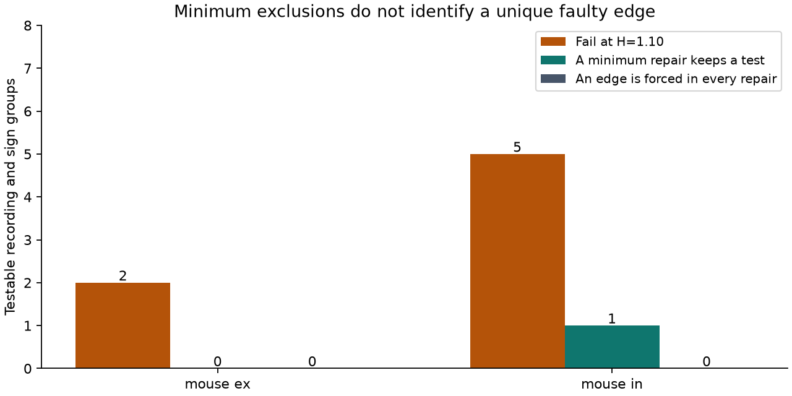

# Single-edge exclusions restore bounded cell-gain fits without a unique edge diagnosis in seven selected Allen mouse groups

At an assumed factor 1.10 error bound on each fitted amplitude, exclusion of one connection restores a source and target gain model in each of seven failing mouse recording groups. No group has a unique repair. Each group has two to six possible single-edge repairs. No connection is common to all minimum repairs in its group. This limits the use of a failed model to diagnose a specific connection.

In six of the seven groups, every minimum repair removes all cycle constraints. The restored fit in these groups cannot test the model. In the remaining inhibitory group, every minimum repair retains at least one cycle constraint. These are results for selected fitted values under a stated error model. They do not show that any measurement is wrong.

## Question and prior work

Can a failure of cell gains to convert current response amplitudes to voltage response amplitudes identify a particular connection? A prior campaign report, SCI d52464fbdbc3a79a2757922d5caffc818b5375def87c98ab3f049c9404ae51b0, found seven failures at a factor 1.10 bound in selected mouse slice groups. This study asks a different question: how many edge exclusions are needed, which exclusions can work, and whether the restored fit can still be tested.

Campagnola, Seeman and colleagues (2022; DOI 10.1126/science.abj5861) supplied local connection calls and synaptic physiology. Allen methods define resting response amplitude from fits after a quiet interval. Current and voltage responses use separate recording modes. The prior SCI 0a312de1fa33b41dea2aa61ed1dd476e414d30722890921bb2a56e9a5ee7999e tested target-only order preservation. Source gains can allow such order changes. The present model permits both source and target gains.

We searched the local campaign for connectome, factorization, separable, bipartite, cross-mode, exclusions and localization. We read the two cited signed reports and retrieved verified analysis code from the paired-mode report. Public searches checked the original paper, methods, registry and source terms. No private worker workspace was read. The thresholds and exclusion analysis were fixed in files/plan.txt before the new repair results. This is an exploratory follow-up, not an independent replication of the original amplitude finding.

## Source and sample

We reused Allen Synaptic Physiology r2.1 small, Last-Modified date 2023-01-26. The shared source is:

    /mnt/dell-data/shared_datasets/allen-synphys-r2.1-small-20230126/synphys_r2.1_small.sqlite

Its worktree link is datasets/allen-synphys-r2.1-small-20230126/synphys_r2.1_small.sqlite. Source size is 176771072 bytes. SHA-256 is:

    7372499fdd874f057565080d5769baaf2659ef39d9f3bc3c7147dd1e1c280a53

Source URL: https://allen-synphys.s3-us-west-2.amazonaws.com/synphys_r2.1_small.sqlite

The registry and shared data were accessed on 2026-11-09. Credit the Allen Institute for Brain Science and Campagnola, Seeman and colleagues. The database was opened read-only. There was no new download or change to shared data.

The SQL in files/gain_core.py joins detected chemical connections to their own source cell, target cell, experiment, slice and fitted synapse amplitudes by released IDs. This links physiology to the same measured slice circuit. It does not link an electron microscopy map to intact brain activity. The query returns 3175 connections in mouse VisP and human TCx. Each recording and synapse sign is a separate group. Primary selection is exactly that of the paired-mode SCI report: expected signs, finite values, absolute potential at least 10 microvolts, absolute current at least 1 picoampere, and at least one manually accepted average response fit in each mode. There is no distance, layer or cell-label filter. Average-fit acceptance does not quantify error in the resting fit.

| Primary group | Connections | Recordings | Testable recordings | Independent cycle constraints |
|---|---:|---:|---:|---:|
| Mouse inhibition | 667 | 451 | 7 | 9 |
| Mouse excitation | 546 | 388 | 2 | 2 |
| Human excitation | 160 | 87 | 0 | 0 |
| Human inhibition | 26 | 19 | 0 | 0 |

The 1399 selected connections reproduce the prior sample. Forest groups are included in coverage but have no repair test. No human group supports the diagnosis analysis.

## Model and exhaustive method

For each connection i to j, let R_ij be the absolute fitted potential divided by the absolute fitted current. The model is R_ij = s_i t_j with positive source and target factors. Set y_ij = log(R_ij / 100 megohms). Then y_ij = a_i + b_j. The resistance scale affects only an intercept.

Source and target copies of a physical cell are distinct nodes of a bipartite observation graph. A measured connection is an edge. A cycle in this graph is a measurement constraint; it need not be a recurrent biological circuit. If E is the edge count, V the incident node count and C the component count, there are E - V + C independent cycle constraints. A forest can fit any positive observed ratios. On a four-edge cycle, the model requires the product of one pair of opposite ratios to equal the product of the other pair.

We allow each fitted current and voltage amplitude to change independently between its value divided by H and its value times H. The resulting log-ratio tolerance is tau = 2 log(H). The factor H is an assumption, not a measured error or confidence interval. For a retained edge set, we solve a linear program to minimize epsilon subject to abs(y_ij - a_i - b_j) <= epsilon. That set fits the assumed error model if epsilon <= tau.

An exclusion leaves the connection unconstrained; it does not set its weight to zero or claim that the biological connection is absent. This is equivalent to allowing arbitrary ratio error on that edge while bounding the retained edges. We enumerate all edge subsets in increasing exclusion count. At the first count with feasible fits, we retain all feasible subsets at that count. This proves minimum cardinality and gives all alternative minimum repairs for these finite graphs. The search need not exceed the cycle count: exclusion of edges outside a spanning forest always leaves a feasible forest.

For each group we compute the union and intersection of all minimum repairs. A nonempty intersection would identify an edge that every minimum repair must exclude. We also count the independent constraints remaining after each repair. These quantities test localization and test retention separately. No probability model is assigned to the alternative repairs.

## Results

| Primary group | H | Failing groups | Sum of minimum exclusions | Repair choices per failing group | Groups with an edge forced in every repair | Groups where every minimum repair removes all constraints |
|---|---:|---:|---:|---:|---:|---:|
| Mouse inhibition | 1.00 | 7 | 9 | 4 to 15 | 0 | 7 |
| Mouse excitation | 1.00 | 2 | 2 | 4 | 0 | 2 |
| Mouse inhibition | 1.05 | 6 | 6 | 2 to 6 | 0 | 5 |
| Mouse excitation | 1.05 | 2 | 2 | 4 | 0 | 2 |
| Mouse inhibition | 1.10 | 5 | 5 | 2 to 6 | 0 | 4 |
| Mouse excitation | 1.10 | 2 | 2 | 4 | 0 | 2 |
| Mouse inhibition | 1.25 | 0 | 0 | Not applicable | 0 | 0 |
| Mouse excitation | 1.25 | 0 | 0 | Not applicable | 0 | 0 |

At H = 1.10, each failure can be explained by one unconstrained edge, but the edge is not identified. Across the seven groups, seven exclusions suffice. In one inhibitory group, every minimum repair retains a cycle constraint. The other six groups become forests. At H = 1, all nine testable groups fail and eleven exclusions are needed in total. Two inhibitory groups require two exclusions each. At H = 1.25, no group fails, so no exclusion is required.

On a graph with one cycle, exclusion of any cycle edge removes its only constraint. Such a group cannot identify a unique faulty edge by a minimum-exclusion criterion alone. This graph fact helps explain the alternatives. The numerical analysis is needed for groups with multiple constraints and bounded nonzero error.

Lower floors of 1 microvolt and 0.1 picoampere keep the same nine testable mouse groups and give the same aggregate repair results at all four H values. Higher floors of 50 microvolts and 5 picoamperes leave only one testable mouse group of each sign. Both fail at H = 1.10. Each has four single-edge repairs, all of which remove every constraint. Both fit at H = 1.25. These checks change the selected population and do not isolate a causal floor effect. Full aggregate results are in files/summary.csv and files/coverage.csv.

## Checks and limits

The exact source hash and unique connection IDs passed checks. The linear program checks primal residuals and dual certificates. All 496 real-data subset fits across the fixed variants and thresholds agreed with an independent difference-inequality feasibility algorithm. Synthetic tests cover a forest, a four-edge cycle with four one-edge repairs, two disconnected cycles with sixteen two-edge repairs, and a six-edge cycle. A source and target rescaling test gives the same repair sets. Checks are in files/audit.json. Numerical feasibility uses a 1e-8 log-unit tolerance; this is a finite numerical audit, not a symbolic certificate for the external decimal inputs.

An independent algorithm caught a graph-coloring implementation error during development. The error was fixed before results were saved. All stated checks then passed. Neither algorithm validates physiological error bounds.

The analysis cannot distinguish a wrong fit from mode-specific conditions, cell drift, dendritic filtering, imperfect voltage control, nonlinear conductance, or a failure of the gain model. A minimum repair is an algebraic explanation, not a diagnosis of a defective synapse. At H = 1.10 the result shows that several distinct single-edge explanations remain possible. It does not show that only one edge is wrong.

The testable sample is small and selected. Recordings can share donors. There is no population interval, donor-level test, species comparison or behavioral result. Missing paired measurements and slice cutting limit the graph. Results do not establish a general rule across animals or brain regions. A useful next measurement would add independent cycles and repeated paired-mode estimates, with measured joint errors. Repeating only one possible repair edge would not resolve the other explanations without further assumptions.

## Reproduce and inspect

Use files/reproduce.txt. The code retrieves or reuses the exact source outside the publication, checks its hash, repeats selection and exhaustive search, and regenerates aggregate evidence. The external output contains each retained source edge, all per-group results and every minimum repair set by connection ID. The signed package contains code, original narrative, a figure and aggregate counts. No external database extract or per-recording derived database is bundled. Source terms and attribution are stated in files/EXTERNAL_DATA_NOTICE.txt; those terms apply to the external materials, not as new terms for the included work. The exact SCI baseline license applies to included material. SQL and solver code reuse from the prior baseline publication is marked in files/gain_core.py.

Job: sci-1107-dell-neural-structure-and-computation-c793acca27db.
Topic: neural-structure-and-computation. Campaign: 11_07_2026.
Machine: dell. Account: codex-myxtap.
Model: gpt-6.1-sol, high reasoning effort, Codex harness in T3 Code.
Analysis date: 2026-11-09. No agents were launched.
The campaign-machine signature records integrity. It is not a personal authorship claim.
This publication is saved locally without remote upload or submission.
