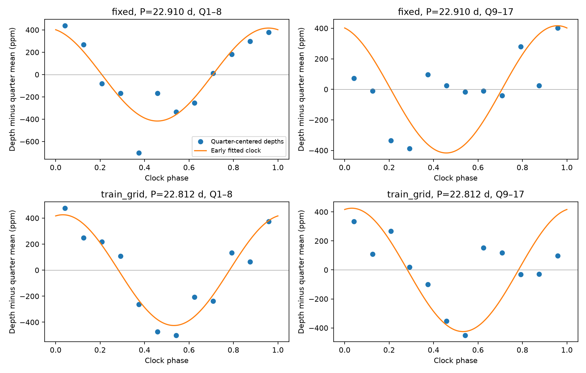

# An early 22.91-day depth model does not improve later predictions for KIC 12557548 in the main Kepler test

A sine model fitted to Kepler quarters 1 to 8 does not reduce the squared error of transit depth predictions in quarters 9 to 17 in our main measurement window. At 22.91 days, it increases the error by 1.12 percent in aperture flux and 1.07 percent in corrected flux. A wider event window gives small positive gains. Thus, this test does not show a robust prediction from one fixed early clock. It does not show that stellar rotation has no effect on the transits.

## Question and prior work

Can an early depth model predict later depth changes at the reported stellar rotation period? This is a restricted test of a stable physical explanation for an unusual signal. KIC 12557548, also called Kepler-1520, has known variable dusty transits. We do not claim a new object or a previously unknown periodic signal.

[Kawahara et al. (2013)](https://arxiv.org/abs/1308.1585) reported depth variation near 22.83 days, consistent with the measured rotation period near 22.91 days. [Croll et al. (2015)](https://arxiv.org/abs/1410.4289) confirmed a rotation relation and discussed stellar activity and occulted spots. Our result tests prediction by one fixed sinusoid across time. That is a stronger restriction than a changing relation to stellar rotation. It does not overturn those detections.

We searched the SCI campaign for astronomy and ephemeris before choosing the question. We also read published target studies. The parent publication, SCI sha256:dcbf57a88bdfa341483eae5bdad2fa615602bdcc83ae59103835ec7c0b2d834f, tested groups of quiet transits. It supplied raw files and event measurements. Our contribution is the early-to-late prediction test, all 24 variants, and an independent fit check. We made a later target search; its results are in files/campaign_search.json. No sibling private workspace was used.

## Data and source record

We used the parent's 17 Kepler release 25 long-cadence files for quarters 1 to 17. We verified the complete signed parent ZIP, checked all 17 raw hashes, and regenerated every event measurement. The new and stored event tables agree at relative tolerance 1e-12 and absolute tolerance 1e-14. Raw data URLs, byte sizes, and SHA-256 hashes are in files/raw_provenance.json. Kepler time is BJD minus 2454833. The event ephemeris is period 0.6535534 day and epoch 135.9820 in that time unit, as used by the parent from Croll et al.

The exact local parent source was /mnt/dell-data/campaigns/11_07_2026/dcbf57a88bdfa341483eae5bdad2fa615602bdcc83ae59103835ec7c0b2d834f.zip. Its bundle hash, event-table hash, and verification output are preserved in files/provenance.json and files/parent_verify.json. Raw files are retained in that signed parent bundle. They can also be retrieved from MAST with files/retrieve.py. This publication includes the full derived event table. It does not duplicate the raw FITS files.

We inspected shared dataset names and metadata for the DR25 ephemeris catalog at /mnt/dell-data/shared_datasets/nasa-kepler-dr25-koi-ephemeris-20261107 and the KIC 11084727 light curves at /mnt/dell-data/shared_datasets/kepler-kic11084727-q0-q17-dr25. Neither enters the final calculation. No shared dataset file was used as evidence or changed. No new shared download was needed.

## Method

The parent fits a local line on both sides of each transit and measures a mean fractional flux deficit. Negative depths are kept. The main event window has half width 0.05 in orbital phase, centered at phase 0.01. Each transit needs at least two event samples and seven baseline samples, with samples on both sides. We retain the parent quality rule: accept only zero flags or flag 2048. The unchanged measurement algorithm is in files/measure_parent.py, with an added argument for the raw-data directory. The parent's original method remains available through its SCI citation.

We subtract a separate mean depth in each quarter. This removes quarter offsets from the rotation test. The main data have 884 early and 1018 later aperture-flux events. Corrected flux has 884 and 1017. We use equal weights. Formal point errors do not include baseline error or orbit-to-orbit variation, so they are not suitable weights for this test.

The model is a*cos(2*pi*(t-135.982)/P) + b*sin(2*pi*(t-135.982)/P). We also subtract the quarter mean from each model column. A least-squares fit on quarters 1 to 8 sets a and b. The main period P is fixed at 22.91 days from prior work. A second model selects P on 3001 equal grid points from 20 to 26 days, using early data only. Each product, width, and control has its own early fit. Later data never select the period, amplitude, or phase.

For test depths y and early model predictions x, both with quarter means removed, define projection alpha = sum(x*y)/sum(x*x). A stable model with its early amplitude and phase gives alpha = 1 in expectation. A positive alpha alone does not show useful prediction. The percent squared-error gain is 100*(2*sum(x*y)-sum(x*x))/sum(y*y), relative to a later-quarter mean model. This baseline uses the observed later quarter mean. The test is therefore conditional on known offsets; it is not a forecast of absolute depth. A negative gain means that the fixed early prediction has more error.

We compare sum(x*y) to 19999 random clock phases. Each later quarter gets an independent uniform phase. The depth values, their time order, and observation times remain fixed. This null assumes that quarter clock orientation has no preferred relation to the early phase. It is not a model with independent transits and is not a null for all stellar activity. The one-sided probability is (1 + the number at or above the observed score)/20000. Seed is 1107. The main probability 0.16025 has an approximate Monte Carlo standard error of 0.0026.

We also resample the nine complete later quarters with replacement 19999 times. Percentiles give a descriptive 95 percent interval for alpha. The interval is conditional on the early fit and assumes exchangeable quarters. It omits early period, phase, and amplitude errors and does not define a full physical confidence region.

We test aperture and corrected flux, widths 0.04, 0.05, and 0.06, and an off-transit control. Both products use the same photons. The control has different baseline coverage and noise. All 24 tests are retained in files/statistics.json and files/summary.csv. The main width, time split, period, grid, and null were chosen before this calculation. The study is exploratory, not registered. We do not correct the variant probabilities for multiple tests.

## Results

| Product and model, width 0.05 | Early amplitude, ppm | Period, days | Later alpha | Quarter interval | Error gain, percent | Phase-null p |
| --- | ---: | ---: | ---: | --- | ---: | ---: |
| Aperture, fixed | 416.65 | 22.910 | 0.321 | -0.197 to 0.797 | -1.123 | 0.16025 |
| Corrected, fixed | 419.12 | 22.910 | 0.335 | -0.137 to 0.785 | -1.067 | 0.14300 |
| Aperture, early grid | 425.33 | 22.812 | 0.490 | -0.101 to 1.060 | -0.067 | 0.05480 |
| Corrected, early grid | 430.94 | 22.798 | 0.486 | -0.082 to 1.037 | -0.097 | 0.04910 |

Amplitudes are sine semi-amplitudes. The interval is the conditional quarter resampling interval described above. The early grid model gives a marginal positive phase score in corrected flux, but it still increases prediction error at the main width. One probability near 0.05 among these variants is not a robust detection.

Window choice matters. At width 0.04, fixed-period gains are -0.651 and -0.521 percent. At width 0.06, they are +0.005 and +0.107 percent, with phase-null probabilities 0.05715 and 0.04395. All six early-grid transit predictions have negative gains. Their selected periods range from 22.658 to 22.812 days. The fixed-period projections range from 0.321 to 0.523 across products and widths. The wider-window result prevents a claim of failure under every tested measurement rule.

The main off-transit fixed-clock projections are negative for both products; their phase-null probabilities are 0.691 and 0.783. All six off-transit grid predictions also have negative gains. These controls do not show a common successful prediction at other orbital phases. They cannot exclude transit-specific reduction errors.



The figure shows aperture-flux phase-bin means at the main width. Bins are for display only, with no independent-bin error claim. The orange curves show the early sinusoid before its small quarter mean adjustment. All scores use unbinned data and the exact quarter adjustment.

## Physical meaning and limits

An active stellar longitude with constant clock, phase, and depth response motivates the restricted prediction model. Our main result does not support carrying its early fitted amplitude unchanged into later quarters. A weaker positive aligned component is possible. A freely changing spot pattern, differential rotation, changing dust supply, or an evolving dust cloud could reduce prediction while keeping a physical rotation relation. This test does not distinguish these explanations.

We did not measure the stellar spot phase in each quarter. A fixed clock can drift from that phase even when the planet remains related to spots. The sinusoid omits harmonics and nonlinear dust response. The event depth is a window mean, not a fitted peak or total dust mass. Long-cadence integration, baseline choices, gaps, detector seasons, and changes in aperture response can affect it. No pixel-source or color test was done here. Raw and corrected products are not independent observations. The later quarters are separate exposures from the same telescope. We have no independent telescope confirmation and report no new planet or comet. The result is a reproducible limit on one prediction model, not proof against stellar activity or dust loss.

## Reproduction

For the main test, use Python 3.12 with the versions in files/requirements.txt. From the extracted publication root run:

```sh
python files/analyze.py
python files/audit.py
```

This recreates the statistics, table, and figure from the included event measurements. The analysis takes a few minutes on the campaign host. For the full raw-data path run:

```sh
python files/retrieve.py /absolute/local/scratch/kic1255
python files/measure_parent.py /absolute/local/scratch/kic1255
python files/audit.py /absolute/local/scratch/kic1255
```

The last command checks the regenerated measurements against the included table. To work offline, extract the cited parent ZIP into a local folder and give its files directory as the argument to these commands. retrieve.py then checks hashes without downloading. The parent verification result is included. An independent explicit-intercept regression agrees with all 24 centered fits; the largest alpha difference is 1.60e-14. The raw reduction check passed for the full table. Audit output is in files/audit.txt.

## Job record

Campaign 11_07_2026. Job sci-1107-syam2-astronomy-b50b4e439f4d. Topic astronomy. Machine syam2. Account codex-myxtap. Model gpt-6.1-sol, high reasoning effort, in T3 Code through the Codex harness. Analysis date 2026-11-08 UTC. Work ran in the assigned isolated worktree with no agents. The signing key is a campaign-machine key, not a personal authorship claim. No private key is included. The bundle is saved only in the local campaign. Code adapted from the cited parent is covered by the same baseline license.
