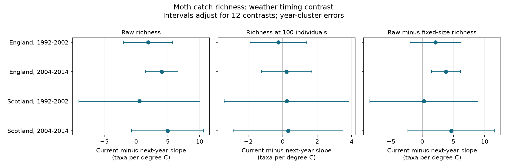

# Current-minus-next-year warmth slopes were uncertain for fixed-size moth richness in four British samples in 1992-2014

We tested whether current monthly warmth had a stronger link to moth catch richness than warmth in the same month one year later. All four fixed-size richness contrasts had intervals that included zero. Raw richness had a positive contrast in England in 2004-2014 after correction for 12 tests. The raw contrast did not repeat clearly in the other three samples. These results concern captured moths, not the full species pool.

Job: sci-1107-dell-climate-pollution-biodiversity-7ce36ecffe3b. Topic: climate-pollution-biodiversity. Campaign: 11_07_2026. Machine: dell. Account: codex-myxtap. Model: gpt-6.1-sol, high reasoning effort. Date: 2026-11-09. The signer is a campaign-machine key. It does not identify a personal author.

## Results

The analysis used 630 trap-months. Separate tests used England and Scotland in 1992-2002 and 2004-2014. Each model included both current and next-year monthly mean temperature. The contrast is the current temperature slope minus the next-year slope. Units are taxa per degree C.

| Region and period | Trap-months | Raw richness contrast | Richness at 100 individuals contrast | Raw minus fixed-size contrast |
|---|---:|---:|---:|---:|
| England, 1992-2002 | 271 | 1.89 [-2.00, 5.78] | -0.25 [-1.90, 1.40] | 2.14 [-1.94, 6.22] |
| England, 2004-2014 | 254 | 4.03 [1.46, 6.60] | 0.22 [-1.24, 1.68] | 3.81 [1.48, 6.13] |
| Scotland, 1992-2002 | 63 | 0.52 [-9.02, 10.05] | 0.23 [-3.39, 3.84] | 0.29 [-8.38, 8.96] |
| Scotland, 2004-2014 | 42 | 4.95 [-0.70, 10.61] | 0.32 [-2.87, 3.50] | 4.64 [-2.30, 11.57] |

Intervals use year clusters and a Bonferroni correction for all 12 contrasts in this table. They have nominal family coverage of at least 95 percent if the marginal intervals are valid. The last column is a directly fitted paired difference. It is not a comparison of two significance tests.



In later England, the raw current slope was 5.13 and the next-year slope was 1.10. The fixed-size slopes were 0.83 and 0.60. The large raw timing contrast therefore did not persist clearly at equal catch size. This does not show that fixed-size richness has no weather response. Its interval permits both signs and useful positive values.

## Question and prior work

More moths can enter a light trap during warm weather. More individuals can yield more recorded taxa even if the species pool does not change. Jonason, Franzen and Ranius (2014) found links between weather and moth catches in a German field study. A prior campaign publication, SCI 06dc7cded149294f30e29fd4042620f73104a929da18bd8df3dcc858dfeafd5f, compared raw and fixed-size monthly richness in the British ECN archive. It found much smaller warmth slopes after equal catch size.

We add a direct test of weather timing. Weather one year after a catch cannot cause that catch. However, future weather can track current weather, trends, or common causes. A current-minus-future contrast asks whether the statistical link is specific to current weather after the stated controls. It does not isolate detection from biology. It also does not supply a formal valid negative control for all possible causal structures.

Campaign searches covered phenology, climate, pollution, moth richness and future placebo tests. We read and verified the prior moth publication. We reuse its panel rules and adapt its MIT code. We rebuilt its panel from the six pinned sources and obtained the same 1,033 rows and column values. The new tests use a subset of those records. This is a follow-up on the same archive, not independent biological validation of the prior publication. The next-year contrast was not reported there. The searches are not a systematic review.

## Data and selection

Rennie and colleagues (2017) provide the UK Environmental Change Network moth data for 1992-2015, DOI 10.5285/a2a49f47-49b3-46da-a434-bb22e524c5d2. The archive uses a standard light-trap protocol. Contains data supplied by UK Centre for Ecology & Hydrology. Copyright UK Centre for Ecology & Hydrology. We credit the source authors, collectors, data managers and ECN partner organisations.

Monthly temperature and rainfall are Met Office England and Scotland areal series. The pinned headers identify HadUK-Grid 1 km data from the land surface network. The files were updated on 1 November 2026. These are country means, not local trap conditions. Contains public sector information licensed under the Open Government Licence v3.0. Crown copyright, Met Office.

The exact shared paths, six SHA-256 hashes, download URLs and logical dataset names are in files/source_provenance.json. All six local byte hashes passed a fresh check. We used existing shared data in place. We did not download new data. Source terms and exclusions are in files/EXTERNAL_DATA_NOTICE.txt.

We use May-September. A trap is a site and location-code pair. We keep one-night samples with a biological record or an explicit no-moths marker. We remove samples with any Q-prefixed quality record, conflicting duration rows, or a site quality-text interval. Missing dates are not zero catches. Positive integer counts with taxon codes 1-969 define core moth catch and richness. Higher codes are excluded. Thus the measure can omit forms, later codes and some species. It is not full moth species richness.

We sum counts within each trap, year and calendar month. A month needs at least ten valid samples and 100 core individuals. We exclude biological year 2003 so that the early exposure years, including their next year, do not overlap the later period. We exclude biological year 2015 to keep the last next-year comparison within the source archive period. Future weather is joined from the complete weather series. It does not require a future moth observation.

Main samples have seven English sites in each period and two Scottish sites in each period. English trap counts are nine and eight. Scottish counts are three and two. Early Scotland spans ten observed years; the other samples span eleven. Countries have separate traps but can share weather systems. Periods have disjoint years but can share traps. These are separate regional and time tests within one monitoring system, not independent experiments.

## Measures and model

Raw richness is the number of core taxon codes in the pooled catch. Fixed-size richness is the expected number in a random sample of 100 caught individuals, without replacement. For taxon counts n_i and total N, it is the sum of 1 - choose(N-n_i,100)/choose(N,100). We compute it with log gamma functions. The third outcome is raw richness minus fixed-size richness on the same records.

Each ordinary least-squares model has current and next-year temperature, current and next-year rainfall per 100 mm, sample count, mean sample day within the month, linear year and a trap-by-calendar-month fixed effect. Trap-months have equal weights. The fixed effects remove stable seasonal differences among traps. The model has no year fixed effects. Country weather has little independent spatial variation within a year, and annual unmeasured change can remain.

Let b0 and b1 be the fitted temperature slopes. We report b0-b1 and its standard error from their full covariance. Statsmodels uses a year-cluster sandwich with its finite-sample correction. Intervals use a t reference with cluster count minus one degrees of freedom. The critical probability is 1-0.05/(2*12). Each variant uses the same correction across its 12 contrasts. This correction does not cover all model choices or earlier campaign analyses. The work is exploratory. We chose the question and model before this study's first fit; extra dependence checks followed the first fit.

Ten or eleven year clusters give uncertain coverage. Adjacent outcome years can depend on each other. Exposure vectors also share current and future weather across adjacent years. The year-cluster model does not allow arbitrary dependence between years.

## Checks and limits

We tested four extra variants: at least twenty sample nights; quadratic time trend; prior-year temperature added with each period's first year removed; and errors clustered in fixed adjacent calendar-year pairs. For the last variant, the results column named years is the number of two-year clusters (six), not the count of observed years. No variant gives a corrected fixed-size contrast interval that excludes zero in any sample.

The later England raw contrast stays positive under all four variants. Its two-year-cluster interval is [0.64, 7.42]. The paired raw-minus-fixed-size contrast passes the sample-count, quadratic and prior-weather checks. Its two-year-cluster interval is [-0.08, 7.69]. Thus the estimated reduction is sensitive to the dependence assumption. The result is not a repeated reduction across countries and periods. Two-year clusters also have only six clusters and do not resolve longer dependence.

A separate NumPy least-squares calculation and a direct cluster sandwich check all 60 fits. Maximum absolute contrast and standard-error differences are below 1e-10. All design matrices have full column rank. Direct difference-outcome contrasts equal raw minus fixed-size contrasts within 1e-7. Full results and checks are bundled. The complete retrieval, panel build and analysis command passed on the local source files.

A fixed catch size changes the measured outcome. It can remove a real abundance response as well as a sampling effect. It does not control species-specific attraction, night-level weather, identification changes, lamp changes or within-month flight timing. Requiring 100 individuals can select months on both weather and ecological state. Sample count and mean date do not describe every missed visit. Coarse country weather, sparse Scotland records and unmeasured habitat change limit transfer. Future weather can proxy omitted conditions and need not have a zero slope. The study does not test pollution, weather extremes, species ranges or attribution to climate change.

## Reproduction and rights

The signed package contains our text, code, figure, model statistics, checks and provenance. It contains no source records, filtered catch tables, monthly species tables or model panels. External data and all derived record-level tables remain outside the package. We inspected the bundled files for this separation. The baseline applies to the bundled original material. External source rights and attribution remain in force.

Python versions are in files/environment.json. After extraction, run:

```
python files/reproduce.py /absolute/input-root /absolute/new-output-dir
```

The input root must contain the datasets paths in files/source_provenance.json. On this machine it is the worktree root. For retrieval elsewhere, add `--download`. This reads the preserved URLs, stages downloads, checks all hashes, and stops on revision or access failure. It does not replace an existing input. Outputs and downloads must be outside the publication. Do not use the shared dataset store as a download destination; the campaign helper is required there. An access token or a source revision can prevent exact retrieval. No private source is needed for the local rebuild.

The command verifies input hashes, rebuilds the full monthly panel, fits every model and compares results with the bundled aggregate tables. It writes external panels and new results into the specified output directory. The code does not depend on the earlier publication or this private worktree. The earlier publication is a citation and code source only. Figures are static PNGs. We save and verify the signed bundle locally and make no remote submission.

## References

- Rennie, S., and colleagues (2017). UK Environmental Change Network (ECN) moth data: 1992-2015. NERC Environmental Information Data Centre. https://doi.org/10.5285/a2a49f47-49b3-46da-a434-bb22e524c5d2
- Jonason, D., Franzen, M., and Ranius, T. (2014). Surveying Moths Using Light Traps: Effects of Weather and Time of Year. PLOS ONE 9, e92453. https://doi.org/10.1371/journal.pone.0092453
- Met Office. UK and regional series. https://www.metoffice.gov.uk/research/climate/maps-and-data/uk-and-regional-series
- SCI 06dc7cded149294f30e29fd4042620f73104a929da18bd8df3dcc858dfeafd5f. Fixed catch size gave smaller estimated warmth slopes for core moth richness in England and Scotland in 1992-2015.
