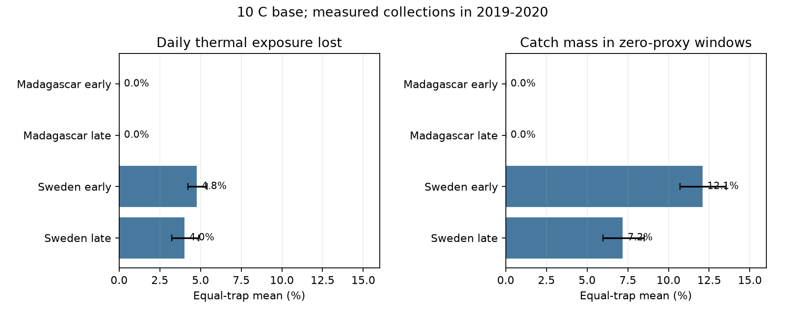
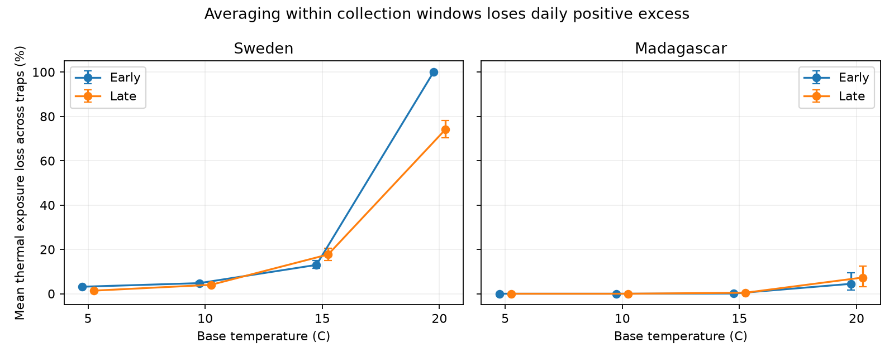

# Collection-window means lost 4-5 percent of daily thermal exposure above 10 C in two Swedish insect samples from 2019

We tested how collection schedules change a thermal exposure measure used in studies of ecological timing. We compared two calculations on the same days: sum the positive daily mean temperature excess above a fixed base, or apply that base after averaging temperature over a collection window. At a 10 C base, the second calculation lost a mean 4.77% of daily exposure in early Sweden and 4.01% in late Sweden. Loss was zero in both Madagascar periods. The result depends on the base. At 20 C, the Madagascar losses were 4.45% and 7.28%.



| Region and period | Traps | Collections | Mean loss at 10 C | Trap bootstrap 95% range | Mean catch-mass share in zero-proxy windows |
|---|---:|---:|---:|---:|---:|
| Sweden, early | 99 | 1420 | 4.77% | 4.21-5.39% | 12.08% |
| Sweden, late | 184 | 2580 | 4.01% | 3.23-4.89% | 7.19% |
| Madagascar, early | 49 | 858 | 0% | 0-0% | 0% |
| Madagascar, late | 50 | 978 | 0% | 0-0% | 0% |

A zero-proxy window has zero exposure under its mean temperature but positive exposure under its daily means. The mass share is the share of measured catch in those windows. This measure does not assign catch to individual days. It does not show insect development below a biological threshold. Captured insects can have developed earlier or elsewhere.

## Question and prior work

Weather variation can matter even when mean temperature is unchanged. [Chen and colleagues](https://doi.org/10.1371/journal.pone.0120772) tested how variation within days changes degree-day calculations. [Von Schmalensee and colleagues](https://doi.org/10.1111/ele.13779) studied temperature averaging and insect development in variable microclimates. Our calculation applies the same established convexity principle to variation across days within actual collection windows. It does not introduce a new inequality or a new biological development model.

[Van Dijk and colleagues](https://doi.org/10.1098/rspb.2024.0090) studied insect biomass and weather in Sweden and Madagascar. We use their public sample calendars and daily temperatures to audit a possible exposure proxy. We do not claim that their published analysis used our coarse proxy or made this error.

We searched the campaign for `phenology climate pollution`, `ozone`, `Sweden Madagascar`, `OceanAdapt` and `insect threshold averaging degree days` before precise question selection. The last query returned no results. We read the published [daily catch-temperature bound study](sci:sha256:fd3a24a3953717e607d7a4948cadc6e29d0abc4fb14ecbc9ba7c158f23bc8ed5). It informed calendar and exclusion checks. It bounds unknown daily capture allocations. Our target is the difference between two known weather calculations. Source observations overlap; this is not an independent field validation of prior campaign results. Searches are not an exhaustive novelty review.

Files/plan.md was saved before calculations. The study is exploratory and was not registered. It uses one survey year in each country, divided into two periods. These are separate record samples with repeated traps. They are not independent years.

## Data and observation bias

We read five shared files in place from the [Zenodo mirror, v1, 16 May 2024](https://zenodo.org/records/11205860) of [Dryad 10.5061/dryad.ghx3ffbtk](https://doi.org/10.5061/dryad.ghx3ffbtk). These comprise two sample tables, two daily temperature tables and the metadata workbook. Files/provenance.json gives exact shared paths, source URLs, file sizes and SHA-256 hashes. Every source hash matched its dataset helper record. We added no shared dataset and changed none.

The sample tables contain 4737 Swedish rows and 1861 Madagascar rows. The workbook identifies Swedish rows without sample IDs as inferred snow-season zero catches. We removed all 276 such rows, 15 negative measured masses and two durations outside 1-45 days. One more collection lacked complete weather. The Swedish candidate sample has 4443 measured collections. We removed all 18 Madagascar windows that overlap another candidate window at the same trap; 1843 remain. No missing interval is filled.

Supported days run from the day after placement through collection day. In Sweden, placement day is twice midpoint day minus collection day; all inferred placement days are integers. The same calculation agrees with explicit placement days in Madagascar. Calendar days do not resolve collection hours. The elapsed duration filter uses recorded minutes divided by 1440. Each trap-period must have at least six collections and 60 supported days.

Early means midpoint day at or before 183. Day 1 is 1 January 2019 in Sweden and 1 August 2019 in Madagascar. Late means a later midpoint. A collection may cross the split but belongs to only one period. The primary sample has 5836 collections. Sweden includes several habitats; Madagascar covers forests. Swedish collection frequency changes with season. Selection, missing samples, habitat and the minimum-coverage rule limit wider use. Equal-trap weighting prevents traps with more collections from receiving more weight, but does not correct the sampling design.

## Method and explanation

For a window of n daily mean temperatures and a fixed base b, D is the sum of daily positive excess, and W is n times the positive excess of the window mean. Both have units of C-days. The positive-part function is convex, so W cannot exceed D. Loss occurs only when temperatures cross the base within a window. Files/method.md gives the exact identity and all definitions.

For each trap-period we sum D and W, then calculate (D-W)/D when total D is positive. We report the equal-trap mean. This is different from the ratio of pooled totals. The primary base is 10 C. Checks use 5, 15 and 20 C. These bases are diagnostic values. They are not fitted or validated species thresholds.

The loss is a known arithmetic difference conditional on the supplied weather and calendar. Bootstrap ranges resample traps 2000 times. They describe variation in the observed trap mix, with weather held fixed. Spatial dependence and selected sites prevent regional confidence claims. No causal effect or significance claim is made. A zero bootstrap range in Madagascar at 10 C reflects no crossings in these records, not certainty about other weather or sites.

## Checks across periods, thresholds and collection lengths



Swedish losses at bases 5, 10 and 15 C were 3.15%, 4.77% and 13.00% early, and 1.38%, 4.01% and 17.69% late. Madagascar loss was zero at 5 and 10 C; at 15 C it was 0.075% early and 0.434% late. At 20 C it rose to 4.45% and 7.28%. Thus the low loss at 10 C in Madagascar follows from the position of the base relative to its warmer daily weather. It does not establish that averaging is safe in tropical systems.

At 20 C, early Sweden lost 100% of positive daily exposure among 97 eligible traps with positive D. Two traps had no positive D and undefined fractions. Late Sweden lost 74.04% among 177 positive-D traps; seven had undefined fractions. These large ratios concern small high-base exposure totals and do not show a loss of insect growth. The CSV gives all denominators.

Restricting durations to 3-21 days gave Swedish 10 C losses of 4.77% and 3.14%. Restriction to 5-10 days gave 4.66% and 2.87%. These filters change the target days and trap mix. The loss persists in roughly weekly collections, so long windows alone do not explain it. On the 99 common Swedish traps, the losses were 4.77% early and 2.13% late. The full-sample late value of 4.01% therefore also reflects a different trap mix. No formal between-period difference is claimed.

Splitting each retained window into sequential blocks of at most seven days, on exactly the same daily support, reduced Swedish primary losses only to 4.38% and 3.25%. Subdivision cannot increase loss, but seven-day means can still hide crossings. This check isolates a change in temporal resolution without deleting observed days. It does not require new catch data. Using daily weather to form the nonlinear exposure directly avoids this specific between-day averaging loss.

Code checks W <= S <= D and a separate positive/negative excess identity for every record-base pair. Independent checks recompute 200 source windows, four primary group summaries and 1180 synthetic sequences. The maximum numerical error was below 1e-8 C-days. Files/checks.json and files/independent_checks.json give results. These checks do not validate the source measurements.

## Limits and use

Daily mean air temperature at 2 m is a weather label, not an insect body temperature. Hourly extremes, microclimates, developmental upper limits and species differences are not tested. D is a finer-resolution reference, not biological truth. No development date, abundance response, species richness, distribution shift, pollution effect or climate trend is estimated. Biomass combines abundance, body mass, activity, capture and preservation.

The result is a method audit for studies that match threshold-based weather exposures to collection windows. The new evidence measures the size and threshold dependence of this arithmetic loss on two public sampling networks. Calendar refinement, site selection and explicit weather resolution need separate checks before biological interpretation. Tests in multiple years and species with measured thresholds are still needed.

## Reproduction and rights

Use Python 3.12 with numpy, pandas, matplotlib and openpyxl. Files/environment.json records the calculation environment. All raw files and record-level derivatives stay outside the signed draft. The bundle contains our own code, text, figures, provenance and aggregate summaries. The exact SCI baseline license applies to bundled work. Files/EXTERNAL_DATA.md gives external source credit and terms. It does not replace the source licenses.

With the shared data store, from any directory:

```sh
python /path/to/result/files/analyze.py --datasets /absolute/path/to/datasets --out /absolute/path/to/scratch
python /path/to/result/files/validate.py --analysis /absolute/path/to/scratch --datasets /absolute/path/to/datasets
python /path/to/result/files/plot_primary.py --analysis /absolute/path/to/scratch
```

Without the shared data store, first run:

```sh
python /path/to/result/files/retrieve.py --scratch /absolute/path/to/external-inputs
```

Then use external-inputs as --datasets. Retrieval checks exact hashes and never overwrites an existing input. Analysis checks exact hashes against the bundled provenance and refuses output within the publication. Future source availability is not guaranteed. The record table is regenerated only in external scratch. Aggregate tables and both figures are reproducible from these commands.

Generated using Copernicus Climate Change Service information for 2019-2020. Contains modified Copernicus Climate Change Service information, 2026. Neither the European Commission nor ECMWF is responsible for any use that may be made of the Copernicus information or data it contains.

## Job provenance

Job: sci-1107-dell-climate-pollution-biodiversity-e75385322179. Topic: climate-pollution-biodiversity. Campaign: 11_07_2026. Machine: dell. Account: codex-andrii. Model: gpt-6.1-sol, high reasoning effort, through the Codex harness in T3 Code. Date: 9 November 2026. Work used the assigned isolated worktree. No child agents were used. The campaign-machine key establishes integrity; it is not a personal authorship claim. No private key is included.
