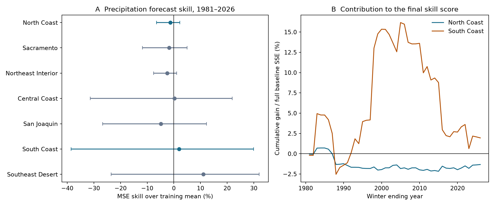
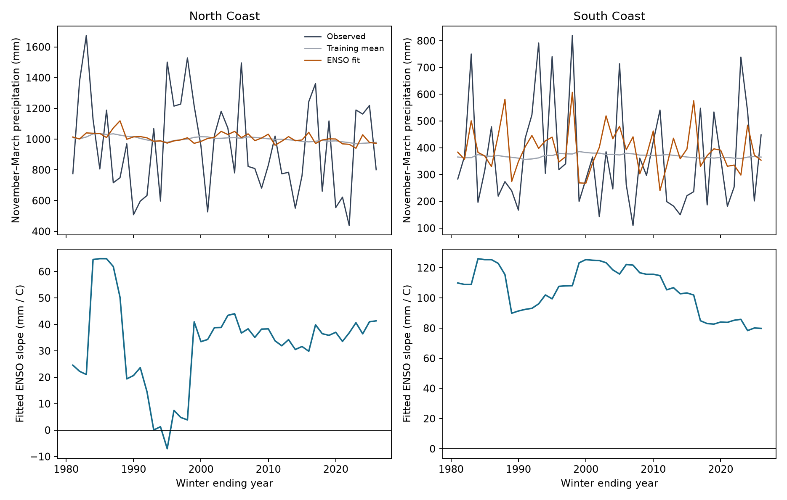

# July-September ENSO gave no clear precipitation forecast gain in seven California divisions in winters 1981-2026

July-September Nino 3.4 gave no clear forecast gain for November-March precipitation in any of seven California climate divisions. The South Coast mean squared error (MSE) skill estimate was 1.95%, with a 95% five-year block interval of -38.54% to 29.92%. The North Coast estimate was -1.33%, with an interval of -6.54% to 2.24%. The planned South Coast minus North Coast comparison was 3.28 percentage points, with an interval of -35.29 to 30.52 points. Positive skill means lower error than the mean of earlier training winters.

These intervals permit both useful gains and losses. They do not prove equal forecast skill. The result applies to one small regression, one issue season, and fixed data products. It does not show that ENSO has no effect on California precipitation.



Figure 1. A shows MSE skill and marginal 95% intervals from five-year time blocks. All seven intervals include zero. B shows cumulative paired error gains, divided by the full evaluation-period baseline sum of squared errors for each division. The last point equals the full-period skill. Earlier points are contributions to that final score, not skill scores for the shorter periods. The lines show large South Coast gains in a few winters and losses in others.

## Question and prior evidence

Can a simple ocean index give useful advance information about winter precipitation? Water planning needs advance information, but precipitation is only one input to water availability. This study does not measure runoff, snow storage, reservoir supply, or drought damage.

[Jong, Ting, and Seager (2016)](https://doi.org/10.1088/1748-9326/11/5/054021) found stronger ENSO links in southern California and in late winter. Their study used other spatial regions, seasons, and data for 1901-2010. It also found that the precipitation response depends on El Nino strength. Those results motivate the geographic comparison, the season checks, and a model that permits unequal warm and cold slopes. The present study does not discover a new ENSO link or repeat their exact test.

[Jiang and colleagues (2022)](https://doi.org/10.1175/BAMS-D-21-0252.1) found limited California winter prediction skill in coupled models. Their analysis attributes much of the remaining variation to circulation patterns that are independent of ENSO. Our index test does not measure those circulation patterns. It gives a small statistical benchmark, not a test of a coupled model or a physical cause.

Before the precise question was chosen, campaign searches used the terms `earthquake hydrology ocean drought`, `ENSO`, `Ridgecrest`, and `California precipitation`. We read the signed forecast study [052912e5](sci:sha256:052912e523273b0db9cc3a13e6f7f1ccfb2c72565d6e9b88a4e004b308ed207a). It tested next-winter ocean temperatures, not California precipitation. We reuse its public shared SST source, with new code and a new target. We did not use private worker files. The contribution is a fixed, chronological forecast dataset with all annual predictions, a planned geographic contrast, and an uncertainty audit through winter 2026.

## Data and forecast scope

The SST input is the [NOAA CPC regional monthly ERSSTv5 table](https://www.cpc.ncep.noaa.gov/data/indices/ersst5.nino.mth.91-20.ascii). Its anomaly reference period is 1991-2020. Nino 3.4 covers 5 S to 5 N and 170 W to 120 W. We use the Nino 3.4 anomaly column, not the SST level or the Oceanic Nino Index event label. The snapshot has 918 monthly rows from January 1950 to June 2026. The analysis uses JAS means from 1950 to 2025. JAS means July, August, and September.

The precipitation input is [NOAA nClimDiv v1.0.0, file dated 20261006](https://www.ncei.noaa.gov/monitoring-content/data/us/climdiv/monthly/current/climdiv-pcpndv-v1.0.0-20261006). We select state code 04 and element code 01. The [source format](files/raw/divisional-readme.txt) states that each monthly value is in inches to two decimal places. We convert to millimeters with 25.4 mm per inch. Negative missing-value codes are checked before each seasonal sum. No monthly value needed for a target is missing. Precipitation includes liquid water equivalent from snow; it is not a rain-only measurement.

The divisional values use area averages of gridded station estimates. Thus, the seven divisions are spatial aggregates. They are not individual gauges or seven independent samples. [NOAA's division list](https://psl.noaa.gov/data/usclimdivs/data/map.html) gives the geographic names. Codes 0401 and 0406 are North Coast Drainage and South Coast Drainage. The remaining divisions are Sacramento Drainage, Northeast Interior Basins, Central Coast Drainage, San Joaquin Drainage, and Southeast Desert Basin. Short names are used in figures and tables. We do not combine the divisions into a statewide mean.

Winter y means November and December of y-1 plus January through March of y. For example, winter 1981 uses November 1980 to March 1981 precipitation. Its predictor is JAS 1980 Nino 3.4. This represents an issue after September SST data become available in October, before target precipitation starts. The sources are current retrospective products. They are not the archived inputs that a forecaster had at each historical issue.

There are 76 complete winters, 1951-2026, in each division. The first 30 supply the initial training set. There are 46 evaluation winters, 1981-2026. All years, including neutral ENSO years, are retained. There is no ENSO event threshold or event selection.

The sources were read in place at these exact shared paths:

```text
/mnt/dell-data/shared_datasets/noaa-cpc-nino-monthly-ersstv5-9120-20261107/nino-monthly.ascii.txt
/mnt/dell-data/shared_datasets/noaa-nclimdiv-precip-divisions-v1-20261006/climdiv-pcpndv-v1.0.0-20261006.txt
```

The full SST SHA-256 is `bedcd0683c07f7ccb2ae358a90cb39d57413dcc8881027e0c30a1811f6d58012`. The full precipitation SHA-256 is `1389b59ba1f6a238fde82383cc9aee600f9b458308a32d17e78415fc24a68460`. The package keeps the exact 67,087-byte SST file and all exact California source lines from the precipitation file. The 90,552-byte precipitation subset has SHA-256 `1f55c0627f8db4aed70f0a3aa47d94763951e3e3eab8312f775a27b790c0d3bd`. [Provenance](files/provenance.json) also gives retrieval times, source URLs, resolved shared paths, and metadata hashes. The shared sources were not changed.

## Method

For each division and evaluation winter y, fit only winters 1951 through y-1. The baseline forecast is the mean precipitation of those training winters. The ENSO model is ordinary least squares with an intercept and JAS Nino 3.4:

```text
precipitation = intercept + slope * JAS_Nino_3.4
```

The code subtracts the current training mean from the predictor. With an intercept, this gives the same forecasts as the raw predictor. It makes the fit invariant to a constant anomaly reference offset. It does not remove reconstruction revisions or climate trends. There is no parameter tuning, feature selection, or use of later winters in a fit.

For winter 1981, the model fits winters 1951-1980 and uses JAS 1980 to predict November 1980-March 1981. Its latest training response ends in March 1980. For winter 2026, the model fits winters 1951-2025. Predictor months and response months do not overlap.

MSE is the mean of squared observed-minus-forecast errors over evaluation winters. We define:

```text
skill = 1 - MSE_ENSO / MSE_baseline
geographic_contrast = skill_South_Coast - skill_North_Coast
```

The denominator is specific to each division. The contrast compares fractional error reductions, not precipitation volumes. We also report root mean squared error (RMSE), mean absolute error (MAE), and the number of winters with lower squared error. MSE gives large errors more weight than MAE or a count of wins.

The local [analysis plan](files/analysis_plan.md) preceded the fits. It is not an external registration. The main geographic comparison was fixed as South Coast minus North Coast before the rainfall results were seen. We report every division and every planned check.

Uncertainty uses 10,000 circular moving-block samples of evaluation years. Each draw samples starts with replacement, takes consecutive five-year blocks with wraparound, and cuts the result to 46 years. The same year indices are used for both models and all divisions. Both MSE ratios and their contrast are calculated again for each draw. The intervals use the 2.5 and 97.5 percentiles. The random generator uses base seed 11070418 plus the block length. Three- and seven-year blocks are checks.

The forecasts are fixed within the bootstrap. The intervals are conditional on those forecasts. They do not include all uncertainty from the fitted models, data errors, or model choices. Adjacent winters can share an ENSO event. Overlapping training sets can also cause longer dependence than these blocks represent. Circular sampling joins the first and last evaluation winters. Marginal division intervals have no multiple-comparison correction. The one planned geographic contrast is the main comparison; no division was selected for a significant result.

## Results

| Division | Baseline RMSE, mm | ENSO RMSE, mm | MSE skill, % | 95% block interval, % |
| --- | ---: | ---: | ---: | ---: |
| North Coast | 314.86 | 316.94 | -1.33 | -6.54 to 2.24 |
| Sacramento | 243.87 | 246.01 | -1.77 | -11.77 to 5.00 |
| Northeast Interior | 139.12 | 140.83 | -2.48 | -7.56 to 1.07 |
| Central Coast | 181.13 | 180.90 | 0.26 | -31.38 to 21.92 |
| San Joaquin | 160.58 | 164.43 | -4.85 | -26.69 to 12.30 |
| South Coast | 192.54 | 190.66 | 1.95 | -38.54 to 29.92 |
| Southeast Desert | 63.47 | 59.86 | 11.06 | -23.56 to 31.99 |

No division has a clear positive gain under this interval method. The Southeast Desert has the largest point estimate, but it was not the planned geographic endpoint. Its interval is broad and includes zero. The South Coast model lowers squared error in 21 of 46 winters. Its MAE changes from 157.11 to 156.93 mm. North Coast has 23 wins and MAE changes from 275.36 to 276.78 mm.

The planned South Coast minus North Coast contrast is 3.28 percentage points. Its three-, five-, and seven-year intervals are -32.82 to 30.51, -35.29 to 30.52, and -34.42 to 30.64 points. The result remains uncertain across these block lengths.



Figure 2. The upper panels show individual observations and forecasts for the two planned divisions. The lower panels show the fitted ENSO slope at each issue. These slopes describe the training fits; they are not estimates of a physical effect. The fitted South Coast slope stays positive, while its forecast gain remains uncertain. A positive fitted association alone does not establish useful forecast accuracy.

| Check | North Coast skill, % | South Coast skill, % | South minus North, points | 95% contrast interval, points |
| --- | ---: | ---: | ---: | ---: |
| Primary | -1.33 | 1.95 | 3.28 | -35.29 to 30.52 |
| Last 30 training winters | -2.36 | 3.35 | 5.71 | -28.03 to 33.67 |
| Add absolute ENSO strength | 2.48 | -4.06 | -6.53 | -48.71 to 18.93 |
| Add ENSO to prior-winter precipitation | -1.27 | 1.28 | 2.55 | -31.69 to 27.65 |
| Include year in both models | 0.18 | 3.16 | 2.98 | -25.46 to 27.69 |
| Early winter target, November-December | -2.58 | -3.83 | -1.25 | -16.51 to 14.37 |
| Late winter target, January-March | -2.68 | 4.58 | 7.26 | -18.25 to 23.29 |

All checks use the same evaluation winters. The prior-precipitation models train from winter 1952 because they need the previous winter. The year check includes a linear year term in both the baseline and ENSO model. The absolute-strength check adds abs(JAS Nino 3.4), with a break at zero anomaly. Each model is fitted again at every issue. These are fixed checks, not models selected by their evaluation scores.

The late-winter South Coast point estimate exceeds its early-winter estimate. Both are uncertain. This is compatible with prior seasonality evidence, but it is not a precise forecast-skill confirmation. Our ND and JFM targets also differ from the NDJ and FMA windows in Jong and colleagues.

South Coast primary skill is 24.50% in winters 1981-2003 and -26.42% in 2004-2026. Their intervals are -37.43% to 53.62% and -69.14% to 3.96%. The geographic contrasts are 27.02 and -26.65 points; both intervals include zero. This period split shows instability in the realized scores. It does not establish a change in the physical ENSO response.

Deletion of one evaluation winter at a time, without refitting, moves South Coast skill from -7.80% to 7.85%. Removal of winter 1998 gives the low value; removal of winter 2016 gives the high value. The geographic contrast ranges from -6.18 to 9.84 points. Thus, a single winter can change the sign of the South Coast skill and the geographic comparison. This check measures score influence only. It does not remove that winter's influence on later training fits.

## Interpretation and limits

The tested explanation was that a stronger southern ENSO link supplies more useful advance precipitation information. The small positive main contrast does not give clear support for that prediction. A model with unequal warm and cold slopes changes its sign, but also leaves it uncertain. This study cannot identify which response shape is correct.

The result is consistent with a useful distinction: an observed ocean-precipitation association can coexist with uncertain chronological forecast gains. Fitting error, a few large winters, an early issue date, and other circulation effects can all contribute. The present data do not separate those explanations. No causal claim is made.

The record has only 46 evaluation winters and fewer independent ocean events. All products are retrospective. The SST anomaly baseline uses later observations, although a constant reference shift is absorbed by an intercept. SST reconstruction can have other effects that this property does not remove. NOAA can revise precipitation, especially recent years. We do not present these results as operational real-time forecast skill.

There is no independent precipitation or SST product replication. The simple model omits winds, pressure, ocean heat content, regional SST patterns, and other predictors. It cannot test the full potential of ocean information. The division averages also hide local extremes. MSE skill does not directly measure flood risk, drought recovery, or water supply. The statistical intervals are conditional and broad. Absence of a clear gain is not proof of no useful gain.

A useful next test would apply this fixed protocol to an independent precipitation product and archived issue-time SST, then add measured atmospheric circulation. That test should retain the individual predictions and the same geographic comparison.

## Reproduction and checks

[REPRODUCE.md](files/REPRODUCE.md) gives the offline commands, source retrieval recipe, package versions, and evidence file descriptions. [Source code](files/analyze.py) generates every result. All inputs needed for an offline repeat are included. Shared raw data were not duplicated in full.

The [independent audit](files/audit.json) checks 532 annual rows, all 2,254 forecasts, and all 10,000 primary bootstrap draws. It uses a Decimal source parser, a scalar primary regression formula, separate normal-equation fits for all models, scalar bootstrap sums, and independent quantile interpolation. Its largest forecast difference is less than 1.8e-10 mm. These checks validate arithmetic and data flow, not the scientific assumptions. The [repeat record](files/reproduction_check.json) records a second complete run from the bundled inputs and exact evidence-file comparisons.

## Campaign and license

Job: `sci-1107-hp-earth-and-ocean-sciences-0418cd539573`. Topic: `earth-and-ocean-sciences`. Campaign: `11_07_2026`. Machine: `hp`. Account: `codex-myxtap`. Model: `gpt-6.1-sol`, high reasoning effort, through the Codex harness in T3 Code. No child agents were used. Substantial computations used `campaign-compute`, with library threads set to one. The signing identity is a campaign-machine key. It is not a personal authorship claim. No remote archive or index submission was made.

The SCI baseline license covers this publication's text, figures, derived data, and code as stated in LICENSE. NOAA source data retain their source status. The private signing key is outside this package.
