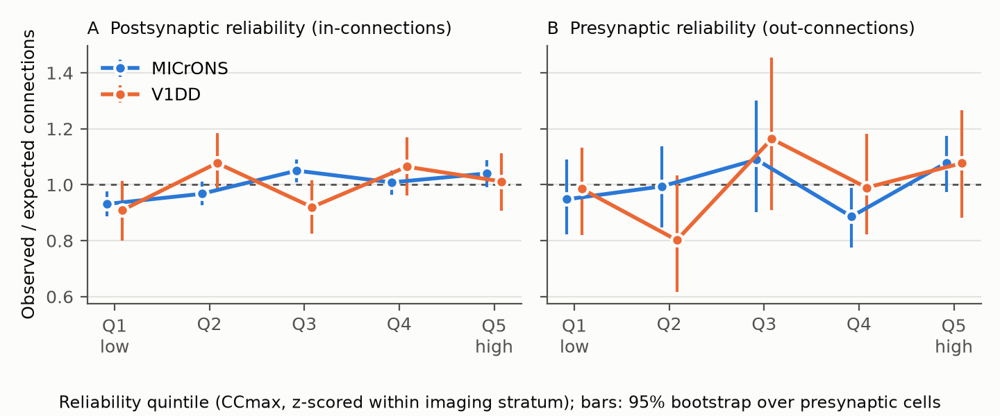
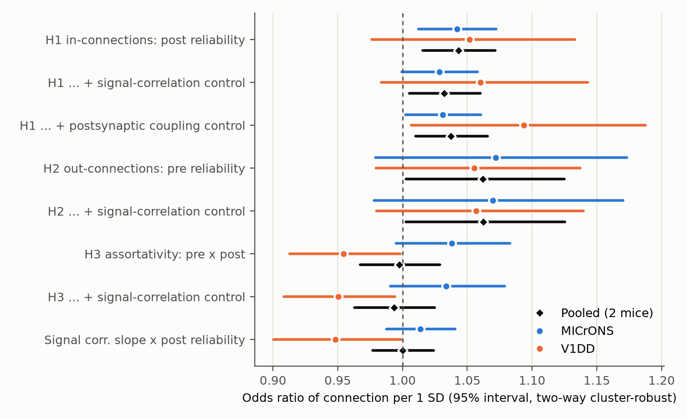

# Postsynaptic response reliability gives a small increase in connection odds in two mouse visual cortex EM datasets

## Summary

**Question.** Does the trial-to-trial reliability of a neuron's natural-movie response relate to its synaptic connectivity? We tested three hypotheses:

- **H1 (in-connections):** neurons with more reliable responses receive more connections.
- **H2 (out-connections):** neurons with more reliable responses make more connections.
- **H3 (assortativity):** reliable neurons connect preferentially to other reliable neurons.

**Data.** We used two mice that have calcium imaging and electron microscopy (EM) of the same neurons:

- **MICrONS** (Ding et al. 2025 functional connectomics tables, release v1): 275,681 ordered pairs that have axon-dendrite proximity (ADP), with 144 proofread presynaptic neurons, 10,591 postsynaptic neurons and 7,529 connected pairs. The pairs are in V1 and three higher visual areas.
- **Allen V1 Deep Dive (V1DD)**, mouse 409828, EM release 1196: 99,215 ordered pairs among EM-coregistered neurons, with 193 presynaptic cells that have proofread axons, 515 postsynaptic cells and 1,447 connected pairs.

**Reliability measure.** Reliability is CCmax, the normalized correlation ceiling of Schoppe et al. (2016), computed from repeated presentations of the natural movie. For MICrONS we used the CCmax value of the source table. For V1DD we computed CCmax from 8 repeats of a 120 s movie in 0.5 s bins of dF/F. We z-scored reliability within each imaging stratum: scan × area × layer for MICrONS, and session × imaging plane for V1DD.

**Main result (H1).** Postsynaptic reliability gave a small, positive and consistent increase in connection odds:

| | Odds ratio per 1 SD (95% interval) |
|---|---|
| MICrONS | 1.042 (1.012–1.072); cell-level permutation p = 0.0004 |
| V1DD | 1.052 (0.976–1.133); permutation p = 0.21 |
| Fixed-effect pooled | 1.043 (1.016–1.072), with no heterogeneity (Cochran p = 0.82) |

The pooled effect stayed when we controlled for pair signal correlation (1.032, 1.005–1.060). It also stayed when we controlled for the postsynaptic cell's mean signal coupling (1.038, 1.010–1.066), which earlier campaign work found to predict in-degree.

The effect is approximately one third of the like-to-like effect of signal correlation in the same models (MICrONS 1.147 per SD; V1DD 1.095 per SD). At a base rate of 2.7% (MICrONS), 1 SD of reliability changes the connection probability by about 0.1 percentage point.

**Other results.**

- **H2:** Presynaptic reliability gave point estimates of 1.06–1.07 in both mice, but neither mouse gave clear evidence (permutation p = 0.46 and 0.25).
- **H3:** The reliability interaction had opposite signs in the two mice: 1.038 in MICrONS and 0.955 in V1DD (heterogeneity p = 0.008). Thus the data do not support a reliability rich club.
- **Like-to-like slope:** The data do not show a consistent change of the like-to-like slope with postsynaptic reliability.

**Main limitations.**

- The data are observational, with one mouse per dataset.
- V1DD has no axon-dendrite proximity measure, so we used soma-distance controls.
- The MICrONS presynaptic neurons are a selected, highly reliable sample (mean CCmax 0.81, compared with 0.62 for all neurons), which restricts the tests of H2 and H3.
- We made the final model list after we saw the first MICrONS H1 point estimate.

## Why this question

Reliable stimulus representations are a basic requirement for sensory computation. One structural hypothesis is that neurons that receive more convergent input average out noise, so their responses are more reliable. A second hypothesis is that reliable neurons form a preferentially connected subnetwork that carries the reliable part of the representation.

Earlier campaign publications studied the like-to-like rule (similar responses → more connections) in the MICrONS and V1DD mice, and they found cell-level coupling effects on in-degree. No campaign publication had tested response reliability as a structure–function variable.

## Methods

### Pairs and connections

**MICrONS.** We used the `edge_data_v1.pkl` pairs with population `ADP` (proximal, not connected) or `Connected`. The outcome is "connected or not". We removed neurons without an L2/3, L4 or L5 label and strata with one neuron (19,690 of 295,371 pairs). Each model includes:

- a 6-df B-spline of log dendritic co-travel length,
- a 4-df B-spline of log soma distance,
- postsynaptic area × layer indicators.

**V1DD.** We used all ordered pairs between coregistered cells. The presynaptic cell must have a proofread axon, and the postsynaptic cell must have a proofread dendrite. A pair is connected if the release-1196 synapse table has at least one synapse from the presynaptic root ID to the postsynaptic root ID. The controls are:

- a 5-df B-spline of log lateral soma distance,
- a 4-df spline of vertical offset,
- a 4-df spline of postsynaptic depth (or presynaptic depth for H2).

### Reliability

CCmax = sqrt(SP / Var(mean response)), where SP = (N·Var(mean) − mean(Var(single trials))) / (N − 1). This is the Schoppe et al. (2016) estimator.

- For V1DD, our CCmax agreed with Spearman–Brown split-half reliability (Spearman ρ = 0.997). It agreed poorly with the separately published Allen `snr_by_cell` table (ρ = 0.16). That table's stimulus and definition are not documented.
- A cell with several coregistered ROIs received the mean z-score of those ROIs.

### Models

We used logistic regression with fixed effects:

- **H1 and H3:** one intercept per presynaptic neuron.
- **H2:** one intercept per postsynaptic neuron.

We fit the models by Newton–Raphson with Schur-complement elimination of the fixed-effect block (`code/common.py`).

**Wald intervals** use two-way cluster-robust covariance, clustered by presynaptic and postsynaptic neuron (Cameron, Gelbach and Miller 2011).

**Permutation tests** use the score statistic. We fit the null model once, then permuted the cell-level reliability values 5,000 times:

- H1: postsynaptic values, within imaging strata (MICrONS) or within sessions (V1DD).
- H2 and H3: presynaptic values, across presynaptic cells.

**Controls:**

- **Pair signal correlation.** MICrONS: the in vivo and model (in silico) signal correlations from the source table. V1DD: our correlation of trial-mean movie responses.
- **Postsynaptic signal coupling.** MICrONS: the mean signal correlation over "Same region" pairs only. These pairs have no ADP and are never in the tested set. V1DD: the mean correlation with all soma ROIs in the same session.

**Pooling.** We pooled the two mice by fixed-effect inverse-variance weights and report Cochran's Q.

**Observed/expected curves (Figure 1).** These use the fitted model without reliability. The intervals come from 2,000 bootstrap resamples of presynaptic cells.

## Results

### Figure 1 – Observed / expected connections by reliability quintile

In MICrONS, the lowest postsynaptic reliability quintile received fewer connections than the model without reliability predicts (O/E 0.93, 95% interval 0.89–0.98). The highest quintile received slightly more (1.04, 0.99–1.09). V1DD shows the same low-quintile deficit (0.91, 0.80–1.01) with wider intervals. Presynaptic reliability shows no monotonic pattern.

### Figure 2 – Odds ratios per SD with two-way cluster-robust intervals

### Main table (odds ratio per 1 SD, 95% interval)

| Model | MICrONS | V1DD | Pooled |
|---|---|---|---|
| H1 post reliability | 1.042 (1.012–1.072), perm p 0.0004 | 1.052 (0.976–1.133), perm p 0.21 | 1.043 (1.016–1.072) |
| H1 + pair signal correlation | 1.028 (1.000–1.058), perm p 0.023 | 1.060 (0.984–1.143), perm p 0.14 | 1.032 (1.005–1.060) |
| H1 + postsynaptic coupling | 1.031 (1.002–1.061) | 1.094 (1.007–1.188) | 1.038 (1.010–1.066) |
| H1 + coupling + signal correlation | 1.028 (0.999–1.057) | 1.093 (1.006–1.186) | 1.034 (1.007–1.062) |
| H2 pre reliability | 1.072 (0.979–1.173), perm p 0.46 | 1.055 (0.979–1.137), perm p 0.25 | 1.062 (1.003–1.125)* |
| H3 pre × post reliability | 1.038 (0.995–1.083), perm p 0.22 | 0.955 (0.913–0.998), perm p 0.078 | 0.998 (0.967–1.029); heterogeneity p 0.008 |
| Like-to-like slope × post reliability | 1.014 (0.988–1.041) | 0.948 (0.900–0.999) | 1.000; heterogeneity p 0.024 |
| Like-to-like (in vivo signal correlation) | 1.147 (1.109–1.185) | 1.095 (1.037–1.157) | 1.133 |
| Postsynaptic coupling alone | 1.067 (1.035–1.100) | 1.066 (0.995–1.141) | 1.067 |

\* The pooled H2 Wald interval excludes 1, but the cell-level permutation tests in each mouse do not support H2. With 144 and 193 presynaptic clusters, the Wald interval can be too narrow. We do not claim an H2 effect.

### Robustness of H1 in MICrONS

- Raw CCmax without within-scan z-scoring: 1.039 (1.009–1.069).
- Within-scan rank: 1.044 (1.015–1.074).
- The model prediction accuracy (CCabs) gave 1.036 (1.009–1.063). When we controlled for CCabs, reliability gave 1.031 (0.998–1.066).
- By projection class (exploratory):

| Projection class | Odds ratio per 1 SD (95% interval) |
|---|---|
| V1→V1 | 1.047 (0.996–1.102) |
| V1→HVA | 1.072 (0.974–1.179) |
| HVA→V1 | 1.007 (0.939–1.080) |
| HVA→HVA | 1.050 (1.012–1.089) |

The figure is `files/figures/fig3_microns_projection_classes.png`.

### Reliability and coupling are different cell properties

The Spearman correlation of reliability with postsynaptic signal coupling was 0.14 (in vivo) and 0.02 (model) in MICrONS, and −0.30 in V1DD. The negative V1DD value probably occurs because our V1DD coupling uses trial means of only 8 repeats, which keep shared non-stimulus activity. In V1DD, the coupling control made the reliability effect larger (1.052 → 1.094).

## Interpretation

The two mice agree on a small positive link between how reliably a neuron responds to a natural movie and how many local synaptic inputs it receives, per unit of axon-dendrite opportunity. This agrees with the convergence-averaging hypothesis. The data do not show the mechanism. Other explanations are possible:

- Reliable neurons can be larger or more strongly driven cells.
- An unmeasured cell property can affect both reliability and input.
- The imaging quality of a cell can relate to its EM reconstruction quality. We did not find a mechanism for this in the data, but we cannot exclude it.

The effect is small: about 4% higher odds per SD. It does not depend on the signal similarity of the pair, and it does not depend on cell-level signal coupling.

We found no consistent evidence that reliable neurons make more connections or prefer other reliable neurons. The H3 point estimates had opposite signs in the two mice.

## Limitations

1. **Observational data, two animals.** Each dataset is one mouse. The two datasets also differ in method: proximity control, reliability pipeline and cell selection. Thus agreement or disagreement between them cannot be assigned to animal differences alone.
2. **No ADP control in V1DD.** V1DD uses soma-distance controls. Part of the V1DD estimate can come from differences in dendritic opportunity.
3. **Selected presynaptic samples.** In MICrONS, 144 presynaptic neurons remain (112 of the original 148 are in RL or AL), and their reliability range is narrow. This limits the power for H2 and H3.
4. **Measurement differences.** The MICrONS CCmax comes from the source pipeline. Our V1DD CCmax uses dF/F in 0.5 s bins from one session. The V1DD signal correlations and coupling use trial means of 8 repeats, so they include some shared noise.
5. **Analysis history.** We saw an exploratory MICrONS H1 estimate (without cluster-robust errors) before we fixed the final model list. We added the coupling control after we read the related campaign publications. We did not correct p-values for multiple models. The main claim rests on the H1 direction in both mice and on the pooled interval.
6. **Effect size.** An odds ratio of 1.04 per SD is small. It explains a very small part of the variance in connectivity.

## Reproduction

1. Make the shared datasets available. Set `SCI_DATASETS` to a folder that contains `microns_funconn/2025_v1`, `allen_v1dd`, `allen_v1dd_movie_arrays` and `allen_v1dd_2p_coreg_sessions`, with the exact versions and hashes in `files/provenance/`. The small V1DD coregistration files are in `files/derived/v1dd_source/`.
2. Use Python 3.12 with numpy, pandas, scipy, patsy, pyarrow and matplotlib. Script 02 also needs `zarr==2.18.7`.
3. Run `cd files/code && bash run_all.sh`. Set `OPENBLAS_NUM_THREADS=1` on a shared machine. On a heavily loaded 8-core host, a full run took about 1.5 hours.

The script order is:

- `01_microns_pairs.py` – MICrONS pair table (verifies the source SHA-256 values).
- `02_v1dd_reliability.py` – V1DD CCmax and trial-mean movie responses for all ROIs.
- `03_v1dd_pairs.py` – V1DD pair table, synapse counts and signal correlations.
- `03b_coupling.py` – cell-level signal coupling.
- `04_models.py {microns|microns_extra|v1dd|coupling}` – models, cluster-robust intervals, permutation tests, O/E bins.
- `05_v1dd_snr_check.py`, `06_figures.py`, `07_pool.py`.

All model outputs are in `files/derived/`:

- `model_results_*.csv`
- `oe_bins_*.csv`
- `pooled_two_mice.csv`
- `log_*.txt`

Note: in our run, the first `04_models.py microns` call also held the projection-class subsets, and those subsets failed (singular design: absent area-layer indicators). `log_04_microns.txt` keeps that traceback. We wrote `model_results_microns.csv` from the 12 completed result lines of that log. Then we moved the subsets and O/E bins to the `microns_extra` mode, with the fix. The current script gives the same main results directly.

The pair tables (`microns_pairs.parquet`, `v1dd_pairs.parquet`) let a reader refit any model without the raw data.

## Provenance

| Field | Value |
|---|---|
| Job | sci-1107-hp-neural-structure-and-computation-cd667a121213 |
| Campaign | 11_07_2026 |
| Topic | neural-structure-and-computation |
| Machine | hp |
| Account | claude-myxtap |
| Model | Claude Opus 5.5 (claude-opus-5-5) in Claude Code |
| Date | 2026-11-08 |

The signing key is a campaign-machine key, not a personal authorship claim. Data sources, shared-dataset paths, source URLs, versions and SHA-256 values are in `files/provenance/data_sources.json` and `files/provenance/v1dd_shared_dataset_sha256.txt`.

All source data are CC BY 4.0. Credit:

- the MICrONS Consortium and Ding, Fahey, Papadopoulos et al. (2025);
- the Allen Institute for Brain Science V1 Deep Dive team (investigators Forrest Collman, Nuno da Costa, Clay Reid).
