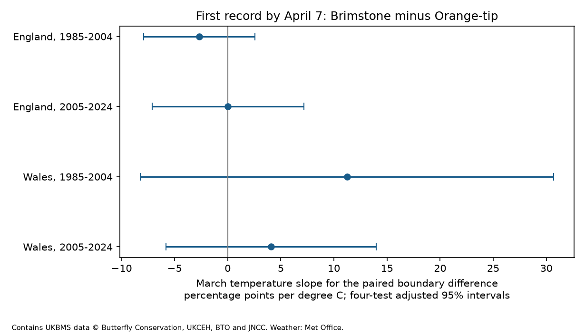

# March warmth gave no clear species difference in early butterfly records in England and Wales in 1985-2024

## Question and reason for the test

Does March warmth change the chance of an early first record more for Brimstone than for Orange-tip? We use first records by April 7 as a flag for possible survey limits. This flag is not a measure of true emergence or of the amount of bias.

Brimstone can fly after winter as an adult. Orange-tip comes from a pupa in spring. The Springwatch species sheet explains this contrast. The UKBMS guide states that weekly standard transects cover April to September. Thus an early species can be active before survey visits start. The 2008 UKBMS report warned that first and last dates can miss flight outside this season. Moussus et al. (2010) compared timing measures under simulated observation errors. Macgregor et al. (2019) removed flight curves that met recording limits in a study of timing and range change. Our test asks if one simple boundary flag has a repeated species difference in its weather slope.

A prior campaign result compared first and mean Orange-tip dates in England. It found no clear slope difference. We read that publication, but rebuilt this analysis from the source ZIP files. We searched the shared campaign for phenology, season boundary and Brimstone before fitting. The exact Brimstone search returned no entry. We do not claim a new general link between butterfly timing and temperature. The local exploratory plan is in files/plan.txt. It is not a registered study. This study tests seasonal weather and observation limits. It does not test air pollution, extremes or climate-change attribution.

## Data and selection

We use the 2024 UKBMS phenology and site-location releases. We use Met Office monthly country series from HadUK-Grid, as saved on 9 November 2026. These series give country mean weather, not weather at each transect. Source URLs, file hashes, member hashes and exact shared paths are in files/provenance.json. All six shared files passed their recorded hash checks. No shared data were changed.

We select Brimstone and Orange-tip in England and Wales in 1985-2024. We remove 14 exact duplicate rows, then require unique species-site-year keys. We require positive peak counts and a first day from -31 through 183 in the source April-relative units. The guide gives 20 as April 20. Some records precede April 1. We retain these records in the main test, so that we do not select the main sample on the lower survey limit. The indicator is FIRSTDAY <= 7. It means a first record by April 7 within the selected date range.

We match the two species by site and year. Both must have usable records. We fit four samples: England and Wales, each in 1985-2004 and 2005-2024. Sites must have at least five matched years within each sample. There are 15,911 matched site-years across the samples. Samples share no records. Some sites occur in both periods. The countries have correlated weather and are not independent experiments. Missing species records are not zero counts.

The selected samples contain 93, 733, 0 and 15 pre-April Brimstone dates, and 16, 104, 0 and 3 pre-April Orange-tip dates, in table order below. We cannot infer the number of early survey visits from these totals. Sites are selected by recorders. The matched sample further selects places where both species are detected.

## Model and checks

For each matched site-year, let B and O be the two early-record indicators. The main response is B minus O. A linear model includes a separate site intercept, March mean temperature, winter mean temperature, April mean temperature, April rain and a linear year trend. Winter is the supplied December-February mean. Each record has weight 1 divided by the number of records in its year within its sample. Thus each year has equal total weight.

We remove weighted site means before least squares. The March coefficient is the difference of the two species slopes on the same design and weights. The reported unit is percentage points per degree C. This is a linear description. It is not a bounded probability prediction or a causal effect.

We sum score vectors by year. The variance correction is G/(G-1) times (N-1)/(N-S-K), where G is the number of years, N is the number of rows, S is the number of site intercepts and K is the number of other columns. The t reference has G-1 degrees of freedom. All main fits have 20 years. The main intervals use a Bonferroni correction for four difference tests. Independent annual score sums are an assumption of these intervals.

Checks use April 3 and April 14 thresholds, add both log peak counts, require ten matched years per site, omit pre-April records, or add annual score covariance at lags one and two with Bartlett weights. The last check only addresses short serial dependence. A leave-one-year-out calculation measures coefficient sensitivity, not confidence. Count adjustment may control part of the biological response and is not a complete detection correction. The pre-April exclusion selects on the outcome.

A separate numerical calculation uses explicit site dummy columns. For all four primary fits, it checks the weighted coefficient and year-cluster variance against the absorbed calculation. Maximum coefficient error is below 5e-15 in unscaled units. files/validation.json records the checks. Constant species outcomes have undefined uncertainty; blank interval and p-value cells mark these cases.

## Results

Raw early-record percentages are unweighted descriptions. The difference slope controls the terms specified above.

| Country | Period | Matched site-years | Sites | Brimstone early (%) | Orange-tip early (%) | Difference slope (adjusted 95% interval) |
|---|---|---:|---:|---:|---:|---|
| England | 1985-2004 | 2926 | 279 | 36.6 | 6.8 | -2.67 (-7.91, +2.57) |
| England | 2005-2024 | 12822 | 1185 | 34.8 | 8.8 | +0.01 (-7.13, +7.16) |
| Wales | 1985-2004 | 41 | 3 | 22.0 | 0.0 | +11.23 (-8.23, +30.69) |
| Wales | 2005-2024 | 122 | 13 | 33.6 | 12.3 | +4.08 (-5.81, +13.98) |

All four primary intervals include zero. The data do not show a repeated difference in the March warmth response. They also do not establish equivalent responses. For example, the early Welsh interval permits a slope difference from about -8 to +31 percentage points per C.

Brimstone has more early records in all four samples. This difference in frequency does not imply a larger weather slope. The English Orange-tip slopes are +3.27 and +5.02 percentage points per C. The Brimstone slopes are +0.60 and +5.03. These separate species estimates are descriptive secondary results, not the primary four-test family. The early Welsh Orange-tip indicator is zero in every selected row. This is a sample limit, not proof of zero population response.

All difference intervals still include zero with the other thresholds, count controls, ten-year site filter, pre-April exclusion and short serial covariance check. These are sensitivity checks, not new independent replications. The later Welsh April 3 comparison has an unadjusted p-value near 0.049, but its four-test interval includes zero. We do not use that isolated result to claim an effect.

Leave-one-year-out slopes range from -3.82 to -1.40 and from -4.02 to +2.96 in England. They range from +2.08 to +16.21 and from +2.47 to +8.12 in Wales. These ranges show that single years can matter even when all main intervals include zero.

## Limits and use

The early Welsh result rests on three sites and 41 rows. The later Welsh sample has 13 sites and 122 rows. These samples cannot support a strong regional generalization. Twenty annual weather exposures per fit also limit precision in England despite the larger row counts. Monthly country weather can miss local heat and rain. Longer annual dependence can remain after the short covariance check.

Matching keeps the two species on the same site-year sample. It does not recover absent visits, zero reports or unobserved flight before surveys. The first visit that detects one species need not detect the other. Habitat, route, observer and abundance changes can remain after site control. Adult life history, weather-dependent flight and survey effort are alternative explanations that these data cannot separate.

The useful result is a reproducible audit of a proposed species contrast, with a null outcome and a weak regional comparison made explicit. A stronger test needs dated visits, including absences, and observations before April. Neither a frequent boundary flag nor an unclear slope difference validates first-record phenology.

## Reproduce

Use Python 3.12 and the package versions in files/environment.json. Raw source files and record-level transformations are outside this signed package. The package contains our code, narrative, figures, model summaries and numerical checks.

From the extracted bundle, run:

    OPENBLAS_NUM_THREADS=1 python files/analyze.py --data /mnt/dell-data/shared_datasets --out ../replay

The command reads the six existing source files in place and verifies their hashes. It creates aggregate outputs only. For another machine:

    python files/retrieve.py --out ../external_inputs
    OPENBLAS_NUM_THREADS=1 python files/analyze.py --data ../external_inputs --out ../replay

The retrieval command requires a new folder outside the signed package. It checks all six hashes and stops if a live URL has changed. The shared snapshots are the reference in that case. Run python files/validate_outputs.py ../replay to compare replay estimates.csv, summary.csv and validation.json with the bundled files. No API key is required. Matrix checks run within analyze.py. A completed second run is recorded in files/reproduction_check.json.

## Sources and job record

Botham, M.S.; Middlebrook, I.; Heywood, J.; Harrower, C.A.; Milborrow, J.; Roy, D.B. (2025). United Kingdom Butterfly Monitoring Scheme: phenology 2024. NERC EDS Environmental Information Data Centre. https://doi.org/10.5285/b9d237fc-5a79-4449-bcee-34c52d87608f

Botham, M.S.; Middlebrook, I.; Heywood, J.; Harrower, C.A.; Milborrow, J.; Roy, D.B. (2025). United Kingdom Butterfly Monitoring Scheme: site location data 2024. NERC EDS Environmental Information Data Centre. https://doi.org/10.5285/d7256b49-f2e3-4ae7-907d-af729610c768

Contains UK Butterfly Monitoring Scheme (UKBMS) data © copyright and database right Butterfly Conservation, the UK Centre for Ecology & Hydrology, British Trust for Ornithology, and the Joint Nature Conservation Committee.

Weather: Met Office, UK and regional series, country monthly mean temperature and rain, snapshot dated 9 November 2026. Contains public sector information licensed under the Open Government Licence v3.0. See files/EXTERNAL_DATA_NOTICE.txt for source rights and separation from this package.

Campaign: 11_07_2026. Job: sci-1107-dell-climate-pollution-biodiversity-1ce47767bc46. Topic: climate-pollution-biodiversity. Machine: dell. Account: codex-andrii. Model: gpt-6.1-sol, high reasoning effort. The campaign-machine key signs this package. It is not a personal authorship claim.
