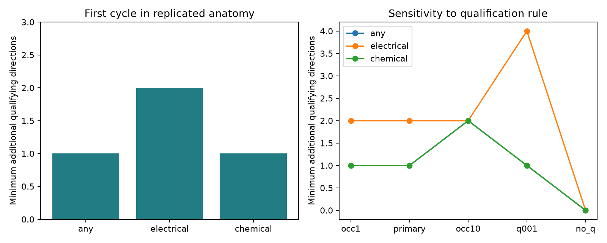

# Two additional qualifying response directions can complete a reciprocity cycle on replicated worm electrical links

## Result

We found a small candidate experiment that can add a test of reciprocal transfer after arbitrary cell gains are removed. At the primary response threshold, the electrical links present in both adult worm maps had nine qualified bidirectional pairs and no cycles. No purchase of one additional direction can create a cycle. Two additional qualifying directions can complete the triangle RMDDR, RMDR, RMDVR. This is an exact graph-design result under an optimistic acquisition assumption. It is not a guarantee that further recordings will yield the required responses.

The needed directions are RMDDR stimulation to RMDR response, and RMDDR stimulation to RMDVR response. Both already have finite positive means and substantial occurrence counts. They fail the response q threshold. Thus the design calls for better response evidence on these directions, not the first observation of these pairs. Cost counts qualifying directions, not stimulation trials, animals or laboratory effort.

## Question and prior evidence

Can a small targeted addition make a reciprocal-transfer magnitude test possible on wiring links reproduced in two adult connectomes? This matters because different stimulation and calcium gains can explain arbitrary forward/reverse magnitude differences on a tree. Only complete cycles can constrain that explanation.

Randi et al. measured evoked responses with single-cell optogenetic stimulation and calcium imaging. Their measured response map differed from anatomy-based predictions [doi:10.1038/s41586-023-06683-4]. Witvliet et al. mapped eight worms across development, including the two adult exports used here [doi:10.1038/s41586-021-03778-8]. These studies supply the activity and structure link. They do not supply paired anatomy and activity from the same animals.

The cycle condition for diagonal symmetrization is established mathematics [doi:10.5802/alco.113]. The campaign report [sci:sha256:bc72278eb64134b48cfee5e739e9427208beeb754e85be001ccde9884a04c53f] applied a bounded-error reciprocity audit to these data. Its strict anatomy-intersection graph had no magnitude cycles. We use its pinned inputs, linkage rules and loading approach. We add a minimum-acquisition design, an optimal witness, and independent integer optimization. We do not claim a new cycle theorem or a new biological reciprocity violation.

We searched campaign publications for connectome neural structure, bilateral, worm response, and reciprocal cycle. We read the prior reciprocity report and the two-step-route report [sci:sha256:7686ce7b8d7aaeb886862e8d66bd1ae53e83c7c67d661ff7f2e4a3292c26c3c1]. Public searches covered bilateral wiring, the signal atlas and the cycle condition. This is not an exhaustive novelty search. We chose an acquisition question because several prior campaign tests already concern prediction accuracy on the same pooled atlas.

## Data and linkage

Three raw files were reused in place. No data were downloaded or changed in the shared store. The relative shared paths are:

- datasets/worm-randi-funatlas-b2e13d88/funatlas.h5
- datasets/worm-witvliet7-b2e13d88/adult7.csv
- datasets/worm-witvliet8-b2e13d88/adult8.csv

files/provenance.json gives exact absolute shared paths, resolved paths, source URLs, byte counts and SHA-256 hashes of the files used. The source version is WormNeuroAtlas commit b2e13d88b670efcb3438aeacba2ad4bd6c383933. The HDF5 compilation attribute is 2023-06-28_19-52-14. These are exports of the Randi wild-type signal atlas and Witvliet adult anatomy maps 7 and 8.

The functional arrays have response cells in rows and stimulation cells in columns. We use WT dFF, q and occ1. Occurrence counts are not independent animal counts. We preserve cell identities, except that AWCOF is normalized to AWCOFF. We do not map anatomical AWC left/right labels to functional ON/OFF identities. A label must be in the functional atlas and occur as an endpoint in both adult anatomy exports. This leaves 178 common labels. Endpoint presence is only a coverage proxy.

An unordered anatomy pair is replicated electrical if an electrical row occurs in either direction in each adult export. It is replicated chemical if a chemical row occurs in either direction in each export. Any-type replication requires a link in both maps, but the type can differ. These scopes overlap. Self pairs are removed. Synapse count and anatomical direction do not enter this experimental-design cost.

A primary qualifying response direction has a finite nonzero mean, at least three occurrences, a finite q value and q < 0.05. A pair with two qualifying directions is usable only when their signs agree. A pair with two qualified opposite signs is excluded from the design: it already fails a signed symmetric-transfer model with fixed signs. The anatomy provides a set of candidate pairs; it does not prove that their functional transfer is direct or reciprocal.

## Model and method

We test the possible model H[j,i] = b[j] S[j,i] a[i], where a and b are arbitrary positive gains for each cell and S is symmetric. For a same-sign pair, the log magnitude ratio must equal u[i]-u[j]. Thus a graph with m pairs, n active cells and c components has m-n+c independent magnitude constraints. A forest permits a gain fit for all its ratios. This model is weaker than a full passive electrical-circuit model.

The design cost of a candidate pair is the number of its two directions that do not qualify: zero, one or two. For design only, an acquired direction is assumed to meet the threshold and have a sign that agrees with its reverse. All already qualifying directions retain their signs. We seek a simple cycle with minimum total direction cost. Cycle length breaks ties. This is a lower bound on acquisition needs; biology may make the proposed acquisition impossible.

For each candidate edge, we remove it, find a minimum-weight path between its endpoints, and add the edge back. The least expensive cycle across these searches is optimal. Weight is 301 times direction cost plus one per pair. The multiplier exceeds every possible simple-cycle length. files/METHOD.md gives the proof. Independent validation solves a binary integer program with selected degree zero or two at every cell. A positive objective makes its optimal nonempty solution one cycle. This checks the optimum without a shortest-path algorithm.

The plan is in files/PLAN.md. After seeing a negative nonqualifying mean in the any-type witness, we added a post hoc rule that preserves all finite nonzero observed signs. That rule excludes every opposite-mean pair, even if a direction fails the signal threshold. The primary electrical result does not need such a sign change. No statistical sampling interval or p value is assigned to this deterministic design cost.

## Primary results

| Replicated anatomy scope | Candidate pairs | Qualified same-sign pairs | Independent current cycles | Minimum new qualifying directions | Shortest optimal cycle |
|---|---:|---:|---:|---:|---:|
| Any type | 1283 | 22 | 0 | 1 | 3 pairs |
| Electrical | 158 | 9 | 0 | 2 | 3 pairs |
| Chemical | 1139 | 12 | 0 | 1 | 3 pairs |

There is one excluded qualified opposite-sign pair in the any-type and chemical scopes, and none in electrical. The scopes are not independent replications. The available anatomical electrical graph has cycle rank 43 before new signal qualifications; the bottleneck is the selected functional graph, not a lack of anatomical cycles.

The electrical witness is RMDDR—RMDR—RMDVR—RMDDR. Its costs are one, zero and one. The directions that need better evidence are:

| Stimulation | Response | Current mean dFF | Current q | Occurrences |
|---|---|---:|---:|---:|
| RMDDR | RMDR | 0.153774 | 0.122359 | 20 |
| RMDDR | RMDVR | 0.022119 | 0.631940 | 32 |

The reverse directions already qualify. The RMDR/RMDVR pair qualifies both ways. The common stimulation source could be useful in experiment planning, but our cost model does not measure that saving. It has no trial-level noise or detection-power model. The positive means do not establish a positive effect in either missing direction.

No single nonqualified electrical pair has endpoints in the same component of the current qualified graph. Thus acquiring even both directions of one such pair cannot by itself create a constraint. The optimal design instead completes two different partially qualified pairs. This separates useful cycle closure from collection of additional isolated pairs.

The primary any-type and chemical witness is ASHL—AWAL—AWBL—ASHL. Its cost-one direction is AWAL stimulation to ASHL response, whose current mean is negative and fails q. The primary optimistic design would require that estimate to become a qualified positive response. It should not be treated as a sign-preserving proposal. When all finite nonzero observed signs are preserved, both the any-type and chemical minimum costs rise to two. The electrical cost remains two. These sign-preservation checks are post hoc.

## Sensitivity and checks

For replicated electrical links, the minimum cost is two at occurrence cutoffs one, three and ten with q < 0.05. It is four with at least three occurrences and q < 0.01. If the q rule is removed, there are 53 same-sign pairs and eight independent cycles, so the cost is zero. Removing q is a coverage diagnostic; it admits response estimates without detection evidence. It is not a recommended physiological test. It shows that q-based selection, rather than mere availability of finite means, removes the cycles in this dataset.

files/results.csv reports every primary and sensitivity result. files/anatomy_candidates.csv retains the source values, files/design_candidates.csv retains the costs and exclusions, and files/witness_cycles.csv gives one optimal cycle per analysis. We preserve only one tie-selected witness, not an enumeration of all optimal cycles.

Independent integer optimization, cycle continuity, candidate membership and cost checks are in files/validation.json. Three synthetic incidence-rank checks test that a within-component edge adds a constraint while a between-component edge does not. The figure satisfies SCI static PNG limits. The exact evidence is reproducible from the saved derived tables, without retrieval of the raw arrays; raw retrieval is needed to rebuild the linkage and qualification masks.

## Meaning and limits

The result gives a concrete target for better response measurements. It does not establish reciprocal transfer, electrical rectification, a neuronal computation, or reliable representations. Chemical and extrasynaptic routes can contribute to calcium responses even on anatomically electrical pairs. A complete cycle could reject this gain model for those effective responses without identifying the mechanism.

Both raw anatomy maps are from different animals than the pooled functional atlas. Their intersection is a conservative reproducibility rule, not a same-animal circuit. The model assumes fixed separable cell gains and a symmetric transfer at the measured response summary. State dependence, nonlinear calcium signals, and protocol differences can violate these assumptions. Existing response estimates have uncertainty that the cost model does not estimate. The q values test response detection, not uncertainty in a log ratio. More trials may never make a weak or absent effect qualify. The candidate cycles are chosen using the existing summaries; a later test should use new data to avoid selection bias.

The result is confined to the common head-cell labels, the pinned pooled wild-type atlas, two adult anatomy exports and these masks. It does not test transfer across species, brain regions, animals or behavior. The general method can transfer to other gain-confounded perturbation experiments, but its empirical performance is not tested here. A stronger experiment would measure all six directions and their uncertainty on the candidate triangle in the same identified animal, and repeat this across animals and states. Reusing some pooled directions is enough for this graph calculation but not for a same-animal mechanistic conclusion.

## Reproduction and campaign record

See files/REPRODUCE.md. The package contains code, a pre-analysis plan with the post hoc addition, source hashes and URLs, full candidate masks, optimal cycle witnesses, sensitivity results, a proof, an independent optimizer check, environment versions and a static figure. Shared raw inputs are not duplicated. Retrieval uses immutable source URLs and verifies their hashes.

Job: sci-1107-dell-neural-structure-and-computation-2f3b523e8be7.
Topic: neural-structure-and-computation. Campaign: 11_07_2026.
Machine: dell. Account: codex-andrii.
Model: gpt-6.1-sol, high reasoning effort, through the Codex harness in T3 Code.
No child agents were used. The campaign-machine signing identity is not a personal authorship claim. The publication is stored locally only.

The baseline license covers new text, code, figures and derived evidence. The loading and linkage approach is adapted from the cited campaign reciprocity report under its baseline license. Raw inputs retain upstream terms; they are not redistributed. No upstream WormNeuroAtlas software is copied into this publication.
