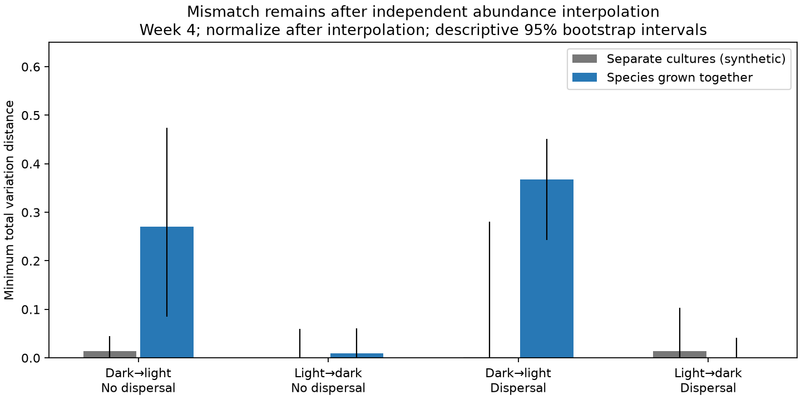

# Independent abundance interpolation left 44-56% of a dark-to-light composition gap in mixed microbial cultures

This study adds an experimental test and a method to the campaign's evidence on weak space-for-time transfer. In mixed microbial cultures, a large part of the final dark-to-light composition gap remained even when each taxon could take any abundance between its unchanged light and dark control means. The reverse switch gave a much smaller residual under that allowance. This direction difference matters: one common transfer fraction can hide different response paths.

## Question and prior work

The selected SCI study (0037934e) found weak thermal transfer across monitoring networks. Later bird work (79a502af) measured source-distance limits. Those results leave a question about responses after arrival. Can the species already present fail to move between the compositions found in unchanged environments, even with different response rates for each taxon?

Thompson, Huerlemann and Altermatt (2021; DOI 10.1086/716724) already showed that species interactions changed history effects in a light-switch experiment. They also reported weak dark-to-light matching in mixed cultures and no clear dispersal effect. We do not claim these findings as new. We add exact lower bounds on endpoint mismatch under three explicit interpolation allowances. The broadest allowance lets each taxon change abundance independently and then normalizes the vector. We also supply uncertainty estimates, taxon-removal checks, a source taxonomy check and reproducible optimization code. This is a secondary analysis, not a new experiment or an estimate of the field thermal gap.

## Data

We used Dryad version 123824, published 2021-06-08, with 2016 population records and no missing entries in the released count table. Seven taxon codes occur in four weekly samples. Cultures were either mixed or separate. Paired light and dark patches either kept their conditions or switched after week 2. Dispersal had two levels. Each treatment cell had six mixed-culture replicate landscapes or three replicates for each separate species. The primary endpoint is week 4, two weeks after the switch. Each of the seven taxa was supplied at the start. Arrival from a distant source was therefore not needed for an initial response.

The data are independent of BBS, the 54 network summaries and the Finnish moth records. They are not an independent replication of the source experiment. We used the public processed counts; the original videos are not in the release. The data prose lists a different seventh taxon from the final paper. The CSV has rot, which the final paper identifies as the rotifer Cephalodella. We retain that code. Four high Euglena populations were estimated during source preprocessing. See files/EXTERNAL_DATA.md for exact source paths, hashes, attribution and rights.

## Tests

For the first two tests, we normalize each replicate vector and then average it. Let a and b be unchanged dark and light mean shares, and y the changed mean. The endpoint gap G is the total variation distance from y to the final-environment control. Total variation is half the sum of absolute species-share differences.

1. The segment test allows any common interpolation a+t(b-a), with t between zero and one. Its minimum distance from y is R_S.
2. The share-box test allows each share independently to lie between its two control values, with all shares still summing to one. Its exact distance is the larger of the total lower-bound deficit and the total upper-bound excess.
3. The abundance test allows each taxon abundance independently to lie between its unchanged mean abundance values, then normalizes those abundances. It uses normalized group mean counts, so synthetic matching of separate-culture replicate numbers has no effect. A linear program gives its exact minimum distance R_A. The share box and abundance allowance are different sets and need not be nested.

The ratio R/G is the fraction of the observed gap that an allowance cannot remove, conditional on the fitted controls. It is not a fraction of all causes, an estimate of equilibrium lag or a causal mediation effect. The optimization derivation is in files/METHOD.md. Independent linear programs checked the segment and share-box formulas to machine precision.

We resampled treatment replicates 10000 times for the share tests and 3000 times for the abundance test. Paired patches remained together. Mixed-culture species remained together. For the main abundance test, separate species had independent resampling of their culture replicates. The separate-culture share bootstrap instead retains the source's synthetic replicate matching and is descriptive. All intervals below are percentile sampling summaries. A positive lower percentile bound for a nonnegative distance is not a calibrated rejection of zero distance.

## Results

| Culture | Dispersal | Switch | Endpoint gap | Minimum abundance residual (95% descriptive interval) | Residual / gap |
|---|---|---|---:|---:|---:|
| Separate | No | dark to light | 0.038 | 0.014 (0.000-0.045) | 37.6% |
| Separate | No | light to dark | 0.453 | 0.001 (0.000-0.060) | 0.1% |
| Separate | Yes | dark to light | 0.017 | 0.002 (0.001-0.280) | 10.1% |
| Separate | Yes | light to dark | 0.425 | 0.014 (0.002-0.103) | 3.4% |
| Mixed | No | dark to light | 0.618 | 0.270 (0.084-0.474) | 43.8% |
| Mixed | No | light to dark | 0.366 | 0.010 (0.001-0.061) | 2.6% |
| Mixed | Yes | dark to light | 0.656 | 0.368 (0.243-0.452) | 56.0% |
| Mixed | Yes | light to dark | 0.321 | 0.000 (0.000-0.042) | 0.1% |

For the dark-to-light switch, mixed cultures retained a large endpoint residual under both common-share and independent-abundance interpolation. Separate cultures had small absolute abundance-envelope residuals. Their residual-to-gap ratios can be large when the total gap is already near zero, so absolute distances are the useful comparison.

The reverse light-to-dark switch shows a useful limit. Its mixed-culture segment residual was 0.214 without dispersal and 0.076 with dispersal. Once independent abundances were allowed, these residuals fell to about 0.010 and 0.0003. Thus a failure of a common interpolation rate alone does not show a failure of independent endpoint adjustment. The model allowance must be stated.

In the share analysis, the dark-to-light mixed-culture segment residuals were 0.272 and 0.374, or 47% and 60% of their endpoint gaps. Week-3 values were 0.109 and 0.154. At week 4, removing any one taxon left segment residuals from 0.171 to 0.299 without dispersal and 0.202 to 0.405 with dispersal. Removing Euglena did not remove the pattern. Square-root composition and pooled-count normalization also retained dark-to-light residuals. These are sensitivity estimates, not independent tests or temporal replications.

A secondary family of 112 approximate simultaneous Welch contrasts found one taxon share above both endpoint controls: eup in mixed, dispersal-connected, dark-to-light cultures. The differences were 0.289 from dark controls and 0.469 from light controls. The simultaneous lower limits were 0.0004 and 0.142. The first margin is very small. This calculation assumes approximately normal share means and independent treatment landscapes; it is not a randomization test. It is supporting evidence only. The nonnegative distance bootstrap should not be used to replace a membership test.

The figure shows all four switches and dispersal conditions, including the small reverse-switch residuals. Whiskers describe bootstrap sampling variation. The second figure, files/results/evidence.png, compares endpoint gaps with segment and share-box residuals.

## Meaning and limits

The added result is a quantitative constraint on an endpoint-interpolation account. In the fitted mixed-culture dark-to-light means, differences in taxon adjustment rates alone cannot match the final composition if abundances must remain within unchanged endpoint ranges. The source experiment makes interactions a credible process to study after arrival. We cannot distinguish predation, competition, changed resource supply or transient density feedbacks from these records.

This result does not rule out all lag models. Controls were sampled after four weeks and need not be equilibrium states. A moving target, overshoot, oscillations or a longer transient can leave the endpoint allowance. There is one laboratory experiment, seven taxa, abrupt light changes and few replicates. Light is a resource and environmental cue, not temperature or a measured pollution dose. Counts include automated classification and imputation errors. The controls themselves are uncertain, and the bootstrap can understate error with small samples. The experiments' separate cultures differ in ecological context and total abundance from mixed cultures; they do not isolate one named interaction. No fraction of the bird, river or butterfly gap can be assigned to this mechanism. No alternative stable state or permanent response ceiling is established.

The useful next test is a longer species-resolved switch experiment with repeated unchanged controls and explicit arrival treatments. It should test independent abundance envelopes before fitting a common response fraction. This package supplies that test, with a case where one switch leaves a large residual and the opposite switch can nearly fit.

## Reproduce and provenance

Run the two scripts in files/REPRODUCE.md against the exact external archive. They produce all aggregate tables and static figures. Source retrieval writes outside the signed publication. The code, narrative, figures and aggregate results use the exact SCI baseline license. External data and source code remain outside the publication.

Job: sci-1107-dell-climate-pollution-biodiversity-bc53c4d7649a. Topic: climate-pollution-biodiversity. Campaign: 11_07_2026. Machine: dell. Account: codex-olen. Model: gpt-6.1-sol, high reasoning effort. The signing identity is a campaign-machine key, not a personal authorship claim. No agents were launched. No remote publication or submission was performed by this job.
