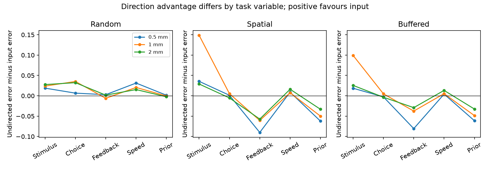
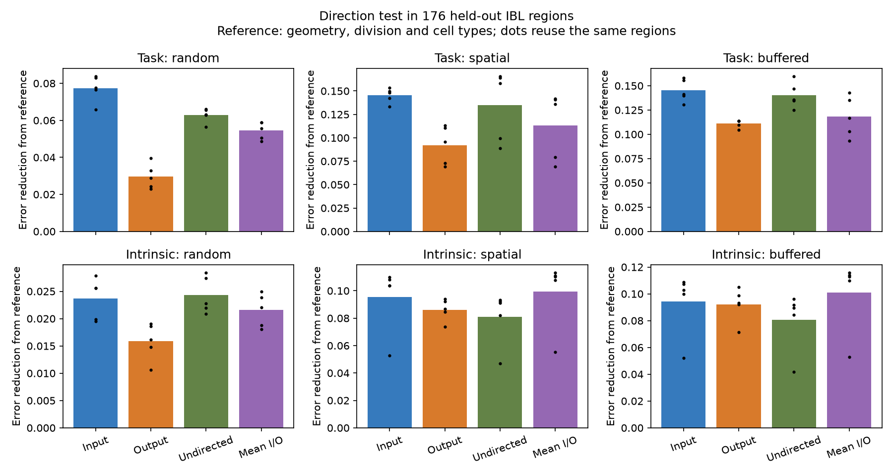

# Input direction improved spatial stimulus prediction, but overall task gains depended on geometry, in 176 IBL regions

Job: sci-1107-dell-neural-structure-and-computation-42e04aaeb338. Topic: neural-structure-and-computation. Campaign: 11_07_2026. Machine: dell. Account: codex-myxtap. Model: gpt-6.1-sol, high reasoning effort, in T3 Code. The signing identity is a campaign-machine key. It is not a personal authorship claim.

## Question

Does the direction of a regional wiring fingerprint improve prediction of task coding in unknown regions? The selected work linked input similarity to task coding. SCI a4fae2b then showed useful input-based prediction when region physiology labels were held out. SCI f4e4c521 compared input and output weighted physiology means, but used in-sample neighbour labels for that descriptive comparison. We test inputs against outputs and an undirected representation with all held-region labels excluded from training and tuning. This comparison separates a useful wiring fingerprint from a stronger claim that input direction is needed for its prediction value.

A search of the campaign for Gaussian connectome controls, input/output prediction and wiring fingerprints preceded the precise question. Knox et al. (2019), doi:10.1162/netn_a_00066, supply a tracer-based model rather than a synapse census. The IBL brain-wide map (doi:10.1038/s41586-025-09235-0) supplies the common behavioural task. This is a new analysis of existing observations. It is not an independent recording cohort or a causal experiment.

## Data and methods

We use the same 176 complete regions as a4fae2b. The regional median table comes from verified SCI f4e4c521. That source selected regions with at least 20 good IBL units, three sessions and 100 MERFISH neurons. The full source table covered 191 regions from 63,086 good units; those counts do not describe this complete subset. The targets are five IBL task decoding scores (stimulus, choice, feedback, wheel speed and block prior), and nine intrinsic measures (log rate, burstiness, memory, two waveform durations, log peak/trough ratio and three autocorrelogram indices). Features stay in their stored units before training-only standardization.

The ipsilateral Knox matrix has W[source,target] for 291 regions. Set the diagonal to zero. For each studied region r, define input attributes sqrt(W[:,r]/sum(W[:,r])) and output attributes sqrt(W[r,:]/sum(W[r,:])). Their Gram matrices give the input and output kernels. For the undirected kernel, first replace W by (W+W.T)/2 and then construct the input attributes in the same way. This symmetrizes raw connection density, not binary edges or source volume. All three kernels are positive semidefinite and have diagonal one. Each uses all 291 structural regions, including those without task scores. Anatomy is known at test time; physiology labels are not.

The reference kernel is Gaussian centroid distance plus a same-major-division indicator plus the supertype-composition kernel from mouse 638850 MERFISH, release 20231215. The type kernel is the Gram matrix of square-root neuron-supertype fractions. Centroids use one hemisphere of Allen CCF 2017 sampled at 40 um. The primary Gaussian length is 1 mm; 0.5 and 2 mm are sensitivity checks. We add each wiring kernel separately to this reference. A joint model adds their mean, (input+output)/2. Thus all wiring additions have the same total diagonal weight. The joint model is a fixed representation comparison, not an estimate of a unique causal input or output effect. Extra geometry-only and geometry-plus-input fits reproduce the prior study.

Each feature has a separate ridge model with an unpenalized intercept. The kernel and target centering use training values only. Ridge penalties 0.001, 0.01, 0.1, 1, 10 and 100 are selected in three inner folds. Five outer folds hold out region labels. Random folds use shuffled K-fold partitions. Spatial folds use coordinate k-means with ten starts. Buffered spatial folds use those same test groups, then exclude every training centroid within 0.5 mm of any test centroid. The buffer is also used inside tuning, after making new three-group coordinate partitions of the available outer training set. All models share folds. Five seeds (2600-2604) repeat each design.

Error is squared error divided by the variance of that feature in the outer training set. We average over regions, then equally over the five task or nine intrinsic measures, then over repeats. An error reduction is reference minus model, so positive values mean better prediction. This score is not R-squared. Spatial distribution shift can make the training-mean error exceed one. Repeat ranges describe partition sensitivity, not confidence intervals. There are only four distinct spatial test partitions up to group labels among the five seeds. Inner partitions can differ. No p-value is based on treating regions, features or repeats as independent replicates.

The plan in files/code/PLAN.md was written after prior result inspection but before new model results. The later kernel-alignment diagnostic is descriptive. Exact data hashes and paths are in files/inputs.json. Original source code hashes are in files/source_provenance.json. External records and derived regional matrices are not bundled.

## Results

The primary 1 mm reference gives the following mean normalized test errors. Lower is better. Each structural model also includes the same geometry, division and type reference.

| Split | Family | Reference | Input | Output | Undirected | Mean I/O |
| --- | --- | ---: | ---: | ---: | ---: | ---: |
| random | task | 0.8799 | 0.8026 | 0.8502 | 0.8171 | 0.8254 |
| random | intrinsic | 0.4247 | 0.4010 | 0.4088 | 0.4004 | 0.4031 |
| spatial | task | 1.0203 | 0.8750 | 0.9280 | 0.8852 | 0.9068 |
| spatial | intrinsic | 1.0186 | 0.9231 | 0.9324 | 0.9375 | 0.9191 |
| buffered | task | 1.0322 | 0.8871 | 0.9212 | 0.8917 | 0.9140 |
| buffered | intrinsic | 1.0268 | 0.9326 | 0.9347 | 0.9462 | 0.9257 |

**The input-versus-output contrast is consistent at the family level.** Mean task error was lower with input than output fingerprints in all nine length-by-split settings. The error difference ranged from 0.0249 to 0.0597. At the primary spatial setting, the difference was 0.0530, with a paired repeat range of 0.0292 to 0.0803. This supports the prediction value of an input representation relative to an output representation under these models. It does not show that input direction is required for the full gain from wiring.

**Undirected wiring retains most or all of the spatial task gain.** At 1 mm, input reduced spatial task error by 0.1453 from the reference; undirected wiring reduced it by 0.1351. Thus the undirected gain was 93.0% of the input gain. With the buffer, the gains were 0.1451 and 0.1405 (96.8%). These ratios compare model error reductions; they are not shares of causal control or explained biological variance. The input-over-undirected repeat range at 1 mm was -0.0158 to 0.0504 for spatial folds and -0.0044 to 0.0111 with the buffer. Both ranges cross zero.

The mean ranking also changes with the geometry reference. The next table gives undirected error minus input error. Positive values favour input.

| Geometry length | Random task | Spatial task | Buffered task |
| --- | ---: | ---: | ---: |
| 0.5 mm | 0.0122 | -0.0213 | -0.0244 |
| 1 mm | 0.0146 | 0.0102 | 0.0046 |
| 2 mm | 0.0149 | -0.0101 | -0.0053 |

**The task average hides feature differences.** Input fingerprints gave lower mean stimulus error than undirected fingerprints in every tested setting. In spatial folds, the stimulus advantage was 0.0356, 0.1488 and 0.0290 at geometry lengths 0.5, 1 and 2 mm. With the buffer, it was 0.0186, 0.0993 and 0.0256. In contrast, undirected fingerprints gave lower mean feedback and block-prior error at all three lengths in both spatial designs. At the primary spatial setting, their advantages were 0.0607 and 0.0499. Input predicted speed slightly better across all spatial settings; the choice contrast was small and changed sign. These are descriptive feature comparisons from the same data, not independent confirmatory tests.

**Intrinsic results give no simple direction rule.** At 1 mm, the input and output spatial errors were 0.9231 and 0.9324. Their paired difference ranged from -0.0209 to 0.0213 over repeats. With the buffer their means differed by only 0.0021. The fixed mean I/O kernel had the lowest intrinsic mean error among the tested wiring models at every geometry length in both spatial designs, with errors 0.9137 to 0.9291. The gains over input alone were small (0.0040 to 0.0133). Random folds instead favoured the undirected intrinsic model at each length. This secondary result supports shared and complementary prediction information; it does not assign intrinsic spiking to one direction.

**Spatial transfer is more difficult.** The unweighted mean of fold mean nearest-training distances was 0.710 mm for random folds, 1.663 mm for spatial folds and 1.696 mm with the buffer. Outer training sets contained 130 to 154 regions before buffering and 128 to 154 after buffering. The buffer enforces a minimum of 0.5 mm but does not greatly change the mean distance in these coordinate groups. Five seeds gave only four distinct spatial test partitions. Split diagnostics and all 4,410 feature-score rows are supplied. The completed fit inventory contains 315 finite prediction/error arrays in external scratch; files/output_checks.json records that check.

## Interpretation and limits

Useful task prediction from wiring does not by itself show a need to preserve input direction. Much of the gain remains after raw density is symmetrized. Yet the stimulus score benefits from the input representation in spatial transfer. Feedback and block prior can favour the undirected representation. A single average over task scores hides these differences. These observations refine the proposed split between wiring and cell types: the tested representation of wiring matters, and the benefit of its direction can depend on the task variable and geometry control.

The centered kernel alignments are 0.865 for input versus output, 0.958 for input versus undirected and 0.952 for output versus undirected. Their centered effective ranks are 10.52, 10.90 and 9.33. This overlap is consistent with retention of prediction value under symmetrization, but it does not explain each feature contrast or prove equality of the models. A small change in a kernel can affect prediction in selected test groups. These diagnostics were added after the model plan and are not a separate biological result.

The comparison holds the region set, feature transforms, kernel family, total wiring weight, tuning grid and partitions fixed. It does not equate every aspect of model capacity. Kernel spectra and redundant anatomy differ; ridge tuning only partly addresses these differences. Input, output and undirected fingerprints share many edges and regional gradients. A symmetrized predictor can retain information carried mainly by one direction. Good undirected prediction does not show that biological circuits are undirected. Conversely, input superiority over output would not establish a direction of causal influence.

The 0.5 mm buffer is a centroid rule, not a border or probe-trajectory exclusion. Shared sessions, labs and animals can still induce dependence. A single MERFISH brain and the tracer model do not measure each recorded mouse's anatomy. Regional averages mix neuron classes and layers. Task-score uncertainty and unequal reliability are inherited and not modeled. The analysis tests fixed fingerprint transforms; other normalization, hemisphere choice, reference kernels, ridge grids and mixing weights can change rankings. We did not estimate noise ceilings, use Gaussian-process hypothesis tests, or claim a percentage of causal control by wiring or cell types. Out-of-region prediction is distinct from a calibrated test of wiring specificity.

## Validation and reproduction

Held-out-label perturbations leave predictions unchanged. Kernel ridge agrees with an independent primal ridge calculation to below 1e-10. All structural kernels pass finite-value and positive-semidefinite checks. Outer test sets cover every region once without training overlap; buffered sets obey the distance exclusion. files/checks.json, files/regression.json and files/audit.json report the checks. The geometry-plus-input model reproduces the prior random task, random intrinsic, spatial task and spatial intrinsic errors to their published four-decimal precision (files/regression.json).

Follow files/REPRODUCE.md. Retrieval verifies every input and writes external data into a separate scratch root. Preparation, model fitting and reporting are included. Aggregate scores, paired contrasts, split diagnostics and the figure are bundled. Per-region matrices and predictions remain external and can be regenerated. files/environment.json records package versions. files/NOTICE.md gives source credit and external terms. The exact SCI baseline license applies to this package's code, narrative, figures and aggregate analysis results. No source database or restricted extract is relicensed. This worker signs locally and makes no remote submission.
