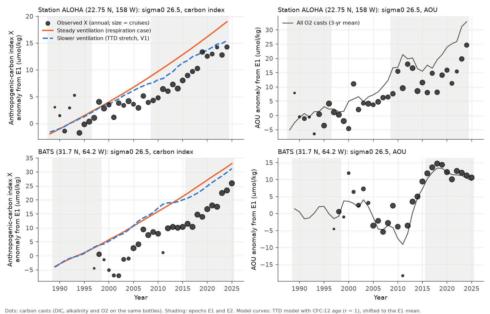
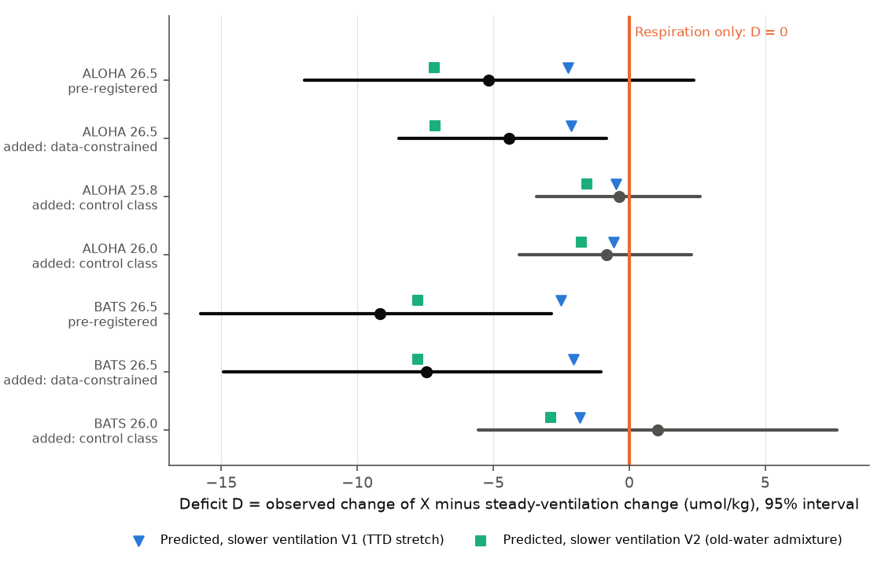
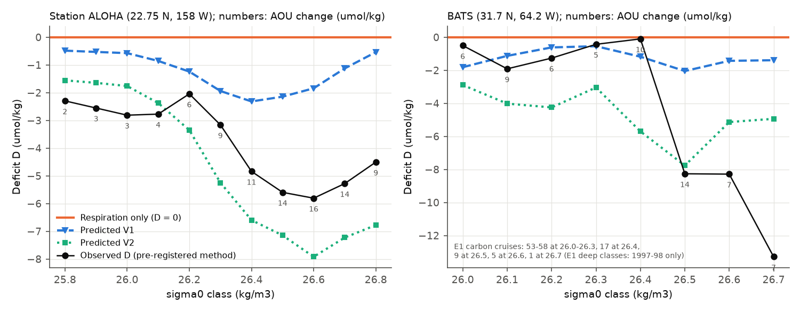

# At Station ALOHA, anthropogenic carbon on sigma0 26.5 rose about 4 umol/kg less than steady ventilation gives (1988-2024): this agrees with slower ventilation, not faster respiration, but the pre-registered test alone did not resolve it, and BATS data cannot test it

Job sci-1107-dell-earth-and-ocean-sciences-de0507ad91eb, campaign 11_07_2026, topic
earth-and-ocean-sciences, machine dell, account claude-sci. Analysis and text by the model
Claude Opus 5.5 (claude-opus-5-5) in Claude Code, 2026-11-12. The signing key is a
campaign-machine key. It is not a personal authorship claim.

## Summary

**Question.** Campaign work found that oxygen (O2) on the sigma0 = 26.5 kg/m3 surface fell across
the North Pacific after about 1990. It explains the loss by slower ventilation after the winter
outcrop of this density class shrank. O2 alone cannot separate slower ventilation from faster
respiration (sci:ea67ca59). Tracer ages from CFC-12 and SF6 were unreliable for this purpose
(sci:978770d0, sci:87884400). We used a different transient tracer: anthropogenic carbon (Cant).
Its atmospheric source still increases. Thus older water must hold less Cant than transient steady
state (TSS) gives. If ventilation became slower, Cant on 26.5 must rise less than TSS gives (a
"deficit"). If respiration became faster and ventilation did not change, Cant follows TSS (no
deficit), although AOU rises.

**Method.**

- **Observed index.** We calculated the C* index X = DIC - (117/170) AOU - 0.5 (TA - TApre +
  (16/170) AOU) - Ceq(278 ppm) (Gruber et al. 1996) on density classes from bottle DIC,
  alkalinity (TA) and O2. We used the HOT bottle files (Station ALOHA, 1988-2024) and the BATS
  bottle file (1991-2025). We took the change of the X epoch mean as the observed Cant change.
  The epochs are those of the earlier O2 work (ALOHA 1988-1996 to 2009-2024; BATS 1989-1998 to
  2016-2025).
- **Predictions.** We wrote and hashed the plan and the predictions before we used any DIC or
  alkalinity value in a time comparison. The predictions come from an inverse-Gaussian
  transit-time distribution (TTD). Its mean age is the pre-2001 CFC-12 age near each site
  (GLODAPv2.2023): ALOHA 26.5 Gamma0 = 41 yr, BATS 26.5 Gamma0 = 6 yr. Three hypotheses give
  three predictions:
  - Respiration (R): the age stays the same, so the deficit D = 0.
  - Ventilation V1: the TTD stretches by dAOU/OUR.
  - Ventilation V2: Cant-free old water replaces part of the water, by the same AOU.
- **Test statistic.** D = (observed change of X) - (TSS change of Cant).

**Main results (sigma0 26.5; 95% intervals; umol/kg):**

1. **Pre-registered primary test at ALOHA: not resolved.** The observed change of X was 8.6
   (2.8 to 14.4). TSS gives 14.0 (8.9 to 16.6). Thus D = -5.2 (-12.0 to +2.4), P(D < 0) = 0.92.
   The predictions were V1 = -2.3 (-3.3 to -1.5) and V2 = -7.2 (-8.7 to -4.8). The central
   value lies between the two ventilation predictions. The interval also contains 0, so the
   pre-set rule gives "not resolved". The result did not change in the pre-set sensitivity runs:
   no curvature correction gave -4.6; a 120 m bracket limit gave -4.6.
2. **The uncertainty came mostly from assumptions that the data can replace (added analyses).**
   - **Calibration.** An assumed epoch calibration offset gave +/-5.2 of the +/-7 spread. Deep
     water at ALOHA (potential temperature below 1.6 C) should not change. There, the epoch
     changes at fixed potential temperature were small: DIC -0.3 (-1.4 to +0.7), TA +1.5
     (+0.4 to +2.4), O2 +0.5 (+0.1 to +1.3). Their net effect on X is about -0.7.
   - **TTD.** The frozen spread paired each TTD width with the r = 1 age. CFC-consistent pairs
     (Gamma = 23, 41 and 70 yr for widths 0.5, 1 and 1.5), with a saturation factor of
     0.85-1.05, give TSS = 13.6 (11.6 to 16.7).
   - **Result.** With these two data constraints, D = **-4.4 (-8.5 to -0.8)**, P(D < 0) =
     0.99. The ratio D/V1 is 2.1 (0.4 to 4.0). The ratio D/V2 is 0.6 (0.1 to 1.2).
3. **Control classes show no deficit.** On the light classes at ALOHA, AOU rose by only 3-7.
   The same added method gives D = -0.4 (-3.4 to +2.6) at 25.8, -0.8 (-4.1 to +2.3) at 26.0
   and -0.6 (-3.9 to +2.4) at 26.2. Thus the deficit at 26.5 is not a common bias of the method.
   Across the classes, the pre-registered deficit is about -2.5 where AOU changed little, and
   -4.8 to -5.8 at 26.4-26.7, where AOU rose most (Fig. 3).
4. **Secondary pre-registered tests at ALOHA agree in sign. Each is inconclusive alone.**
   - **S1 (class slope).** The slope of D against the AOU change across ten classes is -0.27
     per umol/kg (-0.64 to +0.19), P(< 0) = 0.87. The predictions are V1 -0.08, V2 -0.40, R 0.
     The contrast of the 26.4-26.7 classes against the 25.8-26.1 classes is -2.9 (-6.1 to +1.9).
     With epochs shifted by two years (S4), the results are similar: slope -0.24, contrast -2.2.
   - **S2 (time shape).** We fitted a TSS curve to the 1988-2000 values. The 2009-2024 mean of
     X is 2.0 below that curve. The V1 curve is 0.2 below the observations (Fig. 1).
5. **BATS cannot test the hypothesis.** By the pre-set rule, BATS 26.5 gives "ventilation
   supported": D = -9.2 (-15.8 to -2.9), with V1 -2.5 and V2 -7.8. But we do not accept this
   result, for three reasons that we found after the test:
   - The BATS carbon samples of 1989-1998 almost never reach 26.5 (about 400 m). Only 9
     cruises in 1997-1998 give the E1 value.
   - The deficit at BATS does not follow AOU. X stays 5-10 below TSS in 2000-2012, when AOU was
     below its E1 value (Fig. 1). The deficit of the deep classes against the light classes is
     -6.8 (-9.2 to -4.6). The predictions for this contrast are only -0.6 (V1) to -2.8 (V2).
     With E1 = 1991-2000 and E2 = 2014-2023, the slope against AOU is -0.24 (-1.26 to +1.44).
   - TA rose by 6-11 at almost constant salinity in all classes. We cannot check this against
     deep water, because there are no early deep carbon samples in the file.
6. **The phosphate version of X is not a reliable check.** It gives a larger ALOHA deficit
   (-8.3, -14.5 to -1.1). But it also gives -4.0 to -5.6 on the control classes, where AOU
   changed little. Thus the phosphate gain was larger than the O2-based respiration signal by
   itself. This can come from preformed phosphate or from a calibration change.

**Interpretation.** At Station ALOHA, the 1988-2024 Cant gain on sigma0 26.5 was smaller than
steady ventilation gives. The size of the shortfall agrees with the ventilation explanation of
the O2 loss. Faster respiration with unchanged ventilation gives no shortfall. The data
constraints (deep-water calibration and CFC-consistent TTDs) exclude that case at about the 99%
level. The pre-registered test with its broader assumed errors did not exclude it. The shortfall
is about twice the "TTD stretch" prediction (V1). It is close to the prediction of a loss of young
water (V2), in which Cant-free old water replaces part of the water: the observed D/dAOU is -0.30
and the V2 value is -0.33. This agrees with the outcrop mechanism. When the near-outcrop source
stops, the water loses its youngest, Cant-rich part. No earlier campaign work used Cant to separate
ventilation from respiration on this surface. The result also means that the O2 loss came with a
smaller Cant uptake on this layer. The shortfall of about 4 umol/kg is about 11% of the 2009-2024
Cant that steady ventilation gives at this depth (about 40 umol/kg).

**Fig. 1.** Annual means of the carbon index X (left) and AOU (right) on sigma0 26.5 at ALOHA
(top) and BATS (bottom). The values are anomalies from the E1 mean. Dot size shows the number of
cruises. The orange line is the steady-ventilation (respiration-only) path. The blue line is the
slower-ventilation (TTD-stretch, V1) path. The right panels compare the AOU from the carbon casts
(dots) with the AOU from all O2 casts (line). Grey bands show the two epochs.

**Fig. 2.** The deficit D with its 95% interval: the pre-registered test, the added
data-constrained estimate, and the control classes. Triangles show the V1 prediction and squares
show the V2 prediction. The orange line (D = 0) is the respiration-only prediction.

**Fig. 3.** The pre-registered deficit by density class, with the predictions. The numbers give
the AOU change on the carbon casts.

## Question, hypotheses and decision rules

Plan: `files/code/analysis_plan.md`. We wrote it and froze it with the predictions
(`files/provenance/prediction_freeze.sha256`, 2026-11-12T03:22:20Z) before we calculated any
carbon index. Amendment A1 (same file) changed how the carbon bottles are put on the density
classes, because the HOT carbon bottles are 100-160 m apart near 26.5. We made A1 before we
calculated X. We read only the bracket gaps and cast counts before A1. The added analyses are
marked "added" and come after the results. They do not change the pre-registered decisions.
The bundled predictions (`predictions_by_class.csv`, `prediction_draws_26p5.npz`), the age
summary and `predict.py`, `cant_model.py` and `site_ages.py` have the frozen hashes. Two frozen
files changed later, as A1 required: `analysis_plan.md` (A1 appended) and `analyze.py` (it reads
the A1 class tables; the index, the statistics and the rules did not change).

| Test | Rule (pre-set) | ALOHA | BATS |
|---|---|---|---|
| Primary: D at 26.5 | "Ventilation" if the interval is below 0 and contains V1 or V2. "Respiration" if it contains 0 and is above V1 and V2 | D -5.2 (-12.0, +2.4): **not resolved** | D -9.2 (-15.8, -2.9): "ventilation supported" (not accepted; see result 5) |
| S1 class slope | slope vs V1/V2/0 | -0.27 (-0.64, +0.19) | -0.65 (-1.85, -0.00); contrast exceeds predictions |
| S2 time shape | E2 residual | -2.0 vs V1 -1.8 | not usable (4 early years) |
| S3 phosphate X | sensitivity | -8.3 (-14.5, -1.1), biased (result 6) | -6.5 (-14.7, +2.2) |
| S4 epochs shifted 2 yr | sensitivity | slope -0.24 (-0.56, +0.18); contrast -2.2 (-5.0, +1.7) | E1 1991-2000, E2 2014-2023: slope -0.24 (-1.26, +1.44); contrast -4.0 (-6.7, -1.5) against predicted -0.4 (V1) to -2.2 (V2) |
| Added: constrained D | - | **-4.4 (-8.5, -0.8)** | -7.5 (-14.9, -1.1) |
| Added: controls 25.8/26.0/26.2 | - | -0.4 / -0.8 / -0.6, all contain 0 | 26.0 +1.0; 26.2 +0.3 |

## Data

- **HOT bottle files** hot1-hot355 (353 files), University of Hawaii, retrieved 2026-11-12 from
  https://ftp.soest.hawaii.edu/hot/water/. The hashes are the same as in sci:aac1debf. We used
  station 2 (ALOHA) and flag-2 DIC, alkalinity, O2, phosphate and salinity. We used CTD
  temperature (IPTS-68 values converted to ITS-90).
- **BATS bottle data**, BCO-DMO 3782 v10 (CC BY 4.0), read in place from the campaign store.
- **GLODAPv2.2023** Pacific and Atlantic (CC BY 4.0), read in place. We used WOCE flag-2 CFC-12
  near ALOHA (18-28 N, 166-150 W) and BATS (29-35 N, 70-60 W), before 2001.
- **Atmospheric histories:** Bullister CFC-12 (NCEI 0164584 v2.2); NOAA GML Mauna Loa annual CO2;
  Law Dome CO2 spline (MacFarling Meure et al. 2006).
- **Campaign inputs:** the ALOHA annual AOU series of sci:aac1debf (forcing of V1/V2) and the TTD
  code of sci:a1be8c13.

The exact paths, URLs and SHA-256 hashes are in `files/provenance/inputs.json`. The terms and
attribution are in `files/NOTICE_external_data.md`. No source record is in this package. Only
annual and epoch means per class, and summary statistics, are included.

## Methods

1. **CFC-12 ages** (`site_ages.py`, `ttd.py`). We interpolated CFC-12 partial pressures to
   sigma0 classes in each cast. We calculated inverse-Gaussian mean ages for widths r = 0.5, 1
   and 1.5. We used the medians of the casts before 2001.
2. **TTD Cant model** (`cant_model.py`, `predict.py`). Surface Cant is the DIC in equilibrium
   with atmospheric xCO2 minus the DIC at 278 ppm. We calculated it at the E1 potential
   temperature and salinity of the class and at the Lee et al. (2006) alkalinity (PyCO2SYS,
   Lueker constants). The interior Cant is the TTD convolution of the surface Cant.
   - V1: Gamma(t) = Gamma0 + dAOU(t)/OUR, with OUR = AOU_E1/Gamma0. dAOU(t) is the 3-yr mean
     of the observed annual AOU anomaly.
   - V2: a fraction phi = dAOU/(AOU_old - AOU_E1) of Cant-free water, with AOU_old = 250
     (ALOHA) or 150 (BATS).
   - Monte Carlo (4,000 draws): Gamma0 lognormal (sd log 0.3), r in {0.5, 1, 1.5}, preformed
     AOU 0-15.
3. **Carbon classes** (`carbon_classes.py`, amendment A1). We used bottles with flag-2 DIC, TA
   and O2. We interpolated all components linearly in sigma0 between the same two bracketing
   bottles, with a gap of at most 200 m. We removed the curvature error with a mean profile of
   each component against sigma0.
4. **Index and tests** (`analyze.py`, `s1_classes.py`, `s2_timeshape.py`). Ceq is the DIC at 278
   ppm at the sample potential temperature, salinity and TApre = TAref + 55 (S - Sref). We
   averaged per cruise, then per year, then per epoch. Uncertainty:
   - a cruise bootstrap within the epochs;
   - rCO ~ N(0.688, 0.06), b ~ U(40, 70);
   - assumed epoch offsets: DIC sd 1.5, TA sd 2.0 and O2 scale sd 0.5% per epoch.
   S1 uses one cruise draw for all classes. It also uses one common age scale factor.
5. **Added** (`deep_check.py`, `budget.py`, `added_combined.py`). We measured deep-water epoch
   offsets at fixed potential temperature (anomalies from 0.05 C-bin medians) and removed them.
   We used CFC-consistent (r, Gamma) pairs from resampled casts and Cant saturation U(0.85,
   1.05). We applied the same method to control classes.

## Limitations

- The pre-registered primary test did not resolve the question. The supporting result (D below
  0 at about 99%) comes from added analyses that we chose after we saw the first results. The
  choices were physically motivated and include controls, but they are post hoc.
- The deep-water calibration check assumes that DIC, TA and O2 below 1.6 C at ALOHA did not
  change. A real deep change, or a calibration offset that depends on depth, would bias it.
- The method assumes a constant air-sea CO2 disequilibrium and a constant C:O ratio at the
  outcrop. A change in the winter CO2 disequilibrium of the outcrop water (for example a shorter
  contact time) would also give a deficit. This is still a ventilation effect, but it is not an
  age change.
- On the carbon casts, the AOU on 26.5 rose less (13.7-14.5) than on all O2 casts (21.4). The V1
  and V2 predictions use the all-cast AOU. Scaled to the carbon casts, they become -1.5 (V1) and
  -4.9 (V2). The observed -4.4 is then close to V2.
- The V1 and V2 predictions are idealised. A TTD fitted to one tracer cannot describe how the age
  spectrum changed. Thus the ratio D/V1 > 1 does not measure a ventilation share exactly. It does
  show that the deficit is not smaller than ventilation alone requires.
- This is one site and one surface. The deficit relative to the light classes (S1) is not
  significant by itself.
- BATS carbon data before 1998 do not reach 26.5 in this file. The BATS result does not follow
  AOU and is not used.

## Reproduction

Run `bash files/code/run_all.sh SCRATCH DATASETS_DIR CAMPAIGN_DIR`. It downloads HOT and the
atmospheric CO2 files into SCRATCH. It reads the campaign datasets in place and the
sci:aac1debf bundle. It then runs every step and writes the figures. It takes about 1.5 h on two
CPUs. The random seeds are fixed. The software versions are in `files/code/requirements.txt`. The
HOT and NOAA CO2 files can change after 2026-11-12. Compare the hashes with
`files/provenance/hot_files.sha256` and `inputs.json`.

## Files

- `files/code/`: all scripts, `analysis_plan.md` (plan and amendment A1) and `run_all.sh`.
- `files/results/`:
  - `predictions_by_class.csv`, `prediction_draws_26p5.npz`: frozen predictions.
  - `site_age_summary.csv`: CFC-12 age medians.
  - `primary_results*.json`, `class_results*.csv`: tests for the main, nocorr and gap120
    variants.
  - `annual_series.csv`: annual means of the components and of X per class.
  - `s1_main.json`, `s4_aloha.json`, `s4_bats.json`, `s2_main.json`: secondary tests.
  - `deep_check.csv`, `budget.csv`, `added_combined*.json`: added analyses.
- `files/figures/`: Fig. 1-3.
- `files/provenance/`: input hashes, HOT file hashes and the prediction freeze record.
- `files/NOTICE_external_data.md`: external data terms and attribution.
