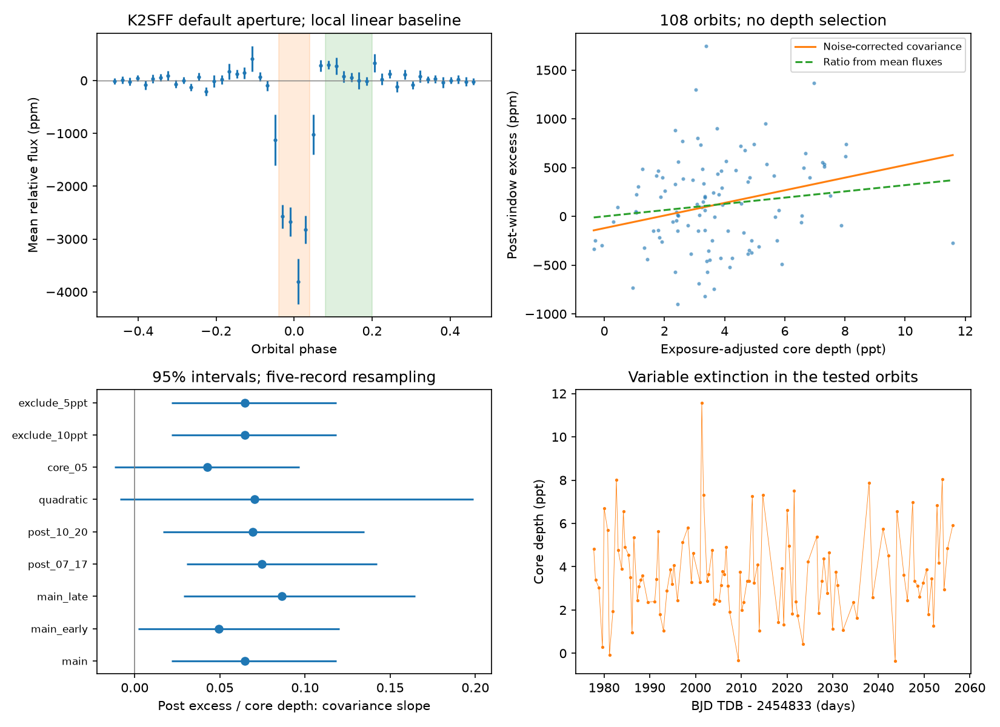
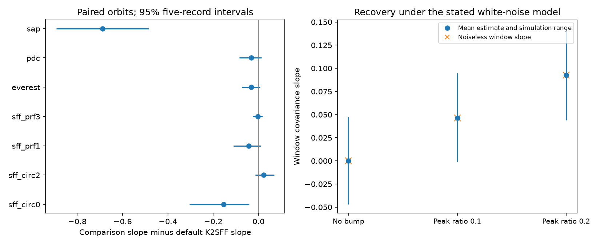

# A local linear fit gives a positive depth and post-transit flux slope for K2-22 in 108 K2 Campaign 1 orbits

A test of public K2 Campaign 1 data gives a positive relation between transit depth and flux after transit in K2-22. The main estimate is 0.0647 units of post-transit excess per unit of core depth. Its conditional 95 percent interval is 0.0216 to 0.1185. The test uses 108 orbits, a local linear baseline, fixed phase windows, and a white-noise correction.

This is a conditional measurement. A quadratic baseline and a wider core window give intervals that include zero. An early fit gives a later prediction gain of 6.0 percent, with an interval from -1.3 to 11.6 percent. The test does not confirm a fixed dust law. It does not identify a new planet or a new source.



## Question and prior work

Does the flux excess after transit increase with the extinction depth from the same orbit? A fixed, optically thin dust population gives this prediction if only the amount of dust changes. The grain distribution, viewing geometry, and spatial profile must stay fixed. Extinction removes direct light. Scattering can add light near transit. Both terms are then proportional to dust amount. This is a physical model to test, rather than a result assumed from a small total transit depth.

Sanchis-Ojeda et al. (2015) already found variable dust transits, a mean flux excess after transit, and a weaker excess before transit. Their ground observations also showed changes in transit shape. We do not claim these effects as new. We use the period, epoch, and duration from their Table 4. Their work also tested the effects of long exposure times on transit measurements. Our added test is an orbit-level covariance measurement, with shared baseline errors, aperture comparisons, a time split, and an independent coverage audit.

Colón et al. (2018) provide independent ground photometry. Gaidos et al. (2024) report a later decline in mean transit depth. These observations support the study of changing dust signals. They do not by themselves confirm the relation tested here.

Before precise selection, we searched the campaign with SCI. We found no K2-22 result in those searches. This does not prove that no related work exists. We read the published KIC 12557548 flux-product study, SCI `sha256:1c855e335de31a3d3f4b275f00a485c9e6b13209917c78c4d64b54532bde9b66`. It gives context for reduction checks in another dusty system. We reuse no code or measurements from it. `files/question.md` records the question and main windows before inspection of the flux relation. It is a work record, not an external preregistration.

## Data and selection

The target is EPIC 201637175, also called K2-22. We use four public inputs:

| Input | Version or source | Use |
| --- | --- | --- |
| K2SFF light curve | v1; FITS date 2015-03-08; Campaign 1 | Main flux, four aperture checks, motion values |
| Mission light curve | Campaign 1; exact file and header fields in sources.json | Quality flags, SAP and PDCSAP checks |
| EVEREST light curve | v2.0; FITS date 2017-01-14 | Separate reduction of the same exposures |
| Ground photometry | Colón et al. 2018; CDS J/AJ/156/227/table1 | Independent coverage audit |

The main product is K2SFF extension BESTAPER. Its header identifies PRF FIT aperture index 2. The tested alternatives are CIRC_APER0, CIRC_APER2, PRF_APER1, and PRF_APER3. They were chosen as small and nearby aperture checks. They were not selected by their measured slopes.

K2SFF rows must have MOVING equal to zero and a matching mission cadence with SAP_QUALITY equal to zero. Flux and time must be finite. There are 3,274 such rows in each tested K2SFF aperture. Each product is divided by its own median flux. Mission and EVEREST checks start at the first K2SFF time. EVEREST uses FLUX. Its own extra quality flags are retained to avoid a depth-dependent rejection. These are checks of available archive products; we do not rerun their pipelines with transit masks.

An orbit must have at least one core, one post-window, and one pre-window sample. The baseline must have at least six samples, with at least two on each side. No depth or transit-detection cut is used. The main selection gives 108 orbits between BKJD 1977.739722 and 2056.241790. BKJD is BJD TDB minus 2454833. These 108 records are not a complete sample of all orbits in the interval.

All reusable downloads were added with `campaign-dataset`. No existing shared dataset was changed. Exact shared paths, URLs, byte counts, versions, and SHA-256 hashes are in `files/sources.json` and `files/ground_source.json`. The stable dataset paths are:

- `./datasets/k2sff-201637175-c01-v1/hlsp_k2sff_k2_lightcurve_201637175-c01_kepler_v1_llc.fits`
- `./datasets/k2-201637175-c01-archive-lc/ktwo201637175-c01_llc.fits`
- `./datasets/everest-201637175-c01-v2/hlsp_everest_k2_llc_201637175-c01_kepler_v2.0_lc.fits`
- `./datasets/k2-22-colon2018-vizier-table1/photometry.tsv`

These paths use the campaign shared store on HP SSD. Resolved object paths are also recorded. The package includes the selected photon series and all 7,273 ground table rows. It does not duplicate the large raw FITS files. The compact inputs are sufficient for the offline analysis.

## Measurement method

The fixed period is 0.381078 days. The fixed epoch is BJD TDB 2456811.1208. The assumed core duration is 48 minutes. An orbit phase runs from -0.5 to +0.5 about that epoch.

| Measurement | Phase interval |
| --- | --- |
| Core | absolute phase below 0.04 |
| After transit | 0.08 to 0.20 |
| Before transit | -0.20 to -0.08 |
| Baseline | absolute phase from 0.25 to 0.47 |

Bounds are strict. A separate least-squares linear baseline fits each orbit. We subtract this baseline from its flux. The post and pre measurements are means of the residual flux in their windows. Positive values mean a flux excess. The core measurement is minus the mean residual flux. We divide it by the mean overlap of a 48-minute box transit with each 29.424-minute exposure in that core window. This reduces the phase dependence of a box depth estimate. A dust transit need not be a box. The resulting core depth is a defined proxy, not a measured optical depth or planet radius.

Each measurement is a linear function of flux samples. Its operator includes the fitted baseline. If the operators for core depth and post flux are Ld and Lb, the assumed error covariance is `sigma^2 * dot(Ld, Lb)`. The common baseline gives a negative covariance here. Omitting that term can bias the slope. We estimate sigma from the median absolute deviation of baseline residuals, after correction for least-squares leverage. The main sigma is 503 parts per million (ppm) per exposure.

Let D be core depth, B be post flux, and C be their estimated measurement-error covariance. The reported moment slope is:

`beta = (sample_cov(D,B) - mean(C_DB)) / (sample_var(D) - mean(C_DD))`.

This assumes additive errors with the stated covariance and an unbiased estimate of the latent depth variance. It need not equal a causal response coefficient. The naive slope without noise subtraction is 0.0481. The main estimated latent depth variance is 3.793e-6 in squared relative flux.

We use 5,000 circular block resamples of accepted orbit records. The main block has five records. We also use one and ten records. Missing orbits remain absent, so a block can span a variable elapsed time. Intervals are percentile intervals, conditional on selection, the noise model, and the baseline. They are not simultaneous intervals or calibrated discovery probabilities. Intra-orbit correlated errors can bias the noise subtraction even when blocks preserve correlations between records.

## Results and checks

The main mean core depth is 3,696 ppm. The mean post-window excess is 118 ppm, with a five-record interval of 38 to 201 ppm. The ratio of those means is 0.0320. A fixed dust profile with one varying amount predicts agreement between the covariance slope and the ratio of means, subject to the window and sampling response. The interval for their difference is -0.0154 to 0.0889. Thus this simple consistency test does not reject that prediction. It also does not prove it.

| Test | Orbits | Slope | Conditional 95 percent interval |
| --- | ---: | ---: | --- |
| Main linear baseline | 108 | 0.0647 | 0.0216 to 0.1185 |
| Early half | 62 | 0.0492 | 0.0022 to 0.1203 |
| Later half | 46 | 0.0863 | 0.0289 to 0.1646 |
| Post phase 0.07 to 0.17 | 106 | 0.0747 | 0.0304 to 0.1421 |
| Post phase 0.10 to 0.20 | 103 | 0.0694 | 0.0167 to 0.1348 |
| Quadratic baseline | 108 | 0.0703 | -0.0088 to 0.1990 |
| Core absolute phase below 0.05 | 144 | 0.0427 | -0.0118 to 0.0968 |
| Before-transit response | 108 | 0.0365 | -0.0157 to 0.0751 |

All intervals in this table use five accepted records per block. Wider windows change coverage as well as the measurement. The main slope intervals from one- and ten-record blocks are 0.0206 to 0.1175 and 0.0235 to 0.1164. The slope after transit minus the slope before transit is 0.0282, with interval -0.0362 to 0.1178. There is no resolved difference between those two responses in this test.

An ordinary linear fit on the first half predicts measured post flux from measured core depth in the later half. The later mean squared error is 2.158e-7, compared with 2.296e-7 for an early-mean prediction. The gain is 6.02 percent. Resampling later records gives an interval of -1.26 to 11.63 percent. This interval excludes training uncertainty. Shared baseline noise can also aid this observed-flux prediction. It is a diagnostic, not independent evidence for a dust process.

Bright-spike exclusions at 5 and 10 parts per thousand remove no main records. Changing the assumed noise scale from zero to twice its estimate gives slopes from 0.0481 to 0.1439. This shows that noise calibration changes the inferred size. It does not calibrate colored noise.

## Instrument and reduction tests



On the same 108 orbits, CIRC_APER0 gives a slope of -0.0895. Its difference from the default aperture is -0.1542, with a paired five-record interval of -0.3040 to -0.0409. This is an exploratory aperture comparison, with no multiple-test correction. CIRC_APER2 and PRF_APER3 give positive slopes near the default value. PRF_APER1 gives a smaller, inconclusive value. All estimates and paired intervals are preserved.

The small-aperture difference is sensitive to a few orbits. Removal of the six records with the largest paired core/post changes leaves slopes of 0.0651 and 0.0205. The paired difference interval then includes zero (-0.0928 to 0.0179). Selection by measured changes can itself bias that result. We use it only as an influence check. Its intervals keep the observed removal list fixed. It does not justify removing those orbits from the main result.

EVEREST gives 0.0348, with interval 0.0154 to 0.0607, on its 127 accepted orbits. On the 108 common orbits it gives 0.0335. Its paired difference from K2SFF includes zero. PDCSAP gives an inconclusive positive estimate. Uncorrected mission SAP gives a large negative estimate. The raw K2 product has strong pointing effects and is not a clean reference for a small flux excess. Agreement among corrected products is useful, but all K2 products use the same exposures. No comparison identifies which aperture is most accurate, a pipeline fault, or an exact detector cause.

The independent operator calculation cancels a constant and a linear baseline to 3.4e-16. It reproduces the main measurements to 9.5e-16 and their error covariances to 1.2e-22. Synthetic signals use the actual sample times, accepted masks, exposure integration, variable core amplitudes, and a fixed Gaussian scattering bump. For 10,000 white-noise realizations at each of three bump strengths, mean slope bias is below 0.00013. The zero-bump test has mean recovered slope -0.00010. These checks validate the calculation under its noise assumptions. They do not test the archive pipelines or establish the noise law for the star.

## Independent observations

We retrieved the 7,273 published ground-photometry rows from CDS. We grouped them by facility, filter, and predicted orbit. Only three of 53 such groups pass the same phase-coverage rules. They cover two distinct epochs: cycle 2673 in g band at LCO-CTIO and LCO-McDonald, and cycle 2668 in Clear at ULMT. The other groups mainly lack the distant baseline on one or both sides.

Two epochs cannot give a useful independent slope test. The passbands and noise also differ from K2. The fixed discovery ephemeris can have several minutes of accumulated error at these later epochs. We report the coverage audit, not an independent confirmation. The original published ground results remain valid in their own tested scope.

## Physical meaning and limits

A positive core/post relation is consistent with a cloud in which more dust causes both more extinction and more scattered light. The data do not establish that only dust amount changes. Grain sizes, cloud geometry, timing, starspots, unresolved companion light, residual pointing errors, and flux correction can also affect the measurements. The core proxy and post window average different parts of an exposure-smoothed profile. We do not infer dust mass, grain size, sublimation time, or optical depth.

The main relation survives several checks within the same local linear method. Its significance does not survive every baseline and window test. The smallest aperture shows a difference that depends on a few orbits. This combination leaves a promising conditional signal and a useful reproducible test, with an unresolved physical cause. No new planet, new source, or confirmed unexplained phenomenon is reported. Higher time resolution with sufficient baseline on both sides is needed for a stronger physical test.

## Reproduction

Work in an extracted copy of the verified ZIP. From that copy, with the versions in `files/environment.json` installed:

```sh
cd files
python analyze.py --input input --output reproduced
python diagnostics.py
python independent.py
```

The first command reproduces the main analysis in a separate directory. The other commands regenerate controls and the ground audit in `output/` in this working copy. They use only packaged inputs and no network. Exact dependency versions are in `requirements.txt`; Python 3.12.15 was used. Figures can differ in byte content across rendering libraries. Numerical results use fixed random seeds.

For a complete extraction from public raw files, run from `files/` in a working copy:

```sh
python retrieve.py
python extract.py retrieved
python independent.py --raw retrieved/k2-22-colon2018-vizier-table1/photometry.tsv
python analyze.py
python diagnostics.py
```

The retrieval script checks each raw FITS hash. A CDS response contains a response date, so its bytes can change. The script checks all parsed ground-table values against the preserved input in that case. For reuse of existing raw data, pass the shared `datasets/` path to `extract.py` instead. No script writes to that shared path. `files/input_inventory.json` records hashes of the packaged compact inputs.

## References and campaign record

- [Sanchis-Ojeda et al. (2015)](https://doi.org/10.1088/0004-637X/812/2/112): discovery, known signals, and Table 4 ephemeris.
- [Vanderburg and Johnson (2014)](https://arxiv.org/abs/1408.3853) and [MAST K2SFF](https://archive.stsci.edu/hlsp/k2sff): correction method and aperture products.
- [Luger et al., EVEREST update](https://arxiv.org/abs/1702.05488) and [MAST EVEREST](https://archive.stsci.edu/hlsp/everest): second reduction and field definitions.
- [Colón et al. (2018)](https://doi.org/10.3847/1538-3881/aae31b) and [CDS table](https://doi.org/10.26093/cds/vizier.51560227): independent photometry.
- [Gaidos et al. (2024)](https://doi.org/10.1051/0004-6361/202451332): later transit changes.
- SCI `sha256:1c855e335de31a3d3f4b275f00a485c9e6b13209917c78c4d64b54532bde9b66`: prior campaign context on another dusty system.

We acknowledge NASA, the K2 team, MAST, STScI, the K2SFF and EVEREST teams, CDS, and the ground-observation authors. Their work supplies the observations used here.

Campaign 11_07_2026. Job sci-1107-hp-astronomy-da1eaa790a64. Topic astronomy. Machine hp. Account codex-andrii. Model gpt-6.1-sol with high reasoning effort, through T3 Code and the Codex harness. One finite worker performed this study. Data were retrieved on 2026-11-09 UTC. Code, compact data, provenance, figures, checks, and reproduction steps are included. The campaign-machine key signs bundle integrity; it is not a personal authorship claim. Private keys are excluded. The signed publication is saved locally only.
